# Tên: School

## Mục lục
- [1. Thông tin tổng quan](#1-thông-tin-tổng-quan)
  - [1.1 Giới thiệu chung](#11-giới-thiệu-chung)
  - [1.2 Mục tiêu](#12-mục-tiêu)
  - [1.3 Phạm vi](#13-phạm-vi)
  - [1.4 Tài liệu tham khảo](#14-tài-liệu-tham-khảo)
- [2. Tổng quan nghiệp vụ](#2-tổng-quan-nghiệp-vụ)
  - [2.1 Đối tượng](#21-đối-tượng)
  - [2.2 Luồng nghiệp vụ](#22-luồng-nghiệp-vụ)
  - [2.3 Nguyên tắc nghiệp vụ](#23-nguyên-tắc-nghiệp-vụ)
- [3. Đặc tả tính năng](#3-đặc-tả-tính-năng)
  - [3.1 Phân rã chức năng](#31-phân-rã-chức-năng)
  - [3.2 Acceptance Criteria](#32-acceptance-criteria)
  - [3.3 Use case](#33-use-case)
  - [3.4 Edge Cases & Error Handling](#34-edge-cases--error-handling)
  - [3.5 Non-functional Requirements](#35-non-functional-requirements)
  - [3.6 Quy ước UI chung](#36-quy-ước-ui-chung)

## 1. Thông tin tổng quan

### 1.1 Giới thiệu chung
"School" (`/admin/school`) là module quản lý danh sách tenant (trường học) ở cấp nền tảng, trong Managing Portal (`api-dev.ecoschool.com.vn`) — cổng quản trị nội bộ dành cho nhân viên Finviet/SOHA, khác hoàn toàn với Operating Portal (`app-dev.ecoschool.com.vn`) mà Admin từng trường sử dụng. Đây là module lớn nhất trong Managing Portal: mỗi trường có một trang "Settings" riêng với **14 tab cấu hình** (đã khảo sát chi tiết cả 14/14 tab, xem UC-05) và một menu "More" với **~26 công cụ quản trị** (import/export dữ liệu, quản lý lớp/giáo viên/học sinh, nhận diện khuôn mặt, dinh dưỡng, lịch học...). Nhiều tab trong Settings chính là **nguồn cấu hình gốc** cho các tính năng/hiện tượng đã ghi nhận ở Operating Portal — đáng chú ý nhất:
- Tab **"Điểm danh"** xác nhận dịch vụ nhận diện khuôn mặt (TOFACE) đang chạy ở **TESTMODE**, giải thích trực tiếp vì sao tính năng Nhận Diện ở Operating Portal (M6-SM4) không tạo ra được điểm danh thật trong tenant demo.
- Tab **"Quản lý tính năng"** chứa mục **Wordbook** (bật, từ điển "trẻ"→"học sinh"/"kid"→"student") — đây CHÍNH LÀ nguyên nhân của hiện tượng nội dung đổi qua lại không nhất quán giữa "học sinh" và "trẻ" đã ghi nhận nhiều lần trong tài liệu Operating Portal, không phải ngẫu nhiên.

**Lưu ý bảo mật:** một số tab (Hóa đơn & Thanh toán, Thanh toán tự động) hiển thị thông tin đăng nhập nhà cung cấp thứ ba (mã số thuế, tài khoản, mật khẩu, secret key) dạng plaintext ngay trên UI. Các giá trị này đã được **redact (che đen)** trong mọi ảnh chụp màn hình của tài liệu này vì lý do bảo mật — xem BR19, BR20.

### 1.2 Mục tiêu
- Cho nhân viên vận hành nền tảng xem, tạo, cập nhật thông tin trường (tenant).
- Cấu hình sâu từng trường: giới hạn hệ thống, tính năng bật/tắt, tích hợp, giao diện...
- Quản lý người dùng (Admin/Giáo viên/Phụ huynh) thuộc từng trường ở cấp nền tảng.
- Cung cấp lối tắt "đăng nhập hộ" vào Operating Portal của một trường để hỗ trợ/khảo sát mà không cần mật khẩu của trường đó.
- Cung cấp bộ công cụ vận hành sâu cho từng trường (import dữ liệu, nhận diện khuôn mặt, quản lý sự cố, dinh dưỡng...).

### 1.3 Phạm vi
| In scope | Out of scope |
|---|---|
| Danh sách trường: xem, tìm kiếm, sắp xếp, phân trang | Chi tiết đầy đủ của cả 26 công cụ trong menu "More" — chỉ khảo sát mẫu 1 công cụ (Onboarding), các công cụ còn lại liệt kê ở dạng inventory |
| Tạo trường mới (khảo sát form, KHÔNG submit thật) | Thực hiện tạo/xóa/cập nhật trường thật trên môi trường dev |
| Xem/Sửa thông tin trường (View/Edit) | Chi tiết trang Edit/Create user riêng lẻ (thuộc phạm vi module User School) |
| **Cấu hình trường (Settings) — đầy đủ cả 14/14 tab**, từng field/toggle | Thực hiện Save thật trên bất kỳ tab nào (chỉ quan sát, không ghi) |
| Danh sách người dùng của 1 trường | — |
| Menu "More" (tổng quan + khảo sát mẫu) | Đăng nhập hộ vào Operating Portal ("Login to admin portal") — bị chặn bởi permission classifier khi khảo sát, xem BR13 |

### 1.4 Tài liệu tham khảo
- `operating-portal/M6-cau-hinh/SM5-tinh-nang.md` — tài liệu Operating Portal phía Admin trường cho tính năng mà tab Settings → "Quản lý tính năng" của module này cấu hình ở phía nền tảng.
- `operating-portal/00-inventory.md` — mẫu cách tiếp cận "Phase 1 inventory, Phase 2 deep-dive" được áp dụng lại cho menu "More" và các tab Settings trong tài liệu này.
- File `.env` của dự án — nơi lưu URL và tài khoản đăng nhập Managing Portal dùng để khảo sát (`MANAGING_PORTAL_URL`, `MANAGING_PORTAL_USER`, `MANAGING_PORTAL_PASS`).

## 2. Tổng quan nghiệp vụ

### 2.1 Đối tượng
| Actor | Vai trò | Trách nhiệm chính |
|---|---|---|
| Nhân viên vận hành nền tảng (Finviet/SOHA) | Người quản trị | Tạo/cấu hình/hỗ trợ trường, đăng nhập hộ để debug hoặc demo |
| Hệ thống | Xử lý nghiệp vụ | Lưu trữ dữ liệu tenant, tổng hợp số liệu (kids/users/storage), đồng bộ cấu hình xuống Operating Portal của từng trường |

### 2.2 Luồng nghiệp vụ

#### 2.2.1 Mô hình hóa nghiệp vụ
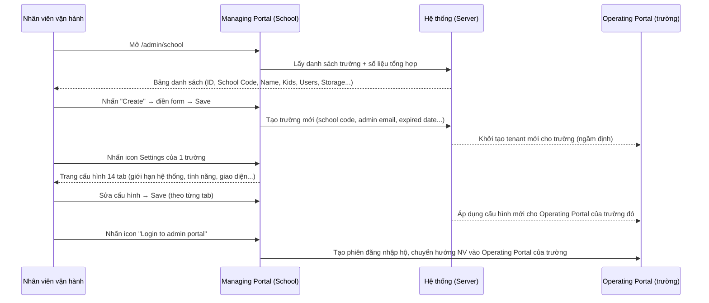

#### 2.2.2 Mô tả các bước nghiệp vụ
| Bước | Người thực hiện | Mô tả | Kết quả |
|---|---|---|---|
| 1 | Nhân viên vận hành | Mở "School" từ sidebar | Danh sách toàn bộ trường trên nền tảng (demo: 27 trường) |
| 2 | Nhân viên vận hành | Tìm/sắp xếp theo ID, School Code, hoặc Name; đổi số dòng hiển thị (5/10/25/50) | Danh sách lọc/sắp xếp lại tương ứng |
| 3 | Nhân viên vận hành | Nhấn "Create" | Mở form tạo trường mới với các field bắt buộc (School Code, Name, Admin Email, Expired Date) |
| 4 | Nhân viên vận hành | Nhấn tên/mã trường trong danh sách | Xem chi tiết đầy đủ thông tin trường (View) |
| 5 | Nhân viên vận hành | Nhấn "Edit" (từ View) hoặc icon bút trong "More" | Sửa được hầu hết field, trừ School Code và Admin Email (readonly) |
| 6 | Nhân viên vận hành | Nhấn icon Settings (⚙) | Mở trang cấu hình 14 tab cho riêng trường đó |
| 7 | Nhân viên vận hành | Nhấn icon "List users" (👤) | Xem danh sách toàn bộ user (Admin/Teacher/Parent) của trường |
| 8 | Nhân viên vận hành | Nhấn "More" | Mở menu ~26 công cụ quản trị sâu cho trường đó |

### 2.3 Nguyên tắc nghiệp vụ
| ID | Nguyên tắc nghiệp vụ |
|---|---|
| BR01 | Bảng danh sách trường có ô tìm kiếm riêng theo ID/School Code/Name và sắp xếp được theo mọi cột số liệu (Total Kids, Total Users, Storage, Last Activity At...) |
| BR02 | Mỗi dòng trường có 3 icon shortcut cố định (List users, Settings, Login to admin portal) + nút "More" chứa danh sách công cụ mở rộng (xem BR14) |
| BR03 | "Delete" chỉ xuất hiện dạng icon riêng (ngoài "More") cho một số trường nhất định — trong dữ liệu demo chỉ trường có badge "Đồng bộ" (Liên cấp PT Sao Mai) có icon này; các trường khác không có nút xóa nhanh [Cần xác nhận điều kiện chính xác] |
| BR04 | Sau khi tạo, **School Code** và **Admin Email** trở thành readonly vĩnh viễn trên form Edit — không thể đổi School Code hay email admin gốc của trường qua UI này |
| BR05 | **Type** và **Sub Type** chỉ chọn được lúc Create; sang Edit, hai field này hiển thị dạng text tĩnh (không phải dropdown) — không đổi được loại hình trường sau khi tạo |
| BR06 | Danh sách "Cấp học" (Tiểu học/THCS/THPT/GDTX) mặc định chọn sẵn cả 4 mục khi Create, nhưng ở form Edit của trường đã tồn tại (VD: demo — trường có học sinh cấp THCS thật) thì không có mục nào được tô chọn — khả năng là lỗi hiển thị, giá trị đã lưu không được load lại đúng vào multi-select [Cần xác nhận với đội dev] |
| BR07 | "Launch Status" là trường chỉ đọc (system-managed) — không xuất hiện dưới dạng input ở cả Create lẫn Edit, chỉ hiển thị text ("Launched") |
| BR08 | Trang View phân biệt 2 nhóm số liệu dễ nhầm: "Maximum Kids/Num of Kids/Remain Kids" (quan sát thấy đều = 0, có thể là field hạn mức cũ không còn dùng) khác với "Total Kids/Total Actived Kids" (số liệu thật, tính từ dữ liệu vận hành) [Cần xác nhận mục đích của nhóm field đầu] |
| BR09 | Trang Settings của 1 trường gồm **14 tab**: Cấu hình chung, Hình ảnh, Hoạt động, Điểm danh, Trao đổi, Hóa đơn & Thanh toán, Thanh toán tự động, Khẩu phần ăn, Quản lý tính năng, Quản lý cấu hình Apps, Quản lý bài học/Tiến độ, Quản lý màu sắc, Quản lý dashboard, Cấu hình học kỳ — đây là nơi cấu hình gốc cho nhiều tính năng phía Operating Portal (VD: giới hạn "Tối đa lớp của trẻ", "Tối đa phụ huynh được bao nhiêu trẻ", các cờ bật/tắt tính năng Dinh Dưỡng/SuppliesPortal/Diary text-to-speech, ẩn thông tin phụ huynh theo vai trò/cột...) |
| BR10 | Tiêu đề tab trình duyệt của trang Edit School hiển thị nhầm là "Manage article" (nhãn boilerplate còn sót lại từ Laravel, chưa được đổi cho module School) |
| BR11 | Danh sách User của 1 trường hiển thị trạng thái Activated/Valid Email/Hidden Password Set dưới dạng chấm tròn màu (xanh lá = có/đúng, đỏ = không/thiếu) thay vì text hay checkbox |
| BR12 | Mỗi user trong danh sách có icon "Login to admin portal" **riêng** (đăng nhập hộ đúng user đó), độc lập với icon "Login to admin portal" ở cấp trường (icon cấp trường có thể đăng nhập hộ dưới vai trò admin mặc định) [Cần xác nhận khác biệt chính xác giữa 2 loại đăng nhập hộ] |
| BR13 | Hành động "Login to admin portal" (cả cấp trường lẫn cấp user) **không thể khảo sát được** trong phiên làm việc này — trình phân loại quyền (permission classifier) của Claude Code auto-mode chặn với lý do "Modify Shared Resources"; cần thao tác thủ công hoặc cấp quyền rõ ràng để khảo sát luồng này |
| BR14 | Menu "More" của mỗi trường có ~26 công cụ: Onboarding, Update school, Contracts, Import/Export kids, Manage kids/classes/teachers, Face recognition (staffs/students/results), Class Placement, Import Account Students, Incidents, Store Config, Take medicine management, Dynamic Links, Upload file report nutritions, Report template, Lesson Sets (export), Statistic, Report progress list, Manage keys, Entity Authentications, Media Stream Histories, Manage Schedules, Nutrition Groups — mỗi mục là một trang/luồng quản trị riêng, xem bảng inventory ở mục 3.4 |
| BR15 | **Tab "Hình ảnh" (Media)**: giới hạn ảnh/video theo tháng cho mỗi trẻ (mặc định 3000 ảnh / 500 phút video) — đây chính là nguồn số liệu "Giới hạn hình"/"Giới hạn video" hiển thị ở Operating Portal M1 Tổng Quan. Ngoài ra còn có: loại giới hạn (theo dung lượng/theo số lượng), Custom Max Upload (giới hạn riêng theo loại file: Picture/Video/Audio Max Size & Total Items), nén video khi upload (size tối đa, bitrate tối đa), quyền duyệt Media (chỉ admin/manager), và tùy chọn dùng CloudFlare Stream (kèm nút "Kiểm tra webhook" và giới hạn độ dài video theo giây) |
| BR16 | **Tab "Hoạt động" (Activity)**: giới hạn số hình/video tối đa mỗi hoạt động (50 hình/10 video), đề xuất mẫu câu hoạt động, bật bình luận (kèm duyệt bình luận phụ huynh), tự động chuyển link thành clickable; nhóm "AI prompt" cho phép tạo text hoạt động bằng AI (giới hạn số request/user và độ dài text); nhóm "Quyền duyệt hoạt động" kiểm soát việc chỉ admin/manager mới duyệt được và có cho giáo viên hỗ trợ xem hoạt động nháp hay không |
| BR17 | **Tab "Điểm danh" (Attendance)**: cấu hình hiển thị tùy chọn hoàn tiền, nhiệt độ mặc định (37°C) và số phút cho phép điểm danh sớm hơn giờ thực tế (VD: +10 phút); dịch vụ nhận diện khuôn mặt là **TOFACE**, đang bật **TESTMODE** — theo đúng ghi chú của hệ thống, ở chế độ này mọi kết quả nhận diện đều trả về `failed` và **không tạo ra attendance thật** (dữ liệu tổng hợp lưu ở bảng `face_recognition_synthetics`) — đây là nguyên nhân trực tiếp của hành vi quan sát được ở Operating Portal M6-SM4 (Nhận Diện); còn có cấu hình riêng cho điểm danh trẻ (2 buổi, ngưỡng chính xác nhận diện 0.9) và điểm danh nhân viên (ngưỡng 0.8, readonly, nhận diện khuôn mặt đang tắt); khung giờ điểm danh (Buổi sáng 07:00–11:30, Buổi chiều 12:00–17:30) là nguồn dữ liệu cho card "Điểm danh trong ngày" ở Operating Portal M1 |
| BR18 | **Tab "Trao đổi" (Communication)**: giới hạn 10 tệp đính kèm, danh sách vai trò được tạo trao đổi nhóm (`admin,manager,teacher`), gộp toàn bộ trao đổi của 1 trẻ vào một luồng; cho phép đăng video trong trao đổi; nhóm "Take medicine" cấu hình dặn thuốc — nhắc lại 1 lần sau mỗi cữ (readonly 30 phút), cho phép đánh dấu "đã uống" trong tối đa 2 ngày quá khứ, và 3 mốc giờ đề xuất mặc định (08:30 Sau ăn sáng / 11:30 Sau ăn trưa / 15:30 Sau ăn xế) khớp với luồng dặn thuốc đã ghi nhận ở Operating Portal M6-Thông Báo |
| BR19 | **Tab "Hóa đơn & Thanh toán"**: bật hóa đơn điện tử (loại SInvoice), tự động tách 2 hóa đơn (HĐĐT & HĐ thường), và hiển thị trực tiếp trên UI (dạng plaintext, không che) thông tin đăng nhập nhà cung cấp SInvoice (mã số thuế/tài khoản/mật khẩu) — **đã redact trong ảnh chụp của tài liệu này**. Đây là nơi cấu hình gốc cho "Cấu hình hóa đơn điện tử" ở Operating Portal M6-SM3 (Học Phí). Ngoài ra: prefix nội dung chuyển khoản QR, kỳ hóa đơn (Default ngày 25→24 hoặc From-to tùy chỉnh), hoàn trả vắng mặt liên tiếp, chi tiết hóa đơn theo excel, thông báo hóa đơn quá hạn (mặc định nhắc sau 12 ngày quá hạn), và phương thức tạo mã QR (VietQR/Ecopay) |
| BR20 | **Tab "Thanh toán tự động"**: 2 cổng thanh toán — VNPAY (tắt, có secret key hiển thị plaintext trên UI, **đã redact**) và Sepay (bật, có API-Key riêng — trống trong tenant demo — và link webhook cố định `/api/1.0/sepay-callback`); đây là nơi cấu hình gốc cho tích hợp Sepay đã ghi nhận (nhưng không đọc được giá trị vì bị "Credential Materialization" chặn) ở Operating Portal M6-SM3 |
| BR21 | **Tab "Khẩu phần ăn"**: cấu hình AI gợi ý thực đơn/phân tích dinh dưỡng (đều tắt mặc định), danh sách Độ tuổi và Khung giá (thêm/xóa được, có cờ "Phổ biến?"), và mục "Cấu hình đếm suất ăn" với **"Thời gian bắt đầu đếm" mặc định 10:00** — chính là con số "Tính đến 10:00 sáng cùng ngày" xuất hiện lặp lại ở Operating Portal M1 Tổng Quan (card "Tổng suất ăn" và modal "Suất ăn theo lớp") |
| BR22 | **Tab "Quản lý tính năng"**: danh sách feature-flag lớn nhất nền tảng (~25+ tính năng: thời khóa biểu, credit, chatbot, tiến độ, người đón trẻ, sổ tay phụ huynh, báo cáo mẫu/tiến độ/tiến độ nâng cao, bộ môn & bài tập, năm học, đối tác, Kid/Student Portal, quản lý chi, liên kết động, góp ý, phiếu bé ngoan, bình chọn, bảng điểm, vận hành, giáo viên chủ nhiệm...); trong đó mục **Wordbook** (bật) chứa từ điển chuyển đổi "trẻ"→"học sinh" (vi) và "kid"→"student" (en) — đây CHÍNH LÀ nguyên nhân của hiện tượng nội dung đổi qua lại không nhất quán giữa 2 từ này đã ghi nhận nhiều lần trong tài liệu Operating Portal (SM1-truong.md BR13, SM6-thong-bao.md, SM1-tong-quan.md): không phải ngẫu nhiên, mà là 1 tính năng thay thế từ ngữ áp dụng không đồng nhất giữa các thành phần giao diện |
| BR23 | **Tab "Quản lý cấu hình Apps"**: App Teacher cho phép admin đăng nhập trên app giáo viên; App Parent kiểm soát hiển thị dashboard, danh mục thông báo hiển thị (General/Plan/Meal menu/Event/School holidays/Timetable — demo chỉ bật "General"), và cho phép upload avatar trẻ |
| BR24 | **Tab "Quản lý bài học/Tiến độ"**: chỉ có đúng 1 cấu hình — cho phép mỗi bộ bài học có nhóm tiêu chí đánh giá riêng (tắt mặc định ở tenant demo) |
| BR25 | **Tab "Quản lý màu sắc"**: cung cấp toàn bộ hệ thống white-label (~20 biến màu hex: kid/cyan/grey/info/draft/error/human/label/staff/unread/primary/success/teacher/warning/nonHuman/secondary/borderColor/darkTeacher/pinnedActivity + logo/footerLogo) nhưng toàn bộ field bị khóa (disabled) trừ khi bật "Sử dụng bộ màu riêng" — trường demo đang dùng bộ màu gốc mặc định (toggle tắt) |
| BR26 | **Tab "Quản lý dashboard"**: chỉ có 1 widget toggle — "Top giáo viên nhận tim tháng" (đang bật) — khớp trực tiếp với widget cùng tên đã ghi nhận ở Operating Portal M1 Tổng Quan |
| BR27 | **Tab "Cấu hình học kỳ"**: định nghĩa 2 bộ học kỳ độc lập cho 2 mục đích: "Bảng điểm" (Học kỳ I/II/Tổng kết) và "Phiếu đánh giá học tập" (Giữa kỳ I/Học kỳ I/Giữa kỳ II/Học kỳ II/Cuối năm); ở tenant demo, "Học kỳ II" trong bộ Phiếu đánh giá học tập đang **tắt** trong khi mọi mục khác đều bật, và không mục nào có ngày bắt đầu/kết thúc — phù hợp với "Cách tính số buổi nghỉ" đang ở chế độ "Tự nhập" (không thể dùng "Tự tính" vì thiếu dữ liệu ngày, theo đúng lưu ý trên UI) |

## 3. Đặc tả tính năng

### 3.1 Phân rã chức năng
| Feature | Platform | Priority | User Story |
|---|---|---|---|
| Xem & tìm kiếm danh sách trường | Web Admin (Managing Portal) | Cao | Là nhân viên vận hành, tôi muốn tìm nhanh 1 trường và xem tổng quan số liệu |
| Tạo trường mới | Web Admin | Cao | Là nhân viên vận hành, tôi muốn khởi tạo tenant mới cho khách hàng |
| Xem/Sửa thông tin trường | Web Admin | Cao | Là nhân viên vận hành, tôi muốn cập nhật thông tin liên hệ, hạn dùng, trạng thái hợp đồng của trường |
| Cấu hình sâu 1 trường (Settings) | Web Admin | Cao | Là nhân viên vận hành, tôi muốn bật/tắt tính năng và giới hạn hệ thống riêng cho từng trường |
| Quản lý user của 1 trường | Web Admin | Trung bình | Là nhân viên vận hành, tôi muốn xem/hỗ trợ tài khoản người dùng thuộc 1 trường cụ thể |
| Truy cập nhanh công cụ vận hành (More) | Web Admin | Trung bình | Là nhân viên vận hành, tôi muốn truy cập nhanh các công cụ chuyên biệt (import dữ liệu, nhận diện khuôn mặt...) mà không cần điều hướng qua Operating Portal |

### 3.2 Acceptance Criteria
| User Story | Chức năng | Acceptance Criteria |
|---|---|---|
| Xem & tìm kiếm | Nhập ô tìm kiếm ID/School Code/Name | Danh sách lọc đúng theo từ khóa; sort 2 chiều theo mọi cột có mũi tên |
| Tạo trường | Điền đủ field bắt buộc (*) → Save | Trường mới xuất hiện trong danh sách với School Code không trùng lặp |
| Sửa thông tin | Đổi Name/Address/Expired Date → Save | Giá trị mới phản ánh đúng ở trang View; School Code/Admin Email không đổi được |
| Cấu hình Settings | Đổi 1 giá trị ở tab "Cấu hình chung" → Save | Giá trị áp dụng ngay cho trường đó, không ảnh hưởng trường khác |

### 3.3 Use case
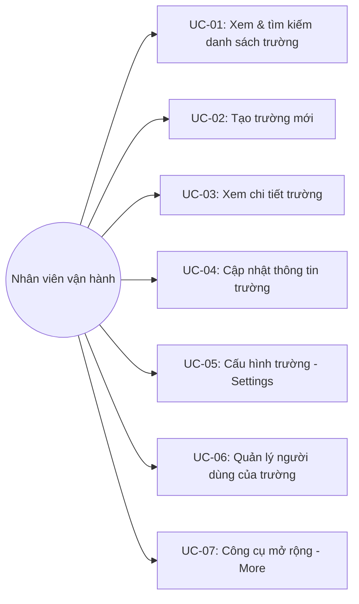

---

| Trường | Nội dung |
|---|---|
| Use case ID | UC-01 |
| Use case name | Xem & tìm kiếm danh sách trường |
| Use case description | Nhân viên vận hành xem toàn bộ trường trên nền tảng, tìm kiếm và sắp xếp theo nhu cầu |
| Actor | Nhân viên vận hành nền tảng |
| Happy path | 1. Mở "School" từ sidebar → bảng liệt kê toàn bộ trường (ID, School Code, Name, Total Actived Kids, Total Kids, Total Users, Storage/Records, Images/Video Duration, Last Activity At, Last Attendance At, Launch Status, Actions):  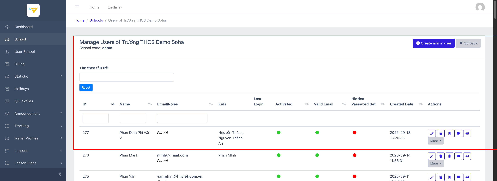 2. Gõ từ khóa vào ô tìm kiếm dưới cột ID/School Code/Name để lọc. 3. Nhấn mũi tên ở tiêu đề cột bất kỳ để sắp xếp tăng/giảm. 4. Đổi "Display" (5/10/25/50) để đổi số dòng mỗi trang. |
| Exception | Không có kết quả khớp từ khóa → bảng trống (không quan sát được message cụ thể trong lần khảo sát) |
| Trigger | Nhân viên vận hành cần tra cứu nhanh 1 trường cụ thể hoặc theo dõi tổng quan toàn nền tảng |
| Pre-condition | Đã đăng nhập Managing Portal với quyền admin nền tảng |
| Post-condition | Không thay đổi dữ liệu — chỉ xem |
| Business Rules | BR01, BR02 |

---

| Trường | Nội dung |
|---|---|
| Use case ID | UC-02 |
| Use case name | Tạo trường mới |
| Use case description | Nhân viên vận hành khởi tạo một tenant (trường) mới trên nền tảng |
| Actor | Nhân viên vận hành nền tảng |
| Happy path | 1. Từ danh sách, nhấn "Create" → mở form Create School với các nhóm field: định danh (School Code*, Name*, Short Name, Slogan), phân loại (Type, Sub Type, Cấp học — mặc định chọn sẵn cả 4 cấp), liên hệ (Email, Website, Address, Phone Number), vận hành (Language, Admin Email*, Expired Date*, Support Information, Social Facebook, Operation Status, Is Test, Price per kid, Sale, Mailer):  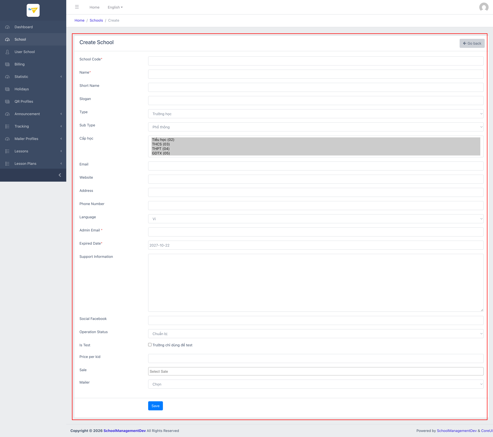 2. Điền tối thiểu 4 field bắt buộc. 3. Nhấn "Save". |
| Exception | Thiếu field bắt buộc hoặc School Code trùng → [Cần xác nhận message lỗi cụ thể, chưa submit thật để tránh tạo trường thật trên môi trường dev] |
| Trigger | Có khách hàng/trường mới cần khởi tạo tenant |
| Pre-condition | Đã đăng nhập với quyền tạo trường |
| Post-condition | Trường mới xuất hiện trong danh sách; không thực hiện submit thật trong quá trình khảo sát |
| Business Rules | — |

---

| Trường | Nội dung |
|---|---|
| Use case ID | UC-03 |
| Use case name | Xem chi tiết trường |
| Use case description | Nhân viên vận hành xem đầy đủ thông tin và số liệu tổng hợp của 1 trường |
| Actor | Nhân viên vận hành nền tảng |
| Happy path | 1. Nhấn vào School Code hoặc Name của trường trong danh sách → trang "View School #{id}" hiển thị toàn bộ field dạng bảng key-value (Id, School Code, Name, Type, Email, Address, Admin Email, Maximum/Num/Remain Kids, Expired Date, Launch Status, Total Actived Kids, Total Kids, Total Classes, Total Teachers, Total Parents, Operation status, Price Per Kid, QR profile...):  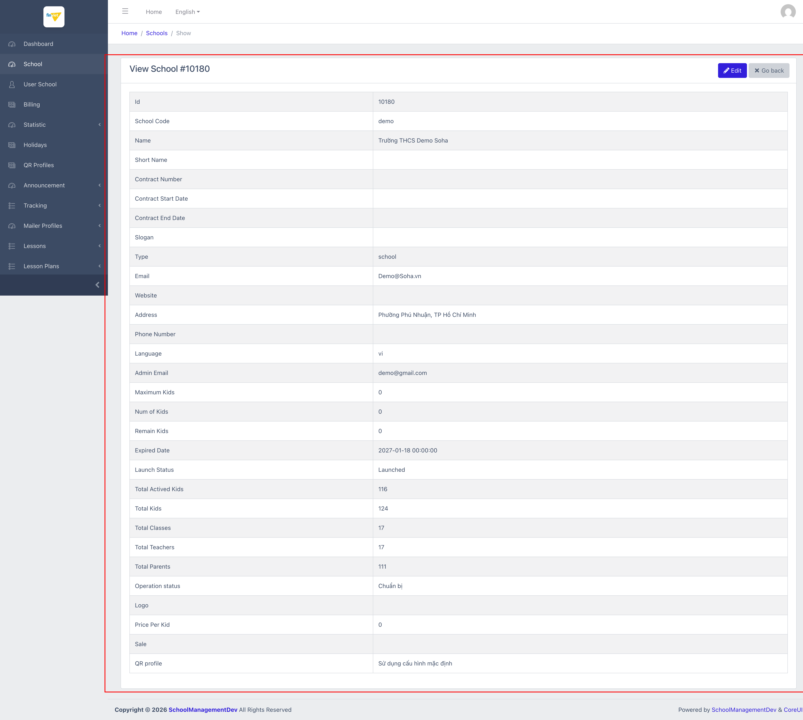 2. Nhấn "Edit" ở góc phải để chuyển sang chỉnh sửa. |
| Exception | Trường không tồn tại (ID sai) → [Cần xác nhận trang lỗi hiển thị] |
| Trigger | Cần tra cứu nhanh toàn bộ thông tin 1 trường trước khi hỗ trợ/xử lý |
| Pre-condition | Đã đăng nhập |
| Post-condition | Không thay đổi dữ liệu |
| Business Rules | BR08 |

---

| Trường | Nội dung |
|---|---|
| Use case ID | UC-04 |
| Use case name | Cập nhật thông tin trường |
| Use case description | Nhân viên vận hành sửa các field cho phép của 1 trường đã tồn tại |
| Actor | Nhân viên vận hành nền tảng |
| Happy path | 1. Từ trang View, nhấn "Edit" (hoặc "Update school" trong More) → form hiển thị gần giống Create, nhưng School Code và Admin Email bị khóa (nền xám, readonly), Type/Sub Type chỉ hiển thị text, Launch Status hiển thị text:  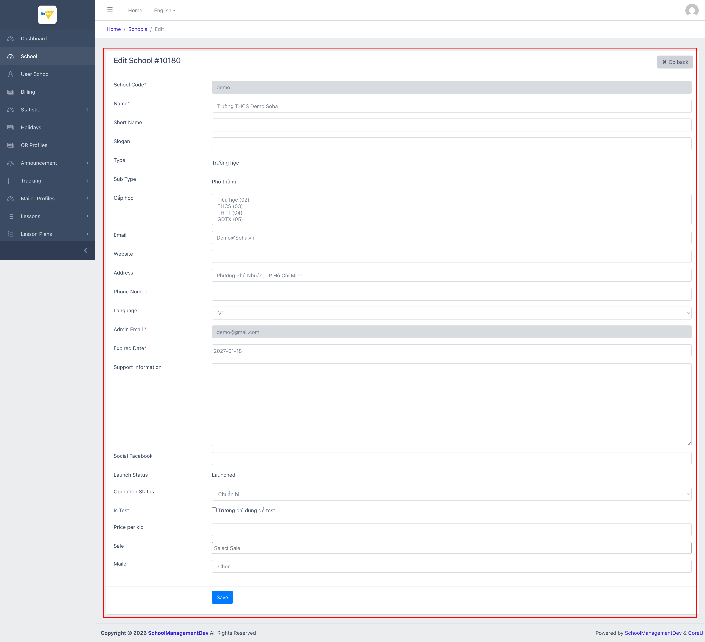 2. Sửa các field còn lại (Name, Address, Expired Date, Operation Status, Is Test, Price per kid, Sale, Mailer...). 3. Nhấn "Save". |
| Exception | Cấp học hiển thị trống dù trường đã có cấp học thật — cần chọn lại thủ công nếu muốn Save mà không làm mất dữ liệu cấp học [Cần xác nhận — rủi ro mất dữ liệu Cấp học nếu Save mà không chọn lại] |
| Trigger | Thông tin trường thay đổi (địa chỉ, hạn hợp đồng, trạng thái vận hành...) |
| Pre-condition | Đã đăng nhập; trường đã tồn tại |
| Post-condition | Thông tin cập nhật phản ánh ở trang View; không thực hiện Save thật trong quá trình khảo sát để tránh ảnh hưởng dữ liệu demo |
| Business Rules | BR04, BR05, BR06, BR07 |

---

| Trường | Nội dung |
|---|---|
| Use case ID | UC-05 |
| Use case name | Cấu hình trường (Settings) |
| Use case description | Nhân viên vận hành cấu hình sâu các giới hạn hệ thống và tính năng cho riêng 1 trường, qua 14 tab |
| Actor | Nhân viên vận hành nền tảng |
| Happy path | 1. Nhấn icon Settings (⚙) của 1 trường → trang "Edit settings {Tên trường}" với 14 tab. **Tab 1 — Cấu hình chung**: Cấu hình gởi mail, giới hạn Teacher/Class/Kid/Parent, các cờ Feature (Dinh Dưỡng, SuppliesPortal, Diary text-to-speech...), Report Progress, Quản lý, Tính năng S3, Ẩn thông tin phụ huynh (theo vai trò và theo cột: Email/SĐT/Ngày sinh/Địa chỉ):  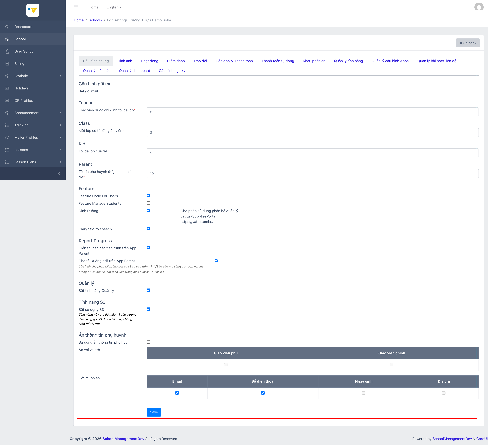 2. **Tab 2 — Hình ảnh**: giới hạn ảnh/video theo tháng, Custom Max Upload theo loại file, nén video, quyền duyệt Media, CloudFlare Stream:  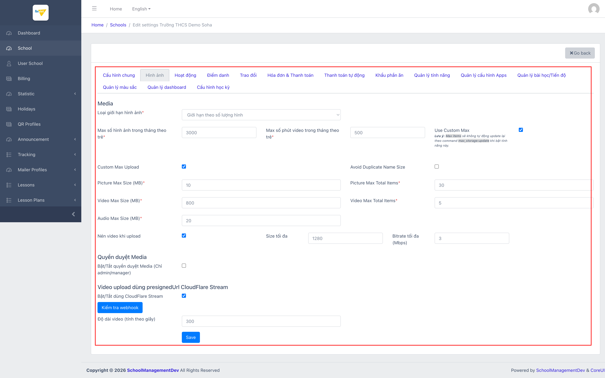 3. **Tab 3 — Hoạt động**: giới hạn hình/video mỗi hoạt động, bình luận, AI tạo text hoạt động, quyền duyệt hoạt động:  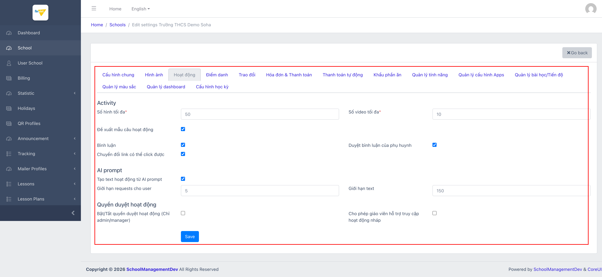 4. **Tab 4 — Điểm danh**: nhiệt độ mặc định, dịch vụ nhận diện khuôn mặt TOFACE (đang ở TESTMODE), điểm danh trẻ/nhân viên, khung giờ điểm danh:  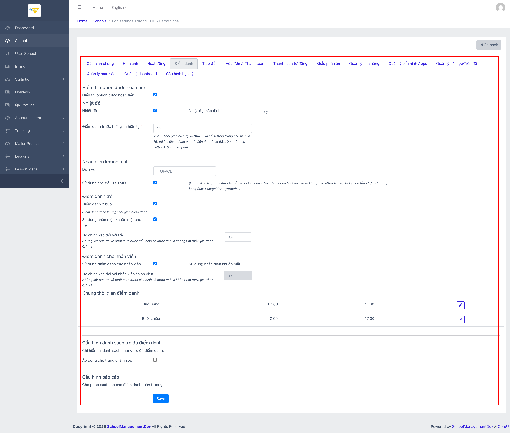 5. **Tab 5 — Trao đổi**: giới hạn tệp đính kèm, vai trò tạo nhóm, tính năng dặn thuốc (nhắc lại, mốc giờ đề xuất):  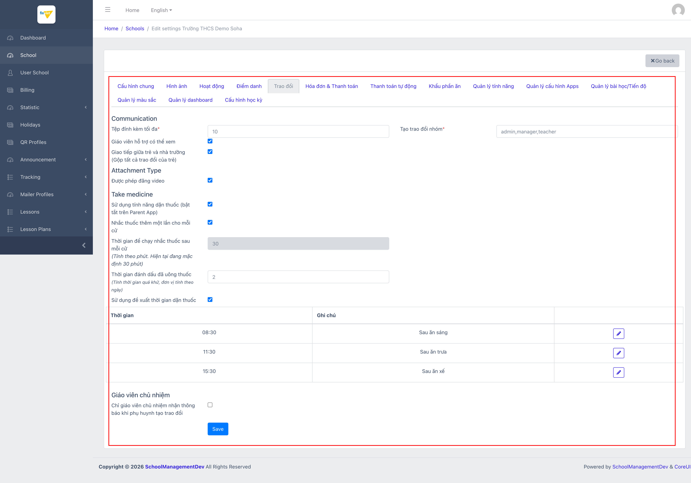 6. **Tab 6 — Hóa đơn & Thanh toán**: hóa đơn điện tử (SInvoice), kỳ hóa đơn, hoàn trả vắng mặt, thông báo quá hạn, tạo mã QR — thông tin đăng nhập nhà cung cấp đã được **redact**:  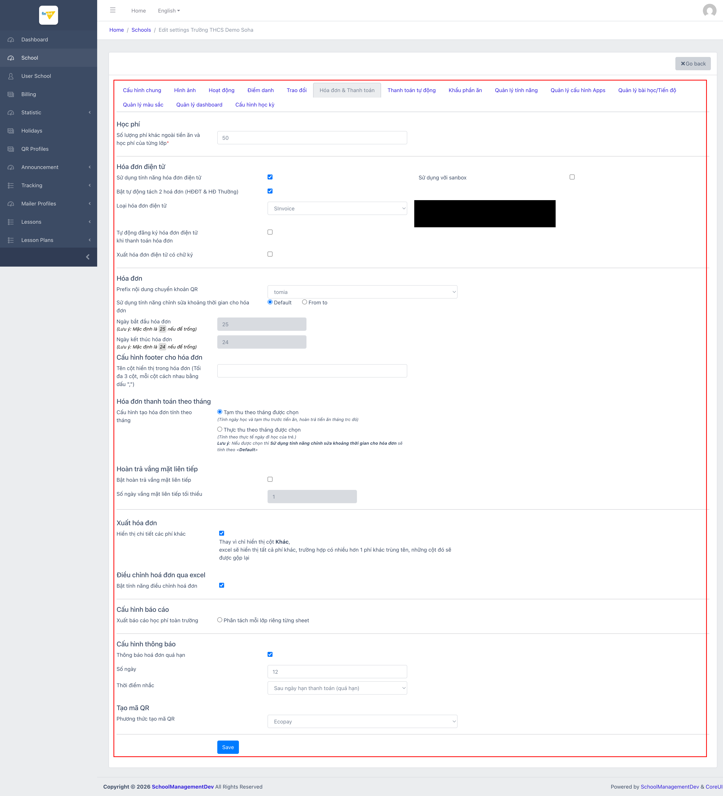 7. **Tab 7 — Thanh toán tự động**: cổng VNPAY (secret key đã **redact**) và Sepay (API-Key, link webhook):  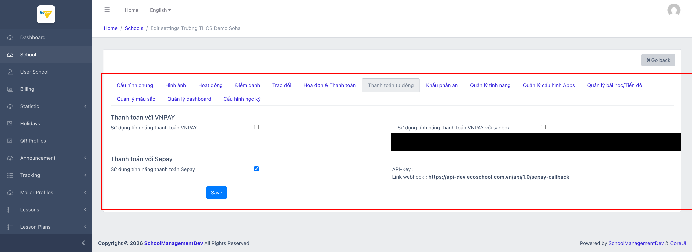 8. **Tab 8 — Khẩu phần ăn**: AI gợi ý thực đơn, Độ tuổi, Khung giá, cấu hình đếm suất ăn (giờ bắt đầu đếm 10:00):  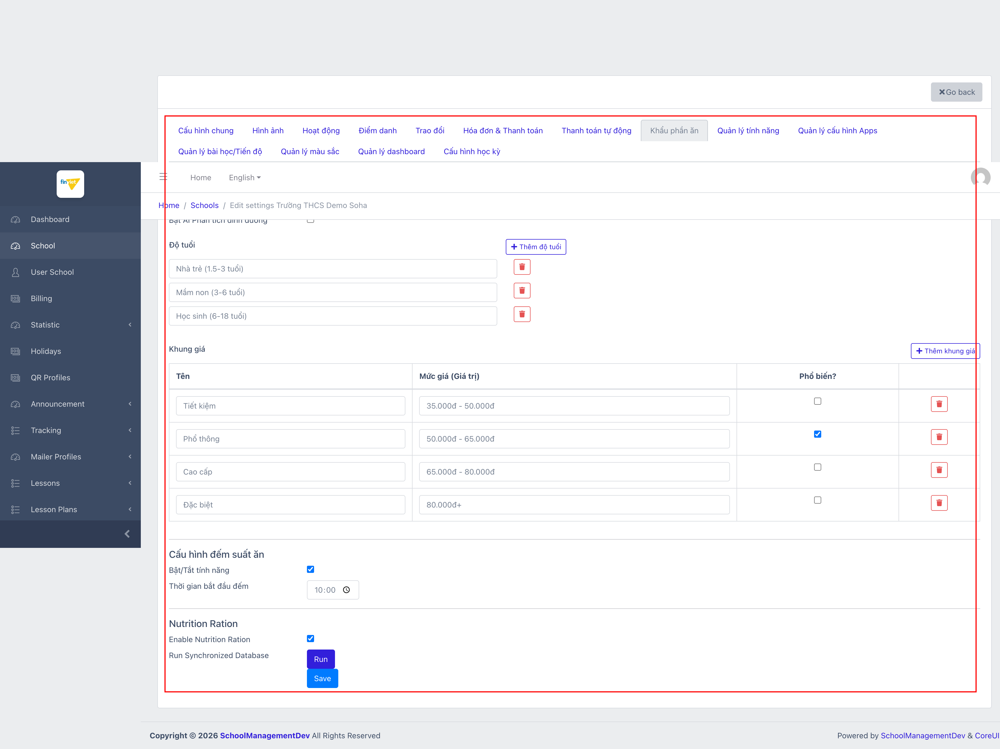 9. **Tab 9 — Quản lý tính năng**: danh sách feature-flag lớn nhất nền tảng:  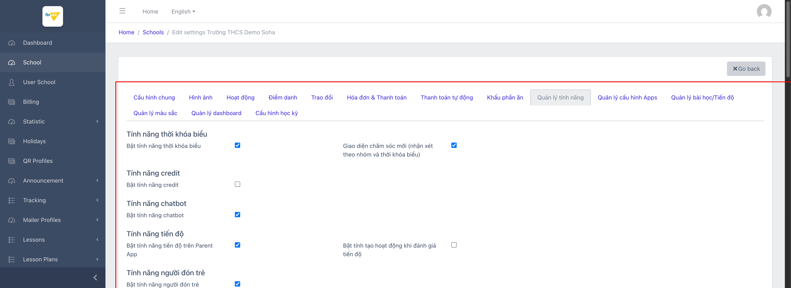 ...trong đó có mục **Wordbook** với từ điển chuyển đổi "trẻ"→"học sinh"/"kid"→"student":  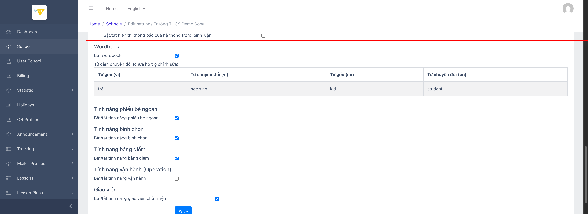 10. **Tab 10 — Quản lý cấu hình Apps**: App Teacher, App Parent (danh mục thông báo dashboard, upload avatar):  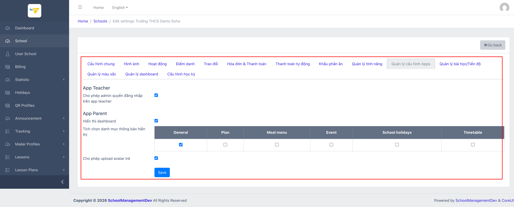 11. **Tab 11 — Quản lý bài học/Tiến độ**: tiêu chí đánh giá theo bộ bài học:  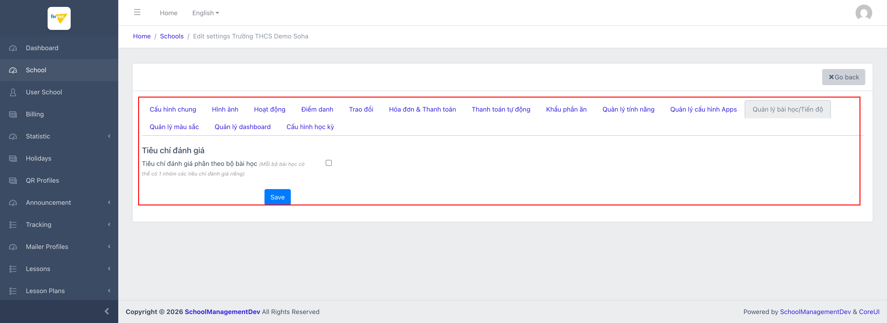 12. **Tab 12 — Quản lý màu sắc**: bộ màu white-label đầy đủ (~20 biến màu + logo):  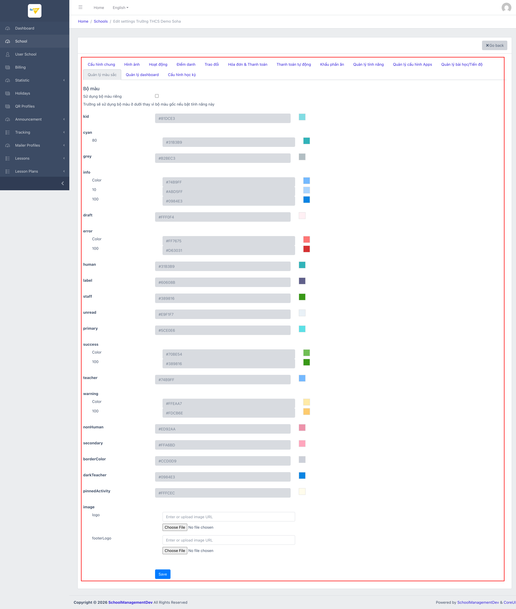 13. **Tab 13 — Quản lý dashboard**: ẩn/hiện widget "Top giáo viên nhận tim tháng":  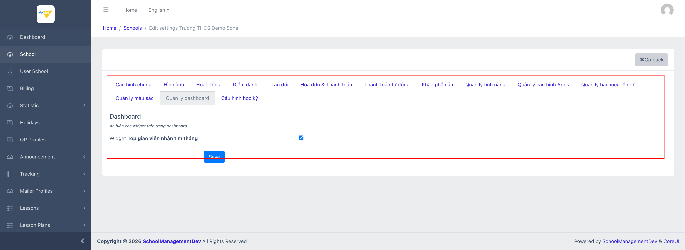 14. **Tab 14 — Cấu hình học kỳ**: cách tính buổi nghỉ, 2 bộ học kỳ (Bảng điểm và Phiếu đánh giá học tập):  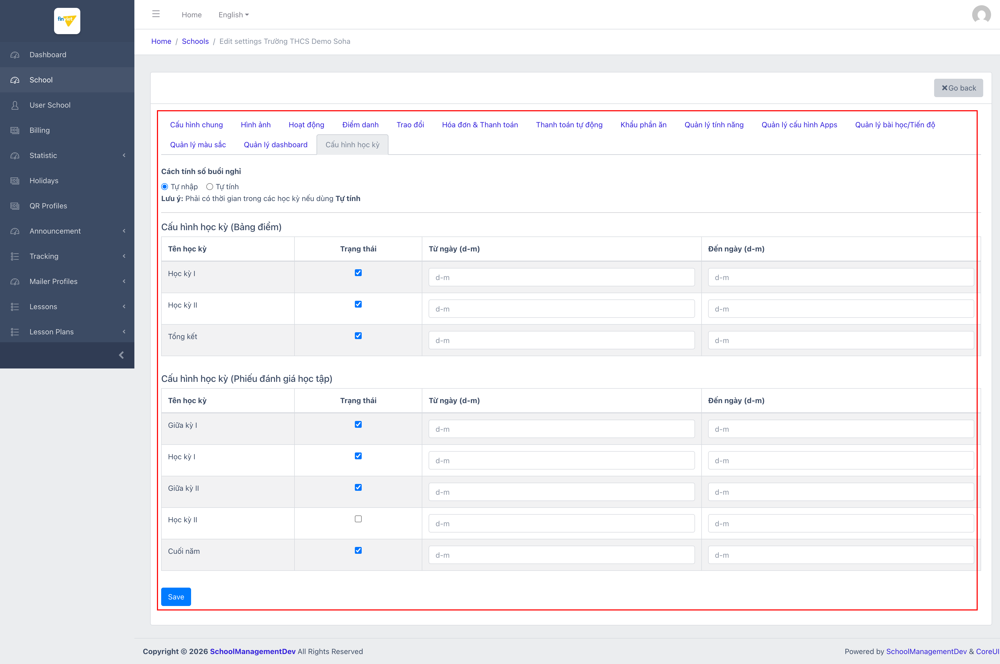 15. Đổi giá trị mong muốn trong tab đang xem → nhấn "Save" (mỗi tab có nút Save riêng, độc lập với các tab khác). |
| Exception | Tab "Hóa đơn & Thanh toán" và "Thanh toán tự động" hiển thị thông tin đăng nhập/secret key của nhà cung cấp thứ ba dạng plaintext ngay trên UI, không có cơ chế ẩn/hiện — rủi ro lộ thông tin nếu chụp màn hình chia sẻ không cẩn thận [Cần xác nhận với đội bảo mật]; tab "Điểm danh" đang bật TESTMODE cho nhận diện khuôn mặt nên mọi kết quả nhận diện thật đều trả về failed — cần tắt TESTMODE nếu muốn nhận diện khuôn mặt hoạt động thật ở Operating Portal |
| Trigger | Cần bật/tắt tính năng hoặc đổi giới hạn hệ thống riêng cho 1 trường (không ảnh hưởng trường khác) |
| Pre-condition | Đã đăng nhập; trường đã tồn tại |
| Post-condition | Cấu hình áp dụng ngay cho Operating Portal của trường đó; không thực hiện Save thật trên bất kỳ tab nào trong quá trình khảo sát |
| Business Rules | BR09, BR15, BR16, BR17, BR18, BR19, BR20, BR21, BR22, BR23, BR24, BR25, BR26, BR27 |

---

| Trường | Nội dung |
|---|---|
| Use case ID | UC-06 |
| Use case name | Quản lý người dùng của trường |
| Use case description | Nhân viên vận hành xem/hỗ trợ danh sách tài khoản (Admin/Teacher/Parent) thuộc 1 trường |
| Actor | Nhân viên vận hành nền tảng |
| Happy path | 1. Nhấn icon "List users" (👤) của 1 trường → trang "Manage Users of {Tên trường}" với cột ID/Name/Email-Roles/Kids/Last Login/Activated/Valid Email/Hidden Password Set/Created Date/Actions, có ô tìm theo tên trẻ:   2. Nhấn icon Edit/Devices/Messages tương ứng để xem chi tiết từng khía cạnh của user. 3. Nhấn "Create admin user" để thêm tài khoản admin mới cho trường. |
| Exception | User chưa từng đăng nhập → cột "Last Login" trống |
| Trigger | Cần hỗ trợ user cụ thể (reset trạng thái, xem thiết bị đăng nhập, xem tin nhắn...) mà không cần vào Operating Portal của trường |
| Pre-condition | Đã đăng nhập; trường đã có user |
| Post-condition | Không thay đổi dữ liệu — chỉ xem (trừ khi chủ động Edit/Delete) |
| Business Rules | BR11, BR12, BR13 |

---

| Trường | Nội dung |
|---|---|
| Use case ID | UC-07 |
| Use case name | Công cụ mở rộng qua menu "More" |
| Use case description | Nhân viên vận hành truy cập nhanh các công cụ quản trị chuyên biệt của 1 trường mà không cần vào Operating Portal |
| Actor | Nhân viên vận hành nền tảng |
| Happy path | 1. Nhấn "More" ở dòng 1 trường → menu 2 cột với ~26 mục (xem bảng inventory 3.4.2). 2. Chọn "Onboarding" (mẫu đã khảo sát) → trang hướng dẫn 3 bước (Import giáo viên → Import lớp → Import học sinh), mỗi bước có nút mở thẳng trang import tương ứng:  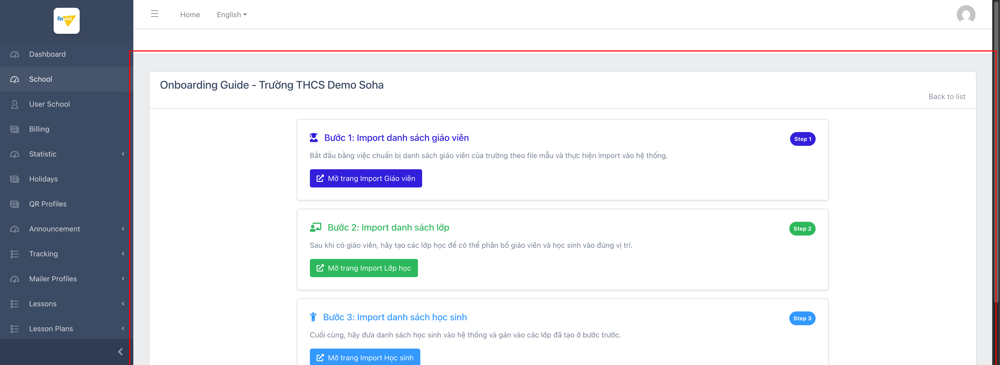 |
| Exception | 25 mục còn lại trong "More" chưa được khảo sát chi tiết — xem bảng inventory 3.4.2 |
| Trigger | Cần thao tác sâu (import dữ liệu, quản lý sự cố, nhận diện khuôn mặt...) cho 1 trường cụ thể |
| Pre-condition | Đã đăng nhập; trường đã tồn tại |
| Post-condition | Tùy công cụ — không thực hiện thao tác ghi dữ liệu thật trong quá trình khảo sát |
| Business Rules | BR03, BR14 |

### 3.4 Edge Cases & Error Handling

#### 3.4.1 Tổng quan
| Nhóm | Tình huống | Xử lý mong đợi |
|---|---|---|
| Edit School | Cấp học không hiển thị mục nào được chọn sẵn dù trường đã có dữ liệu | [Cần xác nhận] — rủi ro nếu Save mà không chọn lại thủ công có thể xóa mất cấu hình Cấp học đã lưu |
| Login to admin portal | Bị chặn bởi permission classifier khi khảo sát bằng Claude Code auto-mode | Cần thao tác thủ công (không qua automation) hoặc cấp quyền Bash/network rõ ràng để kiểm thử luồng này |
| Delete school | Chỉ xuất hiện cho 1 số trường (badge "Đồng bộ") | [Cần xác nhận] điều kiện chính xác — có thể liên quan tới nguồn gốc dữ liệu (đồng bộ từ hệ thống ngoài vs. tạo thủ công) |
| Danh sách trường | Trường "Test" (badge màu vàng) lẫn trong cùng danh sách với trường thật | Không có filter riêng để ẩn/hiện trường Test trên giao diện danh sách chính [Cần xác nhận] |
| Settings → Hóa đơn & Thanh toán / Thanh toán tự động | Mã số thuế, tài khoản, mật khẩu SInvoice và secret key VNPAY hiển thị plaintext trực tiếp trên UI (không có nút ẩn/hiện hay mask) | Đã redact (che đen) toàn bộ các giá trị này trong ảnh chụp của tài liệu — xem BR19, BR20; đội vận hành nên cân nhắc mask các trường này trên UI |
| Settings → Điểm danh | Dịch vụ nhận diện khuôn mặt (TOFACE) đang bật TESTMODE cho tenant demo | Mọi kết quả nhận diện đều trả về `failed`, không tạo attendance thật — cần tắt TESTMODE để nhận diện khuôn mặt hoạt động thật, xem BR17 |
| Settings → Cấu hình học kỳ | "Học kỳ II" trong bộ "Phiếu đánh giá học tập" đang tắt trong khi mọi học kỳ khác đều bật | [Cần xác nhận] có phải chủ đích (VD: năm học chưa qua hết học kỳ II) hay bị bỏ sót khi cấu hình |

#### 3.4.2 Inventory — Menu "More" (26 mục, khảo sát chi tiết: chỉ Onboarding)
| Mục | Mô tả suy luận từ tên |
|---|---|
| Onboarding | Hướng dẫn 3 bước import Giáo viên/Lớp/Học sinh cho trường mới — **đã khảo sát chi tiết** (UC-07) |
| Update school | Alias khác của trang Edit School (UC-04) |
| Contracts | Quản lý hợp đồng của trường |
| Import kids | Import danh sách học sinh hàng loạt |
| Export kids | Xuất danh sách học sinh |
| Manage kids | Quản lý học sinh (tương đương Operating Portal → Nhà Trường → Học Sinh) |
| Manage classes | Quản lý lớp học |
| Manage teachers | Quản lý giáo viên |
| Face recognition for staffs | Nhận diện khuôn mặt cho nhân viên |
| Face recognition for students | Nhận diện khuôn mặt cho học sinh |
| Face recognition results | Kết quả nhận diện khuôn mặt |
| Class Placement | Xếp lớp theo năm học |
| Import Account Students | Import tài khoản học sinh |
| Incidents | Quản lý sự cố của trường |
| Store Config | Cấu hình cửa hàng (store) |
| Take medicine management | Quản lý dặn thuốc |
| Dynamic Links | Quản lý link động (deep link) |
| Upload file report nutritions | Upload file báo cáo dinh dưỡng |
| Report template | Mẫu báo cáo |
| Lesson Sets | Xuất bộ bài học (export) |
| Statistic | Thống kê riêng của trường |
| Report progress list | Danh sách báo cáo tiến độ |
| Manage keys | Quản lý API key của trường |
| Entity Authentications | Xác thực Kid/Student |
| Media Stream Histories | Lịch sử stream media |
| Manage Schedules | Quản lý lịch học |
| Nutrition Groups | Nhóm dinh dưỡng |

#### 3.4.3 Tóm tắt 14 tab trang Settings (tất cả đã khảo sát chi tiết — xem UC-05 và BR15–BR27)
| # | Tab | Business Rule |
|---|---|---|
| 1 | Cấu hình chung | BR09 |
| 2 | Hình ảnh | BR15 |
| 3 | Hoạt động | BR16 |
| 4 | Điểm danh | BR17 |
| 5 | Trao đổi | BR18 |
| 6 | Hóa đơn & Thanh toán | BR19 |
| 7 | Thanh toán tự động | BR20 |
| 8 | Khẩu phần ăn | BR21 |
| 9 | Quản lý tính năng | BR22 |
| 10 | Quản lý cấu hình Apps | BR23 |
| 11 | Quản lý bài học/Tiến độ | BR24 |
| 12 | Quản lý màu sắc | BR25 |
| 13 | Quản lý dashboard | BR26 |
| 14 | Cấu hình học kỳ | BR27 |

#### 3.4.4 Danh sách lỗi/thành công
| Message ID | Trường hợp lỗi | Rule kiểm tra | Message đề xuất | Hình thức báo | Hành vi hệ thống |
|---|---|---|---|---|---|
| — | Không submit form thật (Create/Edit/Settings) trong quá trình khảo sát nên chưa quan sát được message lỗi/thành công cụ thể | | | | — |

### 3.5 Non-functional Requirements
| ID | Nhóm | Yêu cầu |
|---|---|---|
| NFR01 | Hiệu năng | Danh sách trường mặc định hiển thị 50 dòng/trang, hỗ trợ đổi 5/10/25/50 |
| NFR02 | Kiến trúc | Toàn bộ điều hướng là server-rendered full-page (Laravel/CoreUI), không phải SPA — mỗi thao tác (kể cả mở menu "More") là 1 trang riêng với URL riêng |
| NFR03 | Bảo mật | "Admin Email" và "School Code" bị khóa sau khi tạo — tránh nhầm lẫn định danh tenant giữa các hệ thống liên kết (Operating Portal, thanh toán...) |

### 3.6 Quy ước UI chung
- Giao diện dùng theme CoreUI (Laravel boilerplate): sidebar tối màu bên trái, breadcrumb ngay dưới header, nội dung chính trong card trắng.
- Field bắt buộc luôn đánh dấu bằng dấu `*` màu đỏ ngay sau label.
- Field readonly/disabled hiển thị nền xám nhạt, không có viền focus.
- Action trong bảng danh sách dùng icon vuông viền xanh dương (person/gear/arrow-in-box); nút "More" luôn là dropdown xám ở cuối hàng action.
- Trang chi tiết (View) trình bày dạng bảng key-value 2 cột (label bên trái, giá trị bên phải), không dùng card/section riêng như Operating Portal.
- Trang Settings dùng tab ngang (nav-tabs) để chia nhóm cấu hình, mỗi tab có nút "Save" riêng — lưu độc lập, không có nút "Save All" chung cho cả 14 tab.
