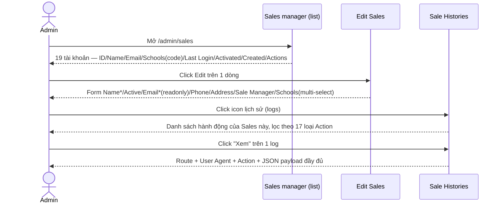
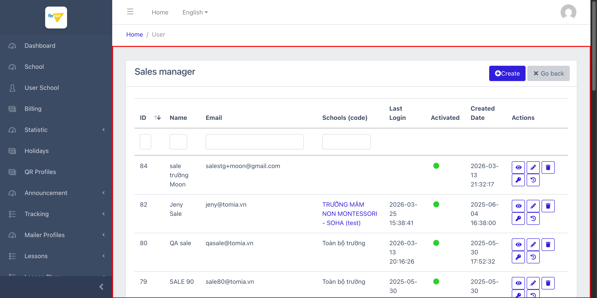
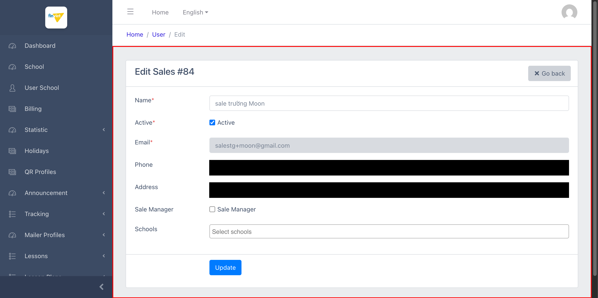
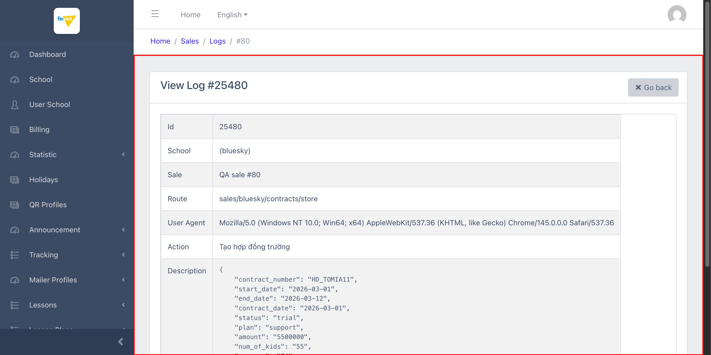

# M20 – Sales (Managing Portal)

> Phạm vi: module **Sales** (`/admin/sales`), không có sub-module (mục sidebar đơn, nằm dưới nhóm "SALES MANAGEMENT"). Đây là module **cuối cùng** trong chuỗi khảo sát M2→M20 của Managing Portal. Phát hiện nổi bật: sub-tính năng **"Sale Histories"** là nhật ký audit chi tiết nhất từng gặp trong dự án — ghi lại đầy đủ route + payload JSON cho từng hành động nghiệp vụ (tạo hợp đồng, đổi mật khẩu người dùng, xoá trẻ...), vượt xa mức độ chi tiết của Audit Log cấp hệ thống (M13).

## Mục lục

- [1. Tổng quan](#1-tổng-quan)
  - [1.1 Giới thiệu](#11-giới-thiệu)
  - [1.2 Actors](#12-actors)
  - [1.3 Phạm vi](#13-phạm-vi)
- [2. Business Flow](#2-business-flow)
  - [2.1 Sequence Diagram](#21-sequence-diagram)
  - [2.2 Business Steps](#22-business-steps)
  - [2.3 Business Rules](#23-business-rules)
- [3. Feature Breakdown](#3-feature-breakdown)
  - [3.1 Acceptance Criteria](#31-acceptance-criteria)
  - [3.2 Danh sách Use Case](#32-danh-sách-use-case)
  - [3.3 Edge Cases](#33-edge-cases)
  - [3.4 UI Conventions](#34-ui-conventions)

---

## 1. Tổng quan

### 1.1 Giới thiệu

Sales quản lý tài khoản nhân viên kinh doanh (Sales) — mỗi tài khoản có thể được gán vào 1 hoặc nhiều trường cụ thể, hoặc trở thành **Sale Manager** (giám sát toàn bộ trường không cần gán riêng lẻ). Tại thời điểm khảo sát có **19 tài khoản** Sales.

**Phát hiện quan trọng — quy tắc phân quyền "Toàn bộ trường" đã xác minh:** cột "Schools (code)" hiển thị **"Toàn bộ trường"** cho 1 số tài khoản dù trường `school_ids[]` trên form Edit của chính tài khoản đó **cũng trống (0 trường được chọn)** — ban đầu tưởng là nghịch lý, nhưng xác minh trực tiếp qua checkbox "Sale Manager" cho thấy: tài khoản có `sale-manager = true` VÀ 0 trường được chọn → hiển thị "Toàn bộ trường" (ngầm định giám sát tất cả); tài khoản `sale-manager = false` VÀ 0 trường được chọn → hiển thị **trống thật sự** (chưa được gán trường nào, có thể chưa dùng được). Đây là 1 business rule tinh tế chỉ phát hiện được qua đối chiếu 2 tài khoản cụ thể (ID=84 vs ID=80), không thể suy ra chỉ từ 1 mẫu.

**Phát hiện quan trọng — "Sale Histories" là nhật ký audit chi tiết nhất dự án:** action "logs" (icon lịch sử) mở trang **"Sale Histories - {tên}"** liệt kê từng hành động nghiệp vụ của riêng tài khoản Sales đó (vd tài khoản "QA sale" có **205 bản ghi**). Mỗi log có action "Xem" dẫn tới trang chi tiết hiển thị: School, Sale, **Route** (route API chính xác, vd `sales/bluesky/contracts/store`), **User Agent**, Action (nhãn tiếng Việt, vd "Tạo hợp đồng trường"), và **Description chứa nguyên văn JSON payload** của hành động (vd toàn bộ dữ liệu hợp đồng: `contract_number`, `start_date`, `amount`, `num_of_kids`...). Đây là nhật ký chi tiết nhất (route + payload đầy đủ cho từng hành động cụ thể) trong toàn dự án — vượt xa Audit Log cấp hệ thống (`M13-audit-log/SM1-audit-log.md`, chỉ đếm số lượt theo route, không có payload) và Reconciliation Logs (`M16-logs/SM4-reconciliation-logs.md`, chỉ có Request/Response tóm tắt). Bộ lọc "Action" trên trang danh sách log liệt kê tới **17 loại hành động** khác nhau được theo dõi (Cập nhật thông tin trường, Đặt người dùng thành quản trị, Xoá người dùng, Đăng nhập vào trường, Đổi mật khẩu người dùng, Tạo/Cập nhật hợp đồng trường, Đổi trạng thái hoá đơn, Phục hồi trẻ...).

**Phát hiện — Email bị khoá sau khi tạo:** trường Email trên form Edit có thuộc tính HTML `readonly` (xác nhận qua DOM, không chỉ suy đoán từ giao diện xám) — không thể đổi email sau khi tạo tài khoản Sales, cùng nhóm pattern "trường bị khoá sau khi tạo" đã thấy ở Brand/Type (`M17-partner/SM2-categories.md` BR02).

### 1.2 Actors

| Actor | Mô tả |
|---|---|
| Finviet/SOHA Super Admin | Quản lý tài khoản Sales, gán trường phụ trách, cấp quyền Sale Manager, xem lịch sử hành động của từng Sales. |

### 1.3 Phạm vi

| Trong phạm vi | Ngoài phạm vi |
|---|---|
| Xem danh sách, xác nhận cấu trúc cột/action | Thực hiện Create/Edit/Delete/đổi mật khẩu thật |
| Xác nhận quy tắc "Toàn bộ trường" qua đối chiếu 2 tài khoản cụ thể | Khảo sát đầy đủ 17 loại Action trong Sale Histories (chỉ xem 1 mẫu chi tiết — "Tạo hợp đồng trường") |
| Xem trang chi tiết Sale Histories, xác nhận nội dung payload không có dữ liệu thẻ/ngân hàng | |

---

## 2. Business Flow

### 2.1 Sequence Diagram

### 2.2 Business Steps

1. Admin xem danh sách Sales, theo dõi trường phụ trách và trạng thái hoạt động.
2. Admin tạo/sửa tài khoản Sales: Name, Active, Email (chỉ đặt được khi tạo), Phone, Address, tick "Sale Manager" nếu muốn giám sát toàn bộ trường, hoặc chọn cụ thể các trường qua multi-select "Schools".
3. Admin dùng action "key" để đặt lại mật khẩu (Password + Password Confirmation).
4. Admin dùng action "logs" để tra cứu lịch sử hành động chi tiết của 1 Sales khi cần điều tra/hỗ trợ.

### 2.3 Business Rules

| ID | Mô tả |
|---|---|
| BR01 | Danh sách có 7 cột: ID (sort được), Name, Email, Schools (code) (link mở view khi có trường cụ thể, text "Toàn bộ trường" khi là Sale Manager), Last Login, Activated (icon tròn), Created Date — cộng Actions (5 nút: View/Edit/Delete/Set Password/Logs). Tổng 19/19 tài khoản. |
| BR02 | **[Đã xác minh qua đối chiếu 2 mẫu]** "Toàn bộ trường" hiển thị khi `sale-manager = true` bất kể `school_ids[]` rỗng hay không; ngược lại `sale-manager = false` với `school_ids[]` rỗng hiển thị trống thật sự (chưa gán trường nào). |
| BR03 | Form Edit gồm: Name*, Active (checkbox), Email* (**readonly**, khoá sau khi tạo), Phone, Address, Sale Manager (checkbox), Schools (multi-select, 27 option, dùng Select2 kiểu tag giống `M19-school-groups`). |
| BR04 | **[Nhật ký chi tiết nhất dự án]** "Sale Histories" ghi lại route API chính xác + payload JSON đầy đủ cho từng hành động — chi tiết hơn hẳn Audit Log (M13, chỉ đếm theo route) và Reconciliation Logs (M16, chỉ có tóm tắt số lượng). Bộ lọc Action có 17 loại hành động khác nhau, bao phủ cả thao tác trên School (cập nhật thông tin, cấu hình), User (đặt admin/giáo viên, xoá, đổi mật khẩu), Contract (tạo/cập nhật hợp đồng), Invoice (đổi trạng thái hoá đơn), và Kid (nhập dữ liệu, phục hồi). |
| BR05 | Payload trong Sale Histories chứa dữ liệu nghiệp vụ thật (vd số hợp đồng, ngày, số tiền, số lượng trẻ) nhưng **không chứa thông tin thẻ/tài khoản ngân hàng** — an toàn để trích dẫn trong tài liệu mà không cần redact. |
| BR06 | Route Delete dùng `/admin/sales/{id}/delete` (không phải `/destroy` như quy ước phổ biến ở phần lớn module khác) — 1 biến thể đặt tên route khác nữa trong dự án (cùng nhóm với Brand/Category ở M17 dùng route không hậu tố). |
| BR07 | Breadcrumb không nhất quán giữa các trang con của cùng module: danh sách hiển thị "Home / User", trang chi tiết log hiển thị "Home / Sales / Logs / #{id}" — 2 tên gọi khác nhau ("User" và "Sales") cho cùng 1 module, lỗi nhỏ về nhất quán điều hướng. |

---

## 3. Feature Breakdown

### 3.1 Acceptance Criteria

- Danh sách phải phản ánh đúng phạm vi trường phụ trách của từng Sales — đạt, cơ chế "Toàn bộ trường" hoạt động đúng như xác minh.
- Sale Histories phải ghi lại đầy đủ chi tiết hành động để phục vụ tra cứu/hỗ trợ — đạt, payload đầy đủ route + dữ liệu JSON.
- Email không được thay đổi sau khi tạo — đạt (readonly xác nhận qua DOM).

### 3.2 Danh sách Use Case

| Mã | Tên | Actor | Mô tả | Happy Path | Exception | Business Rules |
|---|---|---|---|---|---|---|
| UC-01 | Xem danh sách Sales | Admin | Xem toàn bộ tài khoản kinh doanh và phạm vi trường phụ trách. | 1. Admin mở `/admin/sales`. 2. Trang hiển thị 19 tài khoản, cột Schools hiển thị link trường cụ thể hoặc "Toàn bộ trường".   | Không thử Delete thật. | BR01, BR02, BR07 |
| UC-02 | Sửa 1 Sales — xác nhận Email khoá và cơ chế Sale Manager | Admin | Cập nhật thông tin liên hệ, gán trường, cấp quyền Sale Manager. | 1. Admin click Edit trên dòng ID=84. 2. Form hiển thị Email readonly (xám), Sale Manager chưa tick, Schools trống ("Select schools").   | Không thử submit Update thật. | BR02, BR03 |
| UC-03 | Xem chi tiết 1 bản ghi Sale Histories | Admin | Tra cứu route + payload đầy đủ của 1 hành động nghiệp vụ. | 1. Admin mở logs của "QA sale" (205 bản ghi), click "Xem" trên log mới nhất. 2. Trang hiển thị Route `sales/bluesky/contracts/store`, Action "Tạo hợp đồng trường", payload JSON đầy đủ.   | Tài khoản chưa từng hoạt động (ID=84) có Sale Histories trống "No items to show". | BR04, BR05 |

### 3.3 Edge Cases

| # | Tình huống | Quan sát / Rủi ro |
|---|---|---|
| 1 | Sales không phải Sale Manager và chưa được gán trường nào (BR02) | Tài khoản này (vd ID=84 "sale trường Moon") có khả năng không thấy được dữ liệu gì khi đăng nhập — nên có cảnh báo cho admin khi tạo tài khoản Sales thường mà quên gán trường. `[Cần xác nhận]` hành vi thực tế phía tài khoản Sales khi đăng nhập. |
| 2 | Sale Histories có tới 17 loại action nhưng chỉ khảo sát chi tiết 1 loại ("Tạo hợp đồng trường") | Chưa xác nhận các loại action khác (vd "Đổi mật khẩu người dùng", "Xoá người dùng") có payload chứa dữ liệu nhạy cảm hơn hay không (ví dụ mật khẩu mới dạng plaintext trong payload) — cần khảo sát thêm nếu muốn đánh giá đầy đủ rủi ro bảo mật của tính năng này. `[Cần xác nhận]`, quan trọng cần lưu ý cho đội bảo mật. |
| 3 | Breadcrumb không nhất quán "User" vs "Sales" (BR07) | Lỗi nhỏ, gợi ý code có thể được copy từ 1 module "User" khác (tương tự pattern code tái sử dụng đã thấy nhiều lần trong dự án) mà chưa cập nhật đầy đủ tên hiển thị. |

### 3.4 UI Conventions

- Danh sách dùng chung layout DataTables tiêu chuẩn với ô lọc theo cột.
- Trường Schools trên form Edit dùng Select2 tag giống hệt phong cách đã thấy ở `M19-school-groups` — xác nhận đây là 1 component dùng chung giữa 2 module (Sales và School Groups) dù không cùng nhóm sidebar.
- Trang chi tiết Sale History dùng bảng key-value đơn giản (giống trang View ở nhiều module khác) để hiển thị Route/User Agent/Action/payload — cách trình bày JSON payload nhất quán với Payment Transactions và Reconciliation Logs (M16).
