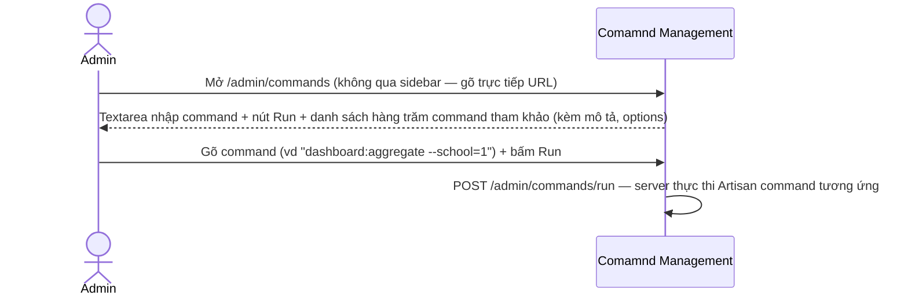
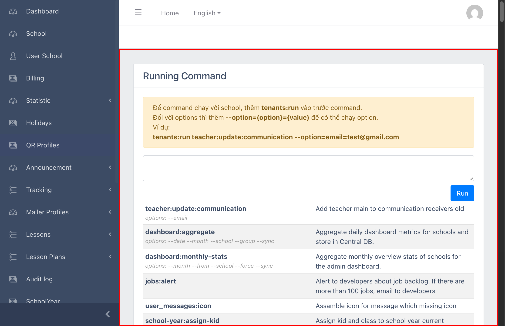

# M21 – Others: Command Runner (Managing Portal)

> Phạm vi: trang **"Comamnd Management"** (`/admin/commands`, chú ý lỗi chính tả ngay trong `<title>` — "Comamnd" thay vì "Command") — **không có mục sidebar nào dẫn tới trang này**. Được tìm ra bằng cách giải mã route `admin.commands.run` (3.165 lượt gọi, 10,54% — mục lớn nhất trong toàn bộ breakdown) đã ghi nhận nhưng chưa xác định được ở `M13-audit-log/SM1-audit-log.md`. **Đây là phát hiện có mức độ rủi ro bảo mật cao nhất trong toàn bộ dự án**: 1 công cụ chạy trực tiếp Artisan command (backend command-line) của hệ thống qua giao diện web, không có lớp xác thực bổ sung nào (khác với `M18-campus-user-management`, nơi có yêu cầu xác nhận lại mật khẩu).

## Mục lục

- [1. Tổng quan](#1-tổng-quan)
  - [1.1 Giới thiệu](#11-giới-thiệu)
  - [1.2 Actors](#12-actors)
  - [1.3 Phạm vi](#13-phạm-vi)
- [2. Business Flow](#2-business-flow)
  - [2.1 Sequence Diagram](#21-sequence-diagram)
  - [2.2 Business Steps](#22-business-steps)
  - [2.3 Business Rules](#23-business-rules)
- [3. Feature Breakdown](#3-feature-breakdown)
  - [3.1 Acceptance Criteria](#31-acceptance-criteria)
  - [3.2 Danh sách Use Case](#32-danh-sách-use-case)
  - [3.3 Edge Cases](#33-edge-cases)
  - [3.4 UI Conventions](#34-ui-conventions)
- [4. Các mục chưa xác định / ngoài phạm vi](#4-các-mục-chưa-xác-định--ngoài-phạm-vi)

---

## 1. Tổng quan

### 1.1 Giới thiệu

"Comamnd Management" là 1 trang cho phép admin gõ trực tiếp tên **Artisan command** (dòng lệnh backend Laravel) vào 1 ô textarea và bấm "Run" để thực thi ngay trên server — về bản chất là 1 giao diện web cho console/command-line của hệ thống. Trang liệt kê **hàng trăm command** có sẵn (đã đếm được hơn 200 dòng trong danh sách tham khảo), mỗi command kèm mô tả ngắn và các option khả dụng (`--option`).

**Vì sao đây là phát hiện quan trọng nhất của dự án:**
- **Không có mục sidebar nào dẫn tới trang này** — chỉ tìm ra được bằng cách chủ động suy luận từ 1 route tên lạ (`admin.commands.run`) xuất hiện với số lượt cao bất thường trong Audit Log (M13), rồi đoán URL `/admin/commands` và xác nhận thành công.
- **Không có lớp xác thực bổ sung** — truy cập được ngay bằng phiên đăng nhập admin thông thường đã dùng suốt dự án, không cần xác nhận lại mật khẩu như `/admin/auth/user` (M18).
- **Phạm vi command cực rộng và có tính phá hoại cao** — trong số các command liệt kê có nhiều lệnh xoá/dọn dữ liệu vĩnh viễn (`transparent-data:clear`, `school-year:clear`, `diary:clean`, `users:hidden_password:clear`, `users:hidden_token:clear`, `remove:records --days --type` — xoá bản ghi khỏi 1 bảng bất kỳ theo tên bảng!), lệnh tạo tài khoản admin mới (`admin:read-only`), và lệnh nhận trực tiếp mật khẩu dạng plaintext làm tham số dòng lệnh (`send:email:password --password`, `authentications:data --password`).
- **Cú pháp cho phép chạy trên 1 trường (tenant) cụ thể** — hướng dẫn ngay trên trang: thêm tiền tố `tenants:run` trước command để chạy command đó trong context của 1 school/tenant cụ thể (ví dụ `tenants:run teacher:update:communication --option=email=test@gmail.com`).

**Không thực hiện bất kỳ command nào** trong quá trình khảo sát — toàn bộ phát hiện trong tài liệu này dựa trên đọc trực tiếp nội dung trang (danh sách command + mô tả) và cấu trúc form (`<textarea name="command">` submit `POST /admin/commands/run`), không phải suy đoán.

### 1.2 Actors

| Actor | Mô tả |
|---|---|
| Finviet/SOHA Dev/Super Admin | Chạy các tác vụ vận hành/bảo trì hệ thống (đồng bộ dữ liệu, dọn dẹp, tạo tài khoản...) trực tiếp qua giao diện web thay vì SSH vào server. |

### 1.3 Phạm vi

| Trong phạm vi | Ngoài phạm vi |
|---|---|
| Xác nhận trang tồn tại, không có sidebar, không có lớp xác thực bổ sung | Chạy bất kỳ command nào (tuyệt đối không thực hiện — rủi ro phá hoại dữ liệu thật quá cao) |
| Đọc danh sách command + mô tả để đánh giá phạm vi rủi ro | Xác minh command nào thực sự bị lạm dụng nhiều nhất trong 3.165 lượt gọi ghi nhận ở Audit Log (không có breakdown chi tiết theo nội dung command) |
| Xác nhận cấu trúc form (textarea + Run) qua DOM | Xác định route `admin.config.compare.post` (mục 4) — không tìm ra URL qua các suy đoán hợp lý |

---

## 2. Business Flow

### 2.1 Sequence Diagram

### 2.2 Business Steps

1. Admin/Dev mở trực tiếp `/admin/commands` (không có lối dẫn từ sidebar).
2. Admin đọc danh sách command tham khảo để tìm command cần chạy và các option hỗ trợ.
3. Admin gõ command vào textarea (có thể thêm tiền tố `tenants:run` để chạy trong 1 school cụ thể, hoặc `--option={key}={value}` để truyền tham số).
4. Admin bấm "Run" — server thực thi ngay lập tức, không có bước xác nhận trung gian nào quan sát được.

### 2.3 Business Rules

| ID | Mô tả |
|---|---|
| BR01 | Route POST đích là `/admin/commands/run` — khớp chính xác với `admin.commands.run` (3.165 lượt, 10,54% tổng request) đã ghi nhận ở `M13-audit-log/SM1-audit-log.md` — xác nhận đây là route có lượt gọi cao nhất trong toàn bộ hệ thống tính theo route name. |
| BR02 | **[Không có mục sidebar]** Không tìm thấy link nào tới `/admin/commands` ở sidebar hay bất kỳ trang nào đã khảo sát trong M1-M20 — chỉ truy cập được qua URL trực tiếp. |
| BR03 | **[Không có lớp xác thực bổ sung]** Truy cập thành công ngay bằng phiên đăng nhập admin thông thường — không có bước "Please confirm your password" như đã thấy ở `M18-campus-user-management/SM1-campus-user-management.md` BR01, dù mức độ rủi ro của trang này rõ ràng cao hơn nhiều. |
| BR04 | Form chỉ có 1 trường: `<textarea name="command">` — nhận bất kỳ chuỗi văn bản nào, submit `POST` không qua bước xác nhận (confirm dialog) nào trước khi thực thi. |
| BR05 | Cú pháp hỗ trợ: (a) command trần (chạy trên central DB), (b) tiền tố `tenants:run {command}` để chạy trong context 1 school/tenant cụ thể, (c) hậu tố `--option={key}={value}` để truyền tham số vào command. |
| BR06 | Danh sách command tham khảo (hơn 200 dòng) bao phủ hầu hết mọi khía cạnh nghiệp vụ đã khảo sát trong dự án: Lessons (`lessonset:clone`, `lessons:clone`), Transparent Classroom (`transparent:activity:re-introduced`, `transparentclassrooms:data:sync` — liên kết trực tiếp tới `M15-transparent-classroom`), Invoice/Billing (`invoice:regenerate:pdf`, `kid-billing:generate`), User (`admin:read-only`, `send:active:email`), và nhiều lệnh dọn dữ liệu (`*:clear`, `*:prune`, `*:remove`). |
| BR07 | **[Rủi ro cao nhất]** Một số command nhận trực tiếp mật khẩu dạng plaintext làm option dòng lệnh (`send:email:password --password`, `authentications:data --password`) — nếu các lượt gọi này bị ghi vào log hệ thống (ví dụ log truy cập server, hoặc chính route "admin.commands.run" trong Audit Log) thì mật khẩu có thể bị lưu lại dạng plaintext ở nơi không ngờ tới. `[Cần xác nhận]` liệu nội dung command có được Audit Log (M13) ghi lại đầy đủ tham số hay không — nếu có, đây tương đương 1 lỗ hổng lộ mật khẩu tương tự M7/M10 nhưng nghiêm trọng hơn vì mật khẩu ở đây do admin tự nhập, có thể là mật khẩu thật của người dùng cuối. |

---

## 3. Feature Breakdown

### 3.1 Acceptance Criteria

- Chỉ Super Admin/Dev đáng tin cậy mới nên truy cập được trang này — **không đạt về kiểm soát truy cập**: không có lớp xác thực bổ sung nào (BR03), chỉ "ẩn" bằng cách không có link, có thể bị truy cập bởi bất kỳ ai đoán được URL và có phiên admin hợp lệ.
- Phải có cơ chế ngăn chạy nhầm command phá hoại — **không đạt**: không có bước xác nhận, không có whitelist rõ ràng ngăn các command `*:clear`/`*:remove`/`*:prune` chạy nhầm phạm vi (toàn hệ thống thay vì 1 tenant).

### 3.2 Danh sách Use Case

| Mã | Tên | Actor | Mô tả | Happy Path | Exception | Business Rules |
|---|---|---|---|---|---|---|
| UC-01 | Xem trang Command Runner và danh sách command khả dụng | Dev/Super Admin | Xem cấu trúc trang, danh sách command tham khảo, hướng dẫn cú pháp. | 1. Truy cập trực tiếp `/admin/commands`. 2. Trang hiển thị hướng dẫn cú pháp, textarea + nút Run, và danh sách command tham khảo.   | Không gõ/chạy bất kỳ command nào — tuyệt đối không thực hiện để tránh rủi ro phá hoại dữ liệu thật. | BR01, BR02, BR04, BR05, BR06 |

### 3.3 Edge Cases

| # | Tình huống | Quan sát / Rủi ro |
|---|---|---|
| 1 | Không có xác thực bổ sung cho 1 tính năng có sức phá hoại cực lớn (BR03) | Đây là rủi ro bảo mật nghiêm trọng nhất phát hiện được trong toàn dự án — nên đề xuất ưu tiên cao nhất: (a) thêm lớp xác nhận mật khẩu tương tự M18, (b) giới hạn theo whitelist command được phép chạy qua UI, (c) thêm log chi tiết + cảnh báo real-time khi có command thuộc nhóm `*:clear`/`*:remove`/`*:prune`/`*:truncate` được gọi. |
| 2 | Command nhận mật khẩu plaintext làm tham số dòng lệnh (BR07) | Cần xác nhận với đội dev liệu các lượt gọi này có bị ghi log (bao gồm tham số) ở nơi nào đó admin khác có thể xem được hay không. |
| 3 | Cú pháp `tenants:run` cho phép chỉ định chạy trên 1 tenant, nhưng không rõ có validate tên tenant hợp lệ hay không trước khi thực thi | Nếu gõ sai/nhập tenant không tồn tại, không rõ hành vi (lỗi rõ ràng hay chạy nhầm phạm vi khác) — `[Cần xác nhận]`, không thử nghiệm vì có thể gây side-effect thật. |

### 3.4 UI Conventions

- Trang dùng lại layout CoreUI/Blade tiêu chuẩn của Managing Portal (sidebar, breadcrumb) — không có dấu hiệu nào trên UI cảnh báo đây là 1 khu vực rủi ro cao, ngoài việc thiếu hẳn link điều hướng tới nó.
- Hướng dẫn cú pháp viết bằng tiếng Việt, đặt ngay trên textarea — là hướng dẫn sử dụng duy nhất, không có cảnh báo rủi ro nào kèm theo.

---

## 4. Các mục chưa xác định / ngoài phạm vi

Trong quá trình rà soát toàn diện sau khi hoàn tất M1-M20, các mục sau được ghi nhận nhưng chưa (hoặc không thể) xác minh đầy đủ:

| Mục | Ghi nhận | Trạng thái |
|---|---|---|
| Route `admin.config.compare.post` (11 lượt, 0,04% — thấy trong breakdown ở `M13-audit-log/SM1-audit-log.md`) | Không có mục sidebar; thử truy cập `/admin/config`, `/admin/config/compare` đều trả về `{"errors":"Invalid Request!"}` (không đúng URL, hoặc route chỉ nhận POST không có trang GET tương ứng) | `[Chưa xác định được]` — không tiếp tục đoán URL để tránh tốn công vô ích; mức độ ưu tiên thấp do lượt dùng rất ít. |
| Routes tiền tố `sales.*` **không có `admin.`** (vd `sales.school.login`, `sales.invoices.revert-status`, `sales.users.set-admin-user`) | Khác với `admin.sales.*` (đã khảo sát ở `M20-sales`), nhóm route này gợi ý có 1 **portal riêng cho Sales** (nơi chính nhân viên Sales đăng nhập và làm việc), tách biệt hoàn toàn khỏi Managing Portal | Xác nhận tồn tại nhưng **ngoài phạm vi** dự án (chỉ khảo sát Managing Portal dành cho Finviet/SOHA Admin). |
| Route tiền tố `frontend.auth.*` | Xác nhận có 1 ứng dụng "frontend" riêng (nhiều khả năng dành cho phụ huynh/giáo viên/học sinh) với hệ thống đăng nhập độc lập | Xác nhận tồn tại nhưng **ngoài phạm vi** dự án. |
| Sidebar và header (avatar/language dropdown) | Đã rà soát lại toàn bộ 44 link trong sidebar — khớp đầy đủ với M1-M20, không thiếu mục nào. Dropdown avatar chỉ có "Logout", không có trang Account/Settings ẩn nào. | Đã xác nhận đầy đủ — không có module ẩn nào khác ngoài Command Runner ở trên. |
