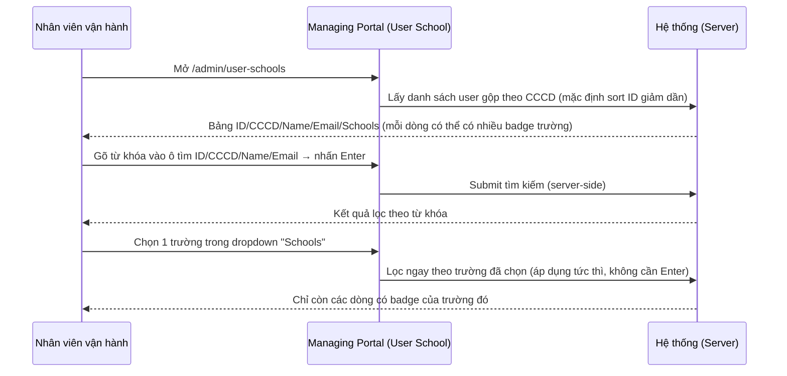
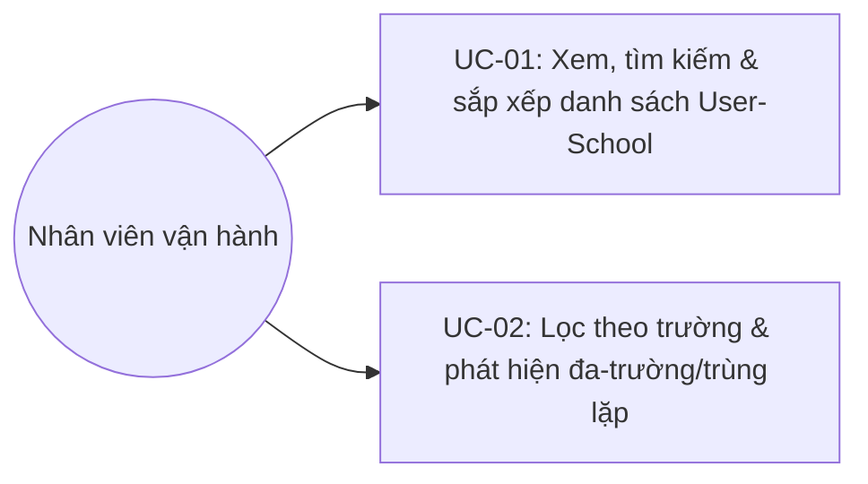
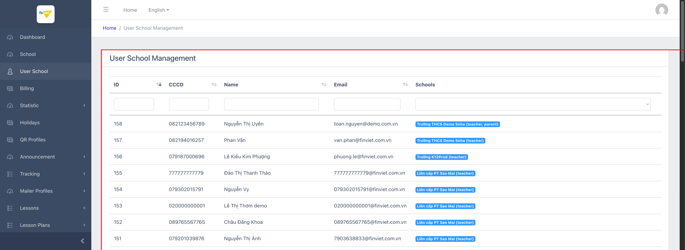
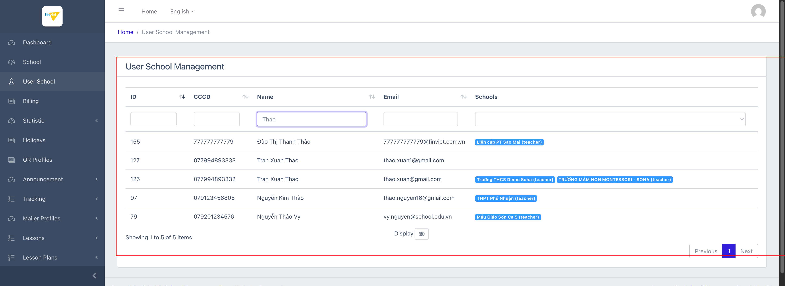
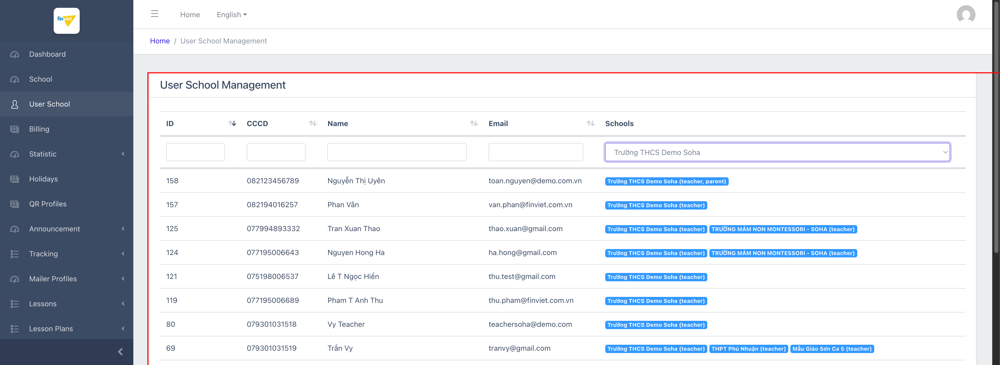

# Tên: User School

## Mục lục
- [1. Thông tin tổng quan](#1-thông-tin-tổng-quan)
  - [1.1 Giới thiệu chung](#11-giới-thiệu-chung)
  - [1.2 Mục tiêu](#12-mục-tiêu)
  - [1.3 Phạm vi](#13-phạm-vi)
  - [1.4 Tài liệu tham khảo](#14-tài-liệu-tham-khảo)
- [2. Tổng quan nghiệp vụ](#2-tổng-quan-nghiệp-vụ)
  - [2.1 Đối tượng](#21-đối-tượng)
  - [2.2 Luồng nghiệp vụ](#22-luồng-nghiệp-vụ)
  - [2.3 Nguyên tắc nghiệp vụ](#23-nguyên-tắc-nghiệp-vụ)
- [3. Đặc tả tính năng](#3-đặc-tả-tính-năng)
  - [3.1 Phân rã chức năng](#31-phân-rã-chức-năng)
  - [3.2 Acceptance Criteria](#32-acceptance-criteria)
  - [3.3 Use case](#33-use-case)
  - [3.4 Edge Cases & Error Handling](#34-edge-cases--error-handling)
  - [3.5 Non-functional Requirements](#35-non-functional-requirements)
  - [3.6 Quy ước UI chung](#36-quy-ước-ui-chung)

## 1. Thông tin tổng quan

### 1.1 Giới thiệu chung
"User School" (`/admin/user-schools`) là một **bảng tra cứu chỉ-đọc (read-only)** duy nhất, hiển thị mối liên kết giữa một người (định danh bởi **CCCD** — số căn cước công dân) và **tất cả trường** mà người đó có tài khoản/vai trò, trên **toàn bộ nền tảng** — khác hẳn với "List users" ở module School (M2), vốn chỉ liệt kê user của **1 trường** cụ thể. Đây là module đơn giản nhất đã khảo sát trong Managing Portal: chỉ có 1 trang danh sách, 5 cột, không có trang Create/Edit/View, không có Actions, không có nút Create.

### 1.2 Mục tiêu
- Cho nhân viên vận hành tra cứu nhanh: "người này (theo CCCD/tên/email) đang có tài khoản ở những trường nào, với vai trò gì?"
- Phát hiện các trường hợp 1 người (giáo viên/phụ huynh) có tài khoản ở **nhiều trường cùng lúc** — hiển thị gộp trong 1 dòng với nhiều badge trường.
- Gián tiếp giúp phát hiện dữ liệu trùng lặp/gần trùng (cùng 1 người nhưng bị đăng ký 2 lần với CCCD/email hơi khác nhau ở 2 trường khác nhau) — điều không thể nhìn thấy được nếu chỉ xem từ bên trong Operating Portal của 1 trường.

### 1.3 Phạm vi
| In scope | Out of scope |
|---|---|
| Xem, tìm kiếm (theo ID/CCCD/Name/Email), lọc theo trường, sắp xếp, phân trang | Tạo/sửa/xóa liên kết user-school (không có chức năng này trên UI — bảng hoàn toàn chỉ đọc) |
| Ghi nhận hiện tượng 1 CCCD gắn với nhiều trường/nhiều vai trò | Truy vết chi tiết từng tài khoản (thuộc phạm vi "List users" của module School — M2) |

### 1.4 Tài liệu tham khảo
- `managing-portal/M2-school/SM1-school.md` (UC-06) — "List users" per-school, khác với bảng cross-tenant này ở chỗ chỉ giới hạn trong 1 trường và có đầy đủ Actions (Edit/Delete/Devices/Messages/Login as/More).

## 2. Tổng quan nghiệp vụ

### 2.1 Đối tượng
| Actor | Vai trò | Trách nhiệm chính |
|---|---|---|
| Nhân viên vận hành nền tảng (Finviet/SOHA) | Người tra cứu | Tìm kiếm/lọc để kiểm tra 1 người có tài khoản ở (những) trường nào |
| Hệ thống | Xử lý nghiệp vụ | Gộp nhóm các bản ghi user theo CCCD và tổng hợp danh sách (trường, vai trò) tương ứng thành 1 dòng |

### 2.2 Luồng nghiệp vụ

#### 2.2.1 Mô hình hóa nghiệp vụ

#### 2.2.2 Mô tả các bước nghiệp vụ
| Bước | Người thực hiện | Mô tả | Kết quả |
|---|---|---|---|
| 1 | Nhân viên vận hành | Mở "User School" từ sidebar | Bảng liệt kê 158 bản ghi (demo), 50 dòng/trang mặc định, sort theo ID giảm dần |
| 2 | Nhân viên vận hành | Gõ từ khóa vào 1 trong 4 ô tìm kiếm (ID/CCCD/Name/Email) → nhấn **Enter** | Danh sách lọc lại theo từ khóa (submit thủ công, không tự động) |
| 3 | Nhân viên vận hành | Chọn 1 trường trong dropdown "Schools" | Danh sách lọc **ngay lập tức** chỉ còn user thuộc trường đó (không cần Enter) |
| 4 | Nhân viên vận hành | Nhấn mũi tên sắp xếp ở tiêu đề cột ID/CCCD/Name/Email | Bảng sắp xếp lại tăng/giảm tương ứng |
| 5 | Nhân viên vận hành | Quan sát cột "Schools" | Nếu 1 dòng có ≥2 badge → người này có tài khoản ở nhiều trường; nếu cột trống → CCCD/email này hiện không gắn với trường nào |

### 2.3 Nguyên tắc nghiệp vụ
| ID | Nguyên tắc nghiệp vụ |
|---|---|
| BR01 | Bảng chỉ có 5 cột (ID, CCCD, Name, Email, Schools) — **không có cột Actions**, không có link/onclick trên bất kỳ dòng nào (đã xác nhận qua DOM: `<tr>` không có `onclick`, không chứa `<a>`), và **không có nút "Create"** — đây là bảng tra cứu thuần chỉ đọc |
| BR02 | Cột "Schools" hiển thị 1 badge riêng cho mỗi cặp (trường, vai trò) mà CCCD/dòng đó có liên kết; 1 dòng có thể có nhiều badge nếu cùng 1 CCCD được đăng ký ở nhiều trường khác nhau (VD: "Trần Vy" — 3 badge: Trường THCS Demo Soha, THPT Phú Nhuận, Mẫu Giáo Sơn Ca 5, đều với vai trò teacher) |
| BR03 | Vai trò (trong ngoặc đơn của mỗi badge) là **theo từng trường**, không phải vai trò toàn cục — cùng 1 người có thể là "teacher" ở trường này nhưng "Parent" ở trường khác (VD: "Nguyễn Văn Cừ" — teacher tại Trường THCS Demo Soha, Parent tại TRƯỜNG MẦM NON MONTESSORI - SOHA) |
| BR04 | 4 ô tìm kiếm theo cột (ID/CCCD/Name/Email) chỉ áp dụng bộ lọc **sau khi nhấn Enter** (submit thủ công); ngược lại, dropdown lọc theo "Schools" áp dụng **ngay lập tức** khi chọn — hành vi không nhất quán giữa 2 kiểu filter trên cùng 1 toolbar |
| BR05 | Một số dòng có cột "Schools" **hoàn toàn trống** (VD: ID 127 "Tran Xuan Thao", ID 118 "Nguyễn Lan Hương", ID 117 "an Võ333") — nghĩa là CCCD/email này tồn tại trong CSDL người dùng của nền tảng nhưng **hiện không gắn với bất kỳ trường nào** [Cần xác nhận nguyên nhân — có thể do tài khoản đã bị gỡ khỏi mọi trường, hoặc dữ liệu chưa đồng bộ đầy đủ] |
| BR06 | Bảng này giúp phát hiện các cặp bản ghi **trùng lặp gần giống nhau** mà chỉ nhìn từ 1 trường sẽ không thấy được — VD quan sát được trong dữ liệu demo: ID 124 ("Nguyen Hong Ha", CCCD `...643`, email `ha.hong@gmail.com`, có 2 trường) và ID 126 (cùng tên, CCCD `...644` — lệch đúng 1 số, email `ha.hong1@gmail.com`, chỉ 1 trường); tương tự ID 125 và 127 ("Tran Xuan Thao", CCCD lệch 1 số, email lệch ký tự "1") — rất có thể là **cùng 1 người thật** bị tạo tài khoản 2 lần với CCCD/email nhập sai lệch nhẹ ở 2 trường khác nhau [Cần xác nhận với đội dữ liệu] |
| BR07 | Sắp xếp mặc định là theo ID giảm dần (user mới nhất lên đầu); mọi cột (trừ Schools) đều sắp xếp 2 chiều được, áp dụng tức thì (client-side, không tải lại trang) |
| BR08 | Phân trang và "Display" (5/10/25/50 dòng/trang, mặc định 50) dùng chung convention với danh sách trường ở module School (M2) |

## 3. Đặc tả tính năng

### 3.1 Phân rã chức năng
| Feature | Platform | Priority | User Story |
|---|---|---|---|
| Xem & tìm kiếm danh sách User-School | Web Admin (Managing Portal) | Cao | Là nhân viên vận hành, tôi muốn tra cứu nhanh 1 người đang có tài khoản ở (những) trường nào |
| Lọc theo trường cụ thể | Web Admin | Trung bình | Là nhân viên vận hành, tôi muốn xem toàn bộ user (theo CCCD) thuộc về 1 trường, gộp cả trường hợp họ còn ở trường khác |

### 3.2 Acceptance Criteria
| User Story | Chức năng | Acceptance Criteria |
|---|---|---|
| Tìm kiếm | Nhập từ khóa vào ô ID/CCCD/Name/Email → Enter | Danh sách lọc đúng theo từ khóa (khớp một phần, không phân biệt hoa/thường) |
| Lọc theo trường | Chọn 1 trường trong dropdown | Danh sách lọc ngay, chỉ còn dòng có badge đúng trường đã chọn |
| Sắp xếp | Nhấn mũi tên ở cột ID/CCCD/Name/Email | Bảng sắp xếp lại đúng chiều tăng/giảm |

### 3.3 Use case

---

| Trường | Nội dung |
|---|---|
| Use case ID | UC-01 |
| Use case name | Xem, tìm kiếm & sắp xếp danh sách User-School |
| Use case description | Nhân viên vận hành xem toàn bộ danh sách người dùng gộp theo CCCD trên toàn nền tảng, tìm kiếm theo ID/CCCD/Tên/Email |
| Actor | Nhân viên vận hành nền tảng |
| Happy path | 1. Mở "User School" từ sidebar → bảng liệt kê ID, CCCD, Name, Email, Schools (mỗi Schools là 1 hoặc nhiều badge "Tên trường (vai_trò)"):   2. Gõ từ khóa (VD: "Thao") vào ô tìm kiếm dưới cột "Name" → nhấn Enter → danh sách lọc lại, lộ ra 1 dòng có Schools trống và 1 dòng trùng tên gần giống với CCCD lệch 1 số:   3. Nhấn mũi tên sắp xếp ở cột bất kỳ để đổi thứ tự. |
| Exception | Từ khóa không khớp bản ghi nào → bảng trống (không quan sát được message cụ thể) |
| Trigger | Cần tra cứu nhanh 1 người theo CCCD/tên/email trước khi hỗ trợ hoặc đối chiếu dữ liệu |
| Pre-condition | Đã đăng nhập Managing Portal |
| Post-condition | Không thay đổi dữ liệu — bảng hoàn toàn chỉ đọc |
| Business Rules | BR01, BR04, BR05, BR06, BR07, BR08 |

---

| Trường | Nội dung |
|---|---|
| Use case ID | UC-02 |
| Use case name | Lọc theo trường & phát hiện đa-trường/trùng lặp |
| Use case description | Nhân viên vận hành lọc theo 1 trường cụ thể để xem toàn bộ user của trường đó, kể cả khi họ còn có tài khoản ở trường khác |
| Actor | Nhân viên vận hành nền tảng |
| Happy path | 1. Chọn 1 trường (VD: "Trường THCS Demo Soha") trong dropdown "Schools" → danh sách lọc ngay, hiển thị badge của TẤT CẢ trường mà mỗi user đó có (không chỉ trường vừa chọn):   2. Quan sát các dòng có ≥2 badge để xác định user nào đang hoạt động ở nhiều trường, và vai trò có thể khác nhau giữa các trường (teacher ở trường này, Parent ở trường khác). |
| Exception | Trường được chọn không có user nào → bảng trống |
| Trigger | Cần xem toàn bộ nhân sự/phụ huynh của 1 trường cụ thể theo góc nhìn cross-tenant, hoặc điều tra nghi vấn trùng tài khoản |
| Pre-condition | Đã đăng nhập |
| Post-condition | Không thay đổi dữ liệu |
| Business Rules | BR02, BR03, BR06 |

### 3.4 Edge Cases & Error Handling

#### 3.4.1 Tổng quan
| Nhóm | Tình huống | Xử lý mong đợi |
|---|---|---|
| Cột Schools trống | CCCD/email tồn tại trong bảng nhưng không có badge trường nào | [Cần xác nhận] nguyên nhân — tài khoản đã rời khỏi mọi trường hay lỗi đồng bộ dữ liệu |
| Trùng lặp gần giống | 2 dòng cùng tên, CCCD lệch 1 chữ số, email lệch 1 ký tự, mỗi dòng gắn với trường khác nhau | [Cần xác nhận] khả năng đây là cùng 1 người bị đăng ký nhầm 2 lần — nên có cơ chế đối soát/gộp nếu đúng |
| Ô tìm kiếm text | Không có nút "Search" hay "Reset" riêng — phải biết nhấn Enter để lọc | Có thể gây nhầm lẫn với người dùng lần đầu (khác hành vi với dropdown lọc theo trường) [Cần xác nhận UX] |

#### 3.4.2 Danh sách lỗi/thành công
| Message ID | Trường hợp lỗi | Rule kiểm tra | Message đề xuất | Hình thức báo | Hành vi hệ thống |
|---|---|---|---|---|---|
| — | Bảng chỉ đọc, không có thao tác ghi dữ liệu nên không có message lỗi/thành công nào để quan sát | | | | — |

### 3.5 Non-functional Requirements
| ID | Nhóm | Yêu cầu |
|---|---|---|
| NFR01 | Hiệu năng | Sắp xếp cột áp dụng tức thì (client-side); lọc theo trường cũng áp dụng ngay; chỉ tìm kiếm theo text cần submit (Enter) |
| NFR02 | Kiến trúc | Trang duy nhất, không có route con (create/edit/view) — đơn giản nhất trong các module đã khảo sát của Managing Portal |

### 3.6 Quy ước UI chung
- Giao diện dùng chung theme CoreUI với module School (M2): bảng có ô tìm kiếm riêng dưới mỗi tiêu đề cột, dropdown lọc riêng cho cột không phải text (Schools).
- Badge trường dùng màu xanh dương (`badge-info`) đồng nhất, không phân biệt màu theo vai trò hay trạng thái.
- Không có bất kỳ affordance trực quan nào (cursor, icon) cho biết bảng là read-only — người dùng chỉ nhận ra khi thử tìm nút Action mà không thấy.
