# M4 – Billing (Managing Portal)

> Phạm vi: module **Billing** trên Managing Portal (`api-dev.ecoschool.com.vn/admin/billings/...`), phục vụ đội Finviet/SOHA theo dõi & quản lý công nợ/billing của từng trường (tenant). Đây là module **kế toán nội bộ**, hoàn toàn tách biệt khỏi bất kỳ màn hình nào trong Operating Portal — phụ huynh/giáo viên/hiệu trưởng không nhìn thấy dữ liệu này ở đâu cả.

## Mục lục

- [1. Tổng quan](#1-tổng-quan)
  - [1.1 Giới thiệu](#11-giới-thiệu)
  - [1.2 Actors](#12-actors)
  - [1.3 Phạm vi](#13-phạm-vi)
- [2. Business Flow](#2-business-flow)
  - [2.1 Sequence Diagram](#21-sequence-diagram)
  - [2.2 Business Steps](#22-business-steps)
  - [2.3 Business Rules](#23-business-rules)
- [3. Feature Breakdown](#3-feature-breakdown)
  - [3.1 Use Case Diagram](#31-use-case-diagram)
  - [3.2 Acceptance Criteria](#32-acceptance-criteria)
  - [3.3 Danh sách Use Case](#33-danh-sách-use-case)
  - [3.4 Edge Cases](#34-edge-cases)
  - [3.5 Non-Functional Requirements](#35-non-functional-requirements)
  - [3.6 UI Conventions](#36-ui-conventions)

---

## 1. Tổng quan

### 1.1 Giới thiệu

Module **Billing** là sổ cái công nợ cấp-trường: với mỗi trường (tenant) đã có bản ghi billing, hệ thống lưu **Total Credits** (tổng số tiền đã nạp/ghi có), **Total Billings** (tổng số tiền đã phát sinh theo từng tháng, tính theo số trẻ active × đơn giá/trẻ) và **Remain** (= Total Credits − Total Billings). Từ danh sách tổng, admin có thể đi sâu vào **Billing Detail** của một trường để xem lịch sử billing theo từng tháng, thêm credit, tải/generate billing, và xem log lịch sử thay đổi đơn giá/trẻ.

**Phát hiện đáng chú ý:** trên dataset dev hiện tại, trong số 27 trường có bản ghi billing, **chỉ duy nhất 1 trường** (`TRƯỜNG MẦM NON MONTESSORI - SOHA`, ID nội bộ = 1 — trường demo gốc/lâu đời nhất hệ thống) có dữ liệu billing thực tế (51 tháng, từ 05/2022 đến 06/2026). 26 trường còn lại — đều là các trường test/demo được tạo sau này — có Total Credits, Total Billings, Remain và Price per kid = 0, tức **chưa bao giờ chạy qua billing engine**. Điều này cho thấy tính năng billing hàng tháng chỉ thực sự "sống" trên 1 tenant duy nhất trong môi trường dev.

### 1.2 Actors

| Actor | Mô tả |
|---|---|
| Finviet/SOHA Admin (Kế toán/Vận hành) | Người dùng chính của module — tra cứu công nợ, đối soát billing hàng tháng, thêm credit cho trường sau khi trường thanh toán. |

### 1.3 Phạm vi

| Trong phạm vi | Ngoài phạm vi |
|---|---|
| Danh sách Billing tổng (tìm kiếm, sắp xếp) | Cơ chế tính "Trẻ hoạt động / Tổng số trẻ" (thuộc modules School/Statistic) |
| "Out of credit's schools" (danh sách trường sắp/đã hết credit) | Luồng thanh toán thực tế của trường (SInvoice/VNPAY — xem `managing-portal/M2-school/SM1-school.md` BR21, BR22) |
| Billing Detail: xem lịch sử billing theo tháng, Add Credit, Generate Billings, Download | Thực thi thật các hành động ghi/xoá (không submit Save/Delete/Generate/Download trong quá trình khảo sát) |
| List Credit (lịch sử các lần nạp credit) | |
| Price per kid logs (lịch sử thay đổi đơn giá/trẻ) | |
| Edit 1 bản ghi billing tháng (xem cấu trúc form, không lưu) | |

---

## 2. Business Flow

### 2.1 Sequence Diagram

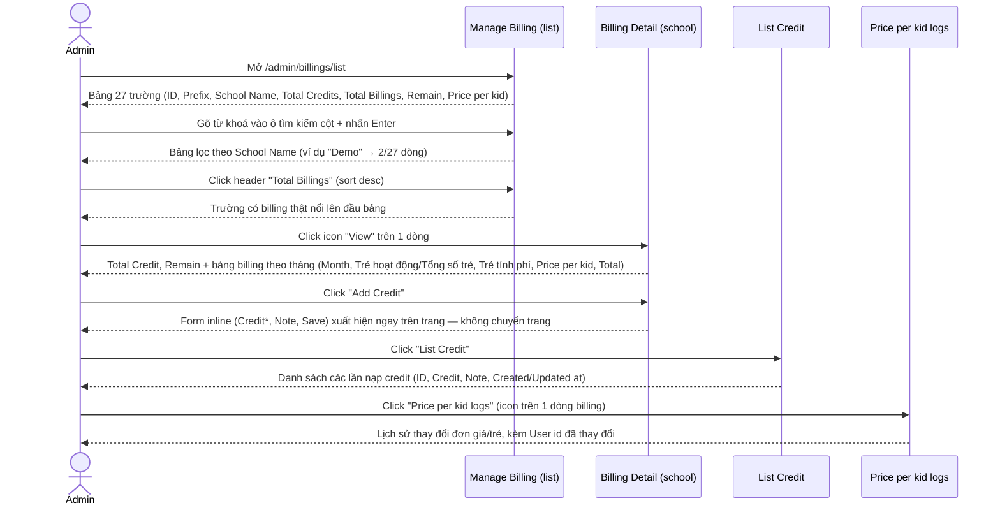

### 2.2 Business Steps

1. Admin mở danh sách Billing tổng, tìm nhanh 1 trường bằng ô tìm kiếm hoặc sắp xếp theo cột số liệu.
2. Admin xem chi tiết billing của 1 trường: tổng credit đã nạp, số dư còn lại (Remain), và lịch sử billing từng tháng.
3. Khi trường đã thanh toán (ngoài hệ thống), admin "Add Credit" để ghi nhận số tiền đã nạp — ghi có vào Total Credit.
4. Cuối tháng, admin có thể "Generate Billings" để hệ thống tự tính billing tháng hiện tại dựa trên số trẻ active thực tế.
5. Admin có thể "Download" (export) lịch sử billing của trường ra file.
6. Nếu cần sửa 1 bản ghi billing tháng cụ thể (ví dụ điều chỉnh số trẻ tính phí), admin dùng action "Edit" trên dòng đó.
7. Mọi thay đổi đơn giá/trẻ (Price per kid) trong lịch sử đều được ghi lại và có thể tra cứu qua "Price per kid logs".

### 2.3 Business Rules

| ID | Mô tả |
|---|---|
| BR01 | Danh sách Billing tổng có các cột: ID, Prefix code, School Name, Total Credits, Total Billings, Remain, Price per kid, Actions (View / Manage credits / Price per kid logs). |
| BR02 | **Remain = Total Credits − Total Billings.** Remain có thể âm nếu billing phát sinh nhiều hơn credit đã nạp (trường hợp thực tế quan sát được: Remain = -4.743.688.000 dù Total Credit = 0 — nghĩa là trường đã phát sinh billing nhưng chưa từng được ghi nhận credit nào trong hệ thống này). |
| BR03 | 3 ô tìm kiếm theo cột (ID, Prefix code, School Name) yêu cầu nhấn **Enter** để submit — không lọc realtime khi gõ (đúng theo pattern đã ghi nhận ở M2/M3). Xác nhận qua `.dataTables_info`: "27 items" → "2 items" chỉ sau khi nhấn Enter. |
| BR04 | Các cột ID, Total Credits, Total Billings, Remain có thể sắp xếp 2 chiều (click lần 1 = tăng dần, lần 2 = giảm dần) qua click trực tiếp vào tiêu đề cột. |
| BR05 | Trên dataset dev: 26/27 trường có toàn bộ chỉ số = 0 (chưa từng chạy billing); chỉ 1 trường (ID=1) có dữ liệu billing thật — sort giảm dần theo "Total Billings" xác nhận ngay trường này nổi lên đầu bảng. `[Cần xác nhận]` liệu đây là do các trường kia mới tạo/test hay do một cấu hình riêng (ví dụ gói dịch vụ miễn phí) khiến billing engine không chạy. |
| BR06 | "Out of credit's schools" (`/admin/billings/credits/almost`) là 1 trang riêng, cùng UI pattern (ID/Prefix code/School Name + cột riêng Remain, Last bill), dùng để liệt kê các trường sắp/đã hết credit. Trên dev hiện tại: "No items to show". |
| BR07 | Trang Billing Detail của 1 trường hiển thị 2 chỉ số tổng (Total Credit, Remain) + bảng lịch sử billing theo tháng: ID, Month, "Trẻ hoạt động / Tổng số trẻ" (dạng phân số, ví dụ 317/403), "Trẻ tính phí" (số trẻ được tính phí — có thể khác số trẻ active), Price per kid, Total, Created at, Updated at, Action. |
| BR08 | **Total (mỗi dòng) = Price per kid × Trẻ tính phí** — xác minh với dòng 06/2026: 900.000 × 317 = 285.300.000 ✓. "Trẻ tính phí" không luôn bằng "Trẻ hoạt động" (ví dụ dòng 07/2023: Trẻ hoạt động/Tổng = 233/267 nhưng Trẻ tính phí = 300, tức được set thủ công/khác biệt so với số hoạt động thực tế). |
| BR09 | "Generate Billings" (nút xanh dương) submit **POST** tới `/admin/school/{id}/billings/generate` — hành động tạo/ghi bản ghi billing tháng hiện tại từ dữ liệu trẻ thực tế. Đây là hành động **ghi dữ liệu**, không được thực thi trong quá trình khảo sát này. |
| BR10 | "Download" submit **POST** tới `/admin/school/{id}/billings/export` — export lịch sử billing ra file. Không được thực thi (tải file) trong quá trình khảo sát này. |
| BR11 | "Add Credit" **không điều hướng trang** — bấm vào sẽ mở 1 form inline ngay trên cùng trang Billing Detail (Credit*, Note, nút Save) để ghi nhận 1 khoản credit mới. |
| BR12 | "List Credit" điều hướng sang trang riêng `/admin/billings/{id}/credits`, liệt kê từng khoản credit đã nạp (ID, Credit, Note, Created at, Updated at, Action). Trên trường có billing thật (ID=1) danh sách này **rỗng** ("No items to show") dù Remain âm hơn 4.7 tỷ — nghĩa là toàn bộ lịch sử billing của trường này được sinh ra (có lẽ qua "Generate Billings" tự động/cron) nhưng **chưa từng có một khoản credit nào được ghi nhận thủ công qua Managing Portal** — số dư âm tồn tại từ rất lâu (ít nhất từ 2022) mà không có động thái nạp tiền nào được ghi lại trong hệ thống này. `[Cần xác nhận]` việc thanh toán có thể được quản lý qua module Logs → Payment Transactions thay vì qua "Add Credit". |
| BR13 | Mỗi dòng billing tháng có 3 action: **Delete** (icon thùng rác, submit `POST` với `_method=DELETE` tới `/admin/school/{id}/billings/{billingId}` — không có thuộc tính `onsubmit`/`data-confirm` nào được phát hiện trong DOM, `[Cần xác nhận]` liệu có hộp thoại xác nhận nào khác được gắn qua JS toàn cục hay không, vì hành động này không được thực thi để kiểm chứng), **Edit** (mở form sửa), **Price per kid logs** (xem log, có tham số `back=` để quay lại đúng dòng vừa xem). |
| BR14 | Form Edit 1 bản ghi billing: **Month, Total activated kids, Total kids, Total price là read-only** (nền xám); chỉ **Price per kid** và **Charged kids** là các trường có thể sửa. `[Cần xác nhận]` Total price có được tự tính lại (Price per kid × Charged kids) khi Save hay không — không kiểm chứng vì không submit form. |
| BR15 | "Price per kid logs" ở cấp trường (không phải cấp dòng billing) là nhật ký toàn bộ các lần thay đổi đơn giá/trẻ theo thời gian: ID, **User id** (định danh số, không resolve ra tên/email), Price per kid, Updated at. Đây là một khoảng trống UX nhỏ — muốn biết "User 68" hay "User 82" là ai phải tra cứu chéo sang bảng user khác. |
| BR16 | Toàn bộ các bảng trong module dùng chung convention phân trang với M2/M3: dropdown "Display" (5/10/25/50 dòng/trang), Previous/Next, đánh số trang. |

---

## 3. Feature Breakdown

### 3.1 Use Case Diagram

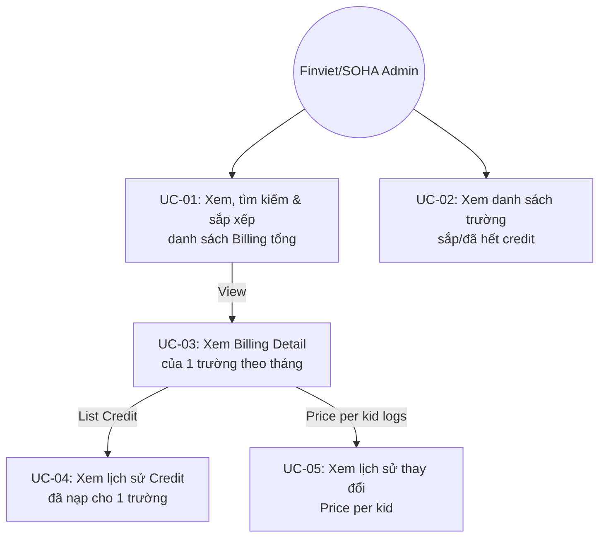

### 3.2 Acceptance Criteria

- Danh sách Billing tổng phải hiển thị đúng số liệu Total Credits/Total Billings/Remain/Price per kid cho từng trường, và Remain phải nhất quán với công thức Credits − Billings.
- Tìm kiếm theo School Name/Prefix code/ID phải trả về đúng tập con dữ liệu sau khi nhấn Enter.
- Sắp xếp theo bất kỳ cột số nào phải phản ánh đúng thứ tự tăng/giảm dần trên toàn bộ 27 dòng (không chỉ trang hiện tại).
- Trang Billing Detail phải liệt kê đầy đủ lịch sử billing theo tháng, và Total mỗi dòng phải khớp Price per kid × Trẻ tính phí.
- Form Add Credit, Edit billing phải xuất hiện đúng vị trí (inline hoặc trang riêng) như đã quan sát, với đúng tập trường bắt buộc (*).

### 3.3 Danh sách Use Case

| Mã | Tên | Actor | Mô tả | Happy Path | Exception | Business Rules |
|---|---|---|---|---|---|---|
| UC-01 | Xem, tìm kiếm & sắp xếp danh sách Billing tổng | Admin | Xem toàn bộ 27 trường có bản ghi billing, tìm nhanh hoặc sắp xếp theo chỉ số. | 1. Admin mở `/admin/billings/list`. 2. Trang hiển thị bảng 27 dòng, mặc định sort theo ID giảm dần.  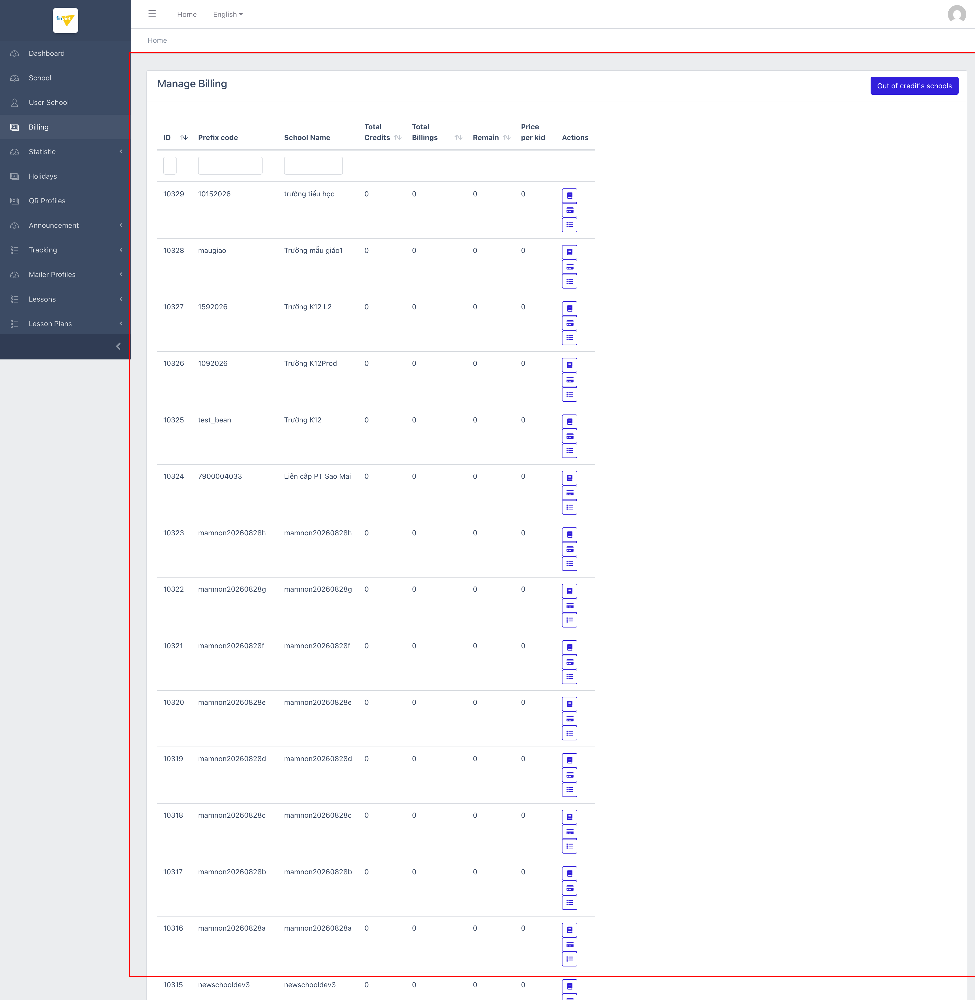  3. Admin gõ "Demo" vào ô tìm kiếm cột School Name, nhấn Enter. 4. Bảng lọc còn 2/27 dòng khớp tên.  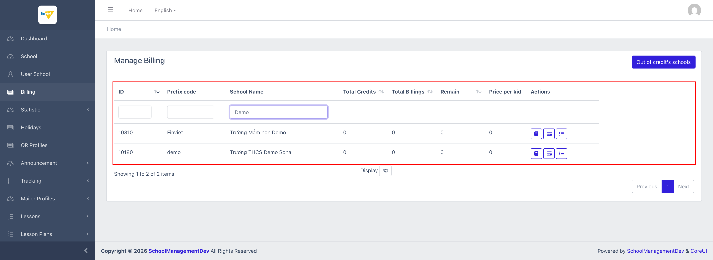  5. Admin xoá bộ lọc, click header "Total Billings" để sort giảm dần. 6. Trường duy nhất có billing thật (ID=1, Total Billings = 4.743.688.000) nổi lên đầu bảng.  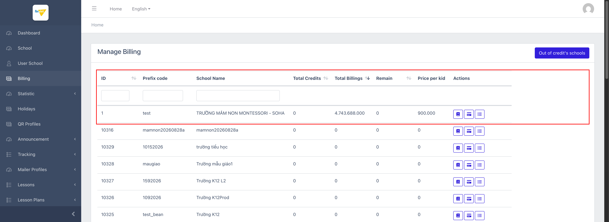 | Gõ từ khoá nhưng không nhấn Enter → bảng không lọc (giữ nguyên "27 items"). | BR01, BR02, BR03, BR04, BR05, BR16 |
| UC-02 | Xem danh sách trường sắp/đã hết credit | Admin | Truy cập nhanh danh sách các trường có nguy cơ hết credit (Remain thấp) để chủ động nhắc nạp tiền. | 1. Từ trang Manage Billing, admin click "Out of credit's schools". 2. Trang `/admin/billings/credits/almost` hiển thị bảng riêng (ID, Prefix code, School Name, Remain, Last bill).  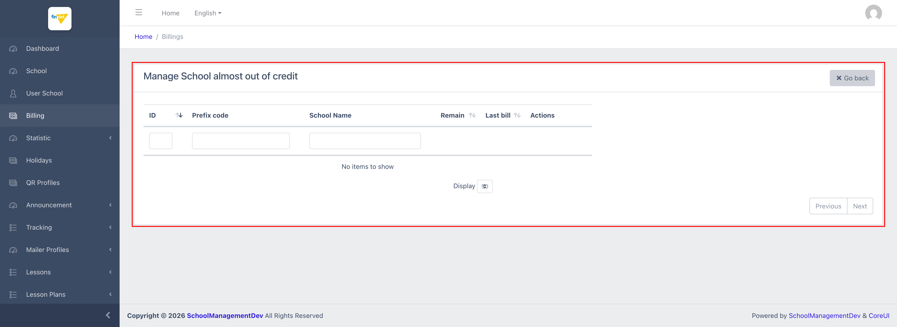 | Trên dữ liệu dev hiện tại: "No items to show" — không trường nào thoả điều kiện ngưỡng (ngưỡng cụ thể `[Cần xác nhận]`, không quan sát được vì danh sách rỗng). | BR06, BR16 |
| UC-03 | Xem Billing Detail của 1 trường theo tháng | Admin | Xem chi tiết công nợ + lịch sử billing hàng tháng của 1 trường, và các hành động quản lý (Generate/Download/Add Credit/Edit/Delete). | 1. Từ danh sách tổng, admin click icon "View" trên 1 dòng. 2. Trang Billing Detail hiển thị Total Credit, Remain, và bảng billing theo tháng (Month, Trẻ hoạt động/Tổng số trẻ, Trẻ tính phí, Price per kid, Total, Created/Updated at, Action).  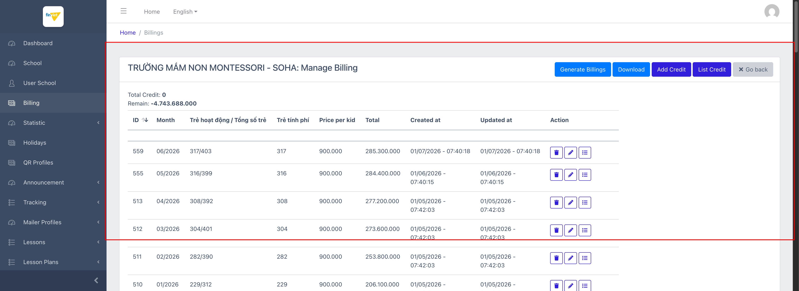  3. Với 1 trường chưa từng phát sinh billing, bảng hiển thị "No items to show", Remain = 0.  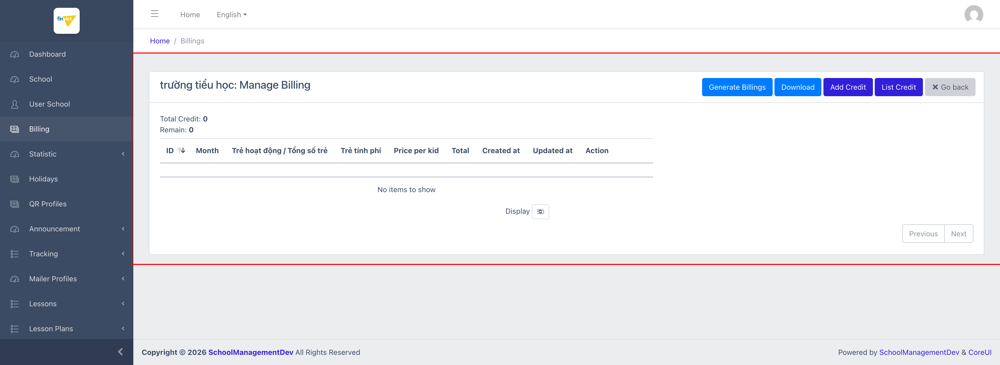  4. Admin click "Add Credit" → form inline (Credit*, Note, Save) xuất hiện ngay trên trang, không chuyển URL.  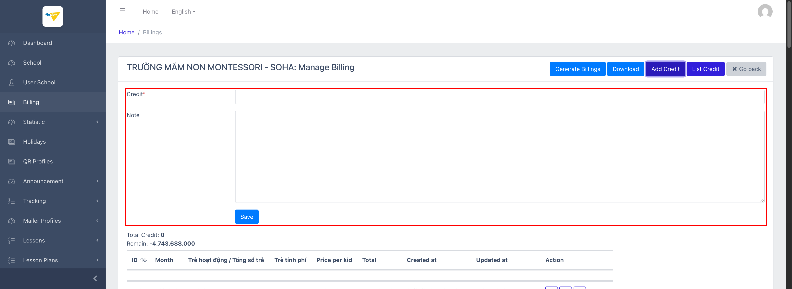  5. Admin click icon "Edit" trên 1 dòng billing tháng để xem form sửa — Month/Total activated kids/Total kids/Total price là read-only, chỉ Price per kid và Charged kids có thể sửa.  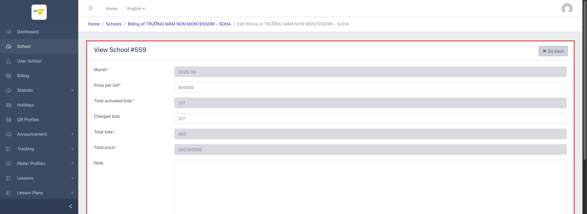 | "Generate Billings" và "Download" đều là hành động POST (tạo dữ liệu / xuất file) — không được bấm thật trong quá trình khảo sát để tránh thay đổi dữ liệu dev. Nút Delete không phát hiện thuộc tính xác nhận (`onsubmit`/`data-confirm`) trong DOM — `[Cần xác nhận]` hành vi thực tế khi bấm. | BR07, BR08, BR09, BR10, BR11, BR13, BR14, BR16 |
| UC-04 | Xem lịch sử Credit đã nạp cho 1 trường | Admin | Tra cứu từng lần nạp credit của 1 trường (số tiền, ghi chú, thời gian). | 1. Từ Billing Detail, admin click "List Credit" (hoặc icon "Manage credits" ở danh sách tổng). 2. Trang `/admin/billings/{id}/credits` hiển thị bảng ID/Credit/Note/Created at/Updated at/Action.  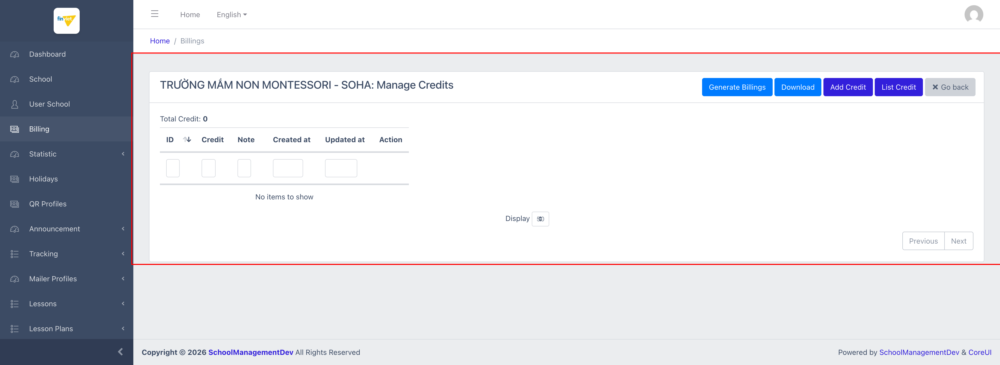 | Trường có billing thật (ID=1) nhưng danh sách credit **rỗng** dù Remain âm hơn 4.7 tỷ — cho thấy khoản nợ này chưa từng được đối soát bằng credit qua đúng module này (xem BR12). | BR11, BR12, BR16 |
| UC-05 | Xem lịch sử thay đổi Price per kid | Admin | Tra cứu nhật ký mọi lần thay đổi đơn giá/trẻ của 1 trường theo thời gian, để đối soát khi có khiếu nại về Total billing. | 1. Từ Billing Detail, admin click icon "Price per kid logs" trên 1 dòng billing. 2. Trang hiển thị bảng ID/User id/Price per kid/Updated at, sắp xếp theo thời gian giảm dần.  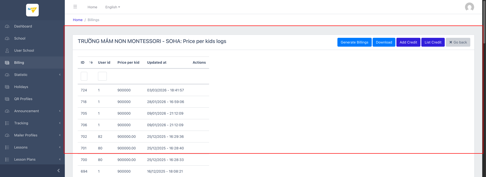 | Cột "User id" chỉ hiển thị ID số thô, không resolve ra tên/email người thực hiện thay đổi. | BR15, BR16 |

### 3.4 Edge Cases

| # | Tình huống | Quan sát / Rủi ro |
|---|---|---|
| 1 | 26/27 trường có toàn bộ chỉ số billing = 0 | Không rõ đây là hành vi mong đợi (trường test/demo cố tình không kích hoạt billing) hay một lỗ hổng cấu hình khiến billing engine bỏ sót các trường mới. `[Cần xác nhận]` |
| 2 | Remain âm sâu (-4.743.688.000) mà Total Credit = 0 và List Credit rỗng | Cho thấy khoản công nợ khổng lồ chưa từng được đối soát qua "Add Credit" trong Managing Portal — có thể được quản lý ở nơi khác (Payment Transactions, hệ thống kế toán ngoài) mà module Billing không phản ánh. `[Cần xác nhận]` |
| 3 | "Trẻ tính phí" đôi khi khác "Trẻ hoạt động" (ví dụ 07/2023: 233 hoạt động nhưng tính phí 300 trẻ) | Cho thấy Charged kids có thể được set thủ công, không tự động đồng bộ 1-1 với số trẻ active — cần hiểu rõ business logic đằng sau để tránh nhầm lẫn khi đối soát doanh thu. `[Cần xác nhận]` |
| 4 | Nút Delete (billing tháng) không có `onsubmit`/`data-confirm` trong DOM | Nếu không có xác nhận nào khác (ví dụ gắn qua JS event listener toàn cục không thấy trong snapshot), thao tác nhầm 1 click có thể xoá vĩnh viễn 1 tháng billing mà không có bước cảnh báo. `[Cần xác nhận]`, không kiểm chứng bằng cách bấm thật. |
| 5 | "Out of credit's schools" trả về rỗng trên toàn bộ dataset dev | Không thể quan sát được ngưỡng "gần hết credit" cụ thể là bao nhiêu, hay định dạng cột "Last bill" trông như thế nào khi có dữ liệu. |

### 3.5 Non-Functional Requirements

- Toàn bộ số tiền hiển thị theo định dạng VNĐ có dấu chấm phân cách hàng nghìn (ví dụ `4.743.688.000`), không có ký hiệu tiền tệ đi kèm.
- Bảng Billing Detail có thể dài (51 dòng cho trường lâu năm nhất, trải dài 2022–2026) — phân trang mặc định 50 dòng/trang là cần thiết để tránh tải chậm.
- Các thao tác ghi dữ liệu (Generate Billings, Add Credit, Edit, Delete) đều dùng CSRF token (`_token`) chuẩn Laravel.

### 3.6 UI Conventions

- Cùng bộ nút hành động lặp lại trên mọi trang con của 1 trường (Generate Billings / Download / Add Credit / List Credit / Go back) — giúp admin điều hướng nhất quán giữa Detail, Credits, và Price-per-kid-logs mà không cần quay lại danh sách tổng.
- Trường read-only trong form Edit được tô nền xám nhạt để phân biệt trực quan với trường có thể chỉnh sửa (nền trắng, viền rõ) — cùng convention với các form Settings đã ghi nhận ở M2.
- "Add Credit" ưu tiên hiển thị inline (không chuyển trang) trong khi "List Credit" lại điều hướng sang trang riêng — một sự bất nhất nhỏ về pattern UI giữa 2 hành động có liên quan chặt chẽ với nhau.
