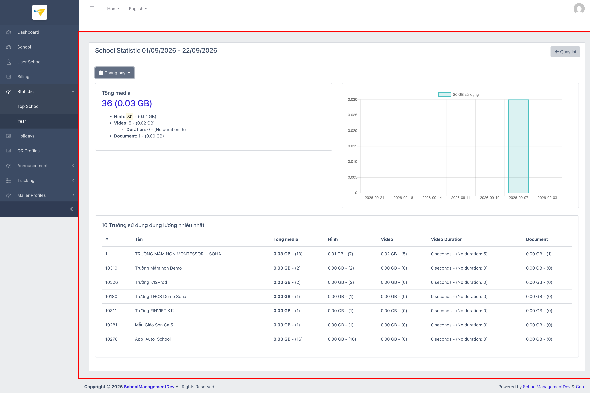
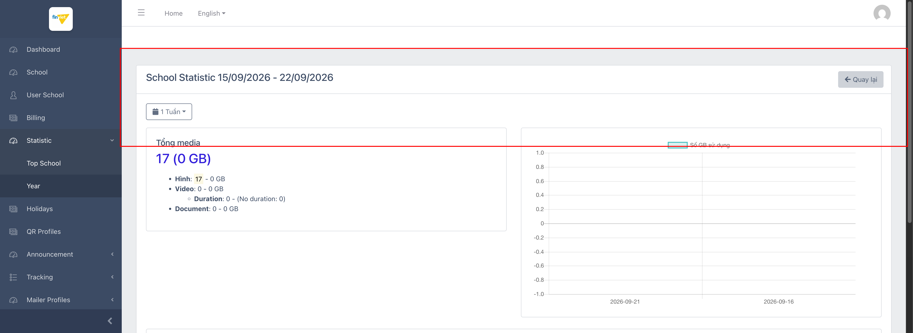
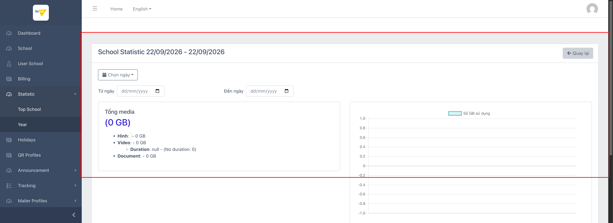
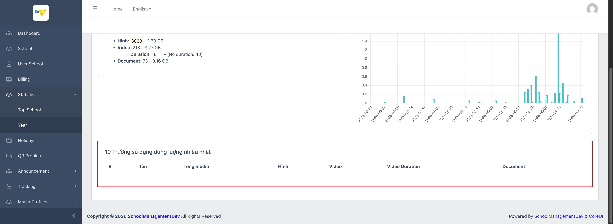

# M5.1 – Statistic: Top School (Managing Portal)

> Phạm vi: sub-module **Top School** (`/admin/statistic/school`), sub-module đầu tiên trong 2 sub-module của module **Statistic**. Đây là trang thống kê **dung lượng media** (hình ảnh/video/tài liệu) trên toàn nền tảng — **không phải** thống kê doanh thu/billing hay số lượng học sinh như tên gọi "Statistic" có thể gợi ý.

## Mục lục

- [1. Tổng quan](#1-tổng-quan)
  - [1.1 Giới thiệu](#11-giới-thiệu)
  - [1.2 Actors](#12-actors)
  - [1.3 Phạm vi](#13-phạm-vi)
- [2. Business Flow](#2-business-flow)
  - [2.1 Sequence Diagram](#21-sequence-diagram)
  - [2.2 Business Steps](#22-business-steps)
  - [2.3 Business Rules](#23-business-rules)
- [3. Feature Breakdown](#3-feature-breakdown)
  - [3.1 Acceptance Criteria](#31-acceptance-criteria)
  - [3.2 Danh sách Use Case](#32-danh-sách-use-case)
  - [3.3 Edge Cases](#33-edge-cases)
  - [3.4 Non-Functional Requirements](#34-non-functional-requirements)
  - [3.5 UI Conventions](#35-ui-conventions)

---

## 1. Tổng quan

### 1.1 Giới thiệu

**Top School** trả lời câu hỏi: "Trong 1 khoảng thời gian, trường nào đang chiếm nhiều dung lượng lưu trữ nhất?". Trang có bộ lọc khoảng thời gian linh hoạt (tháng này/tháng trước/1 tuần/15 ngày/30 ngày/tuỳ chọn), hiển thị tổng dung lượng toàn nền tảng và bảng xếp hạng Top 10 trường theo dung lượng.

**Phát hiện quan trọng:** trên dataset dev, gần như toàn bộ dữ liệu media chỉ đến từ 1 trường duy nhất — cùng trường có billing thật ở M4 (`TRƯỜNG MẦM NON MONTESSORI - SOHA`). Ngoài ra, trang có **2 lỗi hiển thị/chức năng đáng chú ý** khi dùng bộ lọc "Chọn ngày" tuỳ chỉnh (xem BR07, BR08).

### 1.2 Actors

| Actor | Mô tả |
|---|---|
| Finviet/SOHA Admin (Vận hành/Hạ tầng) | Theo dõi dung lượng lưu trữ theo trường để lên kế hoạch hạ tầng/chi phí storage. |

### 1.3 Phạm vi

| Trong phạm vi | Ngoài phạm vi |
|---|---|
| Xem tổng quan dung lượng mặc định ("Tháng này") | Cơ chế tính dung lượng thực tế phía backend (nén ảnh, CDN, v.v.) |
| Đổi khoảng thời gian qua các preset (Tháng trước/1 Tuần/15 Ngày/30 Ngày) | Xoá/quản lý trực tiếp file media (thuộc Announcement → Upload Media, module khác) |
| Dùng "Chọn ngày" để tự nhập khoảng ngày tuỳ ý | So sánh với sub-module **Year** (xem `M5-statistic/SM2-year.md`) |
| Xem bảng Top 10 trường theo dung lượng | |

---

## 2. Business Flow

### 2.1 Sequence Diagram

```mermaid
sequenceDiagram
    actor Admin
    participant TopSchool as Top School

    Admin->>TopSchool: Mở /admin/statistic/school
    TopSchool-->>Admin: Mặc định "Tháng này" — Tổng media + biểu đồ + Top 10 trường
    Admin->>TopSchool: Chọn preset khác (1 Tuần/15 Ngày/30 Ngày/Tháng trước)
    TopSchool-->>Admin: Cập nhật tiêu đề, tổng số liệu, biểu đồ (AJAX, không reload trang)
    Admin->>TopSchool: Chọn "Chọn ngày" + nhập Từ ngày/Đến ngày
    TopSchool-->>Admin: Tổng số liệu & biểu đồ cập nhật đúng; phần "Top 10 trường" không cập nhật (rỗng); tiêu đề trang giữ nguyên giá trị cũ
```

### 2.2 Business Steps

1. Admin mở Top School để xem nhanh trường nào đang dùng nhiều dung lượng nhất trong 1 khoảng thời gian ngắn (mặc định: tháng hiện tại).
2. Admin có thể đổi sang các khoảng thời gian dựng sẵn hoặc tự chọn ngày bắt đầu/kết thúc.
3. Admin dùng bảng Top 10 để xác định trường nào cần được liên hệ/nhắc nhở nếu dung lượng vượt ngưỡng cho phép (ngưỡng cụ thể `[Cần xác nhận]`, không quan sát được trong phạm vi UI này).

### 2.3 Business Rules

| ID | Mô tả |
|---|---|
| BR01 | Trang hiển thị khối "Tổng media" gồm: tổng số lượng + tổng dung lượng (GB), chia nhỏ theo Hình (Image), Video (kèm Duration — tổng thời lượng), và Document. |
| BR02 | Mặc định lọc theo "Tháng này" và cho phép đổi nhanh qua 5 preset: Tháng này, Tháng trước, 1 Tuần, 15 Ngày, 30 Ngày — cộng thêm "Chọn ngày" để tự nhập khoảng ngày tuỳ ý. |
| BR03 | Khi đổi preset (Tháng này/1 Tuần/...), tiêu đề trang ("School Statistic dd/mm/yyyy - dd/mm/yyyy"), khối tổng số liệu, biểu đồ, và bảng Top 10 trường đều cập nhật đồng bộ và chính xác — xác nhận qua thử nghiệm "Tháng này" → "1 Tuần" (36 media → 17 media, ngày trên tiêu đề đổi đúng từ 01/09-22/09 sang 15/09-22/09). |
| BR04 | Bảng "10 Trường sử dụng dung lượng nhiều nhất" hiển thị tối đa 10 dòng, sắp xếp giảm dần theo Tổng media; trên dataset dev với preset "Tháng này" chỉ có 7 trường có bất kỳ hoạt động media nào nên bảng chỉ hiện 7/10 dòng (không hiện dòng trống cho phần còn thiếu). |
| BR05 | Trường hạng 1 trong Top 10 (`TRƯỜNG MẦM NON MONTESSORI - SOHA`) luôn là trường có dung lượng lớn nhất trong mọi khoảng thời gian đã thử nghiệm — cùng 1 trường duy nhất có dữ liệu billing thật ở M4, củng cố nhận định đây là tenant "sống" duy nhất trên dataset dev. |
| BR06 | **[Lỗi hiển thị]** Khi dùng "Chọn ngày" mà chưa nhập Từ ngày/Đến ngày (mặc định cả 2 field trống, hệ thống tự hiểu là "hôm nay - hôm nay"), khối Tổng media hiển thị **`Duration: null`** (chuỗi "null" thô, chưa xử lý) thay vì "0 seconds", và các dòng Hình/Video/Document hiển thị thiếu hẳn con số (`Hình: - 0 GB` thay vì `Hình: 0 - 0 GB`). |
| BR07 | **[Lỗi chức năng]** Khi nhập Từ ngày/Đến ngày hợp lệ và khác ngày hôm nay (ví dụ 01/01/2026 → 22/09/2026), khối Tổng media và biểu đồ cập nhật đúng (4116 media, 5.52 GB, biểu đồ theo ngày hiển thị đầy đủ) — nhưng **bảng "10 Trường sử dụng dung lượng nhiều nhất" không được populate lại, hiển thị rỗng hoàn toàn** dù dữ liệu tổng cho thấy rõ ràng có hoạt động. Đồng thời tiêu đề trang ("School Statistic dd/mm/yyyy - dd/mm/yyyy") **không cập nhật theo khoảng ngày mới đã chọn**, vẫn giữ nguyên giá trị cũ. |

---

## 3. Feature Breakdown

### 3.1 Acceptance Criteria

- Trang phải phản ánh đúng preset thời gian đang chọn ở cả tiêu đề, số liệu tổng, biểu đồ, và bảng xếp hạng.
- Không thành phần nào hiển thị giá trị kỹ thuật thô (`null`, `undefined`, chuỗi rỗng gây hiểu nhầm) ra giao diện người dùng cuối — vi phạm này đã được ghi nhận ở BR06.
- Khi dữ liệu = 0, giao diện phải hiển thị "0" nhất quán ở mọi thành phần, không được để trống một phần (vi phạm ở BR06) hoặc bỏ sót bảng xếp hạng (vi phạm ở BR07).

### 3.2 Danh sách Use Case

| Mã | Tên | Actor | Mô tả | Happy Path | Exception | Business Rules |
|---|---|---|---|---|---|---|
| UC-01 | Xem & lọc thống kê dung lượng Top School | Admin | Xem tổng dung lượng media toàn nền tảng trong 1 khoảng thời gian, và Top 10 trường chiếm nhiều dung lượng nhất. | 1. Admin mở `/admin/statistic/school`.<br>2. Trang hiển thị "Tháng này" mặc định: Tổng media, biểu đồ GB theo ngày, bảng Top 10 trường (7/10 dòng có dữ liệu).<br><br><br><br>3. Admin đổi preset sang "1 Tuần".<br>4. Tiêu đề, số liệu, biểu đồ cập nhật ngay (36→17 media).<br><br> | Khi chọn "Chọn ngày" mà chưa nhập ngày: khối Tổng media hiển thị `Duration: null` và các dòng con thiếu số liệu.<br><br><br><br>Khi nhập đủ Từ ngày/Đến ngày hợp lệ: tổng số liệu & biểu đồ đúng nhưng bảng Top 10 trường trống hoàn toàn.<br><br> | BR01, BR02, BR03, BR04, BR05, BR06, BR07 |

### 3.3 Edge Cases

| # | Tình huống | Quan sát / Rủi ro |
|---|---|---|
| 1 | "Chọn ngày" để trống (mặc định hôm nay-hôm nay) | Hiển thị chuỗi thô `null` ra UI (BR06) — vi phạm nguyên tắc không rò rỉ giá trị kỹ thuật ra người dùng cuối; nên sửa để hiển thị "0 seconds" như các trường hợp khác. |
| 2 | "Chọn ngày" với khoảng ngày hợp lệ (khác hôm nay) | Bảng Top 10 trường không refresh (BR07) — admin sẽ thấy tổng dung lượng lớn nhưng không biết trường nào đóng góp, làm mất tác dụng chính của trang trong trường hợp này. `[Cần xác nhận]` đây là lỗi tái lập ổn định hay chỉ do thứ tự thao tác (đã thử với 2 khoảng ngày khác nhau, cả 2 đều tái hiện lỗi). |
| 3 | Tiêu đề trang không cập nhật khi dùng "Chọn ngày" (vẫn giữ ngày cũ) | Có thể khiến admin hiểu nhầm khoảng thời gian đang xem, đặc biệt khi chụp màn hình/báo cáo lại cho người khác dựa vào tiêu đề. |

### 3.4 Non-Functional Requirements

- Biểu đồ (Chart.js hoặc tương đương) render phía client, cập nhật qua AJAX khi đổi bộ lọc — không cần reload toàn trang cho các preset dựng sẵn.
- Định dạng số liệu dung lượng nhất quán ở 2 chữ số thập phân (GB), số lượng item hiển thị dạng số nguyên trong ngoặc đơn.

### 3.5 UI Conventions

- Nút dropdown khoảng thời gian (icon lịch) ở đầu trang, khối "Tổng media" dạng danh sách phân cấp (bullet lồng nhau cho Video → Duration) bên trái, biểu đồ cột bên phải, bảng chi tiết bên dưới cùng — cùng pattern với sub-module **Year** (`M5-statistic/SM2-year.md`).
- Do dùng chung layout/component với Year, các lỗi hiển thị dữ liệu rỗng (BR06) rất dễ xuất hiện ở các trang thống kê khác có cùng pattern bộ lọc ngày tuỳ chỉnh — nên rà soát chéo khi các module Statistic khác (nếu có trong tương lai) dùng lại cùng component.
