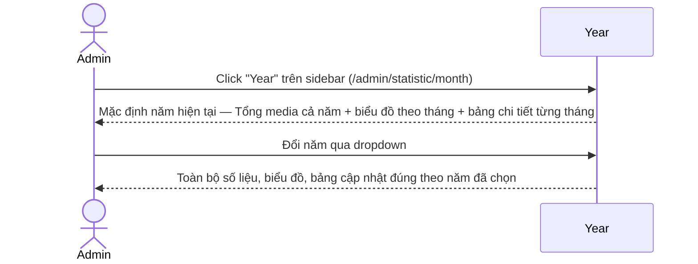
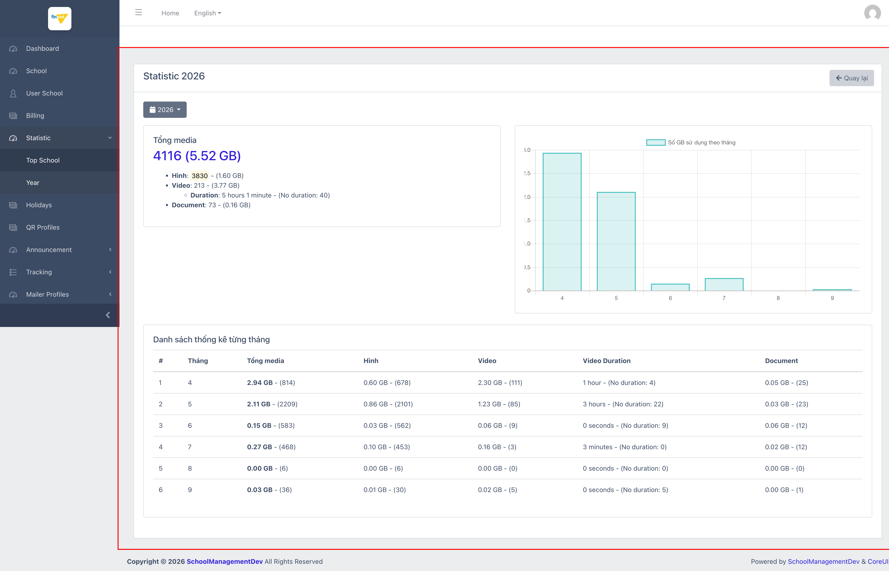
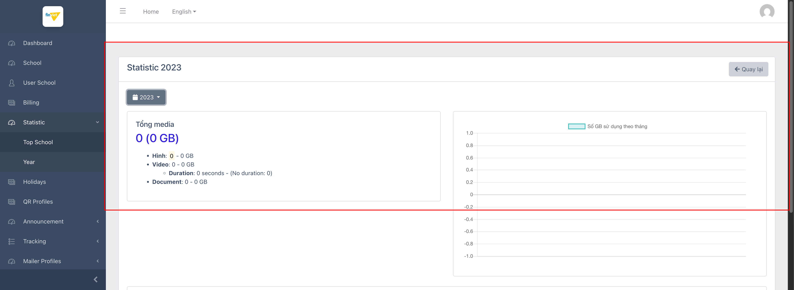

# M5.2 – Statistic: Year (Managing Portal)

> Phạm vi: sub-module **Year** (`/admin/statistic/month`), sub-module thứ hai trong 2 sub-module của module **Statistic**. Cùng như sub-module Top School (`M5-statistic/SM1-top-school.md`), đây là trang thống kê **dung lượng media** (hình ảnh/video/tài liệu) — nhưng tổng hợp **theo năm, trên toàn nền tảng** (không phân theo từng trường).

## Mục lục

- [1. Tổng quan](#1-tổng-quan)
  - [1.1 Giới thiệu](#11-giới-thiệu)
  - [1.2 Actors](#12-actors)
  - [1.3 Phạm vi](#13-phạm-vi)
- [2. Business Flow](#2-business-flow)
  - [2.1 Sequence Diagram](#21-sequence-diagram)
  - [2.2 Business Steps](#22-business-steps)
  - [2.3 Business Rules](#23-business-rules)
- [3. Feature Breakdown](#3-feature-breakdown)
  - [3.1 Acceptance Criteria](#31-acceptance-criteria)
  - [3.2 Danh sách Use Case](#32-danh-sách-use-case)
  - [3.3 Edge Cases](#33-edge-cases)
  - [3.4 Non-Functional Requirements](#34-non-functional-requirements)
  - [3.5 UI Conventions](#35-ui-conventions)

---

## 1. Tổng quan

### 1.1 Giới thiệu

**Year** trả lời câu hỏi: "Trong 1 năm, dung lượng media phát sinh theo từng tháng như thế nào?". Khác với Top School (theo dõi theo trường trong 1 khoảng ngắn), Year tổng hợp **toàn nền tảng** theo từng năm (chọn từ 2021–2026), với biểu đồ và bảng chi tiết theo tháng.

**Phát hiện quan trọng:** toàn bộ hoạt động media trên nền tảng dev chỉ mới bắt đầu từ tháng 04/2026 — các năm trước đó (2021–2025) đều trả về 0 tuyệt đối, nhất quán với phát hiện ở M4 (billing) rằng chỉ có 1 tenant thực sự "sống" trên dataset dev. Khác với Top School, sub-module Year **không gặp lỗi hiển thị "null"** khi dữ liệu rỗng — mọi giá trị đều hiển thị "0" nhất quán.

### 1.2 Actors

| Actor | Mô tả |
|---|---|
| Finviet/SOHA Admin (Vận hành/Hạ tầng) | Theo dõi xu hướng dung lượng lưu trữ theo năm/tháng để lên kế hoạch hạ tầng/chi phí storage dài hạn. |

### 1.3 Phạm vi

| Trong phạm vi | Ngoài phạm vi |
|---|---|
| Xem tổng quan dung lượng theo năm hiện tại (mặc định) | Cơ chế tính dung lượng thực tế phía backend |
| Đổi năm qua dropdown (2021–2026) | Xem chi tiết theo từng trường (thuộc sub-module Top School, xem `M5-statistic/SM1-top-school.md`) |
| Xem bảng chi tiết theo từng tháng trong năm đã chọn | |

---

## 2. Business Flow

### 2.1 Sequence Diagram

### 2.2 Business Steps

1. Admin mở Year để xem bức tranh toàn năm, theo dõi xu hướng tăng/giảm dung lượng theo từng tháng trên toàn nền tảng.
2. Admin đổi năm để so sánh giữa các năm (ví dụ xác nhận nền tảng chưa phát sinh media nào trước 2026).

### 2.3 Business Rules

| ID | Mô tả |
|---|---|
| BR01 | Trang hiển thị khối "Tổng media" gồm: tổng số lượng + tổng dung lượng (GB) của cả năm, chia nhỏ theo Hình, Video (kèm Duration), và Document — cùng cấu trúc hiển thị với Top School. |
| BR02 | Tổng hợp dữ liệu **trên toàn nền tảng** theo năm (không phân theo trường), có dropdown chọn năm 2021–2026. |
| BR03 | Biểu đồ cột theo tháng chỉ vẽ các tháng có dữ liệu — trên năm 2026 chỉ có cột cho tháng 4–9, các tháng 1–3 bị bỏ qua hoàn toàn vì bằng 0 (không vẽ cột cao=0 cho các tháng đó). |
| BR04 | Bảng "Danh sách thống kê từng tháng" liệt kê chi tiết từng tháng có phát sinh (cột: #, Tháng, Tổng media, Hình, Video, Video Duration, Document) — cùng logic ẩn tháng=0 như biểu đồ (năm 2026 chỉ liệt kê 6 dòng cho tháng 4–9, không có dòng cho tháng 1–3). |
| BR05 | Các trường/tháng không có dữ liệu hiển thị đúng giá trị "0" nhất quán (không có lỗi "null" như Top School BR06) — ví dụ năm 2023: "Tổng media: 0 (0 GB)", "Hình: 0 - 0 GB", "Duration: 0 seconds". |
| BR06 | Đổi năm cập nhật đúng và đầy đủ cả tiêu đề, số liệu, biểu đồ, bảng chi tiết — không gặp lỗi tương tự Top School BR06/BR07 (đã kiểm chứng qua chuyển 2026 → 2023 → 2026). |

---

## 3. Feature Breakdown

### 3.1 Acceptance Criteria

- Trang phải phản ánh đúng năm đang chọn ở cả tiêu đề, số liệu tổng, biểu đồ, và bảng chi tiết theo tháng.
- Khi dữ liệu = 0 (cả năm hoặc từng tháng), giao diện phải hiển thị "0" nhất quán, không hiển thị giá trị kỹ thuật thô.
- Các tháng không có dữ liệu được ẩn khỏi biểu đồ/bảng một cách nhất quán (không để lại khoảng trống gây hiểu nhầm).

### 3.2 Danh sách Use Case

| Mã | Tên | Actor | Mô tả | Happy Path | Exception | Business Rules |
|---|---|---|---|---|---|---|
| UC-01 | Xem thống kê dung lượng theo Năm | Admin | Xem tổng dung lượng media toàn nền tảng theo từng năm, với biểu đồ và bảng chi tiết theo tháng. | 1. Admin click "Year" trên sidebar. 2. Trang hiển thị năm hiện tại (2026): Tổng media, biểu đồ cột theo tháng (chỉ tháng có dữ liệu), bảng chi tiết 6 tháng (4–9).    3. Admin đổi năm sang 2023 qua dropdown. 4. Toàn bộ số liệu về "0", bảng trống, không có lỗi hiển thị "null".   | Năm không có dữ liệu hiển thị "0" nhất quán ở mọi nơi — không gặp lỗi giống Top School. | BR01, BR02, BR03, BR04, BR05, BR06 |

### 3.3 Edge Cases

| # | Tình huống | Quan sát / Rủi ro |
|---|---|---|
| 1 | Toàn bộ năm 2021–2025 đều = 0 | Nhất quán với phát hiện ở M4 (billing) — nền tảng dev chỉ thực sự có hoạt động media từ 04/2026, dù dữ liệu billing cho thấy trường ID=1 đã tồn tại từ 2022. `[Cần xác nhận]` liệu media cũ hơn 04/2026 có bị xoá/archive hay chưa từng được nhập vào hệ thống media này. |
| 2 | Đối chiếu tổng năm 2026 (4116 media, 5.52 GB) với phép thử "Chọn ngày" 01/01/2026–22/09/2026 trên Top School | Hai con số khớp nhau chính xác, xác nhận Year và Top School dùng chung 1 nguồn dữ liệu/công thức tính — chỉ khác cách trình bày (theo trường vs. theo tháng). |

### 3.4 Non-Functional Requirements

- Biểu đồ (Chart.js hoặc tương đương) render phía client, cập nhật qua AJAX khi đổi năm.
- Định dạng số liệu dung lượng nhất quán ở 2 chữ số thập phân (GB), số lượng item hiển thị dạng số nguyên trong ngoặc đơn — cùng convention với Top School.

### 3.5 UI Conventions

- Cùng pattern layout với Top School: nút dropdown (icon lịch, ở đây là năm thay vì khoảng ngày) ở đầu trang, khối "Tổng media" dạng danh sách phân cấp bên trái, biểu đồ cột bên phải, bảng chi tiết bên dưới cùng.
- Khác với Top School, sub-module này không có input ngày tự do (chỉ chọn năm từ danh sách dựng sẵn) — có thể là lý do nó không mắc phải lỗi hiển thị "null"/bảng rỗng như Top School's "Chọn ngày" (xem `M5-statistic/SM1-top-school.md` BR06/BR07).
