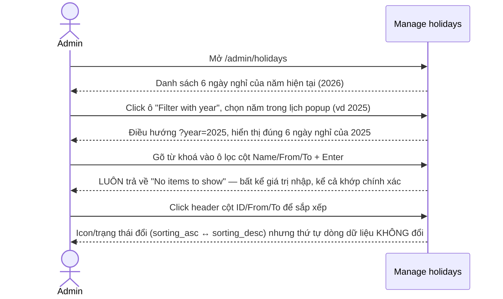
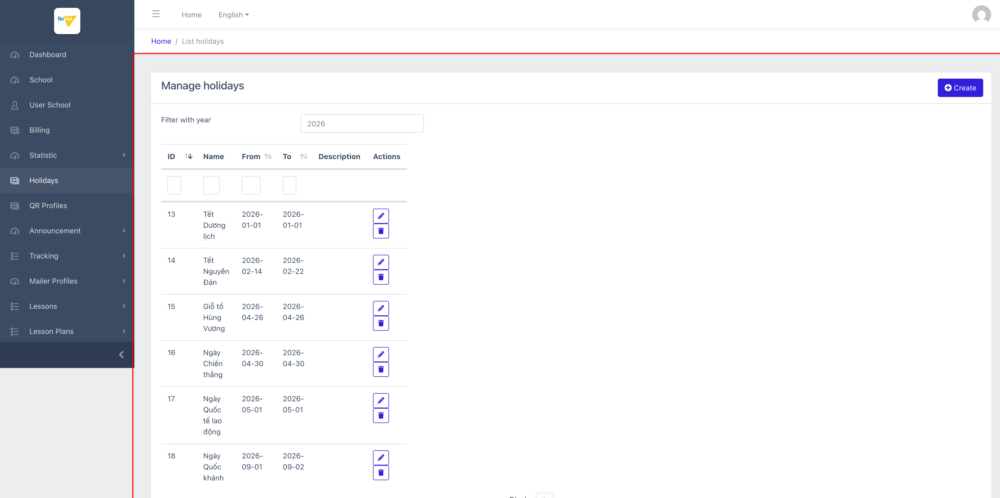
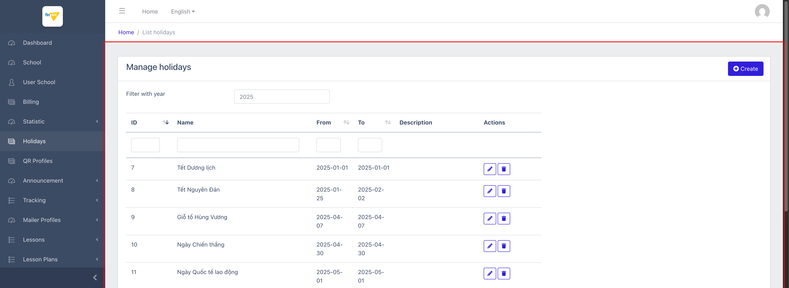
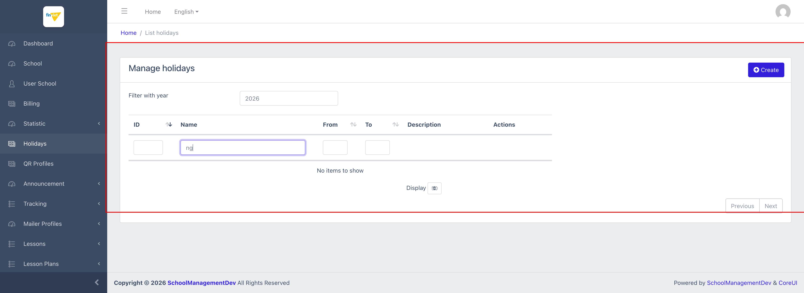
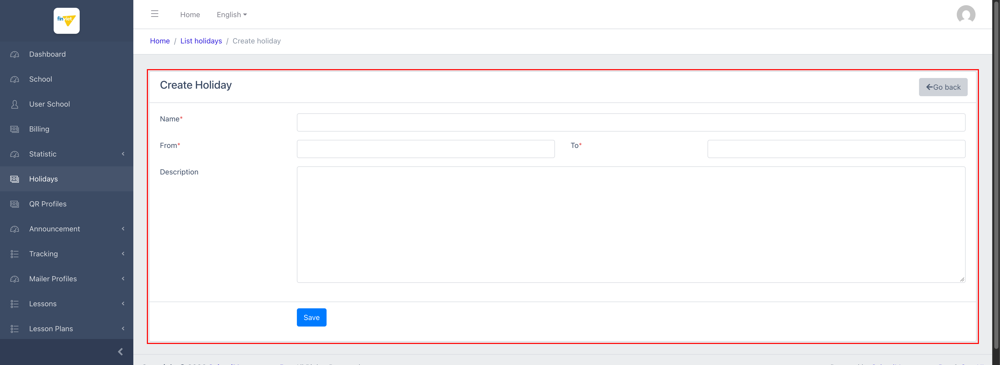
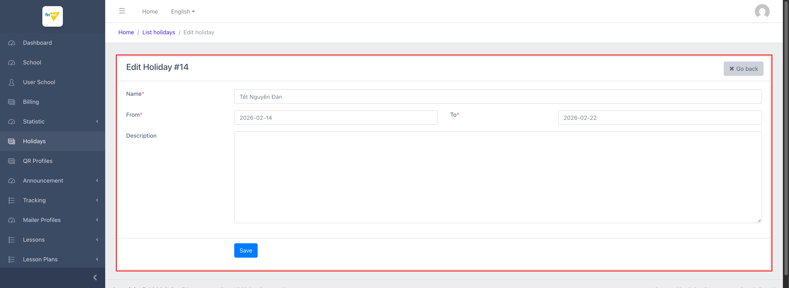

# M6 – Holidays (Managing Portal)

> Phạm vi: module **Holidays** (`/admin/holidays`), quản lý danh mục ngày nghỉ lễ **toàn nền tảng** (không gắn với 1 trường cụ thể). Đây là module nhỏ nhưng phát hiện được **nhiều lỗi chức năng** — hầu hết các bộ lọc cột và sắp xếp trên trang danh sách đều không hoạt động.

## Mục lục

- [1. Tổng quan](#1-tổng-quan)
  - [1.1 Giới thiệu](#11-giới-thiệu)
  - [1.2 Actors](#12-actors)
  - [1.3 Phạm vi](#13-phạm-vi)
- [2. Business Flow](#2-business-flow)
  - [2.1 Sequence Diagram](#21-sequence-diagram)
  - [2.2 Business Steps](#22-business-steps)
  - [2.3 Business Rules](#23-business-rules)
- [3. Feature Breakdown](#3-feature-breakdown)
  - [3.1 Acceptance Criteria](#31-acceptance-criteria)
  - [3.2 Danh sách Use Case](#32-danh-sách-use-case)
  - [3.3 Edge Cases](#33-edge-cases)
  - [3.4 Non-Functional Requirements](#34-non-functional-requirements)
  - [3.5 UI Conventions](#35-ui-conventions)

---

## 1. Tổng quan

### 1.1 Giới thiệu

Module Holidays quản lý danh mục ngày nghỉ lễ dùng chung cho toàn bộ nền tảng (ví dụ: Tết Dương lịch, Tết Nguyên Đán, Giỗ tổ Hùng Vương...) — không có trường chọn "School" trong form Create/Edit, xác nhận đây là dữ liệu **global**, nhiều khả năng được các module khác (tính công/học phí, điểm danh — xem `operating-portal/M4-tai-chinh/SM1-hoc-phi.md` về "trừ ngày nghỉ") tham chiếu tới khi tính toán ngày học thực tế.

Dataset dev có sẵn 2 năm dữ liệu: 2025 (ID 7–12) và 2026 (ID 13–18), mỗi năm 6 ngày nghỉ lễ Việt Nam chuẩn.

**Phát hiện quan trọng:** trang danh sách có **hàng loạt lỗi chức năng** — 3/4 ô lọc theo cột (Name, From, To) hoàn toàn không hoạt động (luôn trả về "No items to show" bất kể giá trị nhập), sắp xếp theo cột (ID/From/To) chỉ đổi icon/trạng thái mà không thực sự sắp xếp lại dữ liệu, tiêu đề tab trình duyệt hiển thị sai ("Manage kid" thay vì tên module), và ô "Filter with year" trông như input gõ-số-rồi-Enter nhưng thực chất chỉ nhận giá trị qua việc click chọn năm trong lịch popup.

### 1.2 Actors

| Actor | Mô tả |
|---|---|
| Finviet/SOHA Admin | Quản lý danh mục ngày nghỉ lễ dùng chung cho toàn nền tảng — tạo/sửa/xoá theo từng năm. |

### 1.3 Phạm vi

| Trong phạm vi | Ngoài phạm vi |
|---|---|
| Xem danh sách ngày nghỉ theo năm (mặc định năm hiện tại) | Cơ chế các module khác (học phí, điểm danh) sử dụng dữ liệu Holidays để tính toán |
| Đổi năm lọc qua datepicker popup | Thực hiện Create/Edit/Delete thật (chỉ mở form quan sát cấu trúc, không bấm Save/Delete) |
| Mở form Create và Edit để xem cấu trúc trường dữ liệu | |
| Kiểm chứng hành vi lọc theo cột (ID/Name/From/To) và sắp xếp | |

---

## 2. Business Flow

### 2.1 Sequence Diagram

### 2.2 Business Steps

1. Admin mở danh sách ngày nghỉ, mặc định xem năm hiện tại.
2. Admin đổi năm qua ô "Filter with year" để xem/chuẩn bị danh mục cho năm khác.
3. Admin tạo mới 1 ngày nghỉ (Name, From, To, Description) hoặc sửa/xoá 1 ngày nghỉ đã có.

### 2.3 Business Rules

| ID | Mô tả |
|---|---|
| BR01 | Form Create/Edit chỉ có 4 trường: Name*, From*, To*, Description (không bắt buộc) — không có trường chọn trường/tenant, xác nhận đây là danh mục **toàn nền tảng**. |
| BR02 | From/To dùng date-picker dạng lịch ngày đầy đủ (Su-Mo-...-Sa, có nút chuyển tháng/năm dạng "September 2026" ở đầu lịch) — định dạng lưu `yyyy-mm-dd`. |
| BR03 | Ô "Filter with year" (`#year`) là 1 input text trơn nhưng được gắn 1 **bootstrap-datepicker chế độ chỉ chọn năm** (`viewMode: "years"`) — giá trị chỉ thực sự được áp dụng khi **click chọn năm trong popup lịch** (JS lắng nghe event `change` do datepicker tự bắn ra khi chọn), gõ số trực tiếp vào ô rồi nhấn Enter **không có tác dụng gì** vì input này không nằm trong bất kỳ `<form>` nào và không có listener nào cho phím Enter. |
| BR04 | **[Lỗi nghiêm trọng]** 3 trong 4 ô lọc theo cột trên bảng (Name, From, To) **hoàn toàn không hoạt động** — luôn trả về "No items to show" bất kể giá trị nhập vào, đã kiểm chứng với nhiều trường hợp: chuỗi có dấu ("Quốc", "Tết"), chuỗi thường không dấu ("ng" — lẽ ra khớp ít nhất 4/6 tên), và khớp theo tháng của ngày ("2026-04" cho cột From). Chỉ riêng ô lọc cột **ID hoạt động đúng** (lọc "13" → đúng 1/1 dòng). |
| BR05 | **[Lỗi]** Click vào tiêu đề cột ID/From/To để sắp xếp chỉ đổi class/`aria-sort` của `<th>` (`sorting_asc` ↔ `sorting_desc`) nhưng **thứ tự các dòng dữ liệu trong bảng không thay đổi** — xác nhận qua việc đọc trực tiếp DOM trước/sau khi click, dữ liệu luôn giữ nguyên thứ tự ID tăng dần bất kể trạng thái sort hiển thị trên icon. |
| BR06 | **[Lỗi]** Tiêu đề tab trình duyệt (`<title>`) của riêng trang danh sách hiển thị sai: **"SchoolManagementDev \| Manage kid"** thay vì tên liên quan đến Holidays — nhiều khả năng là tiêu đề copy từ 1 view Blade khác (ví dụ module quản lý học sinh "kid") và quên cập nhật. Trang Create ("Create Holiday") và Edit ("Edit Holiday #14") có tiêu đề đúng. |
| BR07 | Bảng danh sách không tận dụng hết chiều rộng khả dụng của trang — cột "Name" bị giới hạn width cố định (~350px CSS) khiến các tên dài (vd "Ngày Quốc tế lao động") bị wrap 2-3 dòng dù còn rất nhiều khoảng trắng chưa dùng tới bên phải bảng (quan sát ở cả viewport 1920px). |
| BR08 | Nút Delete (icon thùng rác) submit **POST** với `_method=DELETE` tới `/admin/holidays/{id}` — không phát hiện thuộc tính `onsubmit`/`data-confirm` nào trong DOM, cùng pattern chưa-xác-nhận-được như đã ghi nhận ở M4 Billing. |
| BR09 | Dataset dev có 2 năm: 2025 (ID 7–12) và 2026 (ID 13–18), mỗi năm đúng 6 ngày nghỉ lễ chuẩn Việt Nam (Tết Dương lịch, Tết Nguyên Đán, Giỗ tổ Hùng Vương, Ngày Chiến thắng 30/4, Quốc tế Lao động 1/5, Quốc khánh 2/9) — không có ngày nghỉ tuỳ chỉnh/riêng của trường nào trong dữ liệu mẫu. |

---

## 3. Feature Breakdown

### 3.1 Acceptance Criteria

- Danh sách phải hiển thị đúng ngày nghỉ của năm đang chọn.
- Ô lọc theo cột phải trả về đúng tập con dữ liệu khớp giá trị nhập — vi phạm rõ ràng ở BR04 cho 3/4 cột.
- Click tiêu đề cột để sắp xếp phải phản ánh đúng thứ tự dữ liệu tương ứng — vi phạm ở BR05.
- Tiêu đề tab trình duyệt phải phản ánh đúng nội dung trang đang xem — vi phạm ở BR06.

### 3.2 Danh sách Use Case

| Mã | Tên | Actor | Mô tả | Happy Path | Exception | Business Rules |
|---|---|---|---|---|---|---|
| UC-01 | Xem & lọc danh sách ngày nghỉ theo năm | Admin | Xem danh mục ngày nghỉ lễ của 1 năm, đổi năm xem qua datepicker. | 1. Admin mở `/admin/holidays`. 2. Trang hiển thị 6 ngày nghỉ của năm hiện tại (2026), cột ID/Name/From/To/Description/Actions.    3. Admin click ô "Filter with year", chọn "2025" trong lịch popup. 4. Trang điều hướng `?year=2025`, hiển thị đúng 6 ngày nghỉ của 2025 (ID 7–12).   | Gõ trực tiếp số năm vào ô rồi nhấn Enter: không có tác dụng (BR03). Gõ từ khoá vào ô lọc cột Name (vd "ng", lẽ ra khớp 4/6 dòng) rồi nhấn Enter: luôn trả về "No items to show" (BR04).   | BR03, BR04, BR05, BR06, BR07, BR09 |
| UC-02 | Tạo mới ngày nghỉ | Admin | Thêm 1 ngày nghỉ lễ mới vào danh mục toàn nền tảng. | 1. Admin click "Create". 2. Form hiển thị Name*, From*, To* (date-picker dạng lịch), Description.   | Không thử submit Save thật để tránh tạo dữ liệu thật trong môi trường dev. | BR01, BR02 |
| UC-03 | Sửa ngày nghỉ đã có | Admin | Cập nhật tên/khoảng ngày/mô tả của 1 ngày nghỉ đã tồn tại. | 1. Admin click icon Edit trên 1 dòng (vd ID 14 — "Tết Nguyên Đán"). 2. Form hiển thị đầy đủ dữ liệu hiện tại, cùng cấu trúc với Create.   | Không thử submit Save thật. Nút Delete trên danh sách không có xác nhận rõ ràng trong DOM (BR08) — không thử bấm để tránh xoá dữ liệu thật. | BR01, BR02, BR08 |

### 3.3 Edge Cases

| # | Tình huống | Quan sát / Rủi ro |
|---|---|---|
| 1 | Ô lọc Name/From/To luôn trả về rỗng | Đây là lỗi nghiêm trọng nhất module — khiến tính năng lọc gần như vô dụng khi danh mục lớn hơn (hiện tại chỉ 6 dòng/năm nên chưa gây khó chịu nhiều, nhưng nếu 1 trường cần thêm nhiều ngày nghỉ riêng trong tương lai, admin sẽ không thể tìm kiếm được). `[Cần xác nhận]` với đội dev liệu đây là lỗi biết trước hay chưa từng được phát hiện. |
| 2 | Sắp xếp cột chỉ đổi icon, không đổi dữ liệu | Có thể khiến admin hiểu nhầm dữ liệu đã được sắp xếp theo ý muốn trong khi thực tế không đổi — rủi ro thấp với danh sách nhỏ (6 dòng) nhưng gây nhầm lẫn nếu danh sách phát triển lớn hơn. |
| 3 | Tiêu đề tab "Manage kid" | Lỗi hiển thị nhỏ, không ảnh hưởng chức năng, nhưng cho thấy khả năng code được copy từ module khác (Kid/Student) và chưa rà soát kỹ khi tạo module Holidays. |
| 4 | "Filter with year" trông giống input tự do nhưng cần thao tác click-chọn cụ thể | UX gây nhầm lẫn: admin quen thao tác "gõ rồi Enter" ở các module khác trong hệ thống (M2, M3, M4 đều theo pattern này) sẽ ngỡ ô này bị treo/lỗi khi gõ không có phản hồi. |

### 3.4 Non-Functional Requirements

- Dữ liệu ngày nghỉ là danh mục dùng chung toàn nền tảng — thay đổi ở đây có khả năng ảnh hưởng tính toán ở nhiều module khác (học phí, điểm danh) trên mọi trường, nên cần thận trọng hơn mức thông thường khi sửa/xoá.

### 3.5 UI Conventions

- Khác với các module trước (M2/M3/M4) nơi ô lọc cột dùng input text + Enter nhất quán, Holidays có 2 kiểu input khác nhau trên cùng 1 trang: ô "Filter with year" (datepicker-driven, không nhận Enter) và các ô lọc cột (input text, có vẻ được thiết kế để nhận Enter nhưng bị lỗi không hoạt động) — sự thiếu nhất quán này tự nó đã là một vấn đề UX cần lưu ý khi audit các module còn lại.
