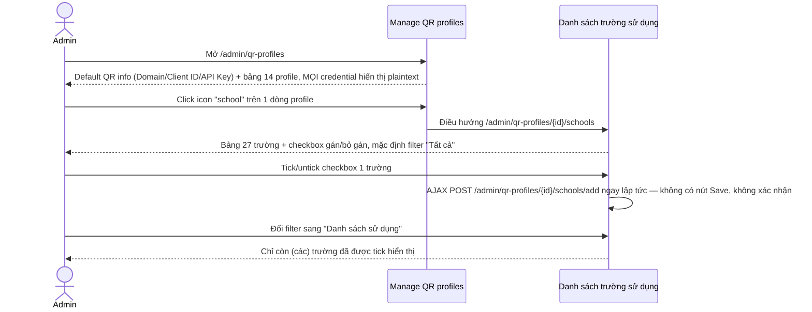
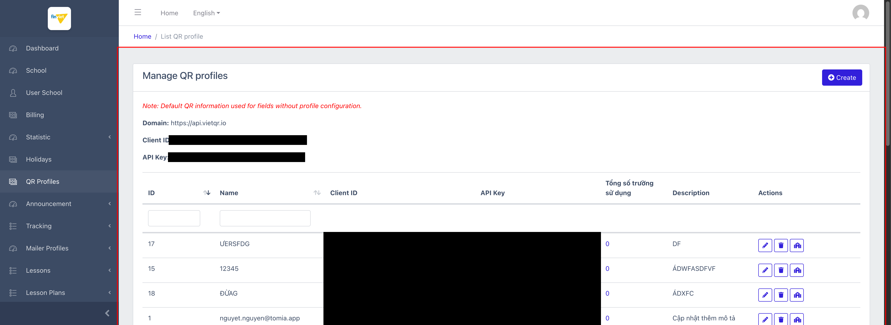
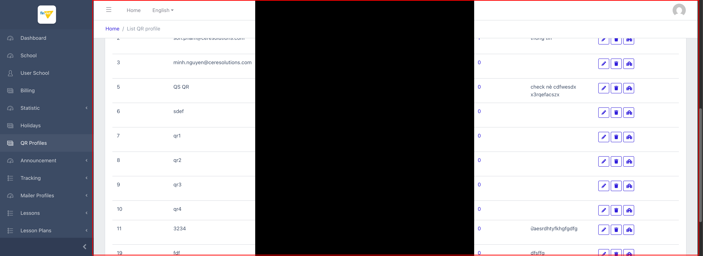
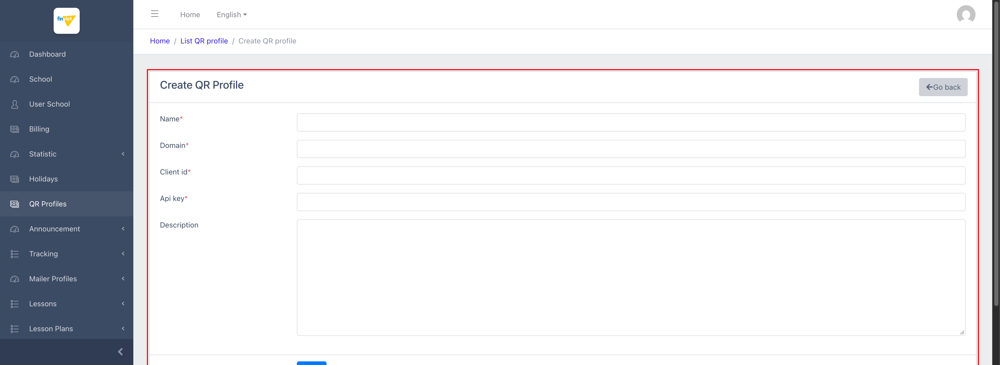
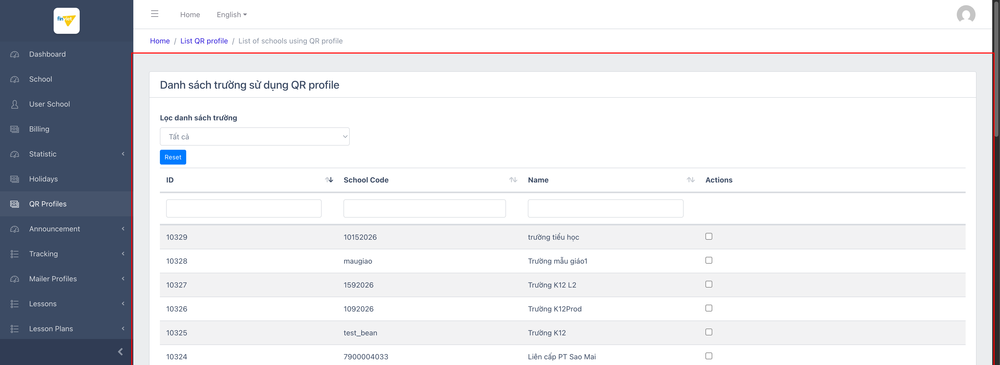
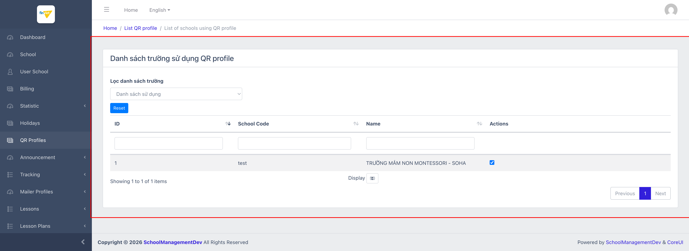
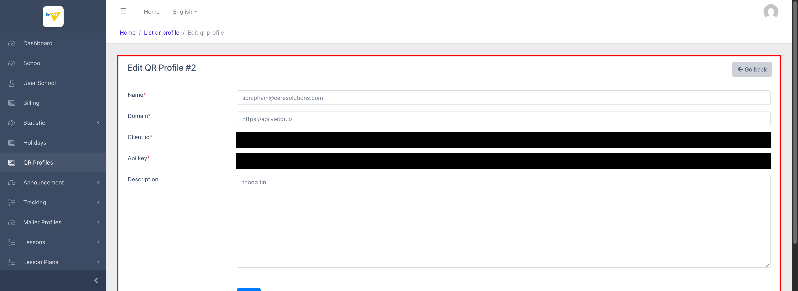

# M7 – QR Profiles (Managing Portal)

> Phạm vi: module **QR Profiles** (`/admin/qr-profiles`), quản lý các bộ thông tin xác thực (Client ID/API Key) của cổng **VietQR** (`api.vietqr.io`) dùng để sinh mã QR thanh toán học phí, và gán từng bộ cho 1 hoặc nhiều trường. **Đây là trang lộ credential nghiêm trọng nhất được phát hiện trong toàn bộ quá trình khảo sát Managing Portal** — hiển thị Client ID/API Key ở dạng plaintext ngay trên bảng danh sách, không cần thao tác nào để "mở khoá" xem.

## Mục lục

- [1. Tổng quan](#1-tổng-quan)
  - [1.1 Giới thiệu](#11-giới-thiệu)
  - [1.2 Actors](#12-actors)
  - [1.3 Phạm vi](#13-phạm-vi)
- [2. Business Flow](#2-business-flow)
  - [2.1 Sequence Diagram](#21-sequence-diagram)
  - [2.2 Business Steps](#22-business-steps)
  - [2.3 Business Rules](#23-business-rules)
- [3. Feature Breakdown](#3-feature-breakdown)
  - [3.1 Acceptance Criteria](#31-acceptance-criteria)
  - [3.2 Danh sách Use Case](#32-danh-sách-use-case)
  - [3.3 Edge Cases](#33-edge-cases)
  - [3.4 Non-Functional Requirements](#34-non-functional-requirements)
  - [3.5 UI Conventions](#35-ui-conventions)

---

## 1. Tổng quan

### 1.1 Giới thiệu

QR Profiles là nơi lưu các bộ credential (Client ID + API Key) của VietQR — dịch vụ tạo mã QR ngân hàng dùng khi phụ huynh thanh toán học phí qua QR (đã ghi nhận ở `operating-portal/M4-tai-chinh/SM1-hoc-phi.md`). Mỗi "profile" có thể được gán cho 0 hoặc nhiều trường; nếu 1 trường không được gán profile riêng, hệ thống dùng bộ **Default QR information** hiển thị ngay đầu trang.

**⚠️ Phát hiện bảo mật nghiêm trọng:** khác với các trường hợp lộ credential trước đó (M2 School Settings — phải vào đúng tab Settings của 1 trường mới thấy; đã redact và báo cáo), ở đây **toàn bộ Client ID/API Key của Default profile VÀ tất cả 14 QR profiles đã tạo hiển thị trực tiếp, dạng plaintext, ngay trên bảng danh sách chính** — không cần click vào đâu cả, không có nút "hiện/ẩn", không mask 1 phần nào. Bất kỳ admin nào có quyền truy cập Managing Portal (kể cả các role chỉ cần xem, nếu có phân quyền như vậy) đều nhìn thấy toàn bộ các bộ credential thanh toán cùng lúc. Toàn bộ giá trị Client ID/API Key trong tài liệu này đã được **redact (che đen)** trước khi lưu ảnh — không giá trị thật nào được ghi vào tài liệu.

Trong 14 profile, 3 profile (ID 1, 2, 3) có tên là địa chỉ email cá nhân (`nguyet.nguyen@tomia.app`, `son.pham@ceresolutions.com`, `minh.nguyen@ceresolutions.com`) và giá trị Client ID/API Key đúng định dạng UUID chuẩn — nhiều khả năng là credential thật được nhân viên/đối tác tạo để test. Các profile còn lại (ID 5–11, 15, 17–19) có tên và mô tả là chuỗi test rõ ràng ("qr1", "qr2", "sdef", "GHSF"...), trong đó 5 profile (ID 5,6,7,8,9) dùng chung 1 cặp Client ID/API Key giống hệt nhau.

### 1.2 Actors

| Actor | Mô tả |
|---|---|
| Finviet/SOHA Admin | Tạo/sửa/xoá các bộ QR profile, gán profile cho từng trường. |

### 1.3 Phạm vi

| Trong phạm vi | Ngoài phạm vi |
|---|---|
| Xem danh sách QR profiles (đã redact credential khi chụp ảnh) | Thực hiện Create/Edit/Delete thật |
| Mở form Create và Edit để xem cấu trúc trường dữ liệu (đã redact) | Toggle checkbox gán/bỏ gán trường thật — đây là hành động ghi tức thời qua AJAX, không có nút Save riêng, không thực hiện để tránh thay đổi dữ liệu dev |
| Xem trang "Danh sách trường sử dụng QR profile" của 1 profile cụ thể, thử bộ lọc Tất cả/Đang dùng/Không dùng | |
| Kiểm chứng hành vi tìm kiếm theo cột Name và sắp xếp theo cột ID | |

---

## 2. Business Flow

### 2.1 Sequence Diagram

### 2.2 Business Steps

1. Admin tạo 1 QR profile mới với Client ID/API Key lấy từ tài khoản VietQR của 1 đối tác/trường.
2. Admin vào trang "Danh sách trường sử dụng" của profile đó, tick chọn (các) trường sẽ dùng profile này.
3. Trường nào không được gán profile riêng sẽ tự động dùng Default QR information khi sinh mã QR thanh toán.
4. Admin có thể sửa lại Client ID/API Key của 1 profile đã tạo, hoặc xoá hẳn profile.

### 2.3 Business Rules

| ID | Mô tả |
|---|---|
| BR01 | Trang danh sách hiển thị **Default QR information** (Domain, Client ID, API Key) ở đầu trang — áp dụng cho các trường "không có profile riêng", và bảng 14 QR profile bên dưới với cột: ID, Name, Client ID, API Key, Tổng số trường sử dụng, Description, Actions (Edit/Delete/Schools). |
| BR02 | **[Rủi ro bảo mật nghiêm trọng]** Client ID và API Key hiển thị **plaintext, không mask, không cần thao tác mở khoá**, cho cả Default profile lẫn toàn bộ 14 profile trong bảng — mức độ lộ cao hơn hẳn so với credential SInvoice/VNPAY từng ghi nhận ở M2 School Settings (nơi phải chủ động vào đúng 1 tab Settings của 1 trường cụ thể mới thấy). Ở đây chỉ cần mở đúng 1 URL danh sách là thấy toàn bộ credential thanh toán của mọi trường cùng lúc. |
| BR03 | Cột "Tổng số trường sử dụng" là 1 link dẫn tới trang "Danh sách trường sử dụng QR profile" của đúng profile đó — số liệu khớp chính xác với số checkbox đã tick trong trang con (verified: profile ID=2 hiển thị "1" và trang con xác nhận đúng 1 trường được tick). |
| BR04 | Trên dataset dev, **chỉ 1/27 trường** (`TRƯỜNG MẦM NON MONTESSORI - SOHA`, ID=1 — cùng trường "sống" duy nhất đã xác nhận ở M4 Billing và M5 Statistic) được gán vào 1 QR profile (profile ID=2, `son.pham@ceresolutions.com`). 26 trường còn lại đều dùng Default QR information. |
| BR05 | Trang "Danh sách trường sử dụng QR profile" liệt kê **toàn bộ 27 trường** (không chỉ trường đã gán), mỗi dòng có 1 checkbox độc lập — tick/untick sẽ **submit AJAX ngay lập tức** (`POST /admin/qr-profiles/{id}/schools/add` với `school_id` + `checked`) mà **không có nút Save riêng và không có hộp thoại xác nhận** — đây là thao tác ghi dữ liệu tức thời chỉ bằng 1 click, rủi ro cao nếu click nhầm. |
| BR06 | Bộ lọc "Lọc danh sách trường" trên trang con có 3 lựa chọn: Tất cả / Danh sách sử dụng / Danh sách không sử dụng — hoạt động đúng, xác nhận qua thử nghiệm chọn "Danh sách sử dụng" cho profile ID=2 → thu gọn đúng còn 1/1 dòng (trường đã tick). |
| BR07 | Form Create/Edit có 5 trường: Name*, Domain*, Client id*, Api key*, Description — **Domain có thể tuỳ chỉnh per-profile** (không cố định `api.vietqr.io`), cho thấy hệ thống có khả năng hỗ trợ nhiều nhà cung cấp QR khác nhau dù dữ liệu mẫu hiện tại toàn bộ đều dùng chung 1 domain VietQR. |
| BR08 | Ô tìm kiếm theo cột **Name hoạt động đúng** (khác với lỗi ở M6 Holidays) — xác nhận qua thử nghiệm gõ "qr" + Enter → thu gọn đúng "5 of 5 items" (khớp qr1/qr2/qr3/qr4/QS QR). Không có ô tìm kiếm riêng cho cột Client ID/API Key/Description. |
| BR09 | **[Lỗi — lặp lại từ M6 Holidays]** Click tiêu đề cột **ID** để sắp xếp chỉ đổi class `sorting_desc`/`aria-sort` của `<th>` nhưng **thứ tự dòng dữ liệu không đổi** — cùng lỗi component DataTables đã ghi nhận ở Holidays, xác nhận đây là lỗi lặp lại ở ít nhất 2 module, nhiều khả năng ảnh hưởng chung tới các bảng dùng chung 1 component sort trong toàn Managing Portal. |
| BR10 | Nút Delete (icon thùng rác) submit **POST** `_method=DELETE` tới `/admin/qr-profiles/{id}` — không phát hiện thuộc tính xác nhận nào trong DOM, cùng pattern chưa-xác-nhận-được đã ghi nhận ở M4/M6. |

---

## 3. Feature Breakdown

### 3.1 Acceptance Criteria

- Danh sách phải hiển thị đúng Client ID/API Key/Tổng số trường sử dụng cho từng profile — về mặt dữ liệu là đúng, nhưng cách hiển thị (plaintext, không mask) vi phạm nguyên tắc bảo mật cơ bản cho dữ liệu credential.
- Trang "Danh sách trường sử dụng" phải phản ánh đúng trạng thái gán/chưa gán qua checkbox và bộ lọc — đạt yêu cầu (BR05, BR06).
- Sắp xếp theo cột ID phải phản ánh đúng thứ tự — vi phạm ở BR09.

### 3.2 Danh sách Use Case

| Mã | Tên | Actor | Mô tả | Happy Path | Exception | Business Rules |
|---|---|---|---|---|---|---|
| UC-01 | Xem danh sách QR profiles & Default QR info | Admin | Xem toàn bộ profile đã tạo cùng Default QR information dùng cho trường chưa được gán riêng. | 1. Admin mở `/admin/qr-profiles`. 2. Trang hiển thị Default QR info + bảng 14 profile (Client ID/API Key đã redact khi lưu ảnh).      3. Admin tìm theo Name (vd "qr") + Enter → đúng 5/5 profile khớp. | Click sắp xếp cột ID: chỉ đổi icon, thứ tự dữ liệu không đổi (BR09). | BR01, BR02, BR03, BR04, BR08, BR09 |
| UC-02 | Tạo mới QR Profile | Admin | Thêm 1 bộ Client ID/API Key mới, có thể gắn domain riêng. | 1. Admin click "Create". 2. Form hiển thị Name*, Domain*, Client id*, Api key*, Description.   | Không thử submit Save thật để tránh tạo dữ liệu thật trong môi trường dev. | BR07 |
| UC-03 | Gán/bỏ gán trường cho 1 QR Profile | Admin | Chọn (các) trường sẽ dùng 1 bộ Client ID/API Key cụ thể thay vì Default. | 1. Admin click icon "school" trên 1 dòng profile (vd ID=2). 2. Trang liệt kê đủ 27 trường kèm checkbox, mặc định filter "Tất cả" — trường đã gán (ID=1) có checkbox tick sẵn.    3. Admin đổi filter sang "Danh sách sử dụng". 4. Bảng thu gọn đúng còn 1/1 trường đã tick.   | Không tick/untick checkbox thật để tránh kích hoạt AJAX ghi dữ liệu ngay lập tức (BR05) — hành vi này được xác nhận qua đọc mã nguồn JS, không phải qua thao tác trực tiếp. | BR03, BR04, BR05, BR06 |
| UC-04 | Sửa QR Profile đã có | Admin | Cập nhật Client ID/API Key/Description của 1 profile. | 1. Admin click icon Edit trên 1 dòng (vd ID=2 — `son.pham@ceresolutions.com`). 2. Form hiển thị đầy đủ dữ liệu hiện tại, Client ID/API Key đã redact khi lưu ảnh.   | Không thử submit Save thật. Nút Delete không có xác nhận rõ ràng trong DOM (BR10) — không thử bấm. | BR07, BR10 |

### 3.3 Edge Cases

| # | Tình huống | Quan sát / Rủi ro |
|---|---|---|
| 1 | Toàn bộ Client ID/API Key hiển thị plaintext trên 1 trang danh sách duy nhất | Đây là phát hiện bảo mật nghiêm trọng nhất trong toàn bộ Managing Portal tính đến thời điểm này — nên được ưu tiên báo cáo/khắc phục sớm (ví dụ: mask 1 phần giá trị, chỉ hiện đầy đủ khi click "View"/hover, hoặc giới hạn quyền xem theo role). `[Cần xác nhận]` với đội bảo mật/dev về mức độ ưu tiên khắc phục. |
| 2 | Checkbox gán trường ghi dữ liệu ngay khi tick, không có Save/confirm | Rủi ro thao tác nhầm cao hơn các form thông thường (vốn có bước Save riêng) — 1 click nhầm có thể gán nhầm profile thanh toán cho 1 trường không liên quan, ảnh hưởng trực tiếp tới việc thu tiền học phí của trường đó. |
| 3 | 5 profile (ID 5,6,7,8,9) dùng chung 1 cặp Client ID/API Key | Có thể là dữ liệu test cố ý dùng chung, nhưng nếu đây là hành vi thật trong production, nhiều profile trỏ cùng 1 credential sẽ khiến việc "Tổng số trường sử dụng" trên từng profile mất ý nghĩa phân tách (nhiều trường tưởng dùng profile khác nhau nhưng thực chất cùng 1 tài khoản VietQR). `[Cần xác nhận]` |
| 4 | Sort cột ID không hoạt động (BR09) | Lặp lại đúng lỗi đã ghi nhận ở M6 Holidays — củng cố giả thuyết đây là lỗi ở tầng component dùng chung (không phải lỗi riêng lẻ của 1 module), nên ưu tiên sửa ở component gốc thay vì từng trang riêng lẻ. |

### 3.4 Non-Functional Requirements

- Đây là dữ liệu **credential thanh toán** (payment gateway secrets) — mức độ nhạy cảm tương đương hoặc cao hơn secrets đã ghi nhận ở M2 (SInvoice/VNPAY), cần áp dụng chuẩn bảo mật tối thiểu tương tự (không hiển thị plaintext tràn lan, giới hạn quyền xem, ghi log truy cập).

### 3.5 UI Conventions

- Cùng pattern "icon action nhóm 3" (Edit/Delete/Link phụ) như đã thấy ở M4 Billing — riêng module này có thêm icon "school" dẫn tới trang gán trường, đặc thù cho quan hệ nhiều-nhiều (profile ↔ school).
- Trang "Danh sách trường sử dụng" tái sử dụng đúng layout bảng 27-trường quen thuộc (ID/School Code/Name) đã thấy ở M2/M3/M4 — nhưng thay cột Actions bằng checkbox instant-toggle thay vì icon link, là điểm khác biệt UI convention cần lưu ý khi so sánh giữa các module.
