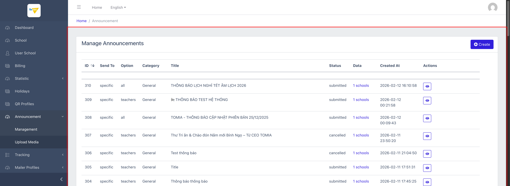
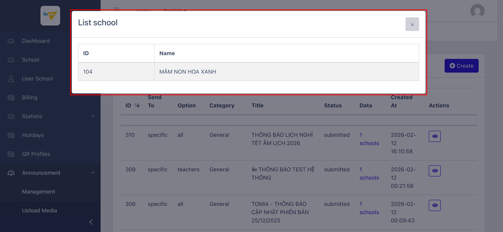
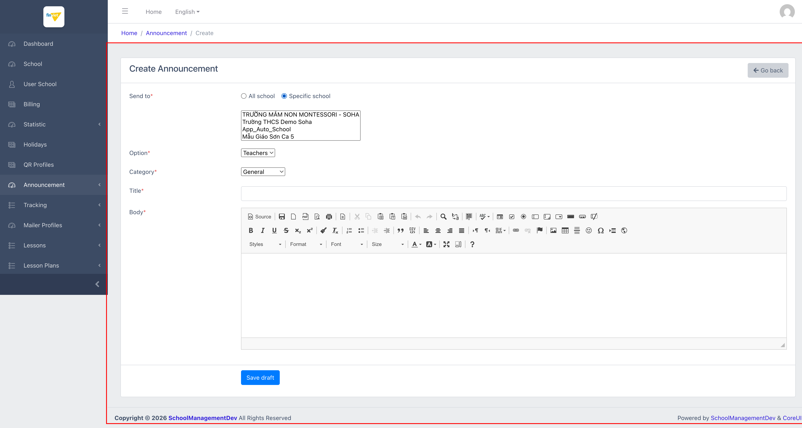
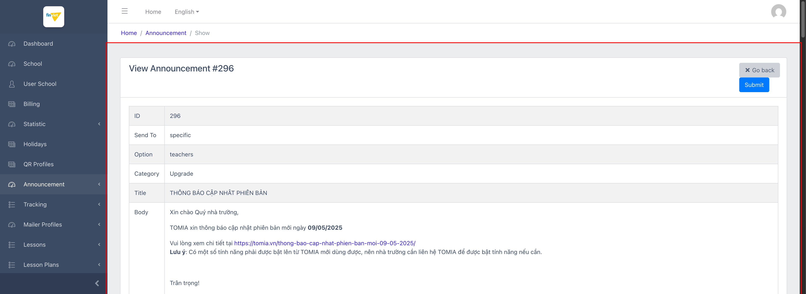
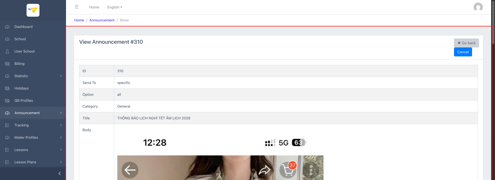

# M8.1 – Announcement: Management (Managing Portal)

> Phạm vi: sub-module **Management** (`/admin/announcement`), sub-module đầu tiên trong 2 sub-module của module **Announcement**. Đây là nơi Finviet/SOHA soạn và gửi thông báo hệ thống (bảo trì, cập nhật phiên bản, lịch nghỉ lễ...) tới các trường trên nền tảng — **một trong số ít module có dữ liệu thật, hoạt động liên tục từ 2023 đến nay** (306 bản ghi), khác hẳn phần lớn các module khác gần như trống dữ liệu.

## Mục lục

- [1. Tổng quan](#1-tổng-quan)
  - [1.1 Giới thiệu](#11-giới-thiệu)
  - [1.2 Actors](#12-actors)
  - [1.3 Phạm vi](#13-phạm-vi)
- [2. Business Flow](#2-business-flow)
  - [2.1 Sequence Diagram](#21-sequence-diagram)
  - [2.2 Business Steps](#22-business-steps)
  - [2.3 Business Rules](#23-business-rules)
- [3. Feature Breakdown](#3-feature-breakdown)
  - [3.1 Acceptance Criteria](#31-acceptance-criteria)
  - [3.2 Danh sách Use Case](#32-danh-sách-use-case)
  - [3.3 Edge Cases](#33-edge-cases)
  - [3.4 Non-Functional Requirements](#34-non-functional-requirements)
  - [3.5 UI Conventions](#35-ui-conventions)

---

## 1. Tổng quan

### 1.1 Giới thiệu

Management là nơi tạo, xem, và quản lý vòng đời thông báo hệ thống gửi tới các trường — nội dung soạn bằng CKEditor 4 (rich text, có thể chèn ảnh/link/bảng), gửi tới **toàn bộ trường** hoặc **1 tập trường cụ thể** do admin chọn, nhắm tới đối tượng Teachers/Parents/All trong mỗi trường, phân theo Category (General/Upgrade/Maintenance).

**Phát hiện đáng chú ý:** đây là module có khối lượng dữ liệu thật lớn nhất và liên tục nhất từng gặp trong Managing Portal — 306 thông báo trải dài từ 07/2023 đến 02/2026, cho thấy đây là 1 tính năng thực sự được đội vận hành dùng thường xuyên (khác hẳn phần lớn module khác gần như trống hoặc chỉ có dữ liệu test). Đối chiếu dữ liệu cũ với School module (M2) còn hé lộ 1 điều thú vị: nhiều thông báo cũ tham chiếu tới **school ID không còn tồn tại trong danh sách 27 trường hiện tại** (ví dụ school ID=104 "MẦM NON HOA XANH") — cho thấy nền tảng từng có 1 tập trường lớn hơn nhiều (134+ trường) trước khi dataset dev bị thu gọn/reset về 27 trường như hiện tại.

### 1.2 Actors

| Actor | Mô tả |
|---|---|
| Finviet/SOHA Admin | Soạn, gửi, huỷ thông báo hệ thống tới các trường. |

### 1.3 Phạm vi

| Trong phạm vi | Ngoài phạm vi |
|---|---|
| Xem danh sách 306 thông báo, xem modal "List school" của 1 thông báo | Thực hiện Create/Edit/Delete/Submit/Cancel thật |
| Mở form Create để xem đầy đủ cấu trúc (Send to/Option/Category/Title/Body CKEditor) | Upload media thật vào Body (thuộc sub-module Upload Media, xem `M8-announcement/SM2-upload-media.md`) |
| Mở trang View (Show) ở cả 2 trạng thái draft (có nút Submit) và submitted (có nút Cancel) để xác nhận vòng đời trạng thái | |
| Kiểm chứng hành vi sắp xếp cột ID | |

---

## 2. Business Flow

### 2.1 Sequence Diagram

```mermaid
sequenceDiagram
    actor Admin
    participant List as Manage Announcements
    participant Create as Create Announcement
    participant Show as View Announcement

    Admin->>List: Mở /admin/announcement
    List-->>Admin: 306 thông báo, mặc định 50/trang, cột Status (draft/submitted/cancelled)
    Admin->>Create: Click "Create"
    Create-->>Admin: Form Send to (All/Specific + multi-select 27 trường) + Option + Category + Title + Body (CKEditor)
    Admin->>Create: Điền form, click "Save draft"
    Create->>Show: Tạo bản ghi trạng thái "draft"
    Admin->>Show: Mở View của bản ghi draft
    Show-->>Admin: Hiển thị đầy đủ nội dung + nút "Submit"
    Admin->>Show: Click "Submit"
    Show->>Show: POST /admin/announcement/submit/{id} — chuyển trạng thái "submitted"
    Admin->>Show: (Sau khi đã submitted) mở lại View
    Show-->>Admin: Nút đổi thành "Cancel"
    Admin->>Show: Click "Cancel" (nếu cần) → trạng thái "cancelled"
```

### 2.2 Business Steps

1. Admin tạo thông báo mới ở trạng thái **draft** qua "Save draft" — chưa gửi tới trường nào.
2. Admin mở lại thông báo draft, rà soát nội dung, click **Submit** để chính thức gửi — chuyển trạng thái **submitted**.
3. Nếu gửi nhầm hoặc cần thu hồi, admin mở thông báo submitted và click **Cancel** — chuyển trạng thái **cancelled**.
4. Chỉ thông báo còn ở trạng thái draft mới có thể Edit/Delete trực tiếp từ danh sách; submitted/cancelled chỉ có thể xem (View) và Cancel (nếu đang submitted).

### 2.3 Business Rules

| ID | Mô tả |
|---|---|
| BR01 | Danh sách có các cột: ID, Send To (specific/school), Option (all/teachers/parents), Category (General/Upgrade/Maintenance), Title, Status (draft/submitted/cancelled), Data (link "N schools"), Created At, Actions. |
| BR02 | **"Send To"** phản ánh cách chọn phạm vi trường lúc tạo: `school` = chọn radio "All school" (gửi toàn bộ), `specific` = chọn radio "Specific school" rồi tick chọn 1 hoặc nhiều trường cụ thể trong multi-select 27 trường — "specific" không đồng nghĩa với "chỉ 1 trường", có thể chọn nhiều (ví dụ thông báo ID=293 "specific" nhưng gửi tới 24 trường). |
| BR03 | Cột **Data** ("N schools") là 1 link mở modal AJAX (`GET /admin/announcement/show/{id}/schools`) liệt kê ID + Name của từng trường đã nhận thông báo đó — xác nhận qua thử nghiệm với thông báo ID=310 (1 trường: "MẦM NON HOA XANH", school ID=104). |
| BR04 | **Vòng đời trạng thái**: `draft` → (nút **Submit** trên trang View, POST `/admin/announcement/submit/{id}`) → `submitted` → (nút **Cancel** trên trang View) → `cancelled`. Không có đường quay lại từ `cancelled` hoặc `submitted` về `draft`. |
| BR05 | Chỉ thông báo ở trạng thái **draft** mới có icon Edit (bút chì) và Delete (thùng rác) ngay trên danh sách — submitted/cancelled chỉ có icon View (mắt). Trên 306 bản ghi hiện tại chỉ có đúng 3 bản ghi còn ở trạng thái draft (ID 296, 293, 276). |
| BR06 | Form Create/Edit dùng **CKEditor 4** đầy đủ tính năng cho trường Body (định dạng chữ, chèn ảnh/bảng/link, Source view, Export to PDF, Print...) — không giới hạn ở textarea thuần như các module khác (Holidays, QR Profiles). |
| BR07 | Nút Delete (icon thùng rác) submit **POST** `_method=DELETE` tới `/admin/announcement/delete/{id}` — không phát hiện thuộc tính xác nhận nào trong DOM, cùng pattern chưa-xác-nhận-được đã ghi nhận ở M4/M6/M7. |
| BR08 | **[Lỗi — lặp lại lần thứ 3]** Click tiêu đề cột **ID** để sắp xếp không thực sự sắp xếp lại dữ liệu (xác nhận: thứ tự dòng trước/sau khi click giống hệt nhau, vẫn giữ 310/309/308...) — cùng lỗi component DataTables đã ghi nhận ở M6 Holidays và M7 QR Profiles, nay xuất hiện ở module thứ 3, càng củng cố đây là lỗi hệ thống dùng chung chứ không phải lỗi cục bộ. |
| BR09 | **[Khác biệt UI convention]** Bảng danh sách Announcement **không có hàng input lọc theo từng cột** (ID/Send To/Option/...) như mọi module trước đó (M2–M7 đều có) — chỉ có sort trên tiêu đề cột (dù sort bị lỗi ở BR08) và phân trang. Với 306 bản ghi trải dài nhiều năm, việc thiếu ô tìm kiếm khiến tra cứu thông báo cũ theo tên khó khăn hơn hẳn so với các module khác. |
| BR10 | Dữ liệu lịch sử cho thấy nền tảng từng có tập trường lớn hơn nhiều so với 27 trường hiện tại trên dataset dev (ví dụ thông báo ID=295/291 "school"+"all" ghi nhận 134 trường nhận, ID=293 ghi nhận 24 trường, trường ID=104 trong modal không tồn tại trong M2 School list hiện tại) — `[Cần xác nhận]` đây là dữ liệu từ 1 lần seed/import khác hay phản ánh việc dataset dev từng bị reset/thu gọn theo thời gian. |

---

## 3. Feature Breakdown

### 3.1 Acceptance Criteria

- Danh sách phải hiển thị đúng Status và số trường nhận (Data) cho từng thông báo.
- Nút hành động (Submit/Cancel/Edit/Delete) phải xuất hiện đúng theo trạng thái hiện tại của thông báo (BR04, BR05).
- Modal "List school" phải liệt kê đúng và đủ danh sách trường đã nhận, khớp với số đếm hiển thị ở cột Data.

### 3.2 Danh sách Use Case

| Mã | Tên | Actor | Mô tả | Happy Path | Exception | Business Rules |
|---|---|---|---|---|---|---|
| UC-01 | Xem danh sách thông báo & chi tiết trường đã nhận | Admin | Xem toàn bộ 306 thông báo, xem nhanh danh sách trường đã nhận 1 thông báo cụ thể qua modal. | 1. Admin mở `/admin/announcement`.<br>2. Trang hiển thị bảng thông báo, 50/trang.<br><br><br><br>3. Admin click link "1 schools" trên 1 dòng (ID=310).<br>4. Modal "List school" hiện ra, liệt kê ID + Tên trường đã nhận.<br><br> | Click sắp xếp cột ID: không có tác dụng thực tế (BR08). Không có ô tìm kiếm theo cột nào (BR09). | BR01, BR02, BR03, BR08, BR09, BR10 |
| UC-02 | Soạn thông báo mới (Create) | Admin | Soạn nội dung thông báo mới bằng CKEditor, chọn phạm vi gửi, lưu nháp. | 1. Admin click "Create".<br>2. Chọn "Specific school" → multi-select 27 trường hiện ra.<br>3. Điền Option/Category/Title/Body (CKEditor đầy đủ toolbar).<br><br> | Không thử submit "Save draft" thật để tránh tạo dữ liệu thật trong môi trường dev. | BR02, BR06 |
| UC-03 | Xem chi tiết & chuyển trạng thái thông báo (Submit/Cancel) | Admin | Xem đầy đủ nội dung 1 thông báo, và (tuỳ trạng thái) gửi đi hoặc huỷ. | 1. Admin mở View 1 thông báo **draft** (ID=296) → thấy nút "Submit".<br><br><br><br>2. Admin mở View 1 thông báo **submitted** (ID=310) → thấy nút "Cancel" thay vì Submit.<br><br> | Không click Submit/Cancel thật để tránh thay đổi trạng thái dữ liệu thật trong dev. Đã xác nhận hành vi qua đọc `action` của form (POST `/admin/announcement/submit/{id}`) thay vì bấm trực tiếp. | BR04, BR05 |

### 3.3 Edge Cases

| # | Tình huống | Quan sát / Rủi ro |
|---|---|---|
| 1 | "specific" nhưng số trường nhận lên tới hàng chục/trăm | Tên gọi "specific" (cụ thể/riêng lẻ) dễ gây hiểu nhầm là chỉ 1 trường — cần làm rõ với đội dev/BA rằng "specific" chỉ có nghĩa "chọn thủ công" chứ không giới hạn số lượng. |
| 2 | Trường trong dữ liệu lịch sử không còn tồn tại trong School module hiện tại (BR10) | Nếu admin click vào modal "List school" của 1 thông báo cũ và thấy tên trường lạ không tìm được trong M2, có thể gây nhầm lẫn/hoang mang — nên có ghi chú UX (ví dụ "trường đã ngừng hoạt động") thay vì hiển thị trơn tên trường không còn tồn tại. |
| 3 | Không có ô tìm kiếm trên danh sách 306 bản ghi (BR09) | Với khối lượng dữ liệu lớn nhất trong toàn bộ Managing Portal tính đến nay, việc thiếu tìm kiếm là hạn chế UX đáng chú ý nhất của module này — admin muốn tìm 1 thông báo cũ theo tiêu đề chỉ có thể dò từng trang (7 trang × 50 dòng). |
| 4 | Sort cột ID không hoạt động (BR08) | Lần thứ 3 ghi nhận cùng lỗi (sau Holidays, QR Profiles) — kết hợp với BR09 (không có tìm kiếm), khiến việc định vị 1 thông báo cụ thể trong 306 bản ghi gần như chỉ có thể dựa vào phân trang tuần tự. |

### 3.4 Non-Functional Requirements

- Nội dung Body lưu dạng HTML (CKEditor output) — có thể chứa ảnh nhúng, bảng, link ngoài; cần cân nhắc kiểm duyệt nội dung trước khi Submit vì không có bước duyệt trung gian nào khác ngoài chính admin tạo thông báo.

### 3.5 UI Conventions

- Đây là module đầu tiên trong Managing Portal dùng **rich text editor (CKEditor 4)** thay vì textarea thuần — khác biệt hẳn so với Description/Note dạng textarea ở M4 Billing, M6 Holidays, M7 QR Profiles.
- Nút hành động trên trang View đổi nhãn/màu theo trạng thái (Submit màu xanh dương cho draft, Cancel màu xanh dương cho submitted) thay vì disable/ẩn — cần đọc đúng nhãn nút để biết trạng thái hiện tại, vì không có badge trạng thái riêng nào khác trên trang View ngoài dòng "Status" trong bảng chi tiết.
