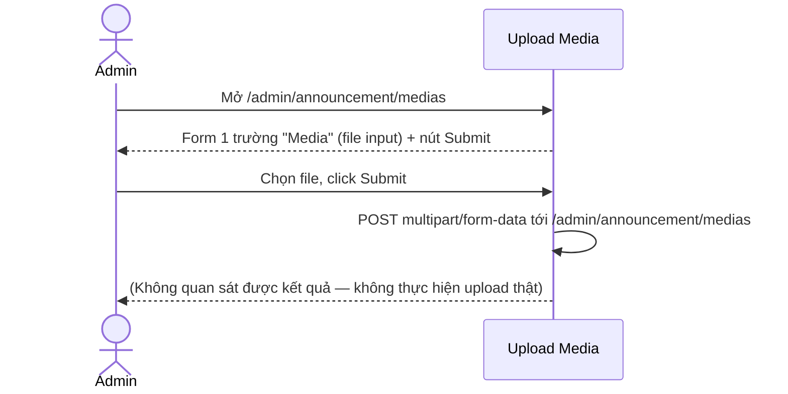
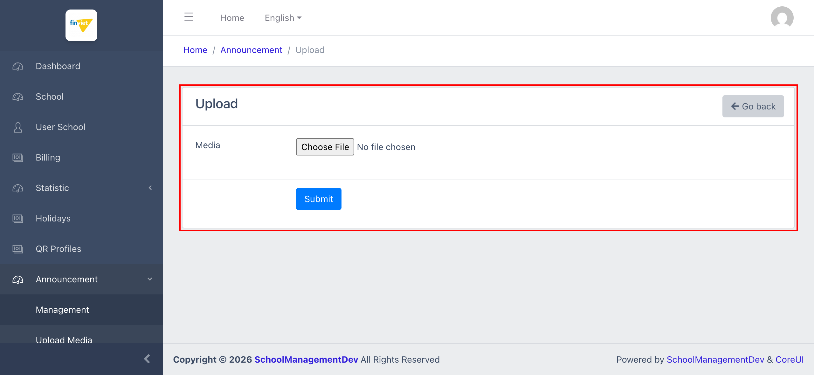

# M8.2 – Announcement: Upload Media (Managing Portal)

> Phạm vi: sub-module **Upload Media** (`/admin/announcement/medias`), sub-module thứ hai trong 2 sub-module của module **Announcement**. Đây là một tiện ích upload file đơn thuần — **không phải** thư viện/gallery quản lý media như tên gọi có thể gợi ý.

## Mục lục

- [1. Tổng quan](#1-tổng-quan)
  - [1.1 Giới thiệu](#11-giới-thiệu)
  - [1.2 Actors](#12-actors)
  - [1.3 Phạm vi](#13-phạm-vi)
- [2. Business Flow](#2-business-flow)
  - [2.1 Sequence Diagram](#21-sequence-diagram)
  - [2.2 Business Steps](#22-business-steps)
  - [2.3 Business Rules](#23-business-rules)
- [3. Feature Breakdown](#3-feature-breakdown)
  - [3.1 Acceptance Criteria](#31-acceptance-criteria)
  - [3.2 Danh sách Use Case](#32-danh-sách-use-case)
  - [3.3 Edge Cases](#33-edge-cases)
  - [3.4 UI Conventions](#34-ui-conventions)

---

## 1. Tổng quan

### 1.1 Giới thiệu

Upload Media là 1 form upload file tối giản — chỉ có 1 trường chọn file (`Media`) và nút `Submit`, không có danh sách file đã tải lên trước đó, không có gallery/thư viện, không có preview. Dựa theo vị trí trong menu (ngay dưới "Management" của module Announcement) và cấu trúc form, đây nhiều khả năng là 1 tiện ích hỗ trợ: tải file lên để lấy URL, sau đó dán thủ công URL đó vào CKEditor Body khi soạn thông báo ở sub-module Management (`M8-announcement/SM1-management.md`) — không phải 1 tính năng quản lý media độc lập.

### 1.2 Actors

| Actor | Mô tả |
|---|---|
| Finviet/SOHA Admin | Tải file (ảnh/tài liệu) lên server để lấy đường dẫn sử dụng khi soạn thông báo. |

### 1.3 Phạm vi

| Trong phạm vi | Ngoài phạm vi |
|---|---|
| Xem cấu trúc form Upload | Thực hiện upload file thật (tránh tạo dữ liệu/file thật trên server dev) |
| Xác nhận endpoint & phương thức submit của form | Xác minh file sau khi upload được dùng như thế nào trong CKEditor của Management (không quan sát trực tiếp được vì không thực hiện upload thật) |

---

## 2. Business Flow

### 2.1 Sequence Diagram

### 2.2 Business Steps

1. Admin mở Upload Media, chọn 1 file từ máy tính.
2. Admin click Submit để tải file lên server.
3. `[Cần xác nhận]` — kết quả sau khi upload (URL trả về, redirect, hay hiển thị lại trên cùng trang) không quan sát được vì không thực hiện upload thật trong quá trình khảo sát.

### 2.3 Business Rules

| ID | Mô tả |
|---|---|
| BR01 | Form chỉ có đúng 1 trường bắt buộc: `Media` (file input, chưa rõ giới hạn định dạng/dung lượng vì không thử upload thật) và nút `Submit`. |
| BR02 | Form submit dạng `POST multipart/form-data` tới chính URL `/admin/announcement/medias` (không có URL `/create` riêng — trang danh sách/tạo dùng chung 1 route). |
| BR03 | Không có bất kỳ danh sách, gallery, hay lịch sử file đã upload nào hiển thị trên trang — nếu admin muốn lấy lại URL 1 file đã tải trước đó, không có cách nào tra cứu lại từ chính sub-module này. |

---

## 3. Feature Breakdown

### 3.1 Acceptance Criteria

- Form phải hiển thị đúng 1 trường file input và nút Submit như quan sát được.
- `[Cần xác nhận]` hành vi sau khi submit thành công (không kiểm chứng được do không thực hiện upload thật).

### 3.2 Danh sách Use Case

| Mã | Tên | Actor | Mô tả | Happy Path | Exception | Business Rules |
|---|---|---|---|---|---|---|
| UC-01 | Tải file media lên server | Admin | Chọn và tải lên 1 file để dùng làm media cho thông báo. | 1. Admin mở `/admin/announcement/medias`. 2. Trang hiển thị form tối giản: Media (Choose File) + Submit.   | Không thực hiện chọn file & Submit thật để tránh upload file thật lên môi trường dev. | BR01, BR02 |

### 3.3 Edge Cases

| # | Tình huống | Quan sát / Rủi ro |
|---|---|---|
| 1 | Không có danh sách file đã upload (BR03) | Nếu admin cần tái sử dụng 1 file đã tải trước đó, hiện không có cách nào tra cứu lại qua UI — phải tải lại file hoặc tự lưu URL đã nhận được ở nơi khác. `[Cần xác nhận]` liệu có tính năng này ở nơi khác (ví dụ trực tiếp trong CKEditor's Image dialog) mà chưa được khảo sát. |
| 2 | Không rõ giới hạn định dạng/dung lượng file | Vì không thử upload thật, chưa xác nhận được validation phía client hay server (loại file cho phép, dung lượng tối đa). `[Cần xác nhận]` |

### 3.4 UI Conventions

- Đây là form đơn giản nhất trong toàn bộ Managing Portal tính đến nay — chỉ 1 trường, không có Description/Note đi kèm như các form Create khác (Billing, Holidays, QR Profiles).
- Không có breadcrumb phụ hay tiêu đề phân biệt rõ đây là 1 tiện ích độc lập hay 1 bước phụ trợ của Management — vị trí trong sidebar (ngay dưới Management) là gợi ý duy nhất về mối quan hệ giữa 2 sub-module.
