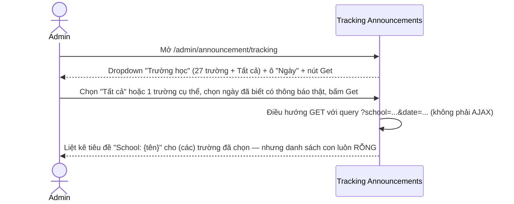
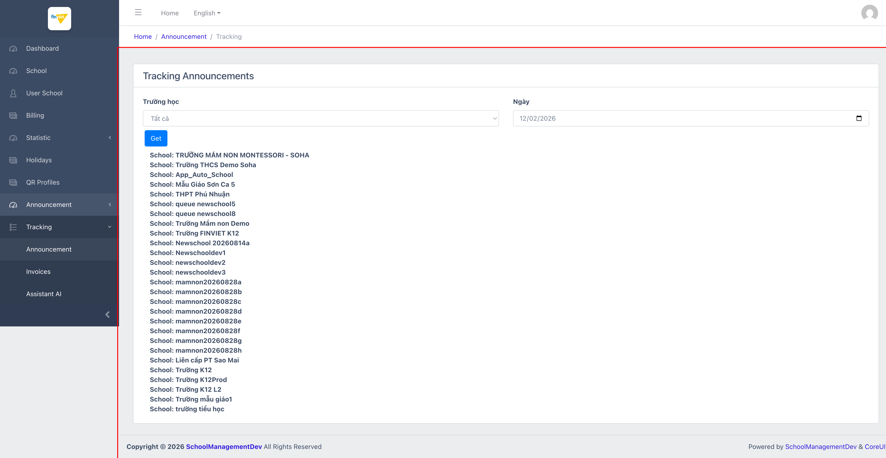
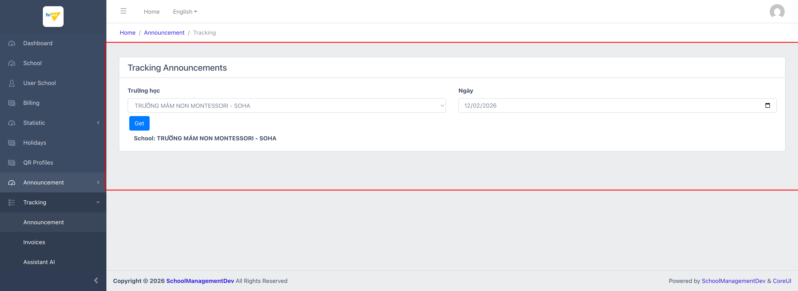

# M9.1 – Tracking: Announcement (Managing Portal)

> Phạm vi: sub-module **Announcement** (`/admin/announcement/tracking`), sub-module đầu tiên trong 4 sub-module của module **Tracking**. Trang này có vẻ được thiết kế để hiển thị dữ liệu theo dõi (đã đọc/chưa đọc?) của thông báo theo từng trường/ngày, nhưng **luôn trả về rỗng trên mọi tổ hợp trường + ngày đã thử**, kể cả trường và ngày chắc chắn có thông báo thật (đối chiếu với `M8-announcement/SM1-management.md`).

## Mục lục

- [1. Tổng quan](#1-tổng-quan)
  - [1.1 Giới thiệu](#11-giới-thiệu)
  - [1.2 Actors](#12-actors)
  - [1.3 Phạm vi](#13-phạm-vi)
- [2. Business Flow](#2-business-flow)
  - [2.1 Sequence Diagram](#21-sequence-diagram)
  - [2.2 Business Steps](#22-business-steps)
  - [2.3 Business Rules](#23-business-rules)
- [3. Feature Breakdown](#3-feature-breakdown)
  - [3.1 Acceptance Criteria](#31-acceptance-criteria)
  - [3.2 Danh sách Use Case](#32-danh-sách-use-case)
  - [3.3 Edge Cases](#33-edge-cases)
  - [3.4 UI Conventions](#34-ui-conventions)

---

## 1. Tổng quan

### 1.1 Giới thiệu

Trang "Tracking Announcements" cho phép chọn 1 trường (hoặc "Tất cả") và 1 ngày cụ thể, sau đó bấm "Get" để xem dữ liệu theo dõi thông báo của (các) trường đó vào ngày đó. Cấu trúc HTML cho thấy mỗi trường có 1 khối `<label>School: {tên trường}</label>` kèm 1 `<ul class="item-list">` rỗng ngay bên dưới — rõ ràng được thiết kế để liệt kê chi tiết (có thể là danh sách người đã đọc/chưa đọc thông báo) nhưng danh sách này **luôn rỗng** trong mọi lần thử.

**Phát hiện quan trọng:** đã thử với ngày 12/02/2026 — ngày mà theo `M8-announcement/SM1-management.md` có ít nhất 3 thông báo thật được gửi (ID 308, 309, 310, trạng thái "submitted") — và cả khi lọc riêng theo đúng trường đã nhận (`TRƯỜNG MẦM NON MONTESSORI - SOHA`), trang vẫn không hiển thị bất kỳ dữ liệu nào. Không phát hiện request AJAX/XHR nào được gửi khi bấm "Get" (route dùng GET query string thông thường, không phải fetch/AJAX) và không có lỗi JS nào trong console — cho thấy đây nhiều khả năng là 1 tính năng **chưa hoàn thiện phía backend** (view đã dựng sẵn cấu trúc HTML nhưng logic populate dữ liệu chưa được nối, hoặc đang join sai bảng/điều kiện) hơn là 1 lỗi hiển thị đơn thuần.

### 1.2 Actors

| Actor | Mô tả |
|---|---|
| Finviet/SOHA Admin | (Dự kiến) tra cứu tình trạng nhận/đọc thông báo của từng trường theo ngày — tính năng hiện không trả về dữ liệu nào để sử dụng thực tế. |

### 1.3 Phạm vi

| Trong phạm vi | Ngoài phạm vi |
|---|---|
| Xem cấu trúc trang, thử lọc theo "Tất cả" và theo 1 trường cụ thể, với ngày có thông báo thật đã biết | Xác định chính xác nguyên nhân backend khiến dữ liệu luôn rỗng (cần truy cập source code/DB, ngoài phạm vi khảo sát UI) |

---

## 2. Business Flow

### 2.1 Sequence Diagram

### 2.2 Business Steps

1. Admin chọn phạm vi trường ("Tất cả" hoặc 1 trường cụ thể qua dropdown) và 1 ngày cụ thể.
2. Admin bấm "Get" — trang điều hướng lại với query string `?school=...&date=...`.
3. `[Cần xác nhận]` — mục đích ban đầu của tính năng (có thể là theo dõi trạng thái đã đọc thông báo của phụ huynh/giáo viên theo ngày) không thể xác nhận được vì không có dữ liệu nào từng hiển thị.

### 2.3 Business Rules

| ID | Mô tả |
|---|---|
| BR01 | Bộ lọc gồm dropdown "Trường học" (27 trường hiện tại + tuỳ chọn "Tất cả") và input "Ngày" (date picker chuẩn), nút "Get" submit dạng GET (không AJAX). |
| BR02 | **[Lỗi/Tính năng chưa hoàn thiện]** Với mọi tổ hợp trường + ngày đã thử — kể cả ngày 12/02/2026 với trường `TRƯỜNG MẦM NON MONTESSORI - SOHA` đã biết chắc có 3 thông báo thật được gửi trong ngày đó — trang luôn hiển thị tiêu đề "School: {tên trường}" nhưng phần nội dung bên dưới (`<ul class="item-list">`) luôn hoàn toàn rỗng, không có bất kỳ dòng dữ liệu nào. |
| BR03 | Không phát hiện request AJAX/XHR hoặc lỗi console nào liên quan khi bấm "Get" — loại trừ khả năng lỗi JS phía client; nhiều khả năng là vấn đề ở logic truy vấn phía server. |
| BR04 | Chọn "Tất cả" hiển thị đủ 27 khối "School: ..." (đúng theo danh sách trường hiện tại của M2 School); chọn 1 trường cụ thể thu gọn đúng còn 1 khối — xác nhận cơ chế lọc theo trường hoạt động đúng ở tầng hiển thị tiêu đề, chỉ riêng phần nội dung chi tiết là rỗng. |

---

## 3. Feature Breakdown

### 3.1 Acceptance Criteria

- `[Không đạt]` Trang phải hiển thị dữ liệu theo dõi thực tế cho ít nhất 1 tổ hợp trường/ngày đã biết có thông báo — không quan sát được trường hợp nào thành công trong quá trình khảo sát.
- Bộ lọc trường/ngày phải phản ánh đúng lựa chọn ở tiêu đề hiển thị — đạt (BR04).

### 3.2 Danh sách Use Case

| Mã | Tên | Actor | Mô tả | Happy Path | Exception | Business Rules |
|---|---|---|---|---|---|---|
| UC-01 | Tra cứu tracking thông báo theo trường & ngày | Admin | Chọn trường + ngày để xem tình trạng theo dõi thông báo. | 1. Admin mở `/admin/announcement/tracking`. 2. Chọn "Tất cả" + ngày 12/02/2026 (ngày có 3 thông báo thật), bấm Get. 3. Trang liệt kê 27 khối "School: ..." — tất cả đều rỗng.    4. Admin lọc riêng trường `TRƯỜNG MẦM NON MONTESSORI - SOHA` (trường chắc chắn có thông báo thật ngày đó) + cùng ngày. 5. Vẫn chỉ hiện tiêu đề, không có dữ liệu.   | Không có exception path nào khác được phát hiện — hành vi rỗng nhất quán trên mọi tổ hợp đã thử. | BR01, BR02, BR03, BR04 |

### 3.3 Edge Cases

| # | Tình huống | Quan sát / Rủi ro |
|---|---|---|
| 1 | Dữ liệu luôn rỗng bất kể trường/ngày (BR02) | Đây là dấu hiệu rõ ràng nhất trong toàn bộ Managing Portal về 1 tính năng có khả năng **chưa từng hoạt động đúng** kể từ khi triển khai — khác với các lỗi UI nhỏ (sort, filter) ở các module khác, đây là toàn bộ mục đích chính của trang không thực hiện được. `[Cần xác nhận]` với đội dev mức độ ưu tiên khắc phục hoặc liệu tính năng này đã bị deprecate. |

### 3.4 UI Conventions

- Layout giống hệt sub-module Invoices (`M9-tracking/SM2-invoices.md`) — cùng pattern "dropdown/date + nút Get + danh sách theo từng trường" — nhưng Invoices có dữ liệu thật trong khi Announcement luôn rỗng, cho thấy 2 trang share chung 1 template nhưng khác nhau ở tầng data-fetching phía sau.
