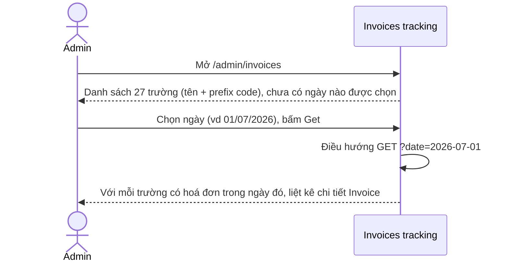
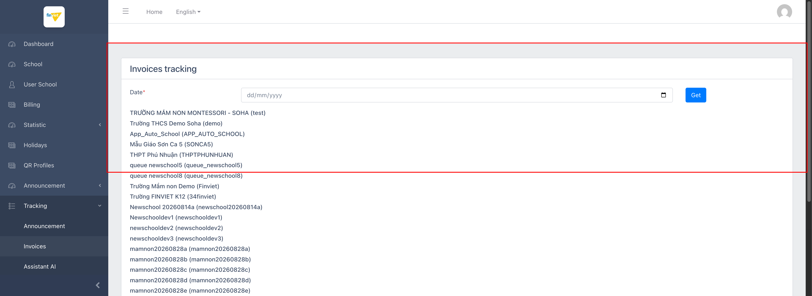
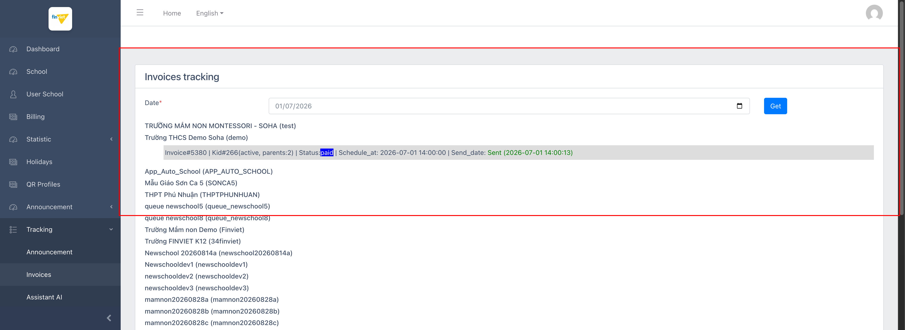

# M9.2 – Tracking: Invoices (Managing Portal)

> Phạm vi: sub-module **Invoices** (`/admin/invoices`), sub-module thứ hai trong 4 sub-module của module **Tracking**. Cùng layout với sub-module Announcement (`M9-tracking/SM1-announcement.md`) nhưng **hoạt động đúng và có dữ liệu thật** — cho phép ops kiểm tra hoá đơn học phí đã được lên lịch/gửi tới phụ huynh vào 1 ngày cụ thể, theo từng trường.

## Mục lục

- [1. Tổng quan](#1-tổng-quan)
  - [1.1 Giới thiệu](#11-giới-thiệu)
  - [1.2 Actors](#12-actors)
  - [1.3 Phạm vi](#13-phạm-vi)
- [2. Business Flow](#2-business-flow)
  - [2.1 Sequence Diagram](#21-sequence-diagram)
  - [2.2 Business Steps](#22-business-steps)
  - [2.3 Business Rules](#23-business-rules)
- [3. Feature Breakdown](#3-feature-breakdown)
  - [3.1 Acceptance Criteria](#31-acceptance-criteria)
  - [3.2 Danh sách Use Case](#32-danh-sách-use-case)
  - [3.3 Edge Cases](#33-edge-cases)
  - [3.4 UI Conventions](#34-ui-conventions)

---

## 1. Tổng quan

### 1.1 Giới thiệu

Invoices tracking cho phép admin chọn 1 ngày và xem, theo từng trường (27 trường, hiển thị kèm Prefix code trong ngoặc), danh sách các hoá đơn học phí (invoice) có lịch gửi (`Schedule_at`) hoặc đã gửi (`Send_date`) vào đúng ngày đó — mỗi dòng gồm mã Invoice, thông tin trẻ (Kid, trạng thái active, số phụ huynh), trạng thái thanh toán (Status: paid/...), và thời gian gửi thực tế.

**Phát hiện quan trọng:** với ngày 01/07/2026, phát hiện 1 hoá đơn thật của trường **Trường THCS Demo Soha** (`demo`) — `Invoice#5380 | Kid#266(active, parents:2) | Status:paid | Schedule_at: 2026-07-01 14:00:00 | Send_date: Sent (2026-07-01 14:00:13)`. Đây là bằng chứng cho thấy **"Trường THCS Demo Soha" cũng là 1 tenant có hoạt động thật** (không chỉ riêng `TRƯỜNG MẦM NON MONTESSORI - SOHA` như các module Billing/Statistic/QR Profiles trước đó cho thấy) — mở rộng nhận định về việc nhiều hơn 1 trường demo có dữ liệu vận hành thật trên dataset dev này.

### 1.2 Actors

| Actor | Mô tả |
|---|---|
| Finviet/SOHA Admin | Kiểm tra xem hoá đơn học phí của các trường có được lên lịch/gửi đúng vào 1 ngày cụ thể hay không — công cụ hỗ trợ debug/đối soát khi trường báo lỗi không nhận được hoá đơn. |

### 1.3 Phạm vi

| Trong phạm vi | Ngoài phạm vi |
|---|---|
| Xem trạng thái mặc định (chưa chọn ngày) | Chỉnh sửa/huỷ hoá đơn trực tiếp từ trang này (không có action nào để làm việc đó — trang thuần hiển thị) |
| Xem dữ liệu thật với ngày 01/07/2026 | Đối chiếu sâu với dữ liệu billing ở M4 (ngoài phạm vi module Tracking) |

---

## 2. Business Flow

### 2.1 Sequence Diagram

### 2.2 Business Steps

1. Admin chọn 1 ngày cần kiểm tra.
2. Admin bấm "Get" — trang liệt kê lại toàn bộ 27 trường, chèn thêm chi tiết hoá đơn (nếu có) ngay dưới tên trường tương ứng.
3. Admin đọc trạng thái từng hoá đơn (Status, Send_date) để xác nhận hoá đơn đã thực sự được gửi hay chưa.

### 2.3 Business Rules

| ID | Mô tả |
|---|---|
| BR01 | Danh sách 27 trường hiển thị dạng "{Tên trường} ({Prefix code})" — cùng định dạng prefix code đã thấy ở M4 Billing. |
| BR02 | Mỗi hoá đơn hiển thị theo định dạng: `Invoice#{id} | Kid#{id}({trạng thái}, parents:{số lượng}) | Status:{trạng thái thanh toán} | Schedule_at: {ngày giờ lên lịch} | Send_date: {Sent/chưa gửi} ({ngày giờ gửi thực tế nếu có})`. |
| BR03 | Trạng thái "paid" và "Sent" được tô màu (xanh dương cho paid, xanh lá cho Sent) để dễ nhận biết trực quan — không phải văn bản thuần. |
| BR04 | Với ngày 01/07/2026: chỉ **1 hoá đơn duy nhất** (của trường "Trường THCS Demo Soha") xuất hiện trong tổng số 27 trường — xác nhận đây cũng là 1 tenant có hoạt động thật, mở rộng danh sách "trường sống" trên dataset dev vốn trước đó chỉ ghi nhận `TRƯỜNG MẦM NON MONTESSORI - SOHA`. |
| BR05 | Không có action nào (Edit/View chi tiết/Resend) đi kèm mỗi dòng hoá đơn — trang thuần tuý chỉ đọc (read-only), dùng để tra cứu nhanh chứ không phải nơi thao tác. |

---

## 3. Feature Breakdown

### 3.1 Acceptance Criteria

- Trang phải liệt kê đúng và đủ 27 trường theo đúng định dạng tên + prefix code.
- Với 1 ngày có hoá đơn thật, trang phải hiển thị đúng thông tin Invoice#/Kid#/Status/Schedule_at/Send_date — đạt, xác nhận qua ngày 01/07/2026.

### 3.2 Danh sách Use Case

| Mã | Tên | Actor | Mô tả | Happy Path | Exception | Business Rules |
|---|---|---|---|---|---|---|
| UC-01 | Tra cứu hoá đơn học phí đã gửi theo ngày | Admin | Kiểm tra hoá đơn học phí đã lên lịch/gửi của các trường vào 1 ngày cụ thể. | 1. Admin mở `/admin/invoices` — mặc định ô Date trống, danh sách 27 trường hiển thị không kèm hoá đơn nào.    2. Admin chọn ngày 01/07/2026, bấm Get. 3. Trường "Trường THCS Demo Soha" hiện 1 dòng chi tiết hoá đơn thật (Invoice#5380, đã thanh toán, đã gửi).   | Không có exception path — 26/27 trường còn lại không có hoá đơn trong ngày đã chọn, hiển thị đúng là không có dòng chi tiết nào (không phải lỗi). | BR01, BR02, BR03, BR04, BR05 |

### 3.3 Edge Cases

| # | Tình huống | Quan sát / Rủi ro |
|---|---|---|
| 1 | Chỉ 1/27 trường có dữ liệu hoá đơn thật trên toàn dataset dev | Củng cố thêm bằng chứng rằng hoạt động thật trên môi trường dev rất tập trung ở 1-2 tenant cụ thể (`TRƯỜNG MẦM NON MONTESSORI - SOHA` cho billing/QR/media, `Trường THCS Demo Soha` cho tuition invoice) — hữu ích khi cần chọn dữ liệu mẫu "thật" để demo hoặc test thủ công trong các phiên làm việc sau. |

### 3.4 UI Conventions

- Cùng layout với sub-module Announcement (`M9-tracking/SM1-announcement.md`): dropdown/date-picker + nút Get + danh sách lặp theo từng trường — nhưng khác biệt rõ rệt ở việc trang này thực sự populate dữ liệu đúng như thiết kế, trong khi Announcement luôn rỗng.
