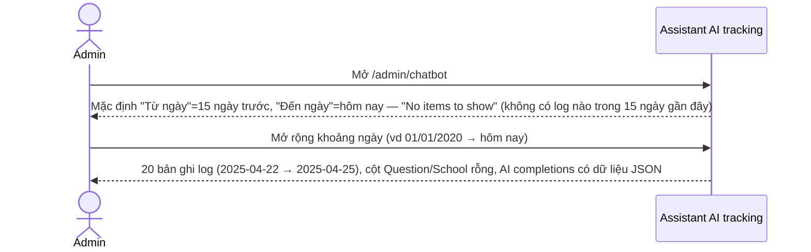
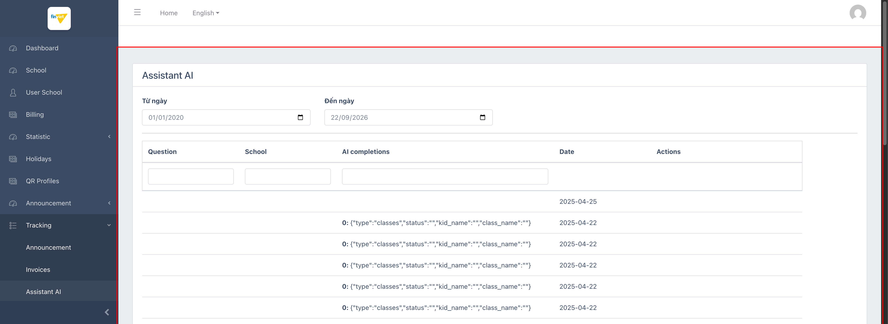

# M9.3 – Tracking: Assistant AI (Managing Portal)

> Phạm vi: sub-module **Assistant AI** (`/admin/chatbot`), sub-module thứ ba trong 4 sub-module của module **Tracking**. Nhật ký truy vấn của tính năng trợ lý AI (chatbot) dành cho phụ huynh/giáo viên — có dữ liệu thật nhưng 2 trong 4 cột dữ liệu (Question, School) luôn để trống.

## Mục lục

- [1. Tổng quan](#1-tổng-quan)
  - [1.1 Giới thiệu](#11-giới-thiệu)
  - [1.2 Actors](#12-actors)
  - [1.3 Phạm vi](#13-phạm-vi)
- [2. Business Flow](#2-business-flow)
  - [2.1 Sequence Diagram](#21-sequence-diagram)
  - [2.2 Business Steps](#22-business-steps)
  - [2.3 Business Rules](#23-business-rules)
- [3. Feature Breakdown](#3-feature-breakdown)
  - [3.1 Acceptance Criteria](#31-acceptance-criteria)
  - [3.2 Danh sách Use Case](#32-danh-sách-use-case)
  - [3.3 Edge Cases](#33-edge-cases)
  - [3.4 UI Conventions](#34-ui-conventions)

---

## 1. Tổng quan

### 1.1 Giới thiệu

Assistant AI tracking liệt kê các lượt truy vấn tới chatbot AI (nhiều khả năng là tính năng hỏi-đáp cho phụ huynh, ví dụ tra cứu lớp/tình trạng học sinh) trong 1 khoảng ngày (Từ ngày/Đến ngày), gồm 4 cột: Question, School, AI completions, Date.

**Phát hiện quan trọng:** với khoảng ngày mặc định (15 ngày gần nhất tính từ hôm nay), trang hiển thị "No items to show" — không phải vì tính năng không hoạt động, mà vì toàn bộ 20 bản ghi log hiện có trên dataset dev đều có `Date` nằm trong tháng 4/2025 (từ 2025-04-22 đến 2025-04-25), rất xa so với ngày hiện tại (09/2026). Mở rộng khoảng ngày về quá khứ (01/01/2020 → hiện tại) mới thấy đủ 20 bản ghi. Trong toàn bộ 20 bản ghi này, **2 cột Question và School luôn trống rỗng ở tầng HTML** (`<td></td>` không có nội dung) — chỉ cột "AI completions" (kết quả JSON đã được AI phân tích ý định, ví dụ `{"type":"classes","status":"","kid_name":"","class_name":""}`) và "Date" có dữ liệu.

### 1.2 Actors

| Actor | Mô tả |
|---|---|
| Finviet/SOHA Admin | Theo dõi mức độ sử dụng và chất lượng phản hồi của trợ lý AI theo thời gian. |

### 1.3 Phạm vi

| Trong phạm vi | Ngoài phạm vi |
|---|---|
| Xem trạng thái mặc định (rỗng do khoảng ngày mặc định không khớp dữ liệu) | Xác định vì sao Question/School không được ghi nhận (cần truy cập source code/DB) |
| Mở rộng khoảng ngày để xác nhận có dữ liệu thật, kiểm tra cấu trúc AI completions | |

---

## 2. Business Flow

### 2.1 Sequence Diagram

### 2.2 Business Steps

1. Admin chọn khoảng ngày cần kiểm tra mức độ sử dụng chatbot.
2. Admin đọc cột "AI completions" để hiểu ý định người dùng đã hỏi (dù không thấy được câu hỏi gốc do cột Question luôn trống).

### 2.3 Business Rules

| ID | Mô tả |
|---|---|
| BR01 | Bộ lọc gồm 2 ô ngày ("Từ ngày"/"Đến ngày", mặc định 15 ngày gần nhất) — không có nút "Get" riêng, tự động submit khi đổi ngày (khác với Announcement/Invoices tracking cùng module). |
| BR02 | Bảng có 4 cột dữ liệu: Question, School, AI completions, Date — cộng cột Actions (cũng luôn trống, không có action nào). |
| BR03 | **[Dữ liệu không đầy đủ]** Toàn bộ 20/20 bản ghi log hiện có đều có cột **Question và School trống hoàn toàn** ở tầng HTML gốc (`<td></td>`) — không phải lỗi hiển thị mà là dữ liệu chưa từng được ghi nhận cho các trường này. |
| BR04 | Cột "AI completions" chứa kết quả đã được AI phân tích thành ý định có cấu trúc (JSON), ví dụ `0: {"type":"classes","status":"","kid_name":"","class_name":""}` — cho thấy chatbot có khả năng phân loại truy vấn thành các "type" (ví dụ "classes" = hỏi về lớp học) nhưng câu hỏi gốc bằng ngôn ngữ tự nhiên không được lưu lại (hoặc không hiển thị) ở đây. |
| BR05 | Toàn bộ 20 bản ghi có Date nằm trong khoảng 2025-04-22 đến 2025-04-25 — 1 đợt sử dụng/test ngắn duy nhất, không có hoạt động nào trước hoặc sau khoảng này tính đến thời điểm khảo sát (09/2026). |

---

## 3. Feature Breakdown

### 3.1 Acceptance Criteria

- Bộ lọc khoảng ngày phải trả về đúng tập bản ghi khớp Date — đạt, xác nhận qua việc mở rộng khoảng ngày.
- Mỗi bản ghi phải thể hiện được câu hỏi gốc (Question) và trường liên quan (School) — **không đạt**, cả 2 cột luôn trống trên toàn bộ dữ liệu hiện có (BR03).

### 3.2 Danh sách Use Case

| Mã | Tên | Actor | Mô tả | Happy Path | Exception | Business Rules |
|---|---|---|---|---|---|---|
| UC-01 | Xem nhật ký truy vấn Assistant AI theo khoảng ngày | Admin | Tra cứu lượt sử dụng chatbot AI trong 1 khoảng thời gian. | 1. Admin mở `/admin/chatbot`, mở rộng khoảng ngày về 01/01/2020 → hôm nay. 2. Trang hiển thị 20 bản ghi, cột AI completions có dữ liệu JSON, cột Date có giá trị — nhưng Question và School trống.   | Với khoảng ngày mặc định (15 ngày gần nhất): "No items to show" vì toàn bộ dữ liệu đã có từ 04/2025, không nằm trong khoảng mặc định. | BR01, BR02, BR03, BR04, BR05 |

### 3.3 Edge Cases

| # | Tình huống | Quan sát / Rủi ro |
|---|---|---|
| 1 | Question và School luôn trống trên mọi bản ghi (BR03) | Làm giảm đáng kể giá trị sử dụng của trang tracking này — admin không thể biết chính xác người dùng đã hỏi gì bằng ngôn ngữ tự nhiên hay hỏi cho trường nào, chỉ suy đoán được qua "type" trong AI completions. `[Cần xác nhận]` đây có phải lỗi ghi log hay 2 cột này vốn dành cho 1 luồng sử dụng khác chưa được kích hoạt trong dataset dev. |
| 2 | Khoảng ngày mặc định (15 ngày gần nhất) không khớp với bất kỳ dữ liệu thật nào hiện có | Nếu không biết cách mở rộng khoảng ngày, admin sẽ lầm tưởng tính năng chatbot chưa từng được ai sử dụng — trong khi thực tế có 20 lượt dùng thật, chỉ là đã hơn 1 năm trước so với thời điểm khảo sát. |

### 3.4 UI Conventions

- Khác với Announcement/Invoices tracking (yêu cầu bấm nút "Get" để submit), Assistant AI tự động lọc lại ngay khi đổi giá trị ô ngày — không có nút submit riêng, 1 điểm khác biệt UI convention trong cùng module Tracking.
