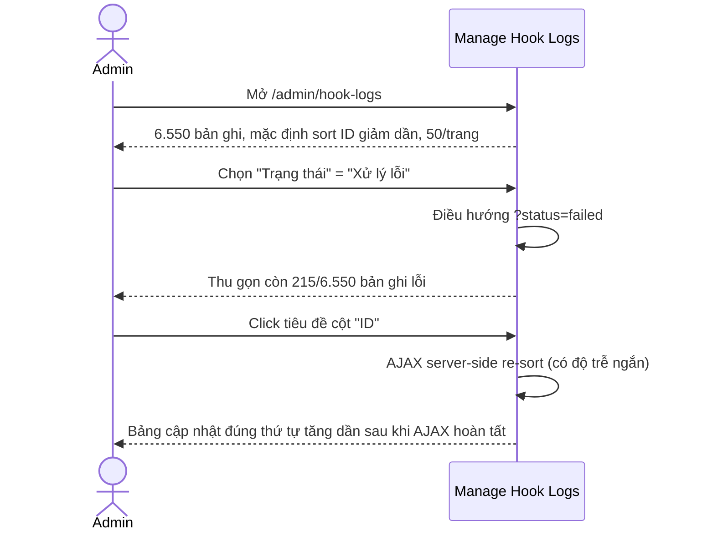
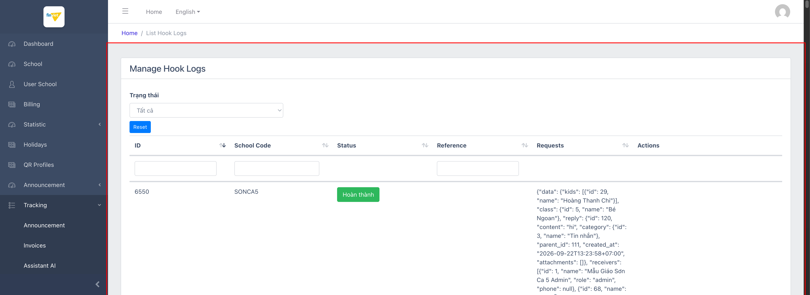
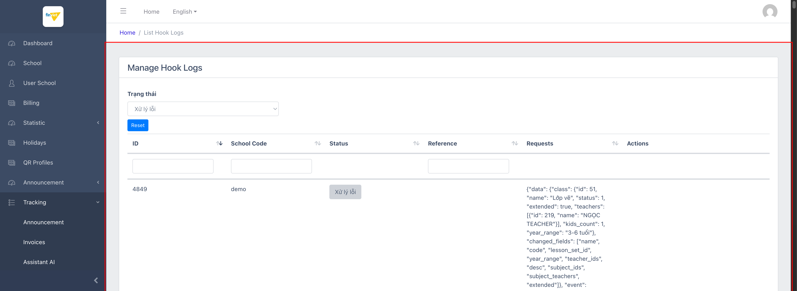

# M9.4 – Tracking: Hook Logs (Managing Portal)

> Phạm vi: sub-module **Hook Logs** (`/admin/hook-logs`), sub-module cuối trong 4 sub-module của module **Tracking**. Nhật ký webhook (sự kiện hệ thống gửi đi/nhận vào) — **bộ dữ liệu lớn nhất từng ghi nhận trong toàn bộ Managing Portal: 6.550 bản ghi**, vượt xa cả Announcement (306 bản ghi, M8). Đây cũng là module đầu tiên xác nhận chức năng **sắp xếp cột hoạt động đúng**, khác với 3 module trước đó.

## Mục lục

- [1. Tổng quan](#1-tổng-quan)
  - [1.1 Giới thiệu](#11-giới-thiệu)
  - [1.2 Actors](#12-actors)
  - [1.3 Phạm vi](#13-phạm-vi)
- [2. Business Flow](#2-business-flow)
  - [2.1 Sequence Diagram](#21-sequence-diagram)
  - [2.2 Business Steps](#22-business-steps)
  - [2.3 Business Rules](#23-business-rules)
- [3. Feature Breakdown](#3-feature-breakdown)
  - [3.1 Acceptance Criteria](#31-acceptance-criteria)
  - [3.2 Danh sách Use Case](#32-danh-sách-use-case)
  - [3.3 Edge Cases](#33-edge-cases)
  - [3.4 Non-Functional Requirements](#34-non-functional-requirements)
  - [3.5 UI Conventions](#35-ui-conventions)

---

## 1. Tổng quan

### 1.1 Giới thiệu

Hook Logs ghi lại các sự kiện webhook (cả gửi ra ngoài lẫn nhận vào, ví dụ thông báo giao dịch ngân hàng ACB, sự kiện `invoice.overdue`, `medicine.reminded`, `communication.reply`...) kèm toàn bộ payload JSON, trạng thái xử lý (Đang xử lý/Hoàn thành/Xử lý lỗi), và trường liên quan. Đây là công cụ debug/giám sát tích hợp hệ thống dành cho đội kỹ thuật.

**Phát hiện quan trọng:**
- **Khối lượng dữ liệu lớn nhất Managing Portal**: 6.550 bản ghi, trải 131 trang — gấp hơn 21 lần Announcement (306, module lớn thứ nhì).
- **Nhiều tenant "sống" cùng lúc**: dữ liệu cho thấy ít nhất 3 trường có hoạt động webhook thật đồng thời — `SONCA5` (Mẫu Giáo Sơn Ca 5, sự kiện `communication.reply`), `demo` (Trường THCS Demo Soha, sự kiện `medicine.reminded`/`medicine.created`), và `APP_AUTO_SCHOOL` (App_Auto_School, sự kiện `invoice.overdue` với số lượng rất lớn) — cùng với `test`/`pnk` (2 school code khác xuất hiện dày đặc trong log về giao dịch ngân hàng ACB).
- **Sắp xếp cột hoạt động đúng** (khác biệt so với M6 Holidays, M7 QR Profiles, M8 Announcement) — nhưng cần chờ 1 khoảng trễ ngắn (round-trip AJAX phía server, do bảng này dùng server-side processing vì khối lượng dữ liệu quá lớn để xử lý phía client) — click 1 lần vào tiêu đề cột ID chuyển đúng từ thứ tự giảm dần (6550→...) sang tăng dần (1→...). Đây là phát hiện quan trọng: 3 module trước bị lỗi sort thật sự (đã xác minh lại có chờ đợi), không phải do đọc kết quả quá sớm.
- **Dấu hiệu khả nghi**: nhiều sự kiện `invoice.overdue` của `APP_AUTO_SCHOOL` lặp lại gần như liên tục (cùng invoice ID xuất hiện ở nhiều dòng log cách nhau 20-40 giây, ví dụ invoice #329 xuất hiện ở cả log lúc 10:01:21 và 10:01:47) — gợi ý 1 cron/job "kiểm tra hoá đơn quá hạn" có thể đang chạy lặp lại bất thường trên cùng 1 tập hoá đơn thay vì chỉ chạy 1 lần/ngày.

### 1.2 Actors

| Actor | Mô tả |
|---|---|
| Finviet/SOHA Admin/Dev | Giám sát và debug các sự kiện webhook — xác định giao dịch ngân hàng nào chưa xử lý xong, sự kiện nào bị lỗi cần xử lý thủ công. |

### 1.3 Phạm vi

| Trong phạm vi | Ngoài phạm vi |
|---|---|
| Xem danh sách tổng quan, lọc theo Trạng thái (Tất cả/Đang xử lý/Hoàn thành/Xử lý lỗi) | Xử lý lại (retry) 1 hook log thất bại — không có action nào cho việc này được tìm thấy |
| Kiểm chứng lại hành vi sắp xếp cột ID (có chờ AJAX) | Đối chiếu sâu từng payload JSON với dữ liệu gốc ở các module nghiệp vụ tương ứng (Billing, School...) |

---

## 2. Business Flow

### 2.1 Sequence Diagram

### 2.2 Business Steps

1. Admin/Dev mở Hook Logs khi cần điều tra 1 sự cố tích hợp (ví dụ giao dịch ngân hàng không được ghi nhận, hoá đơn quá hạn không gửi thông báo).
2. Lọc theo Trạng thái để khoanh vùng nhanh các bản ghi lỗi ("Xử lý lỗi") hoặc đang chờ ("Đang xử lý").
3. Đọc payload JSON đầy đủ trong cột "Requests" để hiểu chi tiết dữ liệu đã được gửi/nhận tại thời điểm đó.

### 2.3 Business Rules

| ID | Mô tả |
|---|---|
| BR01 | Bảng có 6 cột: ID, School Code, Status (badge màu: xanh lá=Hoàn thành, xám=Xử lý lỗi, badge khác cho Đang xử lý), Reference, Requests (chứa payload JSON đầy đủ), Actions. |
| BR02 | **[Dữ liệu trống]** Cột **Reference** và **Actions** luôn trống (`<td></td>`) trên mọi bản ghi đã kiểm tra — tồn tại trong header nhưng chưa từng có nội dung, tương tự pattern đã ghi nhận ở M9 Assistant AI (cột Question/School trống) và các module trước. |
| BR03 | Bộ lọc "Trạng thái" (Tất cả/Đang xử lý/Hoàn thành/Xử lý lỗi) hoạt động đúng — xác nhận qua "Xử lý lỗi" thu gọn chính xác còn 215/6.550 bản ghi. |
| BR04 | **[Xác nhận KHÔNG có lỗi]** Sắp xếp theo cột ID hoạt động đúng khi được chờ đủ thời gian cho round-trip AJAX (bảng này xử lý server-side do khối lượng dữ liệu 6.550 dòng) — khác với kết luận lỗi thật sự ở M6/M7/M8 (đã xác minh lại 3 module đó với cùng phương pháp chờ, kết quả vẫn giữ nguyên là lỗi thật). |
| BR05 | Dữ liệu webhook cho thấy nhiều loại sự kiện khác nhau cùng tồn tại: giao dịch ngân hàng ACB (`BankAPINotify`, không có tên `event` field rõ ràng ở nhóm bản ghi đầu — nhiều khả năng là webhook nhận vào từ cổng ngân hàng), `invoice.overdue`, `medicine.reminded`, `medicine.created`, `communication.reply` — cho thấy hệ thống hook này phục vụ nhiều luồng tích hợp khác nhau (thanh toán, học phí, y tế/thuốc, liên lạc phụ huynh-giáo viên) chứ không chỉ 1 mục đích. |
| BR06 | Các sự kiện có `triggered_by` ghi rõ ai/cái gì kích hoạt: `{"role": "system"}` cho job tự động, hoặc thông tin người dùng cụ thể (`{"id":237,"name":"Ngọc Diễm","role":"parent"}`) cho hành động thật của người dùng — hữu ích để phân biệt log tự động vs. log do thao tác người dùng. |
| BR07 | **[Nghi vấn]** Một số `invoice.overdue` của trường `APP_AUTO_SCHOOL` lặp lại nhiều lần trong khoảng thời gian rất ngắn (vài chục giây) với cùng 1 invoice ID — có dấu hiệu của 1 job/cron chạy lặp lại không đúng chu kỳ dự kiến trên cùng tập dữ liệu, thay vì chỉ ghi nhận 1 lần khi hoá đơn thực sự chuyển trạng thái quá hạn. `[Cần xác nhận]` với đội dev đây là hành vi cron thật hay 1 lỗi trùng lặp event. |

---

## 3. Feature Breakdown

### 3.1 Acceptance Criteria

- Bảng phải hiển thị đúng payload webhook và trạng thái xử lý cho mọi sự kiện — đạt.
- Bộ lọc Trạng thái phải trả về đúng tập con — đạt (BR03).
- Sắp xếp theo cột phải phản ánh đúng thứ tự dữ liệu sau khi chờ xử lý — đạt (BR04), khác biệt tích cực so với các module Tracking khác trong cùng phiên khảo sát.

### 3.2 Danh sách Use Case

| Mã | Tên | Actor | Mô tả | Happy Path | Exception | Business Rules |
|---|---|---|---|---|---|---|
| UC-01 | Xem & lọc nhật ký Hook Logs theo trạng thái | Admin/Dev | Tra cứu toàn bộ sự kiện webhook, khoanh vùng nhanh các bản ghi lỗi. | 1. Admin mở `/admin/hook-logs`. 2. Trang hiển thị 6.550 bản ghi, 50/trang, đủ loại sự kiện (ngân hàng, hoá đơn quá hạn, nhắc thuốc, phản hồi liên lạc).    3. Admin lọc "Trạng thái" = "Xử lý lỗi". 4. Bảng thu gọn đúng còn 215/6.550 bản ghi, cột Reference/Actions vẫn trống.   | Cột Reference và Actions luôn trống trên mọi bản ghi (BR02) — không phải lỗi lọc, mà là dữ liệu/tính năng chưa đầy đủ. | BR01, BR02, BR03, BR05, BR06, BR07 |

### 3.3 Edge Cases

| # | Tình huống | Quan sát / Rủi ro |
|---|---|---|
| 1 | Cột Reference/Actions luôn trống (BR02) | Nếu "Actions" từng dự định có nút "Retry" (thử gửi lại) cho các hook lỗi, tính năng này hiện không khả dụng — admin muốn xử lý lại 215 bản ghi "Xử lý lỗi" sẽ không có cách nào thao tác trực tiếp từ UI này. |
| 2 | `invoice.overdue` lặp lại bất thường trong thời gian ngắn (BR07) | Nếu đây thực sự là lỗi cron, có thể gây spam thông báo "hoá đơn quá hạn" tới phụ huynh nhiều lần cho cùng 1 hoá đơn — ảnh hưởng trải nghiệm người dùng cuối dù nằm ngoài phạm vi UI Managing Portal để xác minh trực tiếp. |
| 3 | Nhiều tenant có hoạt động webhook thật đồng thời | Khác với suy đoán ban đầu từ các module Billing/QR Profiles/Statistic (chỉ 1 tenant "sống"), Hook Logs cho thấy bức tranh đầy đủ hơn: ít nhất 5-6 school code (`SONCA5`, `demo`, `APP_AUTO_SCHOOL`, `test`, `pnk`...) có hoạt động thật — nên khi đánh giá "tenant nào đang hoạt động" trong các khảo sát sau, nên tham chiếu chéo với Hook Logs thay vì chỉ dựa vào 1 module đơn lẻ. |

### 3.4 Non-Functional Requirements

- Với 6.550 bản ghi, bảng dùng xử lý phía server (server-side DataTables) — khác với hầu hết bảng khác trong Managing Portal (thường xử lý phía client do dữ liệu nhỏ) — đây cũng là lý do duy nhất bảng này sắp xếp đúng trong khi các bảng nhỏ hơn (Holidays, QR Profiles, Announcement) bị lỗi.

### 3.5 UI Conventions

- Badge trạng thái dùng màu sắc nhất quán với các module khác đã gặp (xanh lá=thành công, xám=lỗi/trung tính) — nhưng ở đây badge không phải link/button có chức năng, chỉ là hiển thị tĩnh (đã xác nhận không có `onclick`, không nằm trong `<a>`/`<form>`).
- Payload JSON hiển thị dạng text thô, không format/syntax-highlight — với các bản ghi có payload dài (ví dụ `communication.reply` kèm đầy đủ thông tin người nhận), dòng có thể rất dài và khó đọc trên 1 màn hình.
