# System Architecture, Data Topography & Telemetry Diagrams

> **Project:** School Operating Portal (Finviet / SOHA)  
> **Standard:** C4 Model & Mermaid Architecture Topology

---

## 1. C4 System Context Diagram

The School Operating Portal exists as a multi-tenant enterprise system serving internal school operators, external parent applications, and banking gateways.

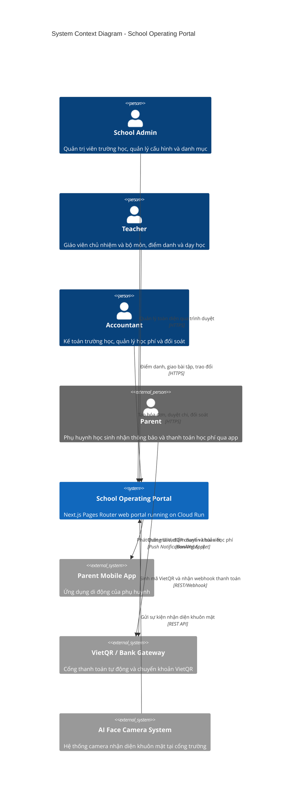

---

## 2. Container & Component Architecture Diagram

The system architecture partitions into an edge reverse proxy, containerized frontend and backend services on Google Cloud Run, persistent data storage, and external integrations.

```mermaid
graph TB
    subgraph Edge["Edge Layer (OpenResty Gateway)"]
        Nginx["OpenResty (Nginx + Lua)<br/>SSL Termination, Rate Limiting, Tenant Routing"]
    end

    subgraph Compute["Compute Layer (Google Cloud Run)"]
        WebContainer["Web Portal Container<br/>Next.js Pages Router + React + Redux<br/>Tailwind CSS + styled-components"]
        ApiContainer["Backend API Container<br/>PHP / Laravel 11 Headless API<br/>Laravel Sanctum Token Auth"]
        WorkerContainer["Background Worker Container<br/>AI Face Recognition & Asynchronous Jobs"]
    end

    subgraph DataStore["Data & Persistence Layer"]
        MainDB[("PostgreSQL / Cloud SQL<br/>Multi-tenant School Database")]
        RedisCache[("Redis Cache & Pub/Sub<br/>Session & Realtime Messaging")]
        CloudStorage[("Google Cloud Storage<br/>Photos, Videos, Homework PDFs")]
    end

    subgraph Observability["Observability & Telemetry"]
        Sentry["Sentry Error Tracking (10% Trace Sampling)"]
        GA4["Google Analytics 4 (gtag)"]
        Clarity["Microsoft Clarity Heatmaps & Replay"]
    end

    Internet[Client Browser] --> Nginx
    Nginx -->|/{schoolCode}/...| WebContainer
    Nginx -->|/{schoolCode}/api/1.0/...| ApiContainer
    WebContainer --> ApiContainer
    ApiContainer --> MainDB
    ApiContainer --> RedisCache
    ApiContainer --> CloudStorage
    ApiContainer --> WorkerContainer
    WorkerContainer --> CloudStorage
    WorkerContainer --> MainDB

    WebContainer -.-> Sentry
    WebContainer -.-> GA4
    WebContainer -.-> Clarity
    ApiContainer -.-> Sentry
```

---

## 3. Core Entity-Relationship Diagram (ERD)

The database schema preserves strong referential integrity across the three priority operational modules.

```mermaid
erDiagram
    SCHOOL ||--o{ CLASS : "has"
    SCHOOL ||--o{ USER : "employs"
    CLASS ||--o{ STUDENT : "enrolls"
    STUDENT ||--o{ GUARDIAN : "has"
    
    %% Vận Hành (Operations)
    CLASS ||--o{ ATTENDANCE : "conducts"
    STUDENT ||--o{ ATTENDANCE : "marked_in"
    CLASS ||--o{ ACTIVITY : "publishes"
    CLASS ||--o{ ALBUM : "owns"
    ALBUM ||--o{ MEDIA_ITEM : "contains"
    MEDIA_ITEM ||--o{ FACE_TAG : "tags"
    STUDENT ||--o{ FACE_TAG : "identified_in"
    
    %% Học Tập (Academics)
    CLASS ||--o{ TIMETABLE : "scheduled_with"
    CLASS ||--o{ ASSIGNMENT : "receives"
    ASSIGNMENT ||--o{ SUBMISSION : "tracks"
    STUDENT ||--o{ SUBMISSION : "submits"
    CLASS ||--o{ GRADEBOOK_ENTRY : "evaluated_in"
    STUDENT ||--o{ GRADEBOOK_ENTRY : "awarded"
    
    %% Tài Chính (Finance)
    SCHOOL ||--o{ FEE_CATALOG_ITEM : "defines"
    CLASS ||--o{ CLASS_FEE_SCHEDULE : "binds"
    FEE_CATALOG_ITEM ||--o{ CLASS_FEE_SCHEDULE : "assigned_in"
    STUDENT ||--o{ INVOICE : "billed_to"
    INVOICE ||--o{ INVOICE_ITEM : "contains"
    INVOICE ||--o{ PAYMENT_RECORD : "settled_by"
    SCHOOL ||--o{ EXPENSE_VOUCHER : "records"
    SCHOOL ||--o{ RECONCILIATION_SESSION : "reconciles"
    %% Nhà Trường (School Governance & Calendar)
    SCHOOL ||--o{ SCHOOL_EVENT : "schedules"
    SCHOOL_EVENT ||..o{ INVOICE : "informs_holiday_meal_refund"

    ATTENDANCE {
        uuid id PK
        uuid student_id FK
        uuid class_id FK
        date attendance_date
        time arrival_time
        time departure_time
        string status "present | excused_absent | unexcused_absent"
        boolean is_late
        float temperature
        string health_condition
        uuid pickup_guardian_id FK
        boolean refund_eligible
    }

    SCHOOL_EVENT {
        uuid id PK
        string school_code FK
        string title
        string category "ngay_nghi | noi_bo | moi_phu_huynh"
        date start_date
        date end_date
        boolean has_specific_time
        time start_time
        time end_time
        string location
        text description
        string cover_image
    }

    INVOICE {
        uuid id PK
        uuid student_id FK
        string invoice_number
        string billing_month
        decimal total_amount
        decimal paid_amount
        decimal meal_deduction_amount
        string payment_status "created | sent | partial | paid | overdue | cancelled"
        string vietqr_string
        date due_date
    }
```

---

## 4. Invoice Lifecycle State Diagram

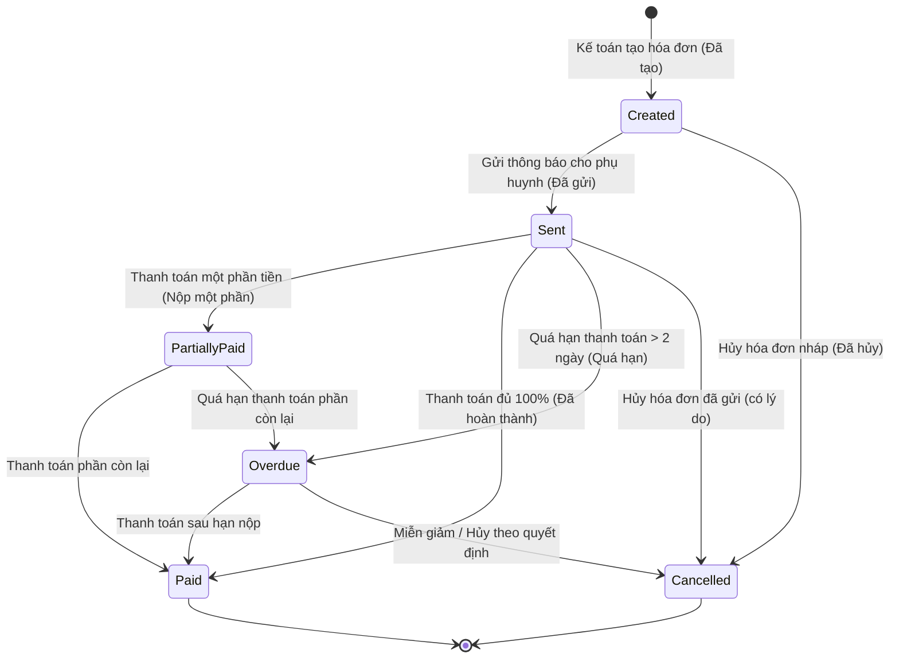

---

## 5. Observability & Telemetry Topology

- **Error Monitoring (Sentry):** Frontend and backend clients capture unhandled runtime exceptions, API HTTP 5xx responses, and Redux error boundaries. Trace sampling is calibrated at 10% to preserve budget and performance.
- **Product Interaction Telemetry (Google Analytics 4):** Tracks critical conversion funnels including `attendance_batch_checkin`, `activity_post_published`, `invoice_generated`, and `reconciliation_completed`.
- **Session Replay (Microsoft Clarity):** Provides visual diagnostic playback and heatmaps to analyze teacher interaction patterns on tablets and desktop browsers.

---

## 6. Academics Gradebook & Evaluation Architecture & State Machine

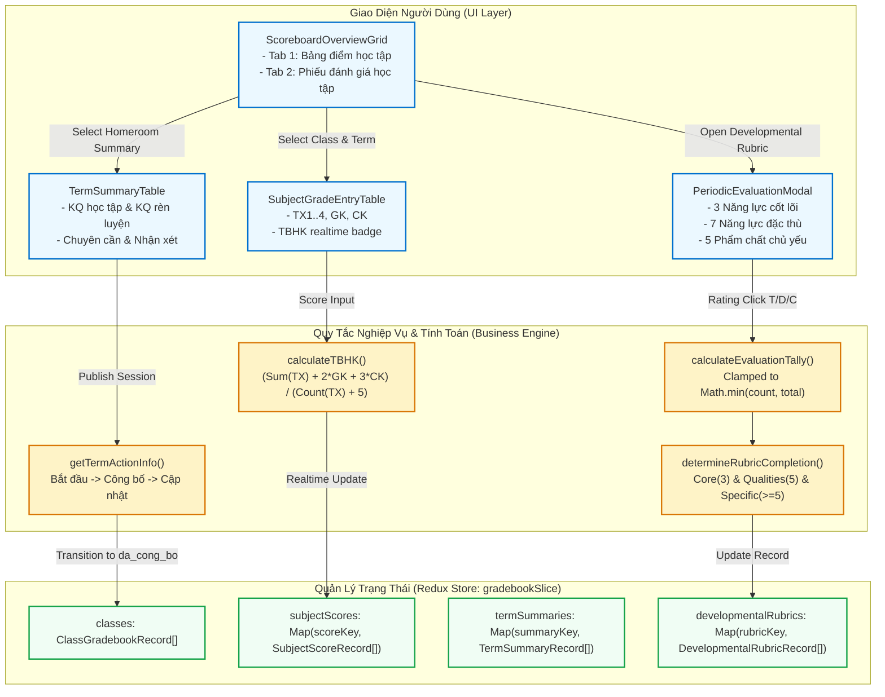

---

## 7. Kiến Trúc Phân Lớp: Quản Lý Học Phí & Hóa Đơn (Finance Invoices & VietQR)

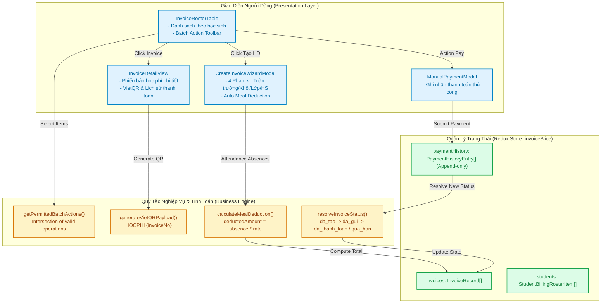

---

## 8. Kiến Trúc Phân Lớp: Danh Mục Khoản Phí (Finance Fee Catalog)

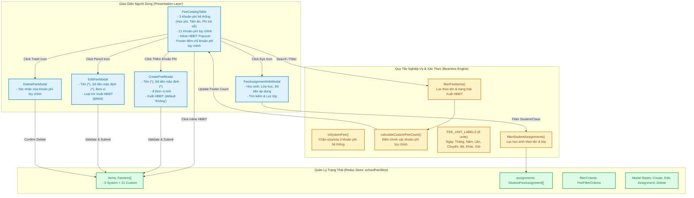

---

## 9. Tuition Management 2D Matrix & Class Fee Schedule Architecture

```mermaid
flowchart TD
    classDef ui fill:#e0f2fe,stroke:#0284c7,stroke-width:2px;
    classDef engine fill:#fef3c7,stroke:#d97706,stroke-width:2px;
    classDef store fill:#dcfce7,stroke:#16a34a,stroke-width:2px;
    classDef ext fill:#f3e8ff,stroke:#9333ea,stroke-width:2px;

    subgraph Overview_Page ["Trang Tổng Quan Quản Lý Học Phí (/school/tuition-management)"]
        OverviewTable["ClassFeeScheduleTable<br/>- 12 lớp cấu hình<br/>- Tìm kiếm & lọc Khối (28 khối)"]:::ui
        ActionMatrix["Icon $: Mở ma trận lớp"]:::ui
        ActionInvoice["Icon Hóa Đơn: Chuyển sang /school/fee?classId"]:::ui
    end

    subgraph Matrix_Page ["Trang Ma Trận Chi Tiết Lớp (/school/tuition-management/:classId)"]
        MatrixTable["ClassFeeMatrixTable<br/>- Bảng 2D: Học sinh x Khoản phí<br/>- Cố định cột thông tin học sinh"]:::ui
        MandatoryInput["Học Phí & Tiền Ăn: Input số tiền bắt buộc"]:::ui
        OptionalToggle["Khoản Tùy Chọn: Toggle switch + Input"]:::ui
        GreenHint["Dòng chữ xanh: 'Phí mặc định: X Đ' (BR04)"]:::ui
        BatchBtn["Icon bút chì đầu cột: Cập nhật hàng loạt"]:::ui
        AddFeeBtn["Nút: Thêm khoản phí vào lớp"]:::ui
        StickySave["Thanh cố định: 'Thay đổi chưa được lưu' (BR10)"]:::ui
    end

    subgraph Modals ["Hộp Thoại Tương Tác"]
        BatchModal["BatchUpdateFeeModal<br/>- Nhập số tiền mới<br/>- Chọn 'Cả lớp' hoặc 'Học sinh gắn thẻ'<br/>- Xuất HĐĐT readonly (BR08)"]:::ui
        AddModal["AddClassFeeModal<br/>- Dropdown loại trừ các khoản đã gán (BR06)<br/>- Gán cho học sinh cụ thể"]:::ui
    end

    subgraph Business_Engine ["Bộ Xử Lý Nghiệp Vụ (src/utils/tuitionManagementValidation.ts)"]
        DivergenceFn["hasPriceDivergence()<br/>Phát hiện chênh lệch với phí mặc định"]:::engine
        HintFn["getDefaultFeeHint()<br/>Tạo nhãn phí mặc định kèm đơn vị"]:::engine
        DedupFn["getAvailableFeesForClass()<br/>Lọc bỏ các khoản phí đã gán cho lớp"]:::engine
        ActiveCountFn["computeActiveStudentsCount()<br/>Đếm số học sinh đang bật khoản tùy chọn"]:::engine
    end

    subgraph Redux_Slice ["Redux Store (tuitionManagementSlice)"]
        StateOverviews["classOverviews: ClassFeeOverview[] (12 lớp)"]:::store
        StateMatrix["matrixRows: StudentFeeMatrixRow[]"]:::store
        StateAssigned["assignedFees: ClassAssignedFee[]"]:::store
        StateDirty["hasUnsavedChanges: boolean"]:::store
    end

    subgraph Ext_Module ["Module Liên Kết"]
        InvoicesMod["Học Phí (/school/fee?classId=12A1)"]:::ext
        FeeCatalogMod["Khoản Phí (/school/school-fees)"]:::ext
    end

    OverviewTable -->|Click Action 1| MatrixTable
    OverviewTable -->|Click Action 2 (BR09)| InvoicesMod
    MatrixTable -->|Render Mandatory Cells| MandatoryInput
    MatrixTable -->|Render Optional Cells| OptionalToggle
    MandatoryInput --> DivergenceFn
    OptionalToggle --> DivergenceFn
    DivergenceFn -->|Khi lệch giá| GreenHint
    OptionalToggle -->|Khi bật/tắt| ActiveCountFn
    ActiveCountFn --> StateAssigned

    BatchBtn --> BatchModal
    AddFeeBtn --> AddModal
    FeeCatalogMod -->|Nguồn danh mục| DedupFn
    DedupFn --> AddModal

    BatchModal -->|Cập nhật học sinh gắn thẻ| StateMatrix
    AddModal -->|Thêm cột khoản phí mới| StateAssigned
    MatrixTable -->|Phát sinh chỉnh sửa| StateDirty
    StateDirty --> StickySave
    StickySave -->|Lưu thay đổi| StateMatrix
```

---

## 11. Finance Expenses & Disbursements Architecture (Khoản Chi)

```mermaid
flowchart TD
    classDef ui fill:#e0f2fe,stroke:#0284c7,stroke-width:2px;
    classDef engine fill:#fef3c7,stroke:#d97706,stroke-width:2px;
    classDef store fill:#ecfdf5,stroke:#059669,stroke-width:2px;
    classDef ext fill:#f1f5f9,stroke:#64748b,stroke-width:2px;

    subgraph Overview_View ["Giao Diện Tổng Quan (/school/expenses)"]
        MonthPicker["Chọn thời gian (Bắt buộc 1 tháng) (BR07)"]:::ui
        Toolbar["Thanh công cụ: Tìm kiếm, Loại phiếu, Trạng thái"]:::ui
        KPICards["Thẻ tổng hợp: Tổng chi, Đã giải ngân, Chờ chi, Nháp/Hủy"]:::ui
        VoucherTable["Bảng danh sách phiếu chi"]:::ui
        ExportBtn["Nút: Xuất dữ liệu (Vô hiệu hóa khi 0 phiếu) (BR09)"]:::ui
        CategoryBtn["Nút: Quản lý danh mục chi phí"]:::ui
    end

    subgraph Detail_View ["Giao Diện Chi Tiết (/school/expenses/:id)"]
        DetailHeader["Tiêu đề phiếu, Trạng thái & Bộ nút theo trạng thái (BR05)"]:::ui
        BeneficiaryCard["Thẻ đối tượng chi: Học sinh (kèm PH) vs Nhân viên (BR02, BR03)"]:::ui
        AccountingMatrix["Bảng hoạch toán chi tiết: 5 cột + Tổng tiền chi (BR04)"]:::ui
        AuditTrail["Nhật ký xử lý: Người lập, Người duyệt, Người chi (NFR03)"]:::ui
    end

    subgraph Create_View ["Giao Diện Tạo Phiếu Chi (/school/expenses/create)"]
        TypeSelector["Loại phiếu: Khác vs Hoàn tiền (kèm thông báo PH) (BR01)"]:::ui
        TargetSelector["Đối tượng: Học sinh vs Nhân viên (BR02)"]:::ui
        MatrixEditor["Soạn bảng hoạch toán: Thêm/Xóa dòng, tự tính thành tiền"]:::ui
        DraftBtn["Nút: Lưu nháp (Trạng thái: Đã tạo) (BR06)"]:::ui
        ApproveBtn["Nút: Lưu & Duyệt chi (Trạng thái: Đã duyệt) (BR06)"]:::ui
    end

    subgraph Modals ["Hộp Thoại Quản Lý"]
        CancelModal["CancelVoucherModal: Bắt buộc nhập lý do hủy (BR05)"]:::ui
        CategoryModal["ExpenseCategoryModal: Thêm/sửa/xóa (Khóa xóa 'Mặc định') (BR08)"]:::ui
    end

    subgraph Engine ["Bộ Xử Lý Nghiệp Vụ (expenseValidation.ts)"]
        CalcRowFn["calculateLineItemTotal(unitPrice, qty)"]:::engine
        CalcTotalFn["calculateVoucherTotal(lines)"]:::engine
        FilterFn["filterVouchers(vouchers, filters)"]:::engine
        PermFn["canCancelVoucher() / canConfirmDisbursement()"]:::engine
        CategoryLockFn["canDeleteCategory() (Khóa 'Mặc định')"]:::engine
    end

    subgraph Redux_Store ["Redux Store (expenseSlice)"]
        StateVouchers["vouchers: ExpenseVoucher[]"]:::store
        StateCategories["categories: ExpenseCategory[]"]:::store
        StateFilters["selectedMonth, searchKeyword, selectedType, selectedStatus"]:::store
    end

    MonthPicker -->|selectedMonth| FilterFn
    FilterFn --> VoucherTable
    VoucherTable -->|Click dòng| DetailHeader
    DetailHeader -->|da_duyet| PermFn
    PermFn -->|Xác nhận chi| StateVouchers
    DetailHeader -->|Hủy phiếu chi| CancelModal
    CancelModal -->|Cập nhật lý do| StateVouchers

    Create_View --> CalcRowFn
    CalcRowFn --> CalcTotalFn
    DraftBtn -->|Tạo phiếu da_tao| StateVouchers
    ApproveBtn -->|Tạo phiếu da_duyet| StateVouchers

    CategoryBtn --> CategoryModal
    CategoryModal --> CategoryLockFn
    CategoryLockFn --> StateCategories
```

---

## 11. Nhà Trường (School Administration) Entity Relationship & Architecture Topology

### 11.1 Master Data Entity-Relationship (ER) Diagram

```mermaid
erDiagram
    GRADE ||--o{ CLASS : "contains"
    CLASS ||--o{ KID : "enrolls (homeroom)"
    CLASS ||--o{ KID : "enrolls (extracurricular)"
    TEACHER ||--o{ CLASS : "homerooms (GVCN)"
    TEACHER }o--o{ CLASS : "teaches (GV phụ trách)"
    TEACHER }o--o{ SUBJECT : "assigned to teach"
    GRADE ||--o{ SUBJECT : "applies to"
    KID ||--o{ PARENT_CONTACT : "has guardians"
    KID ||--o{ GROWTH_RECORD : "tracks physical growth"
    KID ||--o{ TUITION_OVERRIDE : "customizes fees"

    GRADE {
        string id PK
        string code "Mã khối (e.g. 01, 06)"
        string name "Tên khối (e.g. Khối 1, Khối 6)"
        string educationLevel "TH | THCS | THPT | GDTX"
        string schoolYearId FK
    }

    CLASS {
        string id PK
        string code "Mã lớp"
        string name "Tên lớp (e.g. 12A1, Lớp vẽ)"
        string classType "chinh_khoa | ngoai_khoa"
        string gradeId FK "Optional for extracurricular"
        string homeroomTeacherId FK "GVCN for regular"
        int studentCount "Active enrolled count"
    }

    TEACHER {
        string id PK
        string staffCode "Mã nhân viên"
        string fullName "Họ và tên"
        string email "Email đăng nhập"
        string phone "Số điện thoại"
        string address "Địa chỉ"
        string moderationTier "giao_vien_chinh | giao_vien_ho_tro"
        string status "active | on_leave | retired"
    }

    KID {
        string id PK
        string studentCode "Mã học sinh"
        string fullName "Họ và tên"
        string nickname "Biệt danh"
        string cccd "Số CCCD"
        date birthDate "Ngày sinh"
        string gender "male | female"
        string homeroomClassId FK
        string extracurricularClassId FK "Optional"
        string status "active | suspended | archived"
        string internalNotes "Ghi chú học sinh"
    }

    PARENT_CONTACT {
        string id PK
        string kidId FK
        string role "mother | father | guardian | other"
        string fullName "Họ và tên"
        string phone "Số điện thoại"
        string email "Email"
        string cccd "Số CCCD"
        string address "Địa chỉ"
    }

    GROWTH_RECORD {
        string id PK
        string kidId FK
        date recordedDate "Ngày ghi nhận"
        float heightCm "Chiều cao (cm)"
        float weightKg "Cân nặng (kg)"
        float bmi "BMI = weight / (height/100)^2"
        string recorderName "Người ghi nhận"
        string note "Ghi chú"
    }

    SUBJECT {
        string id PK
        string code "Mã môn (e.g. 01, 15, 34)"
        string name "Tên môn học (e.g. Toán)"
        string educationLevel "TH | THCS | THPT | GDTX"
        string subjectType "mon_hoc | hoat_dong_gd | mon_tinh_diem | mon_nhan_xet"
        string category "bat_buoc | tu_chon | lua_chon"
        boolean isSummarized "Tính tổng kết"
        string schoolYearId FK
    }
```

### 11.2 Student Profile Hub 360° Contextual Embedding Architecture

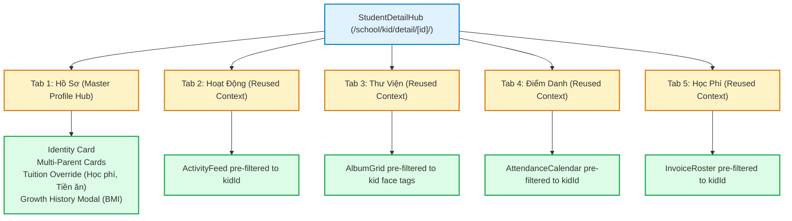

---

## 12. School Administration Phase 2 Architecture & Topography Diagrams

Section 12 captures the architectural topologies, entity relationships, and state machines for School Administration Phase 2 sub-modules:
- Bảng Thông Tin (School Announcements)
- Bình Chọn (School Polls & Surveys)
- Thực Đơn (Nutrition & Weekly Menus)
- Điểm Danh NV (Staff & Teacher Attendance)
- Sổ Tay PH (Parent Handbook & Guidelines)

### 12.1 Phase 2 Entity Relationship Diagram (ERD)

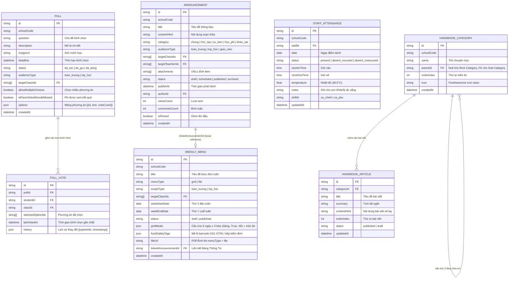

### 12.2 Menu-to-Announcement Automated Publishing Pipeline

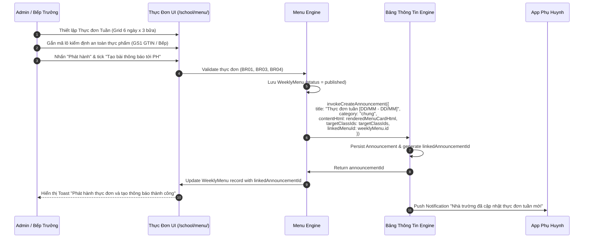

### 12.3 Poll Lifecycle & Change-History State Machine

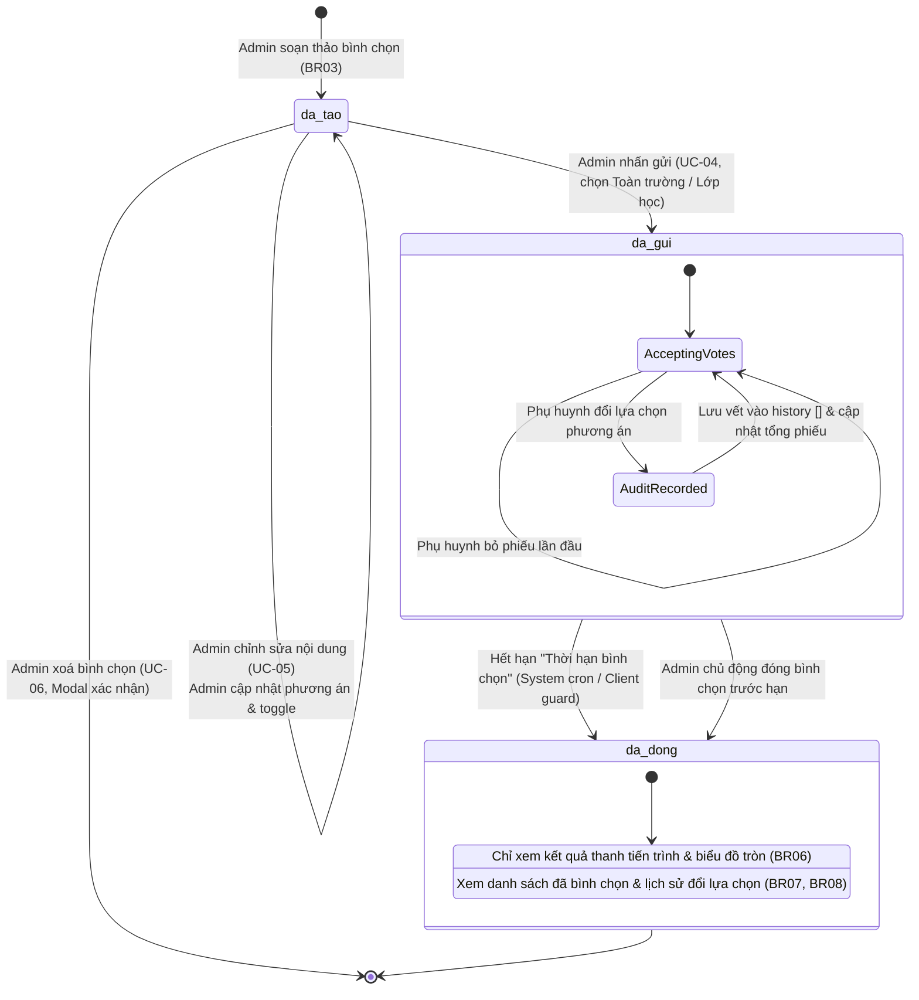

### 12.4 Staff Attendance High-Throughput & Metric Suppression Topology

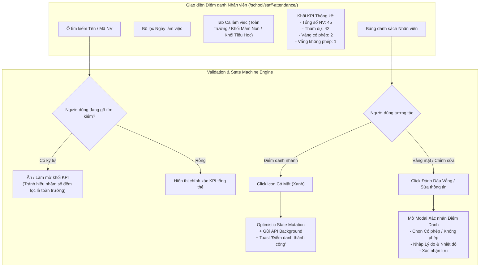

### 12.5 Parent Handbook 2-Tier Hierarchy Navigation Topology

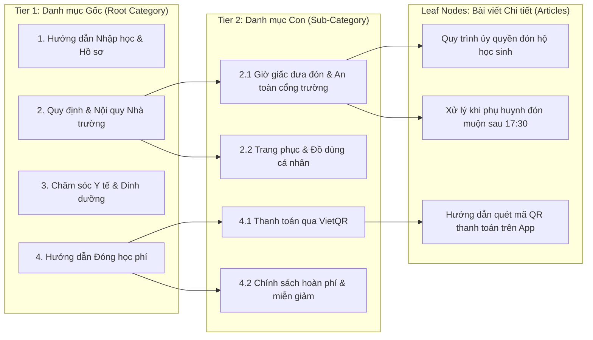

---

## 13. School Administration Phase 3 Architecture & Lifecycle Diagrams

### 13.1 Phase 3 Entity Relationship Diagram (ERD)

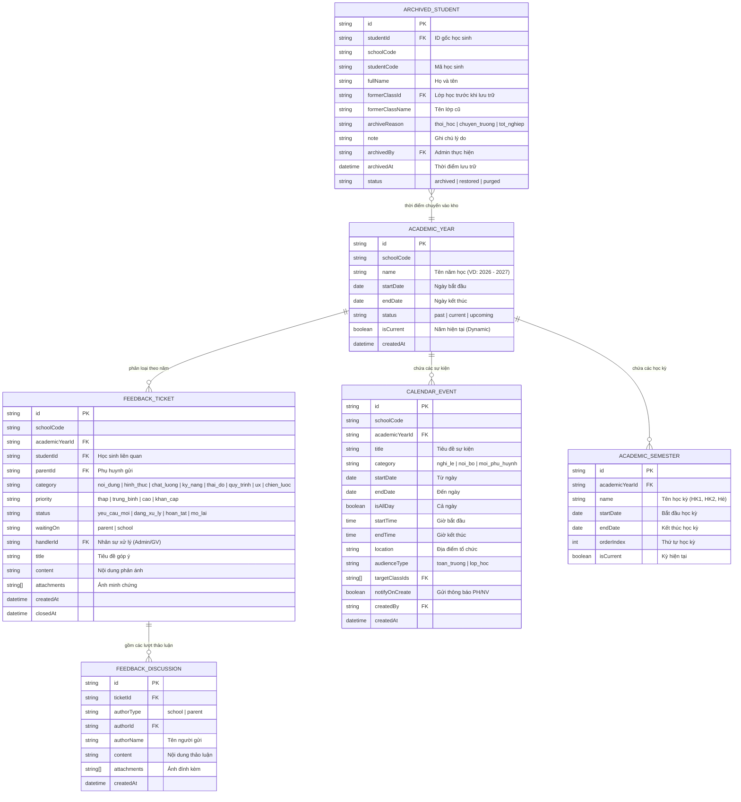

### 13.2 Feedback Ticket Lifecycle & Discussion State Machine

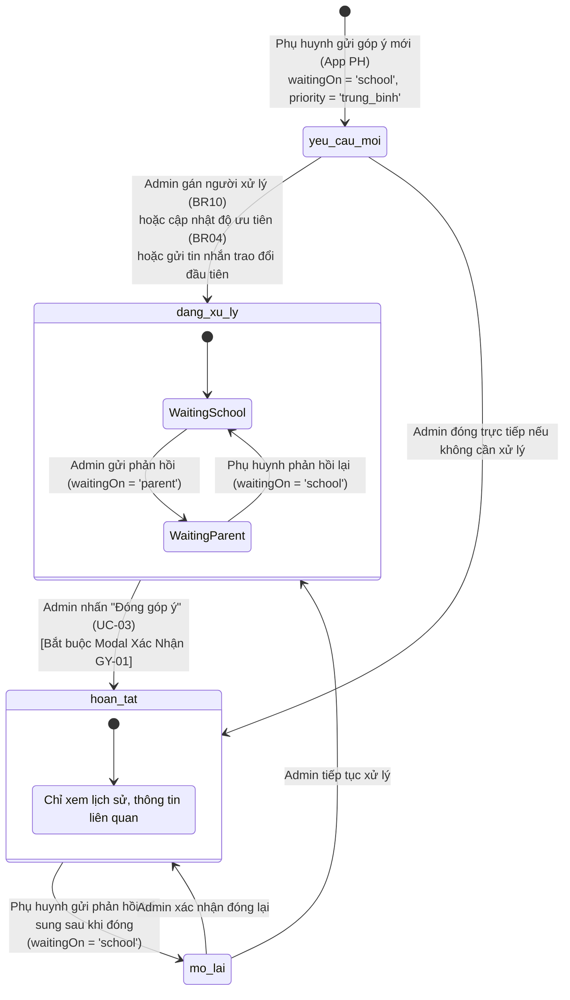

### 13.3 Calendar Multi-View Rendering & Event Aggregation Topology

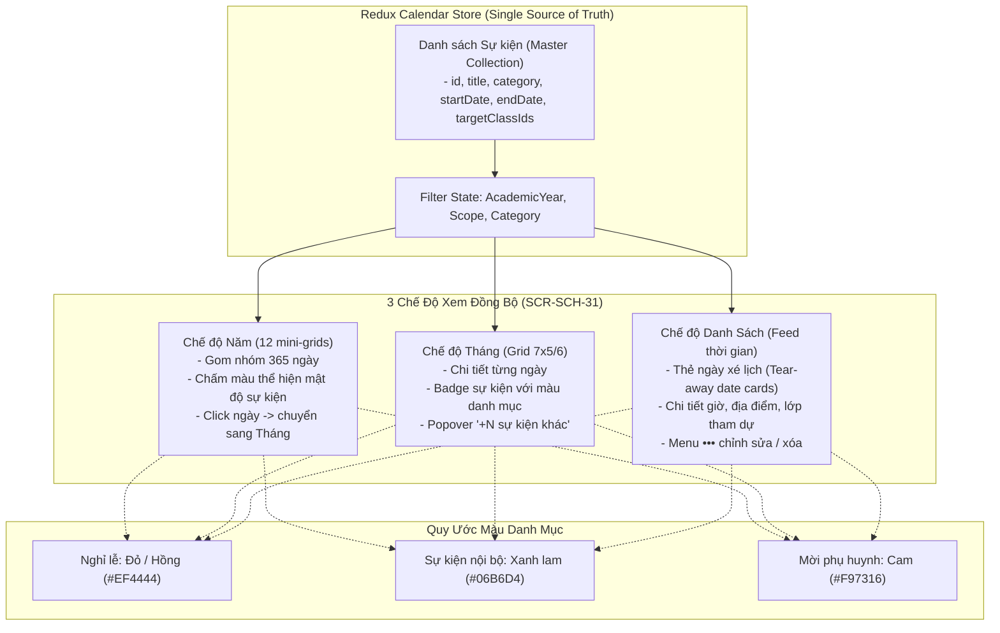

### 13.4 Student Archive Isolation & Two-Step Purge Sequence

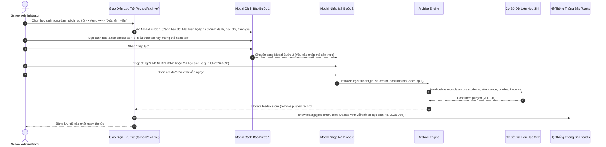

---

## 14. Finance: Miễn Giảm (Tuition Exemption & Discount Management) Architecture & ER Diagrams

### 14.1 Entity Relationship Diagram (ERD)

```mermaid
erDiagram
    SCHOOL_FEE_ITEM ||--o{ DISCOUNT_POLICY : "áp dụng cho khoản thu"
    DISCOUNT_POLICY ||--o{ DISCOUNT_TARGET : "gồm các đối tượng thụ hưởng"
    DISCOUNT_POLICY ||--o{ INVOICE_DISCOUNT_LINE : "sinh ra các dòng khấu trừ"
    TUITION_INVOICE ||--o{ INVOICE_DISCOUNT_LINE : "chứa các khoản giảm trừ"
    KID ||--o{ DISCOUNT_TARGET : "thụ hưởng diện cá nhân"
    CLASS ||--o{ DISCOUNT_TARGET : "thụ hưởng diện tập thể"

    DISCOUNT_POLICY {
        string id PK
        string schoolCode
        string code "Mã chính sách (e.g. MG-2026-001)"
        string name "Tên chính sách miễn giảm"
        string discountType "percent | fixed_amount"
        float discountValue "Giá trị (% hoặc số tiền VND)"
        string feeItemId FK "Khoản thu áp dụng"
        string feeItemName "Tên khoản thu"
        string scopeType "class | student"
        string validityType "academic_year | month_range"
        string academicYearId FK "Optional"
        string fromMonth "YYYY-MM (Optional)"
        string toMonth "YYYY-MM (Optional)"
        string reason "Lý do miễn giảm"
        string status "active | paused | expired"
        string createdBy FK "Admin tạo chính sách"
        datetime createdAt
        datetime updatedAt
    }

    DISCOUNT_TARGET {
        string id PK
        string discountPolicyId FK
        string targetType "class | student"
        string targetId FK "ID của lớp hoặc học sinh"
        string targetName "Tên lớp hoặc họ tên học sinh"
        string targetClass "Tên lớp của học sinh (nếu là student)"
    }

    SCHOOL_FEE_ITEM {
        string id PK
        string code "Mã khoản phí"
        string name "Tên khoản phí (Học phí, Tiền ăn, Xe đưa đón)"
        string feeType "bat_buoc | tu_nguyen"
        int standardAmount "Đơn giá chuẩn (VND)"
        string billingCycle "thang | ky | nam | mot_lan"
    }

    TUITION_INVOICE {
        string id PK
        string invoiceCode "Mã hóa đơn (e.g. HĐ-2026-089)"
        string studentId FK
        string classId FK
        string billingPeriod "Tháng/Kỳ thu"
        int totalGrossAmount "Tổng tiền biểu phí gốc"
        int totalDiscountAmount "Tổng tiền miễn giảm"
        int totalMealRefund "Hoàn tiền ăn do vắng có phép"
        int netPayableAmount "Thực thu = Gross - Discount - Meal"
        string status "da_tao | da_gui | da_thanh_toan | thanh_toan_mot_phan | qua_han | da_huy"
    }

    INVOICE_DISCOUNT_LINE {
        string id PK
        string invoiceId FK
        string discountPolicyId FK "Bảo toàn tham chiếu lịch sử"
        string feeItemId FK "Khoản thu bị trừ"
        string policyCode "Mã chính sách tại thời điểm lập HĐ"
        string policyName "Tên chính sách tại thời điểm lập HĐ"
        string discountType "percent | fixed_amount"
        float discountValue "Giá trị chiết khấu áp dụng"
        int deductionAmount "Số tiền được giảm trừ thực tế (VND)"
        datetime appliedAt "Thời điểm tính toán hóa đơn"
    }
```

### 14.2 Discount Calculation Pipeline & Conflict Resolution Architecture

```mermaid
graph TD
    subgraph Inputs["1. Dữ Liệu Đầu Vào Lập Hóa Đơn"]
        Student["Học Sinh (ID, Tên, Lớp ID)"]
        FeeItems["Danh Mục Khoản Thu Áp Dụng (Biểu Phí Lớp/Trường)"]
        BillingPeriod["Kỳ Thu (Tháng/Năm)"]
        ActivePolicies["Danh Sách Chính Sách Đang Hoạt Động (Status = 'active')"]
    end

    subgraph ScopeMatching["2. Đối Soát Đối Tượng Thụ Hưởng"]
        MatchStudent{"Khớp Student ID?"}
        MatchClass{"Khớp Class ID?"}
    end

    subgraph ConflictResolution["3. Xử Lý Trùng Lặp & Thứ Tự Ưu Tiên (K016)"]
        ScopeSpecificity["Ưu Tiên Specificity:<br/>Chính sách Cá nhân > Chính sách Lớp"]
        HighestPriority["Ưu Tiên Mức Giảm Cao Nhất:<br/>Math.max(Rate 1, Rate 2)"]
        LineItemIndependence["Tách Biệt Khoản Thu:<br/>Học phí, Tiền ăn, Xe tính độc lập"]
    end

    subgraph MathClamping["4. Tính Toán & Giới Hạn Không Âm"]
        ComputePercent["% * Đơn giá khoản thu"]
        ComputeFixed["min(Số tiền cố định, Đơn giá khoản thu)"]
        ClampZero["Deduction = min(CalculatedDeduction, GrossLineItem)"]
    end

    subgraph Output["5. Xuất Dòng Hóa Đơn & Đóng Băng Lịch Sử (K017)"]
        InvoiceLine["Tạo Dòng Giảm Trừ:<br/>'Miễn giảm: {Tên chính sách}' (-X đ)"]
        NetPayable["Thực Thu = Tổng Khoản Thu - Giảm Trừ - Hoàn Tiền Ăn"]
        FrozenAudit["Lưu Snapshot INVOICE_DISCOUNT_LINE (Bất biến)"]
    end

    Student & ActivePolicies --> MatchStudent
    Student & ActivePolicies --> MatchClass

    MatchStudent --> ScopeSpecificity
    MatchClass --> ScopeSpecificity
    ScopeSpecificity --> HighestPriority
    HighestPriority --> LineItemIndependence

    LineItemIndependence --> ComputePercent & ComputeFixed
    ComputePercent & ComputeFixed --> ClampZero
    ClampZero --> InvoiceLine
    InvoiceLine --> NetPayable
    InvoiceLine --> FrozenAudit
```

### 14.3 Temporal Expiration & Historical Immutability Guarantee

```mermaid
graph LR
    subgraph PolicyTimeline["Vòng Đời Chính Sách Miễn Giảm"]
        PActive["Chính sách Hoạt Động<br/>(Kỳ 2026-09 đến 2026-12)"]
        PChange["Kế toán Sửa/Tạm dừng/Hết hạn<br/>(Tại thời điểm 2027-01)"]
    end

    subgraph Invoices["Hóa Đơn Qua Các Kỳ"]
        InvPast["Hóa Đơn Tháng 10/2026<br/>(Trạng thái: Đã thu tiền)<br/>Giảm trừ: -500.000 đ"]
        InvFuture["Hóa Đơn Tháng 02/2027<br/>(Trạng thái: Tạo mới)<br/>Giảm trừ: 0 đ hoặc theo CS mới"]
    end

    PActive -->|Áp dụng vào| InvPast
    PChange -.->|Bị chặn: Không ảnh hưởng| InvPast
    PChange -->|Ảnh hưởng đợt phát hành mới| InvFuture

    style InvPast fill:#dcfce7,stroke:#16a34a,stroke-width:2px;
    style InvFuture fill:#fef3c7,stroke:#d97706,stroke-width:2px;
    style PChange fill:#fee2e2,stroke:#ef4444,stroke-width:2px;
```

---

## 15. Cấu Hình: Học Phí (Settings Fee Configuration Architecture & Component Topology)

### 15.1 Settings Fee Multi-Block Component & Redux State Topology

```mermaid
graph TB
    subgraph ViewLayer["1. UI Presentation Layer (/setting/fee/)"]
        Header["Header Toolbar & Breadcrumbs"]
        B1["Khối 1: Ghi chú hóa đơn (UC-01)<br/>Textarea + Lưu độc lập"]
        B2["Khối 2: Thanh toán Sepay (UC-02)<br/>Secret/Webhook Readonly + Link Lịch sử"]
        B3["Khối 3: Hóa đơn điện tử SInvoice (UC-03)<br/>Collapsible Card + 6 Required Inputs + 2 Toggles"]
        B4["Khối 4: Trả trễ & Báo vắng (UC-04)<br/>Fixed/Tiered Surcharge + 101h Combobox + Giờ HĐ"]
        B5["Khối 5: Email đối soát (UC-05)<br/>Max 3 Emails + Regex & Duplicate Validation"]
        GuardModal["UnsavedChangesModal<br/>Route Navigation Guard"]
    end

    subgraph StateLayer["2. Redux State Store (settingFeeSlice.ts)"]
        S1["draft.invoiceNote<br/>dirtyFlags.invoiceNote"]
        S2["sepay.credentials<br/>(Immutable from Server)"]
        S3["draft.sinvoice<br/>dirtyFlags.sinvoice"]
        S4["draft.latePickupAndRefund<br/>dirtyFlags.latePickupAndRefund"]
        S5["draft.reconciliation<br/>dirtyFlags.reconciliation"]
        GlobalDirty{"hasUnsavedChanges?<br/>any(dirtyFlags) === true"}
    end

    subgraph ValidationEngine["3. Pure Validation Engine (settingFeeValidation.ts)"]
        V_Email["validateEmailCandidate()<br/>RFC 5322 Regex + Duplication Check"]
        V_Tier["validateTierDeletion()<br/>Row 1 Protected, Length >= 2 required"]
        V_SInvoice["validateSInvoicePayload()<br/>6 Mandatory Fields + Masked Pass"]
    end

    B1 --> S1
    B2 --> S2
    B3 --> V_SInvoice --> S3
    B4 --> V_Tier --> S4
    B5 --> V_Email --> S5

    S1 & S3 & S4 & S5 --> GlobalDirty
    GlobalDirty -->|Route change attempt| GuardModal
```

### 15.2 Childcare Surcharge & Absence Refund Policy Engine Topology

```mermaid
flowchart TD
    subgraph InputParameters["1. Tham Số Cấu Hình Trả Trễ & Báo Vắng"]
        LateToggle{"Về muộn bật?"}
        ModeSelect{"Phương thức tính phí?"}
        FixedSettings["Fixed Rate:<br/>Interval: 5-60m (step 5)<br/>Đơn giá: X đ/hs/h"]
        TieredSettings["Tiered Brackets Table:<br/>Dòng 1: [17:00 - 17:30] -> 30.000 đ<br/>Dòng 2: [17:30 - 18:00] -> 60.000 đ"]
        AbsentToggle{"Báo vắng bật?"}
        CutoffHours["Báo trước X giờ (0-100h)"]
        SchoolHours["Giờ hoạt động trường (T2-T7)<br/>(Tham chiếu từ SM1-truong)"]
    end

    subgraph EvaluationEngine["2. Invoicing & Absence Evaluation"]
        CalcLate["Tính phí đón muộn trên báo cáo điểm danh<br/>(Áp dụng theo Fixed hoặc Tiered)"]
        EvaluateAbsence["Đánh giá giờ phụ huynh gửi báo vắng<br/>so với giờ mở cửa trường - X giờ"]
        ConditionalRefund["Hoàn tiền ăn cho ngày nghỉ báo hợp lệ"]
        UnconditionalRefund["Tự động hoàn tiền ăn cho tất cả ngày nghỉ"]
    end

    LateToggle -->|Bật| ModeSelect
    LateToggle -->|Tắt| CalcLateDisabled["Không tính phí về muộn (0 đ)"]
    ModeSelect -->|Theo giờ cố định| FixedSettings --> CalcLate
    ModeSelect -->|Theo khung giờ| TieredSettings --> CalcLate

    AbsentToggle -->|Bật| CutoffHours & SchoolHours --> EvaluateAbsence --> ConditionalRefund
    AbsentToggle -->|Tắt| UnconditionalRefund
```

---

## 16. Nhà Trường: Lịch Sự Kiện (School Event Calendar Architecture, Topology & State Machine)

### 16.1 Component Hierarchy & Route Structure (SCR-SCH-31, SCR-SCH-32, SCR-SCH-33)

The School Event Calendar is structured around a centralized main calendar dashboard supporting 3 distinct rendering modes (`nam`, `thang`, `su_kien`) backed by dedicated creation and editing route pages.

```mermaid
graph TB
    subgraph Layout["App Shell & Navigation"]
        Shell["PortalLayout (Sidebar, Topbar, Tenant Context)"]
    end

    subgraph CalendarDashboard["Main Dashboard: /[schoolCode]/school/calendar (SCR-SCH-31)"]
        Toolbar["CalendarToolbar<br/>- Year Selector (2021-2030+)<br/>- Month Nav (Prev/Next/Current)<br/>- View Switcher (Năm / Tháng / Sự kiện)<br/>- '+ Tạo sự kiện' CTA Button"]
        
        subgraph ViewModes["3 View Projection Modes (Single Data Store)"]
            YearView["CalendarYearView<br/>- 12 Mini-Month Matrix<br/>- Continuous Multi-Day Color Spans<br/>- Bottom Color Legend (3 Categories)<br/>- Click Day -> Open Detail Modal"]
            MonthView["CalendarMonthView<br/>- 7x5/6 Grid (T2-CN Vietnamese Headers)<br/>- Multi-Day Continuous Event Chips<br/>- Cell Overflow Handling (+N more)<br/>- Click Event -> Open Detail Modal"]
            AgendaView["CalendarAgendaView<br/>- Segmented Filter: 'Sắp tới' vs 'Tất cả'<br/>- Chronological Timeline Grouping<br/>- Category Badge, Time, Location<br/>- Inline Action Buttons (Edit / Delete)"]
        end

        subgraph Modals["Inspection & Confirmation Modals"]
            DetailModal["EventDetailModal<br/>- Readonly Event Summary Card<br/>- Category Badge, Time/Date Range<br/>- Location, Description, Attachments<br/>- 'Chỉnh sửa' Jump to Edit Route"]
            DeleteModal["EventDeleteConfirmModal (LS-01)<br/>- Dialog: 'Vui lòng xác nhận xóa sự kiện {tên}'<br/>- Confirm / Cancel Actions"]
        end
    end

    subgraph AuthoringRoutes["Dedicated Authoring Pages"]
        CreatePage["CreateEventPage: /[schoolCode]/school/calendar/create (SCR-SCH-32)<br/>- Cover Image Upload Box<br/>- Title Input (Required)<br/>- 3 Category Radio Pills (Rose, Teal, Amber)<br/>- Date Pickers (Từ ngày - Đến ngày, Auto-sync)<br/>- 'Thêm thời gian' Toggle -> HH:mm Start/End<br/>- Location & WYSIWYG Description<br/>- Attachment Dropzone<br/>- Save / Cancel Buttons"]
        EditPage["EditEventPage: /[schoolCode]/school/calendar/edit/[eventId] (SCR-SCH-33)<br/>- Prefilled Event Form<br/>- Dynamic ID Param Routing<br/>- Update / Cancel Buttons"]
        DirtyGuard["UnsavedChangesModal (LS-02)<br/>- Triggered on dirty form cancel/navigate"]
    end

    Shell --> CalendarDashboard
    CalendarDashboard --> Toolbar
    Toolbar --> YearView & MonthView & AgendaView
    YearView & MonthView --> DetailModal
    AgendaView --> DeleteModal
    DetailModal -->|Click Edit| EditPage
    Toolbar -->|Click '+ Tạo sự kiện'| CreatePage
    AgendaView -->|Click Edit Icon| EditPage
    AgendaView -->|Click Delete Icon| DeleteModal
    CreatePage -.->|Dirty Form Exit| DirtyGuard
    EditPage -.->|Dirty Form Exit| DirtyGuard
```

### 16.2 Redux State Topography & Unified Data Store Model

All 3 calendar views project from a single normalized event collection in `calendarSlice.ts`, ensuring zero desynchronization when switching between Year, Month, and Agenda modes.

```mermaid
graph TB
    subgraph UIComponents["Presentation Layer"]
        YearComp["CalendarYearView"]
        MonthComp["CalendarMonthView"]
        AgendaComp["CalendarAgendaView"]
        ToolbarComp["CalendarToolbar"]
        ModalComp["EventDetailModal"]
    end

    subgraph ReduxSlice["Redux State Machine: calendarSlice.ts"]
        subgraph ViewState["Viewport & Filter State"]
            SelYear["selectedYear: number (e.g. 2026)"]
            SelMonth["selectedMonth: number (1-12)"]
            ActiveMode["activeViewMode: 'nam' | 'thang' | 'su_kien'"]
            ScopeFilter["eventScopeFilter: 'sap_toi' | 'tat_ca'"]
        end

        subgraph EventStore["Normalized Event Cache"]
            EventsList["events: SchoolEvent[]<br/>- id: string<br/>- title: string<br/>- category: 'ngay_nghi'|'noi_bo'|'moi_phu_huynh'<br/>- startDate: YYYY-MM-DD<br/>- endDate: YYYY-MM-DD<br/>- hasSpecificTime: boolean<br/>- startTime / endTime?: HH:mm<br/>- location, description, coverImage, attachments"]
        end

        subgraph ModalState["Modal Dialog State"]
            SelectedId["selectedEventId: string | null"]
            DetailOpen["isDetailModalOpen: boolean"]
            DeleteOpen["isDeleteModalOpen: boolean"]
        end
    end

    subgraph Selectors["Pure State Selectors & Validation Engine"]
        FilterEngine["calendarSelectors.ts<br/>- selectEventsByYear(year)<br/>- selectEventsByMonth(year, month)<br/>- selectAgendaEvents(scope, currentDate)<br/>- selectDaysWithEventSpans(year, month)"]
        ValEngine["calendarValidation.ts<br/>- validateEventForm(payload)<br/>- formatEventTimeSpan(event)<br/>- isMultiDayEvent(event)"]
    end

    ReduxSlice --> Selectors
    Selectors --> YearComp & MonthComp & AgendaComp & ModalComp
    ToolbarComp -->|dispatch(setViewMode / setYear / setMonth)| ViewState
    AgendaComp -->|dispatch(setEventScopeFilter)| ScopeFilter
    YearComp & MonthComp -->|dispatch(selectEvent(id) + openDetailModal)| ModalState
    CreatePage & EditPage -->|dispatch(addEvent / updateEvent)| EventsList
    DeleteModal -->|dispatch(deleteEvent(id))| EventsList
```

### 16.3 Cross-Module Interoperability: Holiday Calendar to Tuition Meal Refund (TASK-FIN-034)

School calendar events tagged as `ngay_nghi` (Rose `#E11D48`) function as the authoritative school holiday master source, automatically informing tuition invoicing meal fee refund calculations.

```mermaid
sequenceDiagram
    autonumber
    actor Admin as School Admin / Ban Giám Hiệu
    participant Cal as Lịch Sự Kiện (/school/calendar)
    participant Store as Calendar Redux / API
    participant FeeEngine as Tuition Invoicing Engine (tuitionCalculations.ts)
    participant Invoice as Hóa Đơn Học Phí (/school/fee)
    actor Parent as Phụ Huynh Học Sinh

    Admin->>Cal: Tạo sự kiện "Nghỉ Tết Nguyên Đán" (08/02 - 14/02)
    Cal->>Cal: Chọn loại: "Ngày nghỉ" (ngay_nghi - #E11D48)
    Cal->>Store: Lưu SchoolEvent (startDate, endDate, category='ngay_nghi')
    
    Note over Store,FeeEngine: Kỳ lập hóa đơn học phí tháng 02/2026
    
    FeeEngine->>Store: Query getSchoolHolidays(month: '2026-02')
    Store-->>FeeEngine: Return 7 ngày nghỉ lễ chính thức
    FeeEngine->>FeeEngine: Tính số ngày ăn bán trú thực tế = Tổng ngày làm việc - 7 ngày lễ
    FeeEngine->>FeeEngine: Khấu trừ 100% tiền ăn bán trú & tiền ăn sáng cho 7 ngày nghỉ lễ
    FeeEngine->>Invoice: Xuất dòng hóa đơn học phí: "Khấu trừ hoàn tiền ăn (Nghỉ Tết: 7 ngày)"
    Invoice-->>Parent: Phụ huynh nhận hóa đơn với số tiền đã khấu trừ chính xác, không cần làm đơn báo vắng
```

### 16.4 Event Lifecycle & Navigation State Machine

```mermaid
stateDiagram-v2
    [*] --> CalendarDashboard: Truy cập /[schoolCode]/school/calendar

    state CalendarDashboard {
        [*] --> YearViewMode: activeViewMode = 'nam'
        YearViewMode --> MonthViewMode: Chọn tab 'Tháng'
        MonthViewMode --> AgendaViewMode: Chọn tab 'Sự kiện'
        AgendaViewMode --> YearViewMode: Chọn tab 'Năm'

        state Inspection {
            DayClicked --> EventDetailModal: Click ngày có sự kiện (Year/Month)
            EventDetailModal --> Closed: Click Đóng
            EventDetailModal --> NavigateToEdit: Click Chỉnh sửa
        }
    }

    state Authoring {
        CalendarDashboard --> CreateEventPage: Click '+ Tạo sự kiện'
        CreateEventPage --> FormDirty: Nhập tiêu đề, ngày, giờ
        FormDirty --> CalendarDashboard: Click Lưu (dispatch addEvent)
        FormDirty --> UnsavedChangesModal: Click Hủy / Back
        UnsavedChangesModal --> CreateEventPage: Tiếp tục chỉnh sửa
        UnsavedChangesModal --> CalendarDashboard: Xác nhận hủy thay đổi

        CalendarDashboard --> EditEventPage: Click Chỉnh sửa từ Agenda / Detail
        EditEventPage --> EditFormDirty: Chỉnh sửa thông tin
        EditFormDirty --> CalendarDashboard: Click Lưu (dispatch updateEvent)
        EditFormDirty --> UnsavedChangesModal: Click Hủy / Back
    }

    state DeletionFlow {
        AgendaViewMode --> EventDeleteConfirmModal: Click icon Thùng rác (LS-01)
        EventDeleteConfirmModal --> AgendaViewMode: Hủy xóa
        EventDeleteConfirmModal --> AgendaViewMode: Xác nhận xóa (dispatch deleteEvent)
    }
```

---

## 17. M5 - Nhà Trường: Quản Lý Lớp Học (School Class Management)

### 17.1 C4 Component Diagram: Class Management Sub-Module

The Class Management sub-module operates under the `NHÀ TRƯỜNG` administrative hub at `/[schoolCode]/school/classes`, acting as both the master record registry for student cohorts and the operational launchpad linking directly to daily teaching and operations.

```mermaid
graph TB
    subgraph UIComponents["Presentation Layer: src/modules/school/classes/"]
        DirectoryComp["ClassDirectoryView<br/>- Dual Taxonomy Tabs (Chính khóa / Ngoại khóa)<br/>- Class Cards & Table View<br/>- Deletion Guardrail Tooltips"]
        DetailComp["ClassDetailView<br/>- Header KPIs & Staffing Summary<br/>- Enrolled Student Roster<br/>- Operational Launchpad Jump Links"]
        CreateEditModal["ClassFormModal<br/>- Taxonomy Selector<br/>- Grade Level & Room<br/>- Homeroom Teacher vs Multi-Instructor"]
        DeleteModal["DeleteClassModal<br/>- Strict 0-student invariant check<br/>- Confirmation phrase"]
        FilterDrawer["ClassFilterDrawer<br/>- Grade, Academic Year, Status, Capacity"]
    end

    subgraph ReduxState["Redux State Machine: classesSlice.ts"]
        subgraph DirectoryState["Directory & Filter State"]
            ActiveTaxonomy["activeTaxonomy: 'chinh_khoa' | 'ngoai_khoa'"]
            FilterState["filterCriteria: ClassFilterState<br/>- searchQuery: string<br/>- gradeLevelId?: string<br/>- academicYear: string<br/>- status?: 'dang_hoat_dong'|'tam_dung'|'da_ket_thuc'"]
            ViewModeState["viewMode: 'grid' | 'table'"]
        end

        subgraph ClassStore["Normalized Class Registry"]
            ClassesList["classes: ClassItem[]<br/>- id, name, code, taxonomy, gradeLevelId<br/>- academicYear, roomNumber, maxCapacity<br/>- studentCount, homeroomTeacherId, instructorIds<br/>- status, tuitionFeeScheduleId, notes"]
            GradeLevels["gradeLevels: GradeLevel[]<br/>- id, name, code, orderNumber"]
        end

        subgraph SelectedClassState["Detail & Modal State"]
            SelectedClassId["selectedClassId: string | null"]
            IsFormOpen["isFormModalOpen: boolean"]
            IsDeleteOpen["isDeleteModalOpen: boolean"]
            FormMode["formMode: 'create' | 'edit'"]
        end
    end

    subgraph BusinessEngine["Pure Selectors & Validation Engine"]
        ClassVal["classValidation.ts<br/>- validateClassPayload(payload, existingClasses)<br/>- checkHomeroomConflict(teacherId, classId, year)<br/>- canDeleteClass(classItem): boolean<br/>- getDeletionBlockReason(studentCount): string"]
        ClassSel["classSelectors.ts<br/>- selectFilteredClasses(taxonomy, filter)<br/>- selectClassRoster(classId)<br/>- selectClassStaffing(classId)"]
    end

    subgraph OperationalLaunchpad["Operational Integration Targets"]
        AttendanceRoute["/[schoolCode]/class/[classId]/attendance"]
        ActivityRoute["/[schoolCode]/class/[classId]/activity"]
        MediaRoute["/[schoolCode]/class/[classId]/media"]
        ScheduleRoute["/[schoolCode]/school/schedule"]
        TuitionRoute["/[schoolCode]/school/tuition-management"]
    end

    ReduxState --> BusinessEngine
    BusinessEngine --> DirectoryComp & DetailComp
    DirectoryComp -->|Select Class| DetailComp
    DirectoryComp -->|Open Create| CreateEditModal
    DirectoryComp -->|Click Delete (studentCount==0)| DeleteModal
    DirectoryComp -->|Adjust Filters| FilterDrawer
    DetailComp -->|Jump to Daily Operations| OperationalLaunchpad
```

---

### 17.2 Dual Taxonomy Entity-Relationship Diagram (ERD)

The relational model cleanly isolates curricular classes (bound to a single grade level and homeroom teacher) from extracurricular classes (trans-grade cohorts with multi-instructor teams).

```mermaid
erDiagram
    SCHOOL ||--o{ CLASS : "manages"
    GRADE_LEVEL ||--o{ CLASS : "categorizes_curricular"
    TEACHER ||--o{ CLASS : "homerooms_curricular"
    CLASS ||--o{ CLASS_INSTRUCTOR : "assigns_extracurricular"
    TEACHER ||--o{ CLASS_INSTRUCTOR : "instructs"
    CLASS ||--o{ STUDENT_CLASS_ENROLLMENT : "enrolls"
    STUDENT ||--o{ STUDENT_CLASS_ENROLLMENT : "attends"
    CLASS ||--o{ CLASS_FEE_SCHEDULE : "binds_tuition"

    CLASS {
        uuid id PK
        string school_code FK
        string name "Tên lớp (e.g. Mầm 1, Tiếng Anh Starters)"
        string code "Mã định danh (e.g. MAM-01, ENG-ST1)"
        string taxonomy "chinh_khoa | ngoai_khoa"
        uuid grade_level_id FK "Nullable for ngoai_khoa"
        string academic_year "2025-2026"
        string room_number "Phòng học (e.g. P.102)"
        int max_capacity "Sĩ số tối đa (default: 30)"
        int student_count "Sĩ số thực tế hiện tại"
        uuid homeroom_teacher_id FK "Required for chinh_khoa, null for ngoai_khoa"
        string status "dang_hoat_dong | tam_dung | da_ket_thuc"
        uuid tuition_fee_schedule_id FK "Liên kết biểu phí thu"
        text notes "Ghi chú điều hành"
        datetime created_at
        datetime updated_at
    }

    CLASS_INSTRUCTOR {
        uuid id PK
        uuid class_id FK
        uuid teacher_id FK
        string role "giao_vien_chinh | tro_giang | huan_luyen_vien"
        boolean is_primary
    }

    GRADE_LEVEL {
        uuid id PK
        string code "KHOI_MAM | KHOI_CHOI | KHOI_LA"
        string name "Khối Mầm | Khối Chồi | Khối Lá"
        int order_number
    }

    STUDENT_CLASS_ENROLLMENT {
        uuid id PK
        uuid student_id FK
        uuid class_id FK
        string academic_year
        date start_date
        date end_date
        string enrollment_status "active | transferred | graduated"
    }

    TEACHER {
        uuid id PK
        string full_name
        string staff_code
        string phone
        string permission_tier "chinh | ho_tro"
        string status "dang_lam_viec | tam_nghi"
    }
```

---

### 17.3 Class Lifecycle & Operational Guardrail State Machine

Classes transition strictly across operational lifecycles while enforcing immutable student safety invariants (K026: Zero-student deletion requirement).

```mermaid
stateDiagram-v2
    [*] --> ClassDirectory: Truy cập /[schoolCode]/school/classes

    state ClassDirectory {
        [*] --> CurricularTab: activeTaxonomy = 'chinh_khoa'
        CurricularTab --> ExtracurricularTab: Chọn tab 'Lớp Ngoại Khóa'
        ExtracurricularTab --> CurricularTab: Chọn tab 'Lớp Chính Khóa'
        
        state ClassStatusLifecycle {
            [*] --> DangHoatDong: Tạo mới lớp (status: 'dang_hoat_dong')
            DangHoatDong --> TamDung: Tạm đình chỉ lớp (nghỉ hè / sửa chữa phòng)
            TamDung --> DangHoatDong: Tái kích hoạt lớp học
            DangHoatDong --> DaKetThuc: Kết thúc năm học / Khóa học
            TamDung --> DaKetThuc: Lưu trữ khóa học cũ
        }
    }

    state DeletionGuardrail {
        state "Kiểm Tra Sĩ Số Thực Tế" as CheckStudentCount
        
        ClassDirectory --> CheckStudentCount: Click nút 'Xóa Lớp'
        CheckStudentCount --> DeletionBlocked: studentCount > 0
        CheckStudentCount --> DeleteConfirmModal: studentCount == 0
        
        state DeletionBlocked {
            [*] --> ShowTooltip: Disable nút Xóa + Hiển thị tooltip cảnh báo
            ShowTooltip --> TransferStudentsHint: Hướng dẫn chuyển học sinh sang lớp khác
        }
        
        state DeleteConfirmModal {
            [*] --> PromptConfirmation: Nhập tên lớp để xác nhận xóa
            PromptConfirmation --> ClassDirectory: Hủy thao tác xóa
            PromptConfirmation --> ClassDeleted: Xác nhận xóa (dispatch deleteClass)
            ClassDeleted --> ClassDirectory: Cập nhật danh sách & hiển thị toast thành công
        }
    }
```

---

### 17.4 Class Creation & Operational Launchpad Sequence Diagram

Illustrates the end-to-end flow from class configuration by the school administrator through homeroom conflict validation (K027) to launching operational activities.

```mermaid
sequenceDiagram
    autonumber
    actor Admin as School Admin / Ban Giám Hiệu
    participant Dir as Danh Sách Lớp (/school/classes)
    participant Form as Modal Tạo Lớp (ClassFormModal)
    participant Engine as Class Validation Engine (classValidation.ts)
    participant Store as Redux classesSlice
    participant Detail as Chi Tiết Lớp (/school/classes/[classId])
    participant Ops as Vận Hành Hàng Ngày (/class/[classId]/attendance)

    Admin->>Dir: Nhấp nút "+ Thêm Lớp Mới"
    Dir->>Form: Mở modal tạo lớp
    Admin->>Form: Chọn loại: "Chính khóa" (chinh_khoa)
    Admin->>Form: Điền tên: "Lớp Mầm 1", Khối: "Khối Mầm", Phòng: "P.102"
    Admin->>Form: Chọn Giáo viên chủ nhiệm: "Cô Nguyễn Thị Mai"
    
    Form->>Engine: checkHomeroomConflict(teacherId, classId, '2025-2026')
    alt Giáo viên đã chủ nhiệm lớp khác
        Engine-->>Form: Cảnh báo conflict: "Giáo viên đã phụ trách lớp Mầm 2"
        Form-->>Admin: Hiển thị hộp cảnh báo xác nhận hoán đổi
    else Không có xung đột
        Engine-->>Form: Validation Passed
    end

    Admin->>Form: Nhấp "Lưu lớp học"
    Form->>Store: dispatch(addClass(payload))
    Store-->>Dir: Cập nhật danh sách lớp & Toast thông báo thành công
    
    Admin->>Dir: Nhấp vào thẻ lớp "Lớp Mầm 1"
    Dir->>Detail: Điều hướng tới Launchpad Chi Tiết Lớp (/[schoolCode]/school/classes/MAM-01)
    Note over Detail: Hiển thị KPI sĩ số (0/30), GVCN, và các phím tắt điều hướng nhanh
    
    Admin->>Detail: Nhấp phím tắt "Điểm danh hàng ngày"
    Detail->>Ops: Điều hướng tới /[schoolCode]/class/MAM-01/attendance
    Note over Ops: Giáo viên tiến hành điểm danh, ghi nhiệt độ và theo dõi đưa đón
```

---

## 18. School Subject Management (Môn Học) Architecture & Diagrams

Section 18 captures the architectural topologies, entity relationships, state machines, and sequence diagrams for School Subject Management (`037-school-subject-management-mon-hoc` / `E-022-school-subject-management`).

### 18.1 Subject Management C4 Component Diagram

```mermaid
graph TD
    subgraph UI ["User Interface Layer"]
        Page["Subject Directory Page (/school/subjects)"]
        Tabs["Segmented Stage Tabs (TH, THCS, THPT, GDTX)"]
        Cards["SubjectSummaryCards (KPI Metrics)"]
        Toolbar["SubjectToolbar (Search, Year, Grade)"]
        Table["SubjectTable (Teacher Chips & Actions)"]
        Drawer["SubjectDetailDrawer (Assessment Matrix & Teachers)"]
        AssignModal["AssignTeacherModal (Unassigned-only Dropdown)"]
        UnassignModal["UnassignTeacherModal (Confirmation Dialog)"]
    end

    subgraph StateManagement ["Client State (Redux Toolkit)"]
        Store["Root Redux Store"]
        Slice["subjectSlice.ts"]
        Actions["assignTeacher<br/>unassignTeacher<br/>setActiveStage<br/>setSearchQuery"]
    end

    subgraph Logic ["Validation & Utilities"]
        Val["subjectValidation.ts"]
        Norm["removeVietnameseTones (Accent-insensitive matching)"]
        Dedupe["getUnassignedTeachers (Deduplication filter)"]
        Guard["canUnassignTeacher (Integrity check)"]
    end

    subgraph CrossModule ["External Modules"]
        Scoreboard["Scoreboard (/school/scoreboard)"]
        Schedule["Timetable (/school/schedule)"]
        Teachers["Teacher Directory (/school/teacher)"]
    end

    Page --> Tabs
    Page --> Cards
    Page --> Toolbar
    Page --> Table
    Page --> Drawer
    Page --> AssignModal
    Page --> UnassignModal

    Table --> Slice
    Drawer --> Slice
    AssignModal --> Slice
    UnassignModal --> Slice
    Toolbar --> Slice

    Slice --> Val
    Val --> Norm
    Val --> Dedupe
    Val --> Guard
    Slice --> Store

    Drawer -.-> Scoreboard
    Drawer -.-> Schedule
    AssignModal -.-> Teachers
```

### 18.2 Educational Stage Subject Taxonomy & Assessment Entity Relationship Diagram (ERD)

```mermaid
erDiagram
    EDUCATION_STAGE ||--o{ SCHOOL_SUBJECT : "partitions"
    SCHOOL_SUBJECT ||--|| EVALUATION_MATRIX : "configures"
    SCHOOL_SUBJECT ||--o{ SUBJECT_TEACHER_ASSIGNMENT : "assigned to"
    SUBJECT_TEACHER_ASSIGNMENT }|--|| TEACHER : "references"
    SCHOOL_SUBJECT ||--o{ CLASS_SUBJECT_LINK : "scheduled in"

    EDUCATION_STAGE {
        string code PK "TH | THCS | THPT | GDTX"
        string name "Tên cấp học"
        string circularRef "Thông tư 27/2020 hoặc 22/2021"
    }

    SCHOOL_SUBJECT {
        string id PK "Unique identifier"
        string code "Unique subject code per stage (e.g. TH-TOAN, THPT-TOAN)"
        string name "Tên môn học tiếng Việt"
        string stage FK "TH | THCS | THPT | GDTX"
        string academicYear "e.g. 2026-2027"
        string classification "mon_hoc | hoat_dong_giao_duc | mon_tinh_diem | mon_nhan_xet"
        string type "bat_buoc | tu_chon | lua_chon"
        string[] applicableGrades "Khối lớp áp dụng"
        boolean isCountedForGPA "Có tính điểm tổng kết"
        boolean isStandardMoET "Môn chuẩn Bộ GD&ĐT"
        string status "active | inactive"
    }

    EVALUATION_MATRIX {
        string term1_mid "score | level | comment | score_comment"
        string term1_end "score | level | comment | score_comment"
        string term2_mid "score | level | comment | score_comment"
        string term2_end "score | level | comment | score_comment"
    }

    SUBJECT_TEACHER_ASSIGNMENT {
        string teacherId FK "Mã giáo viên"
        string teacherName "Tên giáo viên"
        string teacherCode "Mã nhân viên"
        int assignedClassesCount "Số lớp phụ trách"
        string[] assignedClasses "Mảng mã lớp"
        datetime assignedAt "Thời gian phân công"
    }
```

### 18.3 Subject Teacher Assignment & Unassignment State Machine

```mermaid
stateDiagram-v2
    [*] --> Unassigned: Giáo viên chưa được phân công môn học

    state AssignModal {
        [*] --> OpenModal: Click "Phân công GV"
        OpenModal --> FilterTeachers: Lọc danh sách GV (loại trừ GV đã gán)
        FilterTeachers --> SelectTeacher: Chọn giáo viên & lớp phụ trách
        SelectTeacher --> CommitAssign: Click "Lưu phân công"
        CommitAssign --> Assigned: Dispatch assignTeacher
    }

    state Assigned {
        [*] --> ActiveAssignment: GV hiển thị trên chip môn học & drawer
        ActiveAssignment --> UnassignModal: Click nút xóa (trash icon)
    }

    state UnassignModal {
        [*] --> PromptConfirm: Hiển thị cảnh báo số lớp đang phụ trách
        PromptConfirm --> ActiveAssignment: Hủy bỏ thao tác
        PromptConfirm --> CommitUnassign: Xác nhận hủy phân công
        CommitUnassign --> Unassigned: Dispatch unassignTeacher (Bảo lưu điểm đã nhập)
    }
```

### 18.4 Subject Inspection & Teacher Allocation Sequence Diagram

```mermaid
sequenceDiagram
    autonumber
    actor Admin as School Administrator
    participant Dir as Danh Mục Môn Học (/school/subjects)
    participant Drawer as Drawer Chi Tiết Môn (SubjectDetailDrawer)
    participant Modal as Modal Phân Công (AssignTeacherModal)
    participant Store as Redux subjectSlice.ts
    participant Val as Validation Engine (subjectValidation.ts)

    Admin->>Dir: Truy cập danh mục Môn Học
    Dir->>Store: Lấy môn học theo niên khóa 2026-2027
    Store-->>Dir: Render 4 tab cấp học (TH, THCS, THPT, GDTX)
    
    Admin->>Dir: Chọn môn "Ngữ văn" (THCS)
    Dir->>Drawer: Mở SubjectDetailDrawer
    Note over Drawer: Hiển thị ma trận đánh giá 4 kỳ: Giữa K1 (Điểm), Cuối K1 (Điểm), Giữa K2 (Điểm), Cuối K2 (Điểm)
    Note over Drawer: Badge "Có tính điểm trung bình tổng kết"
    
    Admin->>Drawer: Bấm "+ Phân công giáo viên"
    Drawer->>Modal: Mở MODAL-ASSIGN-TEACHER cho môn Ngữ văn
    Modal->>Val: getUnassignedTeachers(allTeachers, assignedTeachers)
    Val-->>Modal: Trả về danh sách GV chưa phụ trách Ngữ văn
    Admin->>Modal: Chọn cô "Hoàng Thị Lan"
    Admin->>Modal: Bấm "Lưu phân công"
    Modal->>Store: dispatch(assignTeacher({ subjectId, teacherId }))
    Store-->>Admin: Hiển thị toast thành công
```

---

## 19. Module 5: Nhà Trường — Khối Lớp (School Grade Level Management Architecture & Diagrams)

### 19.1 Grade Directory & Grade Detail Architecture Topography

```mermaid
graph TD
    classDef page fill:#e0f2fe,stroke:#0284c7,stroke-width:2px;
    classDef component fill:#fef3c7,stroke:#d97706,stroke-width:2px;
    classDef store fill:#dcfce7,stroke:#16a34a,stroke-width:2px;
    classDef dest fill:#f1f5f9,stroke:#64748b,stroke-width:1px,stroke-dasharray: 4 4;

    PageList["GradeListPage (/[schoolCode]/school/grades)"]:::page
    PageDetail["GradeDetailPage (/[schoolCode]/school/grades/[gradeId])"]:::page

    Toolbar["GradeToolbar<br/>(Stage Tabs, Academic Year, Search)"]:::component
    SummaryCards["GradeSummaryCards<br/>(4 Top Metric KPIs)"]:::component
    GradeTable["GradeTable<br/>(Statutory Catalog Roster)"]:::component

    DetailCards["GradeDetailCards<br/>(4 Metric KPI Summary Cards)"]:::component
    ClassTable["GradeClassTable<br/>(8-Col Assigned Class Roster)"]:::component

    StoreGrade["Redux gradeSlice.ts<br/>(Catalog, Filters, Selection)"]:::store
    StoreClass["Redux classSlice.ts<br/>(Classes, Student Counts, Staffing)"]:::store

    DestClass["Class Detail (/school/classes/[classId])"]:::dest
    DestAtt["Attendance (/class/[classId]/attendance)"]:::dest
    DestSched["Schedule (/school/schedule?classId=...)"]:::dest

    PageList --> Toolbar
    PageList --> SummaryCards
    PageList --> GradeTable

    GradeTable -.->|Click Row / faEye| PageDetail

    PageDetail --> DetailCards
    PageDetail --> ClassTable

    ClassTable -.->|Lối tắt Xem lớp| DestClass
    ClassTable -.->|Lối tắt Điểm danh| DestAtt
    ClassTable -.->|Lối tắt TKB| DestSched

    Toolbar <--> StoreGrade
    SummaryCards <--> StoreClass
    GradeTable <--> StoreClass
    DetailCards <--> StoreClass
    ClassTable <--> StoreClass
```

### 19.2 Grade Level and Class Entity Relationship Diagram (ERD)

```mermaid
erDiagram
    ACADEMIC_YEAR ||--o{ GRADE_LEVEL : "spans"
    GRADE_LEVEL ||--o{ CLASS : "contains cohorts"
    TEACHER ||--o{ CLASS : "homerooms (GVCN)"
    TEACHER }o--o{ CLASS : "subject instructors"
    CLASS ||--o{ STUDENT : "enrolls"

    GRADE_LEVEL {
        string id PK "k01, k06, k10, ..."
        string code "Mã khối (K01, K06)"
        string name "Tên khối (Khối 1, Khối 6)"
        string stage "TH | THCS | THPT | GDTX"
        int orderIndex "Thứ tự sắp xếp (1..12)"
        string description "Mô tả khối học"
    }

    CLASS {
        string id PK "c10a1, c10a2, ..."
        string code "Mã lớp học"
        string name "Tên lớp (10A1, 10A2)"
        string gradeLevelId FK "Liên kết khối học"
        string academicYear "2026-2027"
        string homeroomTeacherId FK "GVCN"
        int studentCount "Sĩ số hiện tại"
        int maxCapacity "Sức chứa tối đa (35)"
        string roomName "Phòng học"
        string status "active | inactive"
    }

    TEACHER {
        string id PK
        string staffCode "Mã GV"
        string fullName "Họ tên"
        string phone "Số ĐT liên hệ"
    }

    STUDENT {
        string id PK
        string studentCode "Mã HS"
        string fullName "Họ tên HS"
        string classId FK
    }
```

### 19.3 Dynamic Reactive Rollup Aggregation Sequence

```mermaid
sequenceDiagram
    autonumber
    actor Admin as School Administrator
    participant UI as Grade Dashboard UI
    participant Selector as selectGradeKPIs
    participant ClassSlice as Redux classSlice.ts
    participant GradeSlice as Redux gradeSlice.ts

    Admin->>UI: Mở trang Danh mục Khối lớp
    UI->>Selector: selectGradeKPIs(state)
    Selector->>GradeSlice: Lấy danh sách khối (grades) theo selectedStage
    Selector->>ClassSlice: Lấy danh sách lớp (classes) theo selectedAcademicYear
    
    loop Cho mỗi Grade trong danh sách
        Selector->>Selector: filteredClasses = classes.filter(c => c.gradeLevelId === grade.id)
        Selector->>Selector: totalClasses = filteredClasses.length
        Selector->>Selector: totalStudents = sum(filteredClasses.map(c => c.studentCount))
        Selector->>Selector: assignedHomeroom = count(filteredClasses.filter(c => !!c.homeroomTeacherId))
        Selector->>Selector: homeroomRate = (assignedHomeroom / totalClasses) * 100
    end

    Selector-->>UI: Trả về grades kèm rollups & tổng hợp KPI toàn trường
    UI-->>Admin: Render 4 thẻ KPI summary cards & bảng danh mục hoàn chỉnh (< 30ms)
```

### 19.4 Operational Link Navigation State Machine

```mermaid
stateDiagram-v2
    [*] --> GradeDirectory: Truy cập /school/grades
    
    GradeDirectory --> StageFiltered: Chọn tab cấp học (TH / THCS / THPT / GDTX)
    StageFiltered --> GradeDirectory: Chọn "Tất cả"
    
    GradeDirectory --> SearchActive: Nhập từ khóa không dấu ("khoi 1")
    SearchActive --> GradeDirectory: Xóa từ khóa / Click 'X'
    
    GradeDirectory --> GradeDetail: Click dòng khối / Icon faEye (/school/grades/[gradeId])
    
    state GradeDetail {
        [*] --> RosterViewing: Render 4 KPI + Bảng lớp 8 cột
        RosterViewing --> ClassDetailNav: Click "Xem lớp" -> /school/classes/[classId]
        RosterViewing --> AttendanceNav: Click "Điểm danh" -> /class/[classId]/attendance
        RosterViewing --> ScheduleNav: Click "TKB" -> /school/schedule?classId=...
    }
    
    GradeDetail --> GradeDirectory: Click Breadcrumb / Nút "← Quay lại"
```

---

## 20. Module 5: Nhà Trường — Bảng Thông Tin (School Announcements Architecture & Diagrams)

Section 20 details the architectural topologies, entity relationships, state machines, and sequence diagrams for School Announcement Board (`039-school-announcement-board-bang-thong-tin` / `E-024-school-announcements`).

### 20.1 Announcement System C4 Component Diagram

```mermaid
graph TD
    subgraph UI ["User Interface Layer (Next.js Pages Router)"]
        DirPage["Announcement Directory Page (/[schoolCode]/school/announcements)"]
        CreatePage["Announcement Composer Page (/[schoolCode]/school/announcements/create)"]
        DetailPage["Announcement Detail Page (/[schoolCode]/school/announcements/[id])"]
        EditPage["Announcement Edit Page (/[schoolCode]/school/announcements/edit/[id])"]
        
        Toolbar["AnnouncementToolbar (Search, Status Filter, Category Filter)"]
        Cards["AnnouncementSummaryCards (4 Top KPIs)"]
        Table["AnnouncementTable (Roster with Badges & Row Actions)"]
        Composer["AnnouncementComposer (Title, Channels, Audience, Quill Editor, Files)"]
        PreviewModal["RecipientPreviewModal (Audience Resolution Table)"]
        DeleteModal["IrrevocableDeleteModal (Email Immutability Warning)"]
    end

    subgraph StateManagement ["Client State (Redux Toolkit)"]
        Store["Root Redux Store"]
        Slice["announcementSlice.ts"]
        Actions["createAnnouncement<br/>updateDraftAnnouncement<br/>publishAnnouncement<br/>scheduleAnnouncement<br/>deleteAnnouncement<br/>togglePinAnnouncement"]
    end

    subgraph ValidationEngine ["Domain Logic & Validation Engine"]
        Engine["announcementValidation.ts"]
        VChannel["validateChannels (At least 1 required)"]
        VAudience["validateAudienceTargets (Resolve grade/class targets)"]
        VStatus["validateDraftMutability (Block edits on da_gui)"]
        VSchedule["validateScheduleTime (Must be in future)"]
    end

    subgraph DispatchAdapters ["Multi-Channel Dispatch Adapters (Simulated)"]
        PortalDispatch["Portal Realtime Notification Engine"]
        EmailDispatch["Email Service Adapter (Irrevocable Outbox)"]
        SmsDispatch["SMS Brandname Gateway"]
        PushDispatch["Mobile App Push Service (Zalo / Native)"]
    end

    DirPage --> Toolbar
    DirPage --> Cards
    DirPage --> Table
    DirPage --> DeleteModal
    CreatePage --> Composer
    Composer --> PreviewModal
    DetailPage --> DeleteModal
    EditPage --> Composer

    Table --> Slice
    Composer --> Slice
    DeleteModal --> Slice
    Toolbar --> Slice

    Slice --> Engine
    Engine --> VChannel
    Engine --> VAudience
    Engine --> VStatus
    Engine --> VSchedule
    Slice --> Store

    Slice -.-> PortalDispatch
    Slice -.-> EmailDispatch
    Slice -.-> SmsDispatch
    Slice -.-> PushDispatch
```

### 20.2 Announcement Multi-Channel & Audience Entity Relationship Diagram (ERD)

```mermaid
erDiagram
    SCHOOL ||--o{ ANNOUNCEMENT : "publishes"
    ANNOUNCEMENT ||--o{ ANNOUNCEMENT_ATTACHMENT : "attaches"
    ANNOUNCEMENT ||--o{ ANNOUNCEMENT_AUDIENCE_TARGET : "targets"
    ANNOUNCEMENT ||--o{ ANNOUNCEMENT_RECIPIENT_LOG : "delivers to"
    USER ||--o{ ANNOUNCEMENT_RECIPIENT_LOG : "receives"

    ANNOUNCEMENT {
        string id PK "Unique identifier"
        string schoolCode FK "Tenant code"
        string title "Tiêu đề thông báo"
        string content "Nội dung HTML phong phú"
        string excerpt "Tóm tắt ngắn gọn"
        string category "chung | hoc_phi | su_kien | khan_cap | hoc_tap | nghi_le"
        string priority "normal | important | urgent"
        string status "nhap | da_gui | da_len_lich"
        string[] channels "portal | email | sms | push"
        string audienceScope "toan_truong | khoi_lop | lop_hoc | nhan_vien | tuy_chon"
        datetime scheduledAt "Thời gian phát lịch (nếu có)"
        datetime publishedAt "Thời gian gửi chính thức"
        string createdBy "Mã quản trị viên / GV tạo"
        string authorName "Họ tên người gửi"
        datetime createdAt "Thời điểm khởi tạo"
        datetime updatedAt "Thời điểm sửa đổi"
        boolean isPinned "Ghim lên đầu trang"
        int recipientCount "Tổng số người nhận"
        int emailSentCount "Số lượng email đã gửi"
        int portalReadCount "Số lượng phụ huynh/GV đã xem"
    }

    ANNOUNCEMENT_ATTACHMENT {
        string id PK "Mã đính kèm"
        string announcementId FK "Khóa ngoại thông báo"
        string fileName "Tên tệp tin"
        string fileUrl "Đường dẫn tải về"
        int fileSize "Kích thước byte (tối đa 25MB)"
        string fileType "pdf | docx | xlsx | png | jpg"
    }

    ANNOUNCEMENT_AUDIENCE_TARGET {
        string id PK "Mã đối tượng nhận"
        string announcementId FK "Khóa ngoại thông báo"
        string targetType "grade | class | staff_role | user"
        string targetId "Mã khối / Lớp / Vai trò"
        string targetName "Tên hiển thị (Khối 10, Lớp 10A1, GVCN)"
    }

    ANNOUNCEMENT_RECIPIENT_LOG {
        string id PK "Mã nhật ký gửi"
        string announcementId FK "Khóa ngoại thông báo"
        string userId FK "Mã người dùng (Phụ huynh / GV)"
        string userRole "parent | teacher | staff"
        string channel "portal | email | sms | push"
        string deliveryStatus "cho_xu_ly | sent | delivered | read | failed"
        datetime sentAt "Thời điểm phát"
        datetime readAt "Thời điểm mở xem"
        string errorMessage "Lý do lỗi (nếu có)"
    }
```

### 20.3 Announcement Lifecycle State Machine

```mermaid
stateDiagram-v2
    [*] --> Nhap: Lưu bản nháp (status: 'nhap')

    state Nhap {
        [*] --> DraftEditable: Cho phép sửa tiêu đề, nội dung, kênh gửi, đối tượng
        DraftEditable --> DraftUpdated: Dispatch updateDraftAnnouncement
        DraftUpdated --> DraftEditable: Lưu bản nháp thành công
    }

    Nhap --> DaGui: Gửi ngay (publishAnnouncement)
    Nhap --> DaLenLich: Hẹn giờ gửi (scheduleAnnouncement với scheduledAt > hiện tại)
    Nhap --> Trash: Xóa bản nháp (Xác nhận modal đơn giản)

    state DaLenLich {
        [*] --> ScheduledWaiting: Chờ đến thời điểm scheduledAt
        ScheduledWaiting --> DaGui: Scheduler trigger / Đến giờ phát tin
        ScheduledWaiting --> Nhap: Hủy lịch hẹn (Revert về bản nháp)
    }

    state DaGui {
        [*] --> PublishedImmutable: Khóa toàn bộ form (Read-only hoàn toàn)
        PublishedImmutable --> PinnedState: Ghim / Bỏ ghim lên đầu bảng
        PublishedImmutable --> DetailInspection: Xem chi tiết nội dung và tỷ lệ đọc
    }

    DaGui --> Trash: Xóa thông báo đã gửi
    note right of DaGui
        XÓA THÔNG BÁO ĐÃ PHÁT HÀNH:
        Bắt buộc hiển thị cảnh báo pháp lý:
        "Lưu ý: Người dùng sẽ không thể xem các thông tin
        liên quan đến thông báo này trên cả Web và App,
        trừ những email đã được gửi ra."
    end note

    Trash --> [*]: Đã xóa khỏi danh mục
```

### 20.4 Announcement Creation, Audience Resolution & Multi-Channel Dispatch Sequence Diagram

```mermaid
sequenceDiagram
    autonumber
    actor Admin as Quản Trị Viên / Ban Giám Hiệu
    participant Comp as Trang Soạn Thông Báo (/school/announcements/create)
    participant Preview as Modal Xem Đối Tượng (RecipientPreviewModal)
    participant Engine as Announcement Engine (announcementValidation.ts)
    participant Store as Redux announcementSlice.ts
    participant MailGw as External Email Service Gateway
    participant PortalRoster as Bảng Thông Tin (/school/announcements)

    Admin->>Comp: Nhập Tiêu đề & Nội dung phong phú
    Admin->>Comp: Chọn Kênh: [x] Bảng tin Portal, [x] Email gửi phụ huynh
    Admin->>Comp: Chọn Đối tượng: "Khối lớp" -> Chọn "Khối 10", "Khối 11"
    
    Admin->>Comp: Nhấp "Xem trước danh sách người nhận"
    Comp->>Preview: Mở RecipientPreviewModal
    Preview->>Engine: resolveAudienceRecipients(scope, targets, schoolMasterData)
    Engine-->>Preview: Trả về danh sách 240 phụ huynh & 18 giáo viên phụ trách
    Admin->>Preview: Kiểm tra danh sách & Đóng modal

    alt Tùy chọn 1: Gửi ngay lập tức
        Admin->>Comp: Nhấp nút "Phát hành thông báo"
        Comp->>Engine: validateAnnouncementPayload(payload)
        Engine-->>Comp: Payload Validated (status: 'da_gui')
        Comp->>Store: dispatch(publishAnnouncement(payload))
        Store->>MailGw: Dispatch 240 email background outbox queue
        Store-->>PortalRoster: Điều hướng về danh mục & hiển thị Toast thông báo
    else Tùy chọn 2: Lên lịch gửi trong tương lai
        Admin->>Comp: Chọn "Lên lịch gửi" -> Chọn ngày mai 07:30
        Comp->>Engine: validateScheduleTime(scheduledAt)
        Engine-->>Comp: Thời gian hợp lệ (> hiện tại)
        Comp->>Store: dispatch(scheduleAnnouncement(payload))
        Store-->>PortalRoster: Lưu trạng thái 'da_len_lich' & Toast thành công
    else Tùy chọn 3: Lưu bản nháp
        Admin->>Comp: Nhấp nút "Lưu nháp"
        Comp->>Store: dispatch(createAnnouncement({ ...payload, status: 'nhap' }))
        Store-->>PortalRoster: Lưu nháp & hiển thị huy hiệu 'Bản nháp' màu xám
    end
```

---

## 21. Module 25: Nhà Trường — Bình Chọn (School Polls, Voting & Surveys Architecture Diagrams)

### 21.1 C4 Component Diagram: School Polls Architecture

```mermaid
graph TD
    subgraph Client["Next.js Web Portal Frontend"]
        DirectoryView["Poll Directory Dashboard<br/>/school/poll/"]
        CreateForm["Poll Composer<br/>/school/poll/create"]
        DetailCockpit["Poll Detail & Results Cockpit<br/>/school/poll/[pollId]"]
        SendModal["SendPollModal<br/>MODAL-SEND-POLL"]
        HistoryModal["VoteHistoryModal<br/>MODAL-VOTE-HISTORY"]
    end

    subgraph StateAndLogic["Frontend Logic & Redux Store"]
        PollSlice["Redux State Slice<br/>(pollSlice.ts)<br/>polls[], voters[], filterState"]
        PollValidator["Validation Engine<br/>(pollValidation.ts)<br/>validatePollPayload, calculatePercentages"]
    end

    subgraph BackendServices["Backend & External Gateways"]
        PollAPI["RESTful Poll API<br/>/{schoolCode}/api/1.0/polls"]
        StudentService["Student & Class Service<br/>(Student Voter Roster Sync)"]
        PushNotificationService["Mobile App Notification Service<br/>(Parent Polling Push)"]
    end

    DirectoryView -->|Read/Filter State| PollSlice
    CreateForm -->|Validate Form Payload| PollValidator
    CreateForm -->|Dispatch createPoll| PollSlice
    SendModal -->|Dispatch sendPoll| PollSlice
    DetailCockpit -->|Compute Percentages| PollValidator
    DetailCockpit -->|Trigger History Inspection| HistoryModal
    PollSlice -->|Sync API Mutations| PollAPI
    PollAPI -->|Fetch Enrolled Cohorts| StudentService
    PollAPI -->|Dispatch Survey Notice| PushNotificationService
```

### 21.2 Entity-Relationship Diagram (ERD: Polls, Options, Voter Records & Audit History)

```mermaid
erDiagram
    POLL ||--|{ POLL_OPTION : contains
    POLL ||--o{ STUDENT_VOTER_RECORD : targets
    STUDENT_VOTER_RECORD ||--o{ VOTE_HISTORY_ENTRY : tracks
    CLASS ||--o{ STUDENT_VOTER_RECORD : enrolls

    POLL {
        string id PK
        string schoolCode
        string title
        string description
        string deadline
        string imageUrl
        string status
        string audienceScope
        int totalVotes
        int voterCount
        boolean allowMultipleChoices
        boolean allowParentViewResults
        datetime sentAt
        datetime closedAt
        datetime createdAt
    }

    POLL_OPTION {
        string id PK
        string pollId FK
        string title
        int voteCount
        float percentage
        string color
    }

    STUDENT_VOTER_RECORD {
        string studentId PK
        string pollId FK
        string classId FK
        string studentName
        string studentAvatar
        boolean hasVoted
        datetime lastVotedAt
    }

    VOTE_HISTORY_ENTRY {
        string id PK
        string voterRecordId FK
        datetime timestamp
        string selectedOptionIds
        string selectedOptionTitles
        string voterName
    }

    CLASS {
        string id PK
        string className
        string gradeLevelId
    }
```

### 21.3 Poll State Machine & Action Permissibility Guardrails

```mermaid
stateDiagram-v2
    [*] --> da_tao: Soạn thảo bình chọn (Title, Deadline, Options >= 2)
    
    state da_tao {
        [*] --> DraftReady
        DraftReady: Trạng thái ĐÃ TẠO (Bản nháp)
        DraftReady: 3 Icon Hành động HIỂN THỊ (Sửa, Gửi, Xoá)
        DraftReady --> DraftReady: Chỉnh sửa nội dung / Tùy chọn (UC-05)
    }
    
    da_tao --> da_gui: Xác nhận gửi (UC-04 modal, Toàn trường hoặc Lớp học)
    da_tao --> [*]: Xoá bản nháp (UC-06, Modal xác nhận)
    
    state da_gui {
        [*] --> ActiveVoting
        ActiveVoting: Trạng thái ĐÃ GỬI (Đang mở nhận phiếu)
        ActiveVoting: 3 Icon Hành động HOÀN TOÀN BỊ ẨN (BR02)
        ActiveVoting --> ActiveVoting: Phụ huynh bỏ phiếu lần đầu
        ActiveVoting --> ActiveVoting: Phụ huynh sửa lựa chọn (Lưu vào voteHistory)
    }
    
    da_gui --> da_dong: Hết hạn thời gian bình chọn (Tự động)
    da_gui --> da_dong: Quản trị viên chủ động đóng khảo sát
    
    state da_dong {
        [*] --> ClosedArchive
        ClosedArchive: Trạng thái ĐÃ ĐÓNG (Khóa sổ)
        ClosedArchive: 3 Icon Hành động HOÀN TOÀN BỊ ẨN (BR02)
        ClosedArchive: Chỉ xem kết quả thanh tiến trình và biểu đồ tròn
    }
    
    da_dong --> [*]
```

### 21.4 Voter Ballot Submission & Choice Revision Sequence Diagram

```mermaid
sequenceDiagram
    autonumber
    actor Parent as Phụ Huynh Học Sinh
    actor Admin as Quản Trị Viên / Giáo Viên
    participant App as Mobile Parent App / Web Portal
    participant Store as Redux pollSlice.ts
    participant Engine as pollValidation.ts
    participant Audit as VoteHistory Audit Ledger

    Parent->>App: Mở thông báo bình chọn đang mở (status: 'da_gui')
    App-->>Parent: Hiển thị câu hỏi và danh sách phương án

    alt Lần 1: Bỏ phiếu ban đầu
        Parent->>App: Chọn Phương án A
        Parent->>App: Bấm "Gửi bình chọn"
        App->>Store: dispatch(castVote({ pollId, studentId, selectedOptionIds: ['OPT-A'] }))
        Store->>Engine: validateVoteCardinality(options, poll.config)
        Engine-->>Store: Hợp lệ (1 lựa chọn)
        Store->>Audit: Ghi nhận lượt 1: { timestamp, options: ['OPT-A'] }
        Store->>Store: Cập nhật tổng phiếu OPT-A (+1)
        Store-->>App: Báo thành công "Đã ghi nhận bình chọn"
    else Lần 2: Phụ huynh đổi ý trước hạn chót
        Parent->>App: Mở lại bình chọn trước deadline
        Parent->>App: Đổi lựa chọn sang Phương án B
        Parent->>App: Bấm "Cập nhật bình chọn"
        App->>Store: dispatch(castVote({ pollId, studentId, selectedOptionIds: ['OPT-B'] }))
        Store->>Audit: Ghi nhận lượt 2: { timestamp, options: ['OPT-B'] }
        Store->>Store: Giảm phiếu OPT-A (-1), Tăng phiếu OPT-B (+1)
        Store-->>App: Báo thành công "Đã cập nhật lựa chọn"
    end

    Admin->>App: Vào xem chi tiết bình chọn (/school/poll/[pollId])
    App-->>Admin: Hiển thị kết quả OPT-B cập nhật
    Admin->>App: Bấm icon lịch sử cạnh học sinh đó
    App->>Audit: Lấy toàn bộ mảng voteHistory
    Audit-->>App: Trả về Lần 1 (OPT-A) và Lần 2 (OPT-B)
    App-->>Admin: Mở modal VoteHistoryModal hiển thị toàn bộ lịch sử thay đổi
```


---

## 22. School Staff Attendance Architecture & Lifecycle Diagrams (Điểm Danh NV — Module 26)

### 22.1 Staff Attendance High-Velocity Daily Timekeeping C4 Component Diagram

```mermaid
flowchart TD
    subgraph UI["Staff Attendance Presentation Layer (src/modules/school/staff-attendance/)"]
        Toolbar["StaffAttendanceToolbar.tsx<br/>- Date Picker (<= Today)<br/>- Class Dropdown (?classId=...)<br/>- Role Filter Dropdown<br/>- Search Input<br/>- Static Warning Banner DD-02"]
        Summary["StaffAttendanceSummaryCards.tsx<br/>- Tham Dự (Green/Blue)<br/>- Vắng Có Phép (Amber)<br/>- Vắng Không Phép (Red)<br/>- Auto-hide during search"]
        Table["StaffAttendanceTable.tsx<br/>- Staff Profile Details<br/>- Multi-Role Badges<br/>- 1-Click Check-In / Check-Out<br/>- Inline Time Badges with Rollback<br/>- Vắng Toggle Switch<br/>- Inline Notes Auto-Save on Blur<br/>- 45-Day Read-Only Hard Lock"]
        AbsenceModal["StaffAbsenceModal.tsx<br/>- Warning DD-03 if checked in/out<br/>- Có Phép / Không Phép Radio<br/>- Reason Note Textarea<br/>- Row action disablement"]
        ProfileModal["StaffProfileModal.tsx<br/>- Thông tin Quản Trị (Admin)<br/>- Thông tin người dùng (Others)<br/>- Assigned Class Hyperlinks<br/>- Đã xác thực status"]
    end

    subgraph Logic["Domain Business Logic Layer (src/utils/)"]
        ValEngine["staffAttendanceValidation.ts<br/>- isDateLockedForEdit()<br/>- isDateInFuture()<br/>- validateTimeFormat()<br/>- filterStaffRoster()<br/>- computeStaffKPIs()<br/>- sortStaffByNickname()"]
    end

    subgraph Store["Redux State Management (src/store/slices/)"]
        StaffSlice["staffAttendanceSlice.ts<br/>- staffList: StaffProfile[]<br/>- records: Record<date, StaffAttendanceRecord[]><br/>- filterState: StaffAttendanceFilterState<br/>- Reducers: recordCheckIn, recordCheckOut, updateTimeBadge, recordAbsence, updateNote, setFilter"]
    end

    Toolbar -->|Dispatch Filters & Date| StaffSlice
    Table -->|1-Click Check-In / Out| StaffSlice
    Table -->|Inline Time Edit on Blur| ValEngine
    ValEngine -->|Valid -> Update / Invalid -> Rollback & DD-01| StaffSlice
    Table -->|Toggle Vắng| AbsenceModal
    AbsenceModal -->|Confirm Absence| StaffSlice
    Table -->|Click Nickname| ProfileModal
    StaffSlice -->|Raw State| ValEngine
    ValEngine -->|Derived Filtered Roster & KPIs| UI
```

### 22.2 Daily Timekeeping & Absence State Lifecycle Machine

```mermaid
stateDiagram-v2
    [*] --> Unmarked: Date Loaded (Chưa Điểm Danh)

    state "Đang Điểm Danh (Active Workday)" as ActivePeriod {
        Unmarked --> CheckedIn: 1-Click Check-In (Ghi nhận giờ đến HH:mm)
        Unmarked --> AbsentModal: Bật Toggle Vắng
        
        CheckedIn --> CheckedOut: 1-Click Check-Out (Ghi nhận giờ về HH:mm)
        CheckedIn --> AbsentModal: Bật Toggle Vắng (Hiển thị DD-03)
        CheckedIn --> CheckedIn: Sửa Giờ Badge (Hợp lệ -> Lưu / Lỗi -> Rollback)
        
        CheckedOut --> CheckedOut: Sửa Giờ Badge (Hợp lệ -> Lưu / Lỗi -> Rollback)
        CheckedOut --> AbsentModal: Bật Toggle Vắng (Hiển thị DD-03)
        
        AbsentModal --> Unmarked: Bấm Hủy (Toggle tắt, giữ nguyên nút)
        AbsentModal --> ExcusedAbsent: Chọn "Có phép" -> Bấm Lưu
        AbsentModal --> UnexcusedAbsent: Chọn "Không phép" -> Bấm Lưu
        
        ExcusedAbsent --> Unmarked: Tắt Toggle Vắng (Hủy vắng)
        UnexcusedAbsent --> Unmarked: Tắt Toggle Vắng (Hủy vắng)
    }

    state "Khóa Kiểm Toán Quá 45 Ngày (Read-Only Archive)" as ArchivedPeriod {
        ActivePeriod --> ArchivedPeriod: Quá 45 ngày kể từ ngày chấm công (K046)
        ArchivedPeriod: Khóa cứng toàn bộ thao tác
        ArchivedPeriod: Check-in, Check-out, Vắng, Ghi chú bị vô hiệu hóa
        ArchivedPeriod: Bảo vệ quyết toán lương và kiểm toán BHXH
    }

    ArchivedPeriod --> [*]
```

### 22.3 1-Click Roll Call, Inline Edit Rollback & 45-Day Lock Sequence Diagram

```mermaid
sequenceDiagram
    autonumber
    actor Admin as School Administrator (Người Chấm Công)
    participant Table as StaffAttendanceTable.tsx
    participant Val as staffAttendanceValidation.ts
    participant Toast as Toast Notification
    participant Store as staffAttendanceSlice.ts

    Note over Admin, Store: 1. Thao tác Check-In trực tiếp 1 lần bấm (BR03, K048)
    Admin->>Table: Bấm nút "Check-In" trên dòng nhân viên
    Table->>Store: dispatch(recordCheckIn({ staffId, date, time: "07:45" }))
    Store-->>Table: Cập nhật state, nút chuyển thành badge xanh "07:45" có icon bút chì

    Note over Admin, Store: 2. Sửa trực tiếp giờ trên badge và cơ chế rollback (BR04)
    Admin->>Table: Click vào badge "07:45", xóa trắng ô nhập rồi click ra ngoài (blur)
    Table->>Val: validateTimeFormat("") -> false
    Val-->>Table: Định dạng không hợp lệ
    Table->>Toast: Hiển thị toast lỗi DD-01 ("Thời gian không đúng định dạng.")
    Table->>Table: Tự động hoàn tác về giá trị cũ "07:45"

    Note over Admin, Store: 3. Khóa cứng hồ sơ chấm công quá 45 ngày (BR02, K046)
    Admin->>Table: Chọn ngày cách đây 50 ngày trên lịch
    Table->>Val: isDateLockedForEdit(date) -> true
    Val-->>Table: Đã quá hạn 45 ngày
    Table-->>Admin: Hiển thị cảnh báo DD-02 và vô hiệu hóa tất cả các nút (Read-Only)
```


---

## 23. Module 27: Sổ Tay PH (Parent Handbook Architecture, C4, ER & State Diagrams)

### 23.1 C4 Component Diagram for Parent Handbook

```mermaid
flowchart TD
    subgraph Client["Next.js Pages Router Client Architecture"]
        Layout["PortalLayout.tsx<br/>(Sidebar Navigation Link mounted between Staff Attendance & Calendar)"]
        
        subgraph HandbookModule["src/modules/school/handbook/"]
            Toolbar["HandbookToolbar.tsx<br/>Status Filter, Accent-Insensitive Search, Add Category Button"]
            Tree["HandbookAccordionTree.tsx<br/>2-Tier Accordion Tree, Drag Handles, Context Action Menus"]
            Detail["HandbookDetailPanel.tsx<br/>Breadcrumb Path, Formatted Rich Text, Attachments"]
            CatModal["CategoryModal.tsx<br/>Root/Sub Modal with Read-Only Parent Name"]
            DelModal["HandbookDeleteModal.tsx<br/>Cascading Category (ST-01) vs Article (ST-02) Delete"]
        end

        subgraph HandbookPages["src/pages/[schoolCode]/school/handbook/"]
            IndexPage["index.tsx<br/>Main Handbook Cockpit"]
            CreatePage["create.tsx<br/>Article Composer with Locked Category Breadcrumb"]
            EditPage["edit/[articleId].tsx<br/>Article Editor with Dual Save Actions"]
        end

        subgraph ValidationEngine["src/utils/parentHandbookValidation.ts"]
            TreeBuilder["buildCategoryTree()"]
            PruningFilter["filterTreeByArticleCriteria()"]
            AccordionManager["toggleAccordionState()"]
            ReorderHelper["reorderSiblings()"]
            CascadeDetector["getCascadingDeleteTargets()"]
        end

        subgraph ReduxState["src/store/slices/parentHandbookSlice.ts"]
            HandbookStore["Redux State Store<br/>categories: HandbookCategory[]<br/>articles: HandbookArticle[]<br/>filterState: HandbookFilterState<br/>activeArticleId: string<br/>expandedCategoryIds: string[]"]
        end
    end

    Layout --> IndexPage
    IndexPage --> Toolbar
    IndexPage --> Tree
    IndexPage --> Detail
    Tree --> CatModal
    Tree --> DelModal
    CreatePage --> HandbookStore
    EditPage --> HandbookStore
    Tree --> TreeBuilder
    Toolbar --> PruningFilter
    Tree --> AccordionManager
    Tree --> ReorderHelper
    DelModal --> CascadeDetector
    PruningFilter --> HandbookStore
    CascadeDetector --> HandbookStore
```

### 23.2 Entity Relationship Diagram (ERD)

```mermaid
erDiagram
    HANDBOOK_CATEGORY ||--o{ HANDBOOK_CATEGORY : "has child sub-category (max 2 tiers)"
    HANDBOOK_CATEGORY ||--o{ HANDBOOK_ARTICLE : "contains articles"
    HANDBOOK_ARTICLE ||--o{ HANDBOOK_ATTACHMENT : "includes file attachments"

    HANDBOOK_CATEGORY {
        string id PK
        string schoolCode
        string name "Tên danh mục"
        string note "Ghi chú mô tả"
        string parentCategoryId FK "null for root, rootId for sub-category"
        int displayOrder "Thứ tự sắp xếp anh em"
        datetime createdAt
        datetime updatedAt
    }

    HANDBOOK_ARTICLE {
        string id PK
        string schoolCode
        string title "Tiêu đề bài viết"
        text content "Nội dung rich text HTML"
        string categoryId FK "Thuộc danh mục gốc hoặc con"
        string status "draft | published"
        int displayOrder "Thứ tự sắp xếp trong danh mục"
        string authorName "Tác giả biên soạn"
        datetime publishedAt "Ngày giờ công bố"
        datetime createdAt
        datetime updatedAt
    }

    HANDBOOK_ATTACHMENT {
        string id PK
        string articleId FK
        string name "Tên tệp đính kèm"
        string url "Đường dẫn tải tài liệu"
        string size "Dung lượng (e.g. 2.4 MB)"
        string mimeType "application/pdf, etc."
    }
```

### 23.3 Article Lifecycle State Transition Diagram

```mermaid
stateDiagram-v2
    [*] --> Draft: Soạn bài mới ("Lưu nháp")
    [*] --> Published: Soạn bài mới ("Lưu & Xuất bản" - BR08)

    state "Bản Nháp (Draft)" as Draft {
        Draft: Tiêu đề màu xám nhạt (text-slate-500)
        Draft: Badge xám "Bản nháp"
        Draft: Menu: Sửa, Xuất bản, Xóa
    }

    state "Đã Phát Hành (Published)" as Published {
        Published: Tiêu đề màu cam (#C85A17)
        Published: Không có badge trạng thái
        Published: Menu: Sửa, Ẩn bài viết, Xóa
        Published: Phụ huynh xem được trên App
    }

    Draft --> Published: 1-Click "Xuất bản bài viết" (BR05, BR12)
    Published --> Draft: 1-Click "Ẩn bài viết" (BR05, BR12)
    
    Draft --> Draft: Chỉnh sửa bài viết ("Lưu nháp")
    Published --> Published: Chỉnh sửa bài viết ("Cập nhật")
    
    Draft --> [*]: Xác nhận xóa bài viết (Modal ST-02)
    Published --> [*]: Xác nhận xóa bài viết (Modal ST-02)
```

### 23.4 Sibling Drag-and-Drop & Accordion Expansion Sequence Diagram

```mermaid
sequenceDiagram
    autonumber
    actor Admin as School Administrator
    participant Tree as HandbookAccordionTree.tsx
    participant Val as parentHandbookValidation.ts
    participant Store as parentHandbookSlice.ts

    Note over Admin, Store: 1. Cơ chế Accordion Single-Active (BR02, K050)
    Admin->>Tree: Click mở danh mục con "Học phí & Ưu đãi"
    Tree->>Val: toggleAccordionState(expandedIds, targetCategoryId)
    Val-->>Tree: Đóng danh mục con anh em đang mở, mở danh mục vừa click
    Tree->>Store: dispatch(setExpandedCategories(nextExpandedIds))

    Note over Admin, Store: 2. Kéo-thả sắp xếp thứ tự anh em (BR04, K053)
    Admin->>Tree: Kéo handle (☰) của bài viết #3 lên vị trí #1 trong danh mục
    Tree->>Val: reorderSiblings(articleList, sourceIndex, destIndex)
    Val-->>Tree: Danh sách bài viết với displayOrder mới cập nhật
    Tree->>Store: dispatch(reorderArticles({ parentCategoryId, orderedIds }))

    Note over Admin, Store: 3. Xóa danh mục với cảnh báo lan truyền (BR09, ST-01)
    Admin->>Tree: Chọn "Xóa danh mục" từ menu "..."
    Tree-->>Admin: Hiển thị modal ST-01 ("Tất cả danh mục con và bài viết trong danh mục sẽ bị xóa")
    Admin->>Tree: Bấm "Xác nhận xóa"
    Tree->>Store: dispatch(deleteCategoryCascade({ categoryId }))
    Store-->>Tree: Xóa đệ quy toàn bộ danh mục và bài viết trực thuộc
```


### 24. School Parent Feedback (Góp Ý) Architecture Diagrams

### 24.1 C4 Component Diagram: School Parent Feedback Sub-Module

```mermaid
graph TD
    subgraph ClientBrowser [Trình Duyệt Quản Trị Viên / Giáo Viên]
        FeedbackPage["Feedback Roster Page<br/>/[schoolCode]/school/feedback"]
        DetailPage["Feedback Detail Page<br/>/[schoolCode]/school/feedback/[id]"]
        KPICards["FeedbackKPICards<br/>(4 Thẻ Trạng Thái & Lọc Năm Học)"]
        Toolbar["FeedbackToolbar<br/>(Bộ Lọc Nâng Cao & Tìm Kiếm)"]
        Roster["FeedbackRoster & FeedbackRow<br/>(Bảng Roster & Đổi Ưu Tiên Inline)"]
        Discussion["DiscussionStream & Composer<br/>(Luồng Trao Đổi & Soạn Phản Hồi)"]
        Modals["ClosureModal (GY-01) & ProfileQuickViewModal<br/>(Bảo Vệ Đóng Góp Ý & Xem Profile)"]
    end

    subgraph StateMachine [Redux State Machine]
        FeedbackSlice["feedbackSlice.ts<br/>(Actions: setStatusFilter, updatePriority, addComment, closeFeedback)"]
        ValidationEngine["feedbackValidation.ts<br/>(Rules: calculateFeedbackKPIs, filterItems, turnTakingTransitions)"]
    end

    subgraph Storage [Backend & Mock Persistence]
        MockData["mockFeedbackData.ts<br/>(Fixtures: Feedback Items, Comments, Profiles)"]
        SanctumAPI["Laravel API: /api/1.0/school/feedback<br/>(RESTful Multi-Tenant API)"]
    end

    FeedbackPage --> KPICards
    FeedbackPage --> Toolbar
    FeedbackPage --> Roster
    DetailPage --> Discussion
    DetailPage --> Modals
    
    KPICards --> FeedbackSlice
    Toolbar --> FeedbackSlice
    Roster --> FeedbackSlice
    Discussion --> FeedbackSlice
    Modals --> FeedbackSlice

    FeedbackSlice --> ValidationEngine
    FeedbackSlice --> MockData
    FeedbackSlice -.-> SanctumAPI
```

### 24.2 Feedback Ticket Lifecycle & Reactive Turn-Taking State Machine

```mermaid
stateDiagram-v2
    [*] --> New: Phụ huynh gửi góp ý qua Mobile App (BR09, K054)
    
    New --> Processing: Admin/GV mở xem hoặc đổi người xử lý / ưu tiên
    New --> Completed: Admin xử lý xong & bấm "Đóng góp ý" (Modal GY-01)
    
    Processing --> Processing: Admin gửi bình luận (waitingFor -> Phụ huynh)
    Processing --> Processing: Phụ huynh gửi bình luận (waitingFor -> Nhà trường)
    Processing --> Completed: Admin bấm "Đóng góp ý" (Xác nhận modal GY-01)
    
    Completed --> Reopened: Phụ huynh gửi thêm bình luận từ Mobile App (K057)
    
    Reopened --> Processing: Nhà trường tiếp tục xử lý và phản hồi
    Reopened --> Completed: Admin bấm "Đóng góp ý" lần nữa (Modal GY-01)
    
    Completed --> [*]: Lưu trữ dữ liệu lịch sử
```

### 24.3 Entity-Relationship Diagram (ERD): Feedback, Comments, Attachments, and Actors

```mermaid
erDiagram
    FEEDBACK_ITEM {
        string id PK
        string schoolCode FK
        string code "Ví dụ: #GY-2026-001"
        string title
        string description
        string schoolYear "Ví dụ: 2026 - 2027"
        string category "8 loại cố định"
        string priority "low | medium | high | urgent"
        string status "new | processing | completed | reopened"
        string waitingFor "school | parent"
        string studentId FK
        string parentId FK
        string assigneeId FK "Nullable"
        datetime createdAt
        datetime updatedAt
        datetime closedAt "Nullable"
    }

    FEEDBACK_COMMENT {
        string id PK
        string feedbackId FK
        string authorId FK
        string authorName
        string authorRole "admin | teacher | parent"
        string content
        datetime createdAt
    }

    COMMENT_ATTACHMENT {
        string id PK
        string commentId FK
        string fileUrl
        string fileName
        int fileSize
        string mimeType
    }

    STUDENT_PROFILE {
        string id PK
        string fullName
        string classId FK
        string className
        string avatarUrl
        string studentCode
    }

    PARENT_PROFILE {
        string id PK
        string fullName
        string relationship "Bố | Mẹ | Người giám hộ"
        string phone
        string email
    }

    FEEDBACK_ITEM ||--o{ FEEDBACK_COMMENT : "has comments"
    FEEDBACK_COMMENT ||--o{ COMMENT_ATTACHMENT : "contains attachments"
    FEEDBACK_ITEM }|--|| STUDENT_PROFILE : "relates to student"
    FEEDBACK_ITEM }|--|| PARENT_PROFILE : "created by parent"
```

### 24.4 Two-Way Discussion & Closure Modal GY-01 Sequence Diagram

```mermaid
sequenceDiagram
    autonumber
    actor Admin as School Administrator
    participant Detail as FeedbackDetailPane.tsx
    participant Val as feedbackValidation.ts
    participant Modal as ClosureModal.tsx
    participant Store as feedbackSlice.ts

    Note over Admin, Store: 1. Soạn và gửi phản hồi (Turn-Taking BR05, K057)
    Admin->>Detail: Nhập nội dung phản hồi trong Composer
    Detail->>Val: validateCommentPayload(content)
    alt Nội dung rỗng hoặc chỉ có khoảng trắng (BR06)
        Val-->>Detail: isValid === false
        Detail-->>Admin: Vô hiệu hóa nút "Gửi"
    else Nội dung hợp lệ
        Val-->>Detail: isValid === true
        Detail-->>Admin: Kích hoạt nút "Gửi"
        Admin->>Detail: Bấm "Gửi"
        Detail->>Store: dispatch(addComment({ feedbackId, content, authorRole: 'admin' }))
        Store-->>Detail: Thêm comment mới & đổi waitingFor = 'parent'
    end

    Note over Admin, Store: 2. Đóng góp ý an toàn (Modal GY-01)
    Admin->>Detail: Bấm nút "Đóng góp ý"
    Detail->>Modal: Hiển thị modal GY-01 ("Vui lòng xác nhận Đóng góp ý {tên góp ý}")
    Admin->>Modal: Bấm "Xác nhận đóng"
    Modal->>Store: dispatch(closeFeedback({ feedbackId }))
    Store-->>Detail: Đổi status = 'completed', lưu closedAt, khóa luồng trao đổi
```


## Section 25: School Academic Year (Năm Học — Module 29) Architecture Diagrams

### 25.1 C4 Component Diagram for Academic Year Sub-Module

```mermaid
graph TD
    subgraph Browser ["Web Operating Portal (Next.js Pages Router)"]
        Nav["PortalLayout Navigation<br/>(faCalendarCheck after faCalendar)"]
        AYPage["AcademicYearPage<br/>(/[schoolCode]/school/academic-year)"]
        Toolbar["AcademicYearToolbar.tsx<br/>(Search & + Tạo năm học)"]
        Table["AcademicYearTable.tsx<br/>(Roster with Current Chip & Edit Action)"]
        Modal["AcademicYearModal.tsx<br/>(Minimalist 3-Field Create/Edit Modal)"]
        Store["Redux Store: academicYearSlice<br/>(items, searchQuery, isModalOpen, modalMode)"]
        Engine["academicYearValidation.ts<br/>(isCurrentAcademicYear, validateForm, filter)"]
    end

    subgraph DownstreamModules ["Dependent School Portals (Master Temporal Scope)"]
        Attendance["Điểm Danh (Module 1)"]
        Tuition["Học Phí (Module 3)"]
        Gradebook["Khối Lớp & Điểm (Module 2)"]
        Feedback["Góp Ý (Module 28)"]
    end

    Nav --> AYPage
    AYPage --> Toolbar
    AYPage --> Table
    AYPage --> Modal
    Toolbar -->|dispatch setSearchQuery / openCreateModal| Store
    Table -->|dispatch openEditModal| Store
    Modal -->|dispatch addAcademicYear / updateAcademicYear| Store
    Table -->|evaluate isCurrent| Engine
    Modal -->|validate endDate >= startDate| Engine
    Toolbar -->|evaluate filterAcademicYears| Engine
    Store -.->|Master Academic Year List| DownstreamModules
```

### 25.2 Dynamic Current-Year Evaluation & Temporal Lifecycle Flowchart

```mermaid
flowchart TD
    Start([Bắt đầu hiển thị danh sách năm học]) --> ReadSystemDate[Đọc ngày hệ thống hiện tại: today]
    ReadSystemDate --> IterateYears[Duyệt qua từng bản ghi năm học: year]
    IterateYears --> CheckCurrent{today >= year.startDate<br/>AND<br/>today <= year.endDate ?}
    
    CheckCurrent -- Có (True) --> MarkCurrent[isCurrent = true]
    MarkCurrent --> RenderActiveRow[Render hàng in đậm màu xanh #0070CE<br/>Gắn huy hiệu chip 'Hiện tại']
    
    CheckCurrent -- Không (False) --> CheckPastFuture{today > year.endDate ?}
    CheckPastFuture -- Đã qua --> RenderPastRow[Render hàng bình thường: Năm học cũ]
    CheckPastFuture -- Sắp tới --> RenderFutureRow[Render hàng bình thường: Năm học sắp diễn ra]
    
    RenderActiveRow --> RenderEditAction[Render nút Sửa faEdit]
    RenderPastRow --> RenderEditAction
    RenderFutureRow --> RenderEditAction
    
    RenderEditAction --> OmitDelete[Khóa/Loại bỏ vĩnh viễn nút Xóa<br/>Bảo vệ tính toàn vẹn dữ liệu]
    OmitDelete --> End([Hoàn tất hiển thị bảng])
```

### 25.3 Academic Year Create & Edit Sequence Diagram

```mermaid
sequenceDiagram
    autonumber
    actor Admin as School Administrator
    participant UI as AcademicYearModal.tsx
    participant Val as academicYearValidation.ts
    participant Store as academicYearSlice.ts
    participant Table as AcademicYearTable.tsx

    Note over Admin, Table: 1. Tạo mới năm học (Form 3 trường tối giản)
    Admin->>UI: Mở modal Tạo năm học
    Admin->>UI: Nhập Tên, Ngày bắt đầu, Ngày kết thúc
    UI->>Val: validateAcademicYearForm({ name, startDate, endDate })
    alt Ngày kết thúc < Ngày bắt đầu
        Val-->>UI: isValid === false, error: 'Ngày kết thúc phải sau hoặc bằng ngày bắt đầu'
        UI-->>Admin: Hiển thị thông báo lỗi, nút "Thêm" bị vô hiệu hóa
    else Hợp lệ
        Val-->>UI: isValid === true
        UI-->>Admin: Kích hoạt nút "Thêm"
        Admin->>UI: Bấm nút "Thêm"
        UI->>Store: dispatch(addAcademicYear({ name, startDate, endDate }))
        Store-->>Table: Thêm bản ghi mới & tự động tính toán lại chip "Hiện tại"
        UI-->>Admin: Đóng modal & hiển thị toast thành công
    end

    Note over Admin, Table: 2. Chỉnh sửa năm học (In-place mutation, Zero delete)
    Admin->>Table: Bấm icon "Sửa" trên hàng dữ liệu
    Table->>Store: dispatch(openEditModal(year))
    Store-->>UI: Điền sẵn dữ liệu cũ vào modal
    Admin->>UI: Chỉnh sửa thông tin & bấm "Cập nhật"
    UI->>Store: dispatch(updateAcademicYear({ id, name, startDate, endDate }))
    Store-->>Table: Cập nhật thông tin bản ghi (giữ nguyên ID gốc)
    UI-->>Admin: Đóng modal & cập nhật tức thì trên giao diện
```

### 25.4 Academic Year Entity Relationship Diagram (Master Temporal Key)

```mermaid
erDiagram
    ACADEMIC_YEAR {
        string id PK "Unique CUID / UUID"
        string name "VD: Năm học 2026 - 2027"
        string startDate "YYYY-MM-DD"
        string endDate "YYYY-MM-DD"
        boolean isCurrent "Calculated dynamically"
        string createdAt "ISO timestamp"
        string updatedAt "ISO timestamp"
    }

    CLASS_ROSTER {
        string id PK
        string academicYearId FK "References ACADEMIC_YEAR"
        string className
        string gradeLevel
    }

    TUITION_INVOICE {
        string id PK
        string academicYearId FK "References ACADEMIC_YEAR"
        string studentId FK
        number totalAmount
    }

    GRADEBOOK_SCOREBOARD {
        string id PK
        string academicYearId FK "References ACADEMIC_YEAR"
        string subjectId FK
        string classId FK
    }

    FEEDBACK_TICKET {
        string id PK
        string academicYearId FK "References ACADEMIC_YEAR"
        string title
        string status
    }

    ACADEMIC_YEAR ||--o{ CLASS_ROSTER : "scopes"
    ACADEMIC_YEAR ||--o{ TUITION_INVOICE : "bills in"
    ACADEMIC_YEAR ||--o{ GRADEBOOK_SCOREBOARD : "evaluates in"
    ACADEMIC_YEAR ||--o{ FEEDBACK_TICKET : "scoped by"
```

---

## 26. School Archive (Lưu Trữ — Module 30) Architecture & Diagrams

### 26.1 C4 Component Diagram for School Archive

```mermaid
flowchart TD
    subgraph Client["Next.js Web Portal (Client-Side)"]
        subgraph Navigation["Portal Navigation"]
            Sidebar["PortalLayout.tsx (Menu NHÀ TRƯỜNG, icon faArchive, Pos #14)"]
        end

        subgraph Presentation["Archive UI Components (src/modules/school/archive/)"]
            Toolbar["ArchiveToolbar.tsx<br/>- Search by name/code/nickname<br/>- Extended month filter (YYYY-MM)<br/>- Export data button<br/>- Counter 'Tổng: N'<br/>- Zero create buttons (BR01)"]
            Table["ArchiveTable.tsx<br/>- 10 columns with tolerant nulls<br/>- Clickable student name<br/>- Clickable staff operator link<br/>- Sort arrow A-Z / Z-A<br/>- Action icons: Phục hồi & Xóa"]
            DetailModal["ArchivedStudentDetailModal.tsx<br/>- Banner '🔒 Học sinh đã được lưu trữ'<br/>- Read-only demographics<br/>- Lý do, Ngày, Ghi chú"]
            StaffModal["ArchiveStaffModal.tsx<br/>- Staff administrative contact card"]
            RestoreModal["RestoreConfirmModal.tsx<br/>- Modal LT-01 with friendly graphic<br/>- Class continuity check"]
            PurgeModal["PermanentDeleteModal.tsx<br/>- Modal LT-02 with red hazard graphic<br/>- Irreversible purge warning"]
        end

        subgraph StateManagement["Redux Store (src/store/slices/)"]
            Slice["archiveSlice.ts<br/>- students: ArchivedStudent[]<br/>- filters: ArchiveFilterState<br/>- selectedStudent, selectedStaff<br/>- modals: detail, staff, restore, purge<br/>- actions: restore, purge, setFilters"]
        end

        subgraph BusinessLogic["Pure Validation & Business Rules (src/utils/)"]
            ValEngine["archiveValidation.ts<br/>- filterArchivedStudents()<br/>- sortArchivedStudents()<br/>- evaluateRestorationClass()<br/>- formatArchiveDate()"]
        end
    end

    Sidebar --> Presentation
    Toolbar -->|Search / Filter Changes| Slice
    Toolbar -->|Export Action| ValEngine
    Table -->|Open Detail Modal| Slice
    Table -->|Open Staff Modal| Slice
    Table -->|Open Restore Modal| Slice
    Table -->|Open Purge Modal| Slice
    RestoreModal -->|Confirm Restore| Slice
    PurgeModal -->|Confirm Purge| Slice
    Slice -->|Filter & Sort| ValEngine
    Slice -->|Filtered State| Table
```

### 26.2 Student Lifecycle State Machine Diagram

```mermaid
stateDiagram-v2
    [*] --> Enrolled: Direct Enrollment (Module Học Sinh)
    Enrolled --> Active: Class Assignment & Active Attendance
    Active --> Archived: Student Withdrawal / Graduation (Module Học Sinh)
    
    state Archived {
        [*] --> ColdStorage: Stored with Archive Date, Reason, Staff
        ColdStorage --> ColdStorage: Inspected, Searched, Month Filtered, Exported
        ColdStorage --> ColdStorage: Profile Viewed (Yellow Banner '🔒 Học sinh đã được lưu trữ')
    }

    Archived --> Active: Restore (Former class active in ongoing academic year)
    Archived --> Unassigned: Restore (Former class closed/dissolved -> 'Chưa xếp lớp' with amber alert)
    Unassigned --> Active: Administrative Class Assignment
    
    Archived --> Purged: Permanent Deletion (Modal LT-02 with red hazard confirm)
    Purged --> [*]: Irreversibly Erased from Database
```

### 26.3 Student Restoration & Class Continuity Sequence Diagram

```mermaid
sequenceDiagram
    autonumber
    actor Admin as School Administrator
    participant Table as ArchiveTable.tsx
    participant Modal as RestoreConfirmModal.tsx
    participant Engine as archiveValidation.ts
    participant Store as archiveSlice
    participant Toast as Toast Notifications

    Admin->>Table: Bấm icon Phục hồi (faBoxOpen)
    Table->>Store: dispatch(openRestoreModal(student))
    Store-->>Modal: Mở modal xác nhận LT-01 với minh họa thân thiện
    Note over Modal: "Vui lòng xác nhận phục hồi học sinh {tên học sinh}!"

    Admin->>Modal: Bấm "Xác nhận phục hồi"
    Modal->>Engine: evaluateRestorationClass(student, activeClasses)
    
    alt Lớp cũ còn hoạt động trong năm học hiện tại
        Engine-->>Store: restoreStudent({ id, targetClassId: formerClassId })
        Store-->>Table: Xóa khỏi danh sách lưu trữ, chuyển về danh sách hoạt động
        Store->>Toast: showToast({ type: 'success', text: 'Đã phục hồi học sinh về lớp {lớp cũ}' })
    else Lớp cũ đã giải tán hoặc sang năm học mới
        Engine-->>Store: restoreStudent({ id, targetClassId: null })
        Store-->>Table: Xóa khỏi danh sách lưu trữ, đặt classId = null
        Store->>Toast: showToast({ type: 'warning', text: 'Đã phục hồi. Vui lòng xếp lớp mới cho học sinh!' })
    end
    Modal-->>Admin: Đóng modal & cập nhật giao diện
```

### 26.4 Guarded Permanent Purge Sequence Diagram

```mermaid
sequenceDiagram
    autonumber
    actor Admin as School Administrator
    participant Table as ArchiveTable.tsx
    participant Modal as PermanentDeleteModal.tsx
    participant Store as archiveSlice
    participant DB as Backend Database
    participant Toast as Toast Notifications

    Admin->>Table: Bấm icon Xóa (faTrash)
    Table->>Store: dispatch(openPurgeModal(student))
    Store-->>Modal: Mở modal xác nhận LT-02 với minh họa đỏ có dấu X
    Note over Modal: "Vui lòng xác nhận xoá học sinh {tên học sinh}!"<br/>Cảnh báo đỏ: Mất toàn bộ lịch sử điểm danh, học phí, đánh giá (BR06)

    Admin->>Modal: Bấm "Xác nhận xoá vĩnh viễn"
    Modal->>Store: dispatch(purgeStudent(studentId))
    Store->>DB: DELETE /api/1.0/archive/students/{id}/purge
    DB-->>Store: 200 OK (Purged across all tables)
    Store-->>Table: Xóa vĩnh viễn khỏi danh sách lưu trữ
    Store->>Toast: showToast({ type: 'error', text: 'Đã xoá vĩnh viễn học sinh khỏi hệ thống!' })
    Modal-->>Admin: Đóng modal & cập nhật tổng số bản ghi
```

### 26.5 Entity Relationship Diagram (ERD)

```mermaid
erDiagram
    STUDENT ||--o| ARCHIVE_RECORD : "moves to upon withdrawal"
    STAFF_OPERATOR ||--o{ ARCHIVE_RECORD : "executes withdrawal"
    FORMER_CLASS ||--o{ ARCHIVE_RECORD : "previously enrolled in"
    ARCHIVE_RECORD ||--o{ HISTORICAL_ATTENDANCE : "preserves"
    ARCHIVE_RECORD ||--o{ HISTORICAL_INVOICE : "preserves"
    ARCHIVE_RECORD ||--o{ HISTORICAL_GRADE : "preserves"

    ARCHIVE_RECORD {
        string id PK
        string studentCode "Unique identifier"
        string fullName "Student name"
        string nickname "Optional nickname"
        string dateOfBirth
        string gender
        string formerClassId FK "References FORMER_CLASS"
        string archiveDate "Nullable YYYY-MM-DD"
        string archivedByStaffId FK "References STAFF_OPERATOR"
        string archiveReason "Nullable free-form text"
        string archiveNote "Nullable detailed notes"
        string status "archived"
    }

    STAFF_OPERATOR {
        string id PK
        string name
        string role
        string email
        string phone
    }

    FORMER_CLASS {
        string id PK
        string name
        string academicYearId
        boolean isActive
    }
```

---

## 27. Cấu Hình: Trường (School Master Profile Architecture & Lifecycle Diagrams)

### 27.1 C4 Component Diagram: School Master Profile & Configuration Topography

The School Profile sub-module acts as the foundational baseline singleton for an educational institution within the active tenant `{schoolCode}`, decoupling overview inspection from tabbed editing and sub-form state mutations.

```mermaid
graph TB
    subgraph ViewLayer["Presentation Layer: src/modules/setting/school/"]
        OverviewComp["SchoolOverviewView (SCR-SCH-INFO-01)<br/>- Master Profile Read-Only Cards<br/>- Operating Hours Badge Table<br/>- Attendance Rules Summary<br/>- Edit Action Icon Button (icon_edit_square)"]
        EditContainer["SchoolEditContainer (SCR-SCH-INFO-02 / 03)<br/>- Two-Tab Routed Navigation (?tab=info / ?tab=weekdays)<br/>- Navigation Guard (TR-02)"]
        InfoForm["SchoolInfoForm (Tab 1)<br/>- Name, Short Name, Address, Contact<br/>- Logo Upload Zone<br/>- Inline Blur Validation (TR-01)"]
        WeekdaysForm["OperatingHoursForm (Tab 2 - Sub-form A)<br/>- Mon-Sat 5-minute stepped time pickers<br/>- Static Sunday Rest Indicator (K073)<br/>- Independent Save Button"]
        RulesForm["AttendanceRulesForm (Tab 2 - Sub-form B)<br/>- Late Arrival Toggle + 5-60m Dropdown<br/>- Late Departure Toggle + Fee Linkage (K074)<br/>- Independent Save Button"]
        GuardModal["UnsavedChangesModal (TR-02)<br/>- Intercepts dirty tab/route departure"]
    end

    subgraph StateLayer["Redux State Store: schoolProfileSlice.ts"]
        ProfileState["masterProfile: SchoolProfile<br/>- id, code, name, shortName, address<br/>- email, phone, website, motto, logo<br/>- educationalStages (Read-Only)<br/>- defaultLanguage: 'vi' | 'en'"]
        HoursState["operatingHours: DayOperatingHour[]<br/>- dayOfWeek (2-7, CN)<br/>- isOpen: boolean<br/>- openTime, closeTime (5m steps)"]
        RulesState["attendanceRules: AttendanceRules<br/>- mode: '2_sessions' (Read-Only)<br/>- sessionWindows (Read-Only)<br/>- lateArrivalEnabled, lateArrivalMinutes<br/>- lateDepartureEnabled"]
        DirtyFlags["dirtyState<br/>- isInfoDirty: boolean<br/>- isHoursDirty: boolean<br/>- isRulesDirty: boolean"]
    end

    subgraph ValidationEngine["Pure Validation Engine: schoolValidation.ts"]
        ValInfo["validateSchoolInfo(formData)<br/>- Mandatory Name, Address, Email (TR-01)<br/>- Email regex & Phone format"]
        ValHours["validateOperatingHours(schedule)<br/>- openTime < closeTime for active days<br/>- 5-minute stepped interval assertion"]
        ValRules["validateAttendanceRules(rules)<br/>- lateArrivalMinutes range [5..60]"]
    end

    subgraph CrossModuleLinks["Cross-Module Link Targets"]
        FeeRoute["/[schoolCode]/setting/fee<br/>(Cấu hình học phí & phí trông muộn)"]
    end

    OverviewComp -->|Click Edit| EditContainer
    EditContainer --> InfoForm & WeekdaysForm & RulesForm
    InfoForm --> ValInfo --> ProfileState
    WeekdaysForm --> ValHours --> HoursState
    RulesForm --> ValRules --> RulesState
    RulesForm -.->|Click link 'tại đây'| FeeRoute
    EditContainer -.->|Dirty navigation attempt| GuardModal
```

### 27.2 Redux State & Sub-Form Autonomy Architecture (`K071`)

Operating Hours and Attendance Rules in the second edit tab are completely decoupled into autonomous sub-forms with independent Redux actions and validation gates.

```mermaid
sequenceDiagram
    autonumber
    actor Admin as School Administrator
    participant WeekdaysTab as OperatingHoursForm
    participant RulesTab as AttendanceRulesForm
    participant Store as schoolProfileSlice
    participant Toast as Toast Notification

    Note over WeekdaysTab,RulesTab: Tab 2: Giờ hoạt động (?tab=weekdays)
    
    Admin->>WeekdaysTab: Cập nhật giờ Thứ 2 (07:00 - 17:30)
    Admin->>WeekdaysTab: Click "Cập nhật" (Nút sub-form A)
    WeekdaysTab->>Store: dispatch(updateOperatingHours(schedule))
    Store-->>WeekdaysTab: Cập nhật operatingHours, reset dirtyHours = false
    Store->>Toast: showToast({ type: 'success', message: 'Cập nhật giờ hoạt động thành công!' })
    Note over RulesTab: AttendanceRules form hoàn toàn không bị submit hay validate lại (K071)

    Admin->>RulesTab: Bật switch "Đến muộn" -> Chọn 20 phút
    Admin->>RulesTab: Click "Cập nhật" (Nút sub-form B)
    RulesTab->>Store: dispatch(updateAttendanceRules(rules))
    Store-->>RulesTab: Cập nhật attendanceRules, reset dirtyRules = false
    Store->>Toast: showToast({ type: 'success', message: 'Cập nhật quy định điểm danh thành công!' })
    Note over WeekdaysTab: OperatingHours form hoàn toàn không bị ảnh hưởng (K071)
```

### 27.3 Entity Relationship Diagram (ERD)

```mermaid
erDiagram
    SCHOOL_TENANT ||--|| SCHOOL_PROFILE : "has master identity"
    SCHOOL_PROFILE ||--|{ OPERATING_HOUR : "defines weekly hours"
    SCHOOL_PROFILE ||--|| ATTENDANCE_RULE : "defines calculation thresholds"
    SCHOOL_PROFILE ||--o{ EDUCATIONAL_STAGE : "offers (read-only)"
    ATTENDANCE_RULE ||--o| FEE_SETTING : "cross-links for late pickup fee"

    SCHOOL_PROFILE {
        string id PK
        string schoolCode FK "Tenant identifier"
        string name "Tên trường *"
        string shortName "Tên ngắn gọn"
        string address "Địa chỉ trường *"
        string email "Email liên hệ *"
        string phone "Số điện thoại"
        string website "Website"
        string motto "Khẩu hiệu / Slogan"
        string contactInfo "Thông tin liên hệ bổ sung"
        string defaultLanguage "vi | en"
        string logoUrl "Đường dẫn ảnh logo"
        datetime updatedAt
    }

    OPERATING_HOUR {
        string id PK
        string schoolProfileId FK
        int dayOfWeek "2: T2 .. 7: T7, 1: CN"
        string dayLabel "Thứ 2 .. Thứ 7, Chủ nhật"
        boolean isOpen "True cho T2-T7, False cho CN"
        string openTime "HH:mm (5-minute step)"
        string closeTime "HH:mm (5-minute step)"
    }

    ATTENDANCE_RULE {
        string id PK
        string schoolProfileId FK
        string attendanceMode "2_sessions (Read-Only)"
        string morningWindow "07:00 - 11:30"
        string afternoonWindow "13:30 - 17:00"
        boolean lateArrivalEnabled "Bật/Tắt mốc đến muộn"
        int lateArrivalMinutes "5 to 60 (step 5)"
        boolean lateDepartureEnabled "Bật/Tắt mốc về muộn"
    }

    EDUCATIONAL_STAGE {
        string code PK "02-TH | 03-THCS | 04-THPT"
        string name "Tiểu học | THCS | THPT"
        boolean isReadOnly "true (Liên hệ Eco School để đổi)"
    }
```

### 27.4 Master Profile Edit State Machine: Dirty Form Guard & Multi-Tab Lifecycle (`TR-02`, `FR-SCH-INFO-008`)

```mermaid
stateDiagram-v2
    [*] --> ReadOnlyOverview: Truy cập /[schoolCode]/setting/school
    
    ReadOnlyOverview --> EditModeInfo: Click icon Sửa (icon_edit_square) -> ?tab=info
    ReadOnlyOverview --> EditModeWeekdays: Click Sửa hoặc alias -> ?tab=weekdays

    state EditSession {
        [*] --> CleanState
        CleanState --> DirtyState: User thay đổi bất kỳ trường nào (info, hours, rules)
        
        state DirtyState {
            [*] --> InterceptNavigation
            InterceptNavigation --> ShowGuardModal: Chuyển tab / Click link / Back browser
            
            state ShowGuardModal {
                [*] --> PromptUser
                PromptUser: "Thay đổi chưa được lưu. Xác nhận rời khỏi?" (TR-02)
            }
        }
        
        ShowGuardModal --> CleanState: User click "Xác nhận rời khỏi" (Discard changes)
        ShowGuardModal --> DirtyState: User click "Hủy bỏ" (Remain on current form)
        DirtyState --> CleanState: User click "Cập nhật" thành công (Save committed)
    }

    EditSession --> ReadOnlyOverview: Lưu thành công hoặc Hủy bỏ điều hướng về overview
```

### 27.5 Late Departure Surcharge Integration Flow: School Profile to Tuition Fee Settings (`K074`)

```mermaid
sequenceDiagram
    autonumber
    actor Admin as School Administrator
    participant ProfileUI as AttendanceRulesForm (/setting/school/edit?tab=weekdays)
    participant Router as Next.js Router
    participant FeeUI as FeeSettingsView (/setting/fee)
    participant FeeEngine as Tuition Invoicing Engine

    Admin->>ProfileUI: Bật switch "Về muộn"
    ProfileUI-->>Admin: Hiển thị notice "Học sinh ra về sau 15 phút sẽ tính là về muộn"
    ProfileUI-->>Admin: Hiển thị link "Cài đặt phí trông học sinh về muộn tại đây"
    
    Admin->>ProfileUI: Click link "tại đây"
    ProfileUI->>Router: router.push('/[schoolCode]/setting/fee')
    Router-->>FeeUI: Chuyển sang trang Cấu hình học phí
    
    Admin->>FeeUI: Thiết lập bảng biểu phí trông muộn (Cố định hoặc Bậc thang theo khung giờ)
    FeeUI->>FeeEngine: Lưu cấu hình đơn giá trông muộn (e.g. 50.000 đ/giờ)
    
    Note over FeeEngine: Báo cáo điểm danh & hóa đơn học phí tự động áp dụng đơn giá từ Fee Settings (K074)
```

---

## 28. Cấu Hình: Tài Khoản (User & Student Account Management Architecture & Component Topology)

### 28.1 C4 Component Diagram: Account Management Sub-Module

```mermaid
graph TB
    subgraph UIComponents["Presentation Layer: src/modules/setting/account/"]
        TabsShell["AccountTabsShell<br/>- Tab 1: 'Người Dùng' (?tab=users)<br/>- Tab 2: 'Học Sinh' (?tab=students)"]
        
        subgraph UserAccountComponents["User Accounts Workstream"]
            UserToolbar["UserAccountsToolbar<br/>- Search, Role Filter, Status Filter<br/>- CSDL Sở Sync Filter<br/>- '+ Thêm người dùng' CTA"]
            UserTable["UserAccountsTable<br/>- Multi-Role Badges, CSDL Sở Badge<br/>- Linked Students for Parents<br/>- Instant Row Status Toggle (TK-06)<br/>- Action Suppression for Admin (K077)"]
            UserFormModal["UserAccountForm Modal<br/>- Admin Role Disabled on Create (BR04)<br/>- CSDL Sở Locked Full Name & Banner (BR05)<br/>- Dynamic Staff Controls & TK-02 (BR10)<br/>- Dynamic Management Classes (BR12)<br/>- Collapsible Additional Info (BR13)"]
            EmailModal["ChangeEmailModal<br/>- Dedicated RFC 5322 Email Modal (BR08)"]
            ConfirmUpdateModal["AccountActionConfirmModal (TK-05)<br/>- Gated Form-Level Update Confirmation"]
            DeleteUserModal["DeleteAccountModal (TK-04)<br/>- Guarded User Deletion"]
        end

        subgraph SecurityRoutes["Dedicated Security Sub-View"]
            PasswordPage["ChangePasswordSubPage (/setting/users/[id]/password)<br/>- Located under BẢO MẬT (K080)<br/>- Active Session Revocation Advisory<br/>- Dual Password Inputs with Visibility Toggles"]
        end

        subgraph StudentAccountComponents["Student Accounts Workstream"]
            StudentToolbar["StudentAccountsToolbar<br/>- Search, Class Filter, Status Filter"]
            StudentTable["StudentAccountsTable<br/>- 1-to-1 Enrolled Student Mapping<br/>- Action '+' (Create) vs Pencil (Edit)"]
            StudentFormModal["StudentAccountModal<br/>- Regex Username Validation (/^[a-zA-Z0-9_\-\.]+$/)<br/>- Password & Active Toggle"]
        end
    end

    subgraph ReduxState["Redux State Machine: accountSlice.ts"]
        UserStore["users: UserAccount[]<br/>- id, fullName, email, phone, roles<br/>- active, isSyncedFromCsld, linkedStudents<br/>- staffFunctions, staffCode, assignedClassIds"]
        StudentStore["studentAccounts: StudentAccountItem[]<br/>- studentId, studentCode, fullName, className<br/>- username, hasAccount, active"]
        FilterStore["filters: UserAccountFilterState & StudentAccountFilterState"]
        ModalStore["modals: ModalState<br/>- userFormMode, targetUser, isConfirmOpen"]
    end

    subgraph BusinessValidation["Pure Validation Engine: accountValidation.ts"]
        ValUser["validateUserForm()<br/>- Mandatory Name, Phone, Role<br/>- Staff Functions >= 1 Check (TK-02)"]
        ValAdmin["validateAdminRoleProtection()<br/>- Disallow Admin Creation / Editing"]
        ValCsld["validateCsldSyncStatus()<br/>- Reject Row Status Toggle with TK-03"]
        ValEmail["validateEmailRFC5322()<br/>- Pure Email Syntax & Deduplication"]
        ValStudent["validateStudentUsername()<br/>- Alphanumeric / Email Character Regex"]
    end

    TabsShell --> UserToolbar & UserTable
    TabsShell --> StudentToolbar & StudentTable
    UserToolbar --> UserFormModal
    UserTable --> UserFormModal & DeleteUserModal
    UserFormModal --> EmailModal & ConfirmUpdateModal
    UserFormModal -.->|Link to Security| PasswordPage
    StudentTable --> StudentFormModal

    UserFormModal & ConfirmUpdateModal --> ReduxState
    UserTable --> ReduxState
    StudentFormModal & StudentTable --> ReduxState
    PasswordPage --> ReduxState

    ReduxState <--> BusinessValidation
```

### 28.2 Entity Relationship Diagram (ERD): User, Student, and Access Control

```mermaid
erDiagram
    SCHOOL ||--o{ USER_ACCOUNT : "provisions"
    USER_ACCOUNT ||--o{ USER_ROLE_ASSIGNMENT : "holds"
    ROLE ||--o{ USER_ROLE_ASSIGNMENT : "assigned_to"
    USER_ACCOUNT ||--o| STAFF_PROFILE : "extends_staff"
    USER_ACCOUNT ||--o{ PARENT_STUDENT_LINK : "guards"
    STUDENT ||--o{ PARENT_STUDENT_LINK : "parented_by"
    STUDENT ||--o| STUDENT_ACCOUNT : "logs_in_as"
    CLASS ||--o{ STUDENT : "contains"
    CLASS ||--o{ MANAGEMENT_CLASS_ASSIGNMENT : "managed_by"
    USER_ACCOUNT ||--o{ MANAGEMENT_CLASS_ASSIGNMENT : "supervises"

    USER_ACCOUNT {
        uuid id PK
        string schoolCode FK
        string fullName "Họ và tên (locked if CSDL Sở)"
        string email UK "Tên đăng nhập / Email liên hệ"
        string phone "Số điện thoại"
        string gender "male | female"
        date birthDate
        boolean active "Trạng thái hoạt động"
        boolean isSyncedFromCsld "Cờ đồng bộ CSDL Sở"
        string avatarUrl
        datetime createdAt
        datetime updatedAt
    }

    ROLE {
        string code PK "admin | quan_ly | giao_vien | nhan_vien | phu_huynh"
        string name "Tên vai trò"
        boolean isAdministrative
    }

    USER_ROLE_ASSIGNMENT {
        uuid userId FK
        string roleCode FK
    }

    STAFF_PROFILE {
        uuid userId PK, FK
        string staffCode "Mã nhân viên"
        string[] staffFunctions "diem_danh | ke_toan | thong_bao | cham_soc_y_te"
        string identityCard "CCCD / CMND"
        string position "Chức vụ"
        date hireDate "Ngày vào làm"
        string qualification "Bằng cấp"
        string skills "Kỹ năng chuyên môn"
        string department "Bộ phận / Tổ chuyên môn"
    }

    PARENT_STUDENT_LINK {
        uuid userId FK
        uuid studentId FK
        string relationship "Bố | Mẹ | Người giám hộ"
    }

    STUDENT_ACCOUNT {
        uuid studentId PK, FK "Strict 1-to-1 Mapping"
        string username UK "Tên tài khoản (Regex validated)"
        string passwordHash
        boolean active "Trạng thái tài khoản học sinh"
        datetime lastLoginAt
    }

    STUDENT {
        uuid id PK
        string studentCode UK
        string fullName
        uuid classId FK
        string status "active | withdrawn"
    }

    CLASS {
        uuid id PK
        string name "Tên lớp"
    }

    MANAGEMENT_CLASS_ASSIGNMENT {
        uuid userId FK
        uuid classId FK
    }
```

### 28.3 Asymmetric Status & Safeguard Lifecycle State Machine

```mermaid
stateDiagram-v2
    [*] --> ActiveAccount: Tạo mới tài khoản thường (Active)
    
    state StandardAccount {
        ActiveAccount --> InactiveAccount: Row-level toggle (Áp dụng tức thì + Toast TK-06)
        InactiveAccount --> ActiveAccount: Row-level toggle (Áp dụng tức thì + Toast TK-06)
        
        ActiveAccount --> EditFormOpen: Click icon Bút chì (Edit)
        EditFormOpen --> UpdateConfirmation: Click "Cập nhật"
        UpdateConfirmation --> ActiveAccount: Xác nhận qua Modal TK-05
        UpdateConfirmation --> EditFormOpen: Hủy bỏ Modal TK-05
    }

    state CsldSyncedAccount {
        [*] --> CsldActive: Tài khoản đồng bộ từ CSDL Sở
        CsldActive --> CsldRowAttempt: Click row status toggle
        CsldRowAttempt --> CsldActive: Bị từ chối! Giữ nguyên trạng thái + Lỗi TK-03
        
        CsldActive --> CsldEditOpen: Click icon Bút chì (Edit)
        state CsldEditOpen {
            [*] --> NameLocked: Họ và tên disabled vĩnh viễn
            [*] --> WarningBanner: Hiển thị banner vàng CSDL Sở
        }
    }

    state SuperAdminAccount {
        [*] --> AdminLocked: Tài khoản mang vai trò Admin
        AdminLocked --> ViewOnlyRoster: Chỉ hiển thị icon Xem (faEye)
        note right of AdminLocked: Icon Sửa và Xóa bị ẩn hoàn toàn (K077)
    }
```

### 28.4 Decoupled Security Workflow Topology (Email & Password Management)

```mermaid
sequenceDiagram
    autonumber
    actor Admin as School Administrator
    participant Form as UserAccountForm.tsx
    participant EmailModal as ChangeEmailModal.tsx
    participant Router as Next.js Router
    participant PwdPage as ChangePasswordSubPage.tsx (/password)
    participant AuthEngine as Authentication & Session Management

    alt Luồng 1: Thay Đổi Email Người Dùng (BR08)
        Admin->>Form: Mở form chỉnh sửa người dùng
        Note over Form: Trường Email hiển thị dạng read-only kèm nút "Thay đổi"
        Admin->>Form: Click nút "Thay đổi" bên cạnh Email
        Form->>EmailModal: Mở modal ChangeEmailModal
        Admin->>EmailModal: Nhập email mới và bấm "Xác nhận thay đổi"
        EmailModal->>EmailModal: Kiểm tra cú pháp RFC 5322 & kiểm tra trùng lặp
        EmailModal->>AuthEngine: Cập nhật email tài khoản
        EmailModal-->>Form: Đóng modal, hiển thị email mới, ghi nhận audit log
    else Luồng 2: Đặt Lại Mật Khẩu Chuyên Dụng (BR09, K080)
        Admin->>Form: Cuộn xuống mục BẢO MẬT
        Admin->>Form: Click liên kết "Đổi mật khẩu người dùng"
        Form->>Router: router.push('/[schoolCode]/setting/users/[id]/password')
        Router->>PwdPage: Khởi tạo trang chuyên dụng /password
        PwdPage-->>Admin: Hiển thị cảnh báo bảo mật: Thu hồi toàn bộ phiên đăng nhập (NĐ 13/2023/NĐ-CP)
        Admin->>PwdPage: Nhập mật khẩu mới & xác nhận mật khẩu (icon ẩn/hiện)
        Admin->>PwdPage: Click "Lưu mật khẩu"
        PwdPage->>AuthEngine: Hash mật khẩu mới, thu hồi token phiên cũ (Revoke active sessions)
        PwdPage->>Router: router.push('/[schoolCode]/setting/users')
        Router-->>Admin: Quay về danh sách người dùng kèm toast thông báo thành công
    end
```


### 29. Settings Face Recognition Architecture & Life-Cycle Diagrams (Nhận Diện)

#### 29.1 Component Topology & C4 Container Diagram (`K083`, `K084`)

```mermaid
flowchart TD
    subgraph Client["Next.js Pages Router Client (/setting/face-recognition)"]
        Shell["FaceRecognitionShell.tsx<br/>(Master Container & Tổng: N)"]
        Toolbar["FaceRecognitionToolbar.tsx<br/>(Search Text, Class Dropdown, Status Dropdown)"]
        Table["FaceRecognitionTable.tsx<br/>(STT, Code, Name, Class Link, Photo, Date, Actions)"]
        RegModal["RegisterFaceModal.tsx<br/>(Read-Only Demographics + Upload + Disabled Save)"]
        EditModal["EditFaceModal.tsx<br/>(Current Photo Preview + Mandatory New Upload)"]
        DelModal["DeleteFaceConfirmModal.tsx<br/>(Explicit Name Confirmation Dialog)"]
    end

    subgraph StateMachine["Client State & Invariant Engine"]
        Slice["Redux faceRecognitionSlice.ts"]
        Val["faceRecognitionValidation.ts (BR01-BR09 Pure Engine)"]
        Fixtures["mockFaceRecognitionData.ts"]
    end

    subgraph DownstreamConsumers["Downstream Operational Consumers"]
        Attendance["Module 1: Điểm Danh<br/>(Contactless Gate/Bus Roll Call)"]
        Media["Module 1: Thư Viện<br/>(AI Album Facial Auto-Tagging)"]
    end

    Shell --> Toolbar & Table
    Table --> RegModal & EditModal & DelModal
    RegModal & EditModal & DelModal --> Slice
    Table --> Slice
    Slice --> Val
    Slice --> Fixtures
    Slice -. Biometric Vector Baseline .-> Attendance & Media
```

#### 29.2 Biometric Student State Machine & Action Affordance Lifecycle (`BR01`, `BR02`, `K087`)

```mermaid
stateDiagram-v2
    [*] --> UnregisteredState: Enrolled Student in Directory
    
    state UnregisteredState {
        PhotoColumn: Photo displays "-"
        DateColumn: Date displays "-"
        ActionColumn: Circular "+" button (Tooltip: Đăng ký ảnh nhận diện)
    }

    UnregisteredState --> RegisteringModal: Click "+" icon
    state RegisteringModal {
        Demographics: Nickname, Gender, DOB, Class link (read-only)
        UploadArea: "UPLOAD FILE" trigger
        SubmitButton: Disabled by default until new file chosen
    }
    RegisteringModal --> UnregisteredState: Click "Hủy bỏ" (No data change)
    RegisteringModal --> RegisteredState: Choose image + Click "Đăng ký"

    state RegisteredState {
        PhotoColumn: Displays real image thumbnail
        DateColumn: Displays formatted date DD/MM/YYYY
        ActionColumn: 2 circular buttons (Pencil Edit + "X" Delete)
    }

    RegisteredState --> EditingModal: Click Pencil icon
    state EditingModal {
        PreviewArea: Pre-renders current facial image
        Demographics: Read-only student info
        SubmitButton: Strictly disabled until NEW file chosen
    }
    EditingModal --> RegisteredState: Click "Hủy bỏ" OR (Upload new file + Click "Đăng ký")

    RegisteredState --> DeletingModal: Click "X" icon
    state DeletingModal {
        PromptText: "Vui lòng xác nhận xóa thông tin nhận diện của học sinh {Họ tên}"
        ConfirmButton: Danger action
    }
    DeletingModal --> RegisteredState: Click "Hủy bỏ" (Data preserved)
    DeletingModal --> UnregisteredState: Click "Xác nhận" (Biometric data purged)
```

#### 29.3 Guarded Biometric Deletion & Data Protection Flow (`BR06`, `K088`, `NFR01`)

```mermaid
sequenceDiagram
    autonumber
    actor Admin as School Administrator
    participant Table as FaceRecognitionTable
    participant Modal as DeleteFaceConfirmModal
    participant Store as Redux faceRecognitionSlice
    participant Audit as Privacy & Audit Log (Decree 13/2023/NĐ-CP)

    Admin->>Table: Nhấn icon X (Xóa ảnh nhận diện)
    Table->>Store: dispatch(openDeleteModal(student))
    Store-->>Modal: Mở hộp thoại xác nhận
    Note over Modal: Hiển thị đích danh: "Vui lòng xác nhận xóa thông tin nhận diện của học sinh {Họ tên}"
    alt Hủy bỏ
        Admin->>Modal: Bấm "Hủy bỏ"
        Modal->>Store: dispatch(closeModal())
        Modal-->>Admin: Đóng hộp thoại, không thay đổi dữ liệu
    else Xác nhận xóa
        Admin->>Modal: Bấm "Xác nhận"
        Modal->>Store: dispatch(deleteFacePhoto({ studentId }))
        Store->>Audit: Ghi nhận sự kiện thu hồi dữ liệu sinh trắc học
        Store-->>Table: Cập nhật dòng về trạng thái chưa đăng ký
        Table-->>Admin: Hiển thị toast thông báo xóa thành công
    end
```

#### 29.4 Observability, Telemetry & Audit Signals Map

```mermaid
flowchart LR
    subgraph UI_Triggers["User Operations"]
        SearchEvent["Filter / Search Change"]
        UploadEvent["File Upload Selected"]
        RegisterEvent["Register Face Confirmed"]
        UpdateEvent["Update Face Confirmed"]
        DeleteEvent["Delete Face Confirmed"]
    end

    subgraph Telemetry["Observability & Audit Sentry/Log Signals"]
        MetricFilter["metric: face_recognition.filter_duration_ms (<5ms)"]
        MetricUpload["metric: face_recognition.file_size_bytes"]
        AuditEnroll["audit: biometrics.student_enrolled {studentId, timestamp}"]
        AuditUpdate["audit: biometrics.student_photo_updated {studentId, timestamp}"]
        AuditPurge["audit: biometrics.student_purged {studentId, adminId, reason: user_request}"]
    end

    SearchEvent --> MetricFilter
    UploadEvent --> MetricUpload
    RegisterEvent --> AuditEnroll
    UpdateEvent --> AuditUpdate
    DeleteEvent --> AuditPurge
```

---

## Section 30: Cấu Hình — Tính Năng (Feature Flags & Academic Term Configuration)

### 30.1 Container Topology & Independent Two-Route Architecture

```mermaid
flowchart TD
    subgraph Browser["Next.js Pages Router (Client Runtime)"]
        Nav["PortalLayout.tsx (Sidebar Menu: Cấu hình / Tính năng)"]
        
        subgraph Routes["Route Endpoints"]
            RouteAct["/[schoolCode]/setting/activity/<br/>(Tab Hoạt Động, Default)"]
            RoutePer["/[schoolCode]/setting/period/<br/>(Tab Học Kỳ)"]
            RouteAlias["/[schoolCode]/setting/features<br/>(Redirects to /setting/activity)"]
        end

        subgraph Presentation["Presentation Components"]
            TabsComp["FeatureFlagsTabs.tsx<br/>(Route Tab Switcher)"]
            ActComp["ActivitySettingsTab.tsx<br/>(Comments & Moderation Switches)"]
            PerComp["PeriodSettingsTab.tsx<br/>(Year Selector & Terms Table)"]
            RowComp["InlineTermRow.tsx<br/>(Inline Text/Date Inputs + Tick/X Icons)"]
        end

        subgraph ReduxState["Redux Toolkit Store (featureFlagsSlice)"]
            SliceState["featureFlagsReducer<br/>- activitySettings<br/>- savedActivitySettings<br/>- academicYears<br/>- terms<br/>- inlineEdit { editingTermId, draftTerm }"]
        end

        subgraph Validation["Pure Validation Engine"]
            ValEngine["featureFlagsValidation.ts<br/>- isActivitySettingsDirty()<br/>- canAddTerm()<br/>- validateTermDates()<br/>- isTermEditingLocked()"]
        end
    end

    Nav --> RouteAct
    RouteAlias -.-> RouteAct
    Nav --> RoutePer
    RouteAct --> TabsComp & ActComp
    RoutePer --> TabsComp & PerComp
    PerComp --> RowComp
    ActComp --> SliceState & ValEngine
    PerComp --> SliceState & ValEngine
    RowComp --> SliceState & ValEngine
```

### 30.2 State Machine & Inline Row Mutual Exclusion Lifecycle

```mermaid
stateDiagram-v2
    [*] --> Idle: View Table (All rows read-only)

    state Idle {
        [*] --> TermCountCheck
        TermCountCheck --> AddEnabled: terms.length < 2
        TermCountCheck --> AddDisabled: terms.length >= 2
    }

    Idle --> InlineAdding: Click "+ Thêm học kỳ" (if terms < 2)
    Idle --> InlineEditing: Click Edit (pencil icon) on Term Row

    state InlineAdding {
        [*] --> RenderBlankRow: Insert empty row at end of table
        RenderBlankRow --> LockOtherRows: Lock other Edit icons & "+ Thêm học kỳ"
        LockOtherRows --> InputDraftValues: Enter Name, Dates, Notes
        InputDraftValues --> ValidateNewDates: Click Tick (Save)
        ValidateNewDates --> CommitNewTerm: Valid (startDate <= endDate)
        ValidateNewDates --> InputDraftValues: Invalid (Show error message)
        InputDraftValues --> CancelNewRow: Click X (Cancel)
    }

    state InlineEditing {
        [*] --> ConvertToInputs: Swap row to text & date inputs
        ConvertToInputs --> LockSiblingRows: Lock sibling Edit icons & "+ Thêm học kỳ"
        LockSiblingRows --> ModifyValues: Adjust Dates or Notes
        ModifyValues --> ValidateEditDates: Click Tick (Save)
        ValidateEditDates --> CommitEdit: Valid (startDate <= endDate)
        ValidateEditDates --> ModifyValues: Invalid (Show error message)
        ModifyValues --> RevertOriginal: Click X (Cancel)
    }

    CommitNewTerm --> Idle: Term added, unlock controls
    CancelNewRow --> Idle: Blank row removed, unlock "+ Thêm học kỳ"
    CommitEdit --> Idle: Edits saved, unlock controls
    RevertOriginal --> Idle: Changes discarded, unlock controls
```

### 30.3 Data Flow & Cross-Module Consumer Integration

```mermaid
flowchart LR
    subgraph ConfigMaster["M6: Cấu hình — Tính Năng Authority"]
        ActFlags["Activity Feature Flags<br/>(allowComments, requireModeration)"]
        TermDates["Academic Term Milestones<br/>(Học kì 1 & Học kì 2 Dates)"]
    end

    subgraph OperationsConsumers["M1: Vận Hành Consumers"]
        ActivityFeed["Module: Hoạt Động<br/>- Comment input visibility<br/>- Review queue routing"]
        AttendanceReports["Module: Báo Cáo Điểm Danh<br/>- Term-bounded attendance tallies"]
    end

    subgraph AcademicsConsumers["M2: Học Tập Consumers"]
        Timetables["Module: Thời Khóa Biểu<br/>- Term-bounded weekly schedules"]
        Homework["Module: Bài Tập<br/>- Assignment semester grouping"]
        Gradebook["Module: Điểm & Đánh Giá<br/>- Midterm/Final semester GPA"]
    end

    ActFlags --> ActivityFeed
    TermDates --> AttendanceReports
    TermDates --> Timetables
    TermDates --> Homework
    TermDates --> Gradebook
```

---

## 31. Cấu Hình — Thông Báo (Notification Configuration)

### 31.1 Architecture & Component Container Diagram

```mermaid
graph TD
    classDef page fill:#e0f2fe,stroke:#0284c7,stroke-width:2px;
    classDef card fill:#fef3c7,stroke:#d97706,stroke-width:1.5px;
    classDef store fill:#dcfce7,stroke:#16a34a,stroke-width:2px;
    classDef modal fill:#fee2e2,stroke:#ef4444,stroke-width:1.5px;

    Page["NotificationPage<br/>(/[schoolCode]/setting/notification)"]:::page
    Banner["NotificationPolicyBanner<br/>(3 Core Policies)"]:::card
    Card1["AttendanceNotificationCard<br/>(Check-in/out, 17:00, Extracurricular)"]:::card
    Card2["BirthdayNotificationCard<br/>(Shared Schedule, Recipient Toggles)"]:::card
    Card3["TuitionNotificationCard<br/>(Invoice Alert, Directional Due Date)"]:::card
    Card4["OtherNotificationCard<br/>(Activities Awaiting Approval & Daily Logs)"]:::card
    Card5["ParentNotificationCard<br/>(Orange Highlighted Action Triggers)"]:::card
    Bar["NotificationActionBar<br/>(Sticky Bottom, 'Cập nhật' Button)"]:::card
    Modal["NotificationConfirmModal<br/>('Vui lòng xác nhận thay đổi...')"]:::modal
    Store["Redux Store<br/>(notificationSettingsSlice)"]:::store

    Page --> Banner
    Page --> Card1
    Page --> Card2
    Page --> Card3
    Page --> Card4
    Page --> Card5
    Page --> Bar
    Bar -->|Click 'Cập nhật' if isDirty| Modal
    Modal -->|Confirm| Store
    Store -->|Update state| Page
```

### 31.2 Monolithic Form State Machine

```mermaid
stateDiagram-v2
    [*] --> CleanState: Load saved settings

    state CleanState {
        [*] --> ButtonDisabled: isDirty = false
    }

    CleanState --> DirtyState: User mutates any toggle, time, day, or scope

    state DirtyState {
        [*] --> ButtonEnabled: isDirty = true
    }

    DirtyState --> CleanState: User reverts all values to saved baseline

    DirtyState --> AwaitingConfirmation: Click "Cập nhật"

    state AwaitingConfirmation {
        [*] --> RenderModal: Display MODAL-NOTIF-01
        RenderModal --> DismissModal: Click "Hủy bỏ"
        RenderModal --> CommitChanges: Click "Xác nhận"
    }

    DismissModal --> DirtyState: Modal closes, working edits retained
    CommitChanges --> CleanState: Save committed, toast shown, isDirty = false
```

### 31.3 Multi-Channel Dispatch & Calendar Fallback Pipeline

```mermaid
flowchart TD
    CronWorker["Daily Notification Cron Daemon<br/>(Triggers at scheduled time)"]
    Settings["School Notification Settings<br/>(activeSchoolSettings)"]

    CronWorker --> Settings
    Settings --> CheckCalendar{"Is scheduled day in [29, 30, 31]?"}

    CheckCalendar -->|Yes| OverflowCheck{"Does current month<br/>have scheduled day?"}
    CheckCalendar -->|No| NormalTrigger["Trigger on scheduled day"]

    OverflowCheck -->|Yes| NormalTrigger
    OverflowCheck -->|No| FallbackTrigger["Fallback to last calendar day<br/>(e.g. Feb 28/29, Apr 30)"]

    NormalTrigger --> RouteChannel
    FallbackTrigger --> RouteChannel

    RouteChannel{"Notification Category"}

    RouteChannel -->|Operations / Birthday / Tuition / Parent| PushDelivery["Push Router<br/>- Web Portal Header<br/>- Mobile App Push"]
    RouteChannel -->|Administrative Queues| DualDelivery["Dual-Channel Router<br/>- Web/App Push (if toggled)<br/>- Email Dispatch (if toggled)"]
```
