# User & System Operational Flows — School Operating Portal

> **Module Coverage:** Vận Hành (Operations), Học Tập (Academics), Tài Chính (Finance)  
> **Governance:** Marcus Fleet Flow Engineering

---

## 1. Primary Operational Flows (Vận Hành)

### 1.1 Daily Per-Class Attendance & Departure Flow

The daily attendance flow manages morning arrival check-in (Đón) and afternoon departure checkout (Trả) with health tracking and authorized guardian verification.

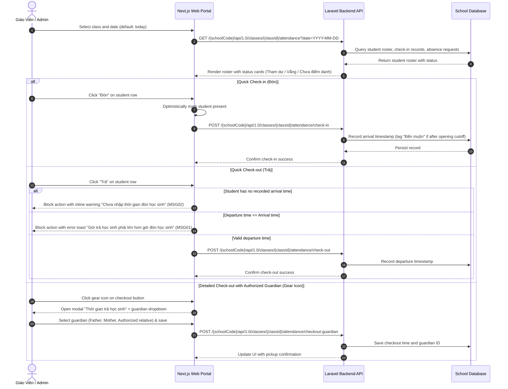

### 1.2 Daily Activity Logging & Moderation Feed Flow (Hoạt Động)

The activity logging flow manages classroom social timeline creation, shortcut trigger injections (`@`, `#`, `$`), media gallery attachments, moderation review queue (`cho_duyet` -> `approved`), and floating pinned items.

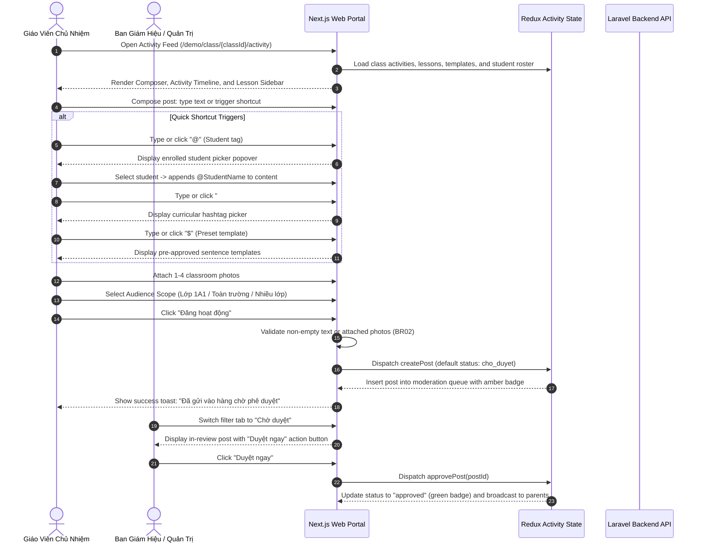

### 1.3 Class Media Albums & AI Facial Recognition Flow (Thư Viện)

The class media library flow governs automatic aggregation from Activities and Attendance into protected system albums (BR01), creation of custom event albums with audience scopes (BR02), photo inspection with dual view modes (BR04, BR05), advanced filtering capped at 5 students (BR06), multi-photo selection (BR07), and AI facial recognition scanning (BR08, BR09).

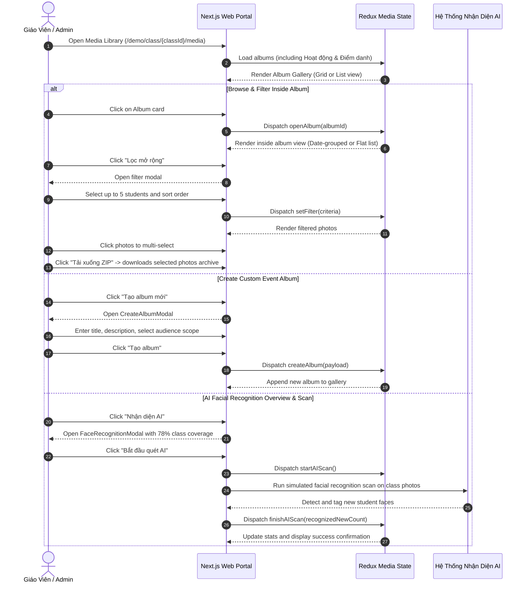

### 1.4 Parent Messaging & Absence Request Review Flow (Trao Đổi)

The parent messaging communication center governs 1:1 parent-teacher communications (`/demo/conversations`) and custom student group channels (`/demo/conversations/group`). It incorporates real-time category filtering (BR02), interactive absence leave card status transitions (`cho_xu_ly` -> `da_xac_nhan` / `da_huy`) with automated system audit log injection (BR03, BR04), sticky important leave alerts (BR06), group student and deduplicated parent management (BR07, BR08), multi-factor deep search (BR10), and message recall (BR12).

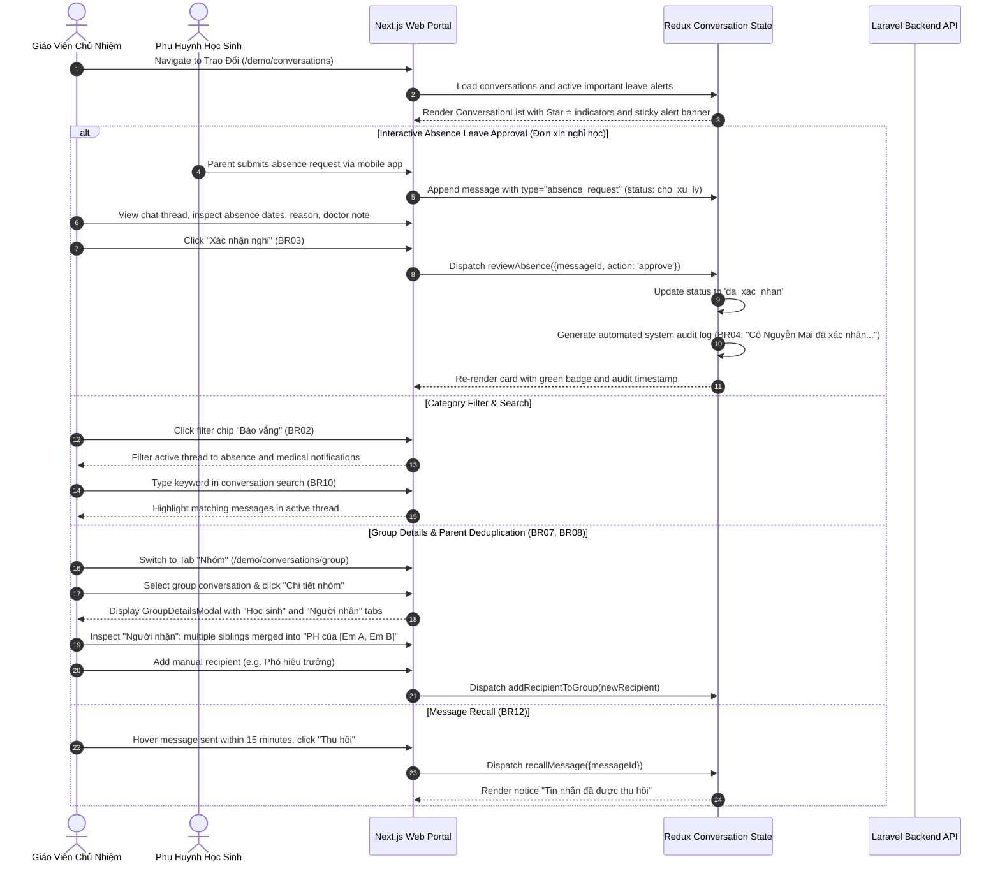

---

## 2. Academic Flows (Học Tập)

### 2.1 Homework Distribution & Student Submission Flow

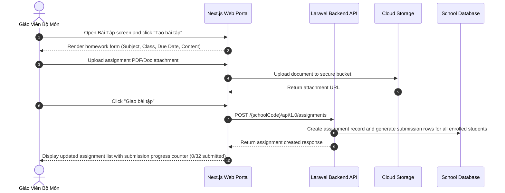

---

## 3. Financial Flows (Tài Chính)

### 3.1 Tuition Invoicing with Attendance-Based Meal Deductions & VietQR Payment

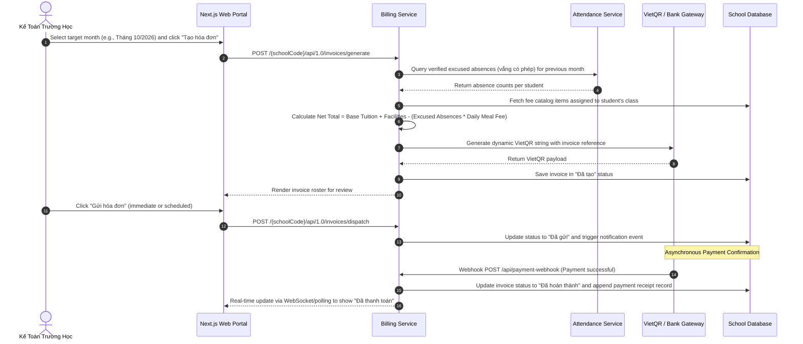

---

## 4. Failure & Recovery Flows

### 4.1 Network Outage During Morning Attendance Check-In
- **Detection:** Client detects network disconnection via browser `navigator.onLine` or HTTP timeout after 3 failed retries.
- **Client Behavior:** The portal enters offline mode; teacher check-in clicks are stored locally in indexedDB with optimistic UI checks. A top warning banner reads "Mất kết nối mạng - Dữ liệu đang được lưu tạm trên thiết bị".
- **Recovery Flow:** Upon network restoration, client automatically replays queued check-in mutations sequentially to `/{schoolCode}/api/1.0/classes/{classId}/attendance/batch-sync`, resolves any server timestamps, and displays success toast "Đã đồng bộ thành công X lượt điểm danh".

### 4.2 Inconsistent Transaction in Payment Reconciliation
- **Detection:** Reconciliation engine compares bank transaction report against internal invoice payment records and flags discrepancy (e.g., Amount paid mismatch or missing invoice code).
- **Client Behavior:** System flags session row with "Lệch đối soát" (discrepancy badge) and isolates unmatched transactions in an audit tab.
- **Recovery Flow:** The accountant opens the transaction details modal, reviews the matched bank narrative, and chooses either:
  1. Manual assignment to student invoice (resolves typo in reference code).
  2. Mark as refund / unrecognized payment voucher.

---

## 5. School Administration Flows (Nhà Trường)

### 5.1 Student Enrollment & Lifecycle Transition Flow

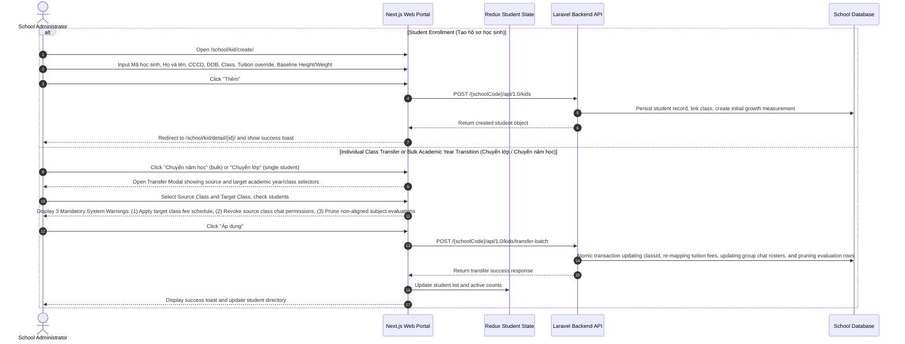

### 5.2 Teacher Onboarding & Moderation Permission Pipeline

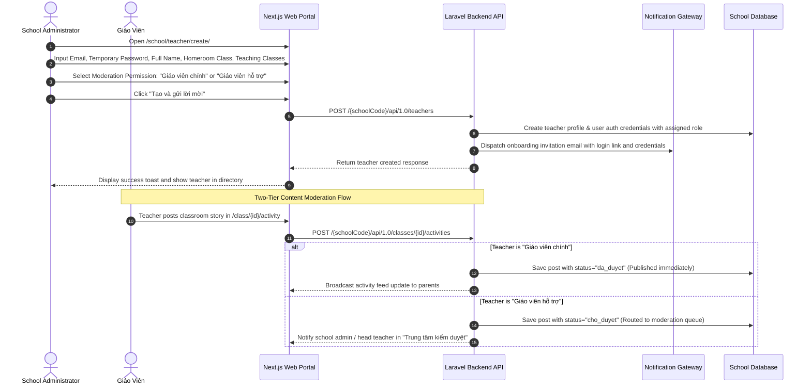

### 5.3 Class Management & Deletion Guardrail Flow

```mermaid
sequenceDiagram
    autonumber
    actor Admin as School Administrator
    participant Client as Next.js Web Portal
    participant API as Laravel Backend API
    participant DB as School Database

    Admin->>Client: Open Lớp Học (/school/class/)
    Client-->>Admin: Display Curricular ("Lớp chính khóa") and Extracurricular ("Lớp ngoại khóa") tabs
    
    alt Class Creation
        Admin->>Client: Click "Thêm lớp học"
        Client-->>Admin: Render form with toggle "Ngoại khóa"
        alt Toggle Off (Chính khóa)
            Client-->>Admin: Show fields: Tên lớp, Khối lớp, GV chủ nhiệm, Điểm & Đánh giá
        else Toggle On (Ngoại khóa)
            Client-->>Admin: Hide Khối lớp & Đánh giá; show multi-select "Giáo viên phụ trách"
        end
        Admin->>Client: Submit form
        Client->>API: POST /{schoolCode}/api/1.0/classes
        API->>DB: Insert class record
        API-->>Client: Return created class
    else Attempt Class Deletion
        Admin->>Client: Click row action menu on a class
        alt Class has studentCount >= 1
            Client-->>Admin: Delete action is completely hidden/disabled (Deletion safety invariant)
        else Class has studentCount === 0
            Client-->>Admin: Show "Xóa" in action menu
            Admin->>Client: Click "Xóa"
            Client-->>Admin: Display confirmation dialog "Vui lòng xác nhận xóa lớp {tên lớp}!"
            Admin->>Client: Click "Xác nhận"
            Client->>API: DELETE /{schoolCode}/api/1.0/classes/{id}
            API->>DB: Delete class record
            API-->>Client: Return 200 OK
            Client-->>Admin: Show success toast and remove class from table
        end
    end
```

---

## 6. School Administration Phase 2 (Nhà Trường) Sequence Diagrams

### 6.1 Announcement Composition, Scheduling & Bulk Deletion Flow

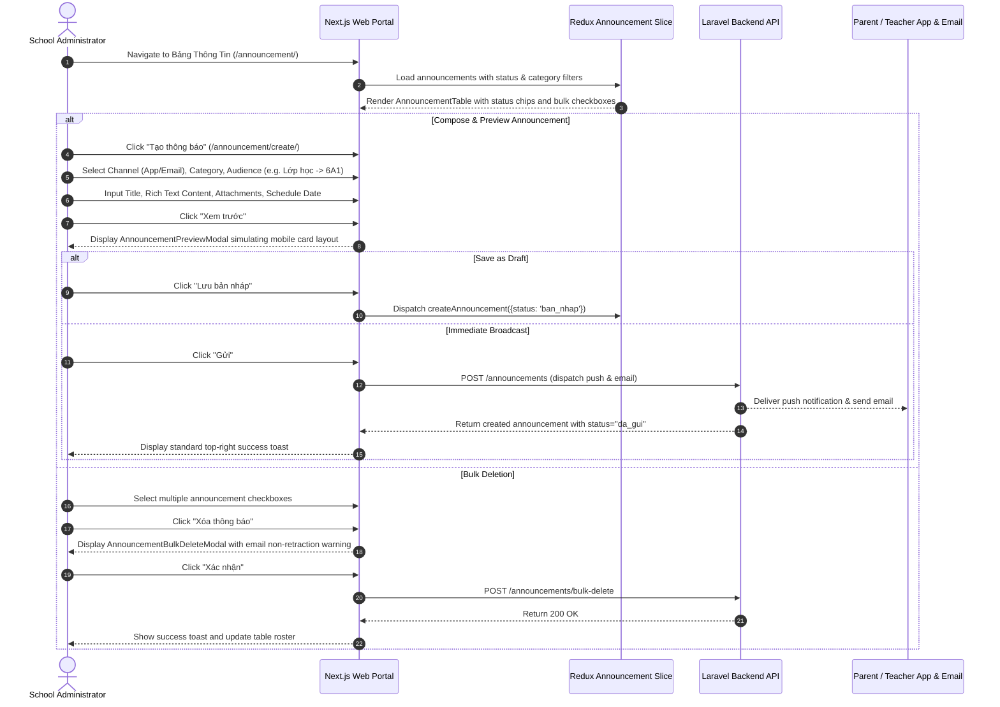

### 6.2 Stakeholder Survey Formulation, Audience Dispatch & Analytics Flow

```mermaid
sequenceDiagram
    autonumber
    actor Admin as School Administrator
    participant Client as Next.js Web Portal
    participant Store as Redux Poll Slice
    participant API as Laravel Backend API
    participant Parent as Parent Mobile App

    Admin->>Client: Navigate to Bình Chọn (/school/poll/)
    Admin->>Client: Click "Tạo bình chọn"
    Admin->>Client: Input Question, Description, Deadline, Options (>= 2), Multi-choice switch
    Admin->>Client: Click "Tạo bình chọn"
    Client->>Store: Save poll in status="da_tao" (Draft, no recipients yet)
    
    alt Audience Dispatch
        Admin->>Client: Click paper plane icon on poll row
        Client-->>Admin: Display PollDispatchModal
        Admin->>Client: Select Audience ("Toàn trường" or "Lớp học" -> INFANT; Lá)
        Admin->>Client: Click "Xác nhận"
        Client->>API: POST /polls/{id}/dispatch
        API-->>Parent: Display active poll in parent app
        Client-->>Admin: Update status to "da_gui" with success toast
    end

    alt Live Analytics & Revision Audit
        Parent->>API: Submit / modify vote choices
        Admin->>Client: Open Poll Details (/school/poll/{id}/)
        Client->>Store: Calculate option vote percentages and total votes
        Store-->>Client: Render progress bars
        alt Total Votes > 0
            Client-->>Admin: Render interactive SVG pie chart
        else Total Votes === 0
            Client-->>Admin: Hide pie chart (avoid empty visual shell)
        end
        Admin->>Client: Click history icon on a student response row
        Client-->>Admin: Render VoteHistoryModal showing previous vote changes and timestamps
    end
```

### 6.3 Weekly Menu Creation, Fallback Inheritance & Food Provenance Flow

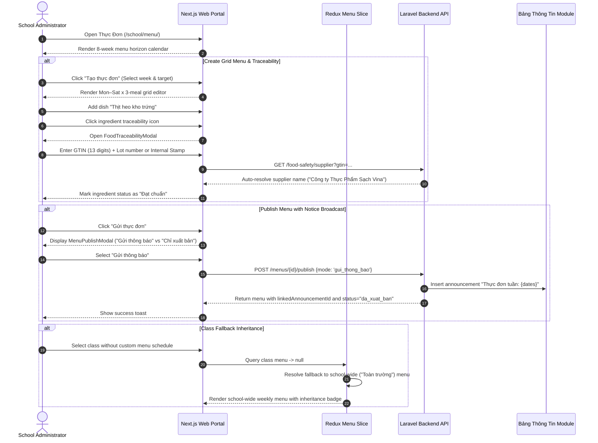

### 6.4 Staff Daily Attendance Rapid Clock-In & Absence Flow

```mermaid
sequenceDiagram
    autonumber
    actor Admin as School Administrator / Duty Officer
    participant Client as Next.js Web Portal
    participant Store as Redux Staff Attendance Slice
    participant API as Laravel Backend API

    Admin->>Client: Open Điểm Danh NV (/school/staff-attendance/)
    Client->>Store: Load staff roster for today (default)
    Store-->>Client: Render 3 KPI counters (Tham dự, Vắng có phép, Vắng không phép)

    alt Rapid Single-Click Clock-In
        Admin->>Client: Click "Check-In" on staff row
        Client->>Store: Optimistically record current timestamp (HH:mm)
        Store-->>Client: Render blue time badge with edit icon (< 50ms)
        Client-->>Admin: Display standard top-right success toast (no modal)
        Client->>API: POST /staff-attendance/check-in {staffId, time}
    end

    alt Mark Staff Absent
        Admin->>Client: Toggle "Vắng" on staff row
        Client-->>Admin: Display AbsentMarkingModal (check-in/out buttons disabled on row)
        Admin->>Client: Select "Có phép", input reason, click "Lưu"
        Client->>Store: Set attendanceStatus="absent_excused"
        Store-->>Client: Increment "Vắng có phép" counter and display amber badge
        Client->>API: POST /staff-attendance/mark-absent
    end

    alt Name Search & Metric Suppression
        Admin->>Client: Type staff name in search input
        Client->>Store: Apply client-side substring filter
        Store-->>Client: Render filtered rows; hide top 3 KPI counters (prevent confusion)
        Store-->>Client: Display bottom contextual counter "Tổng: N"
    end
```

### 6.5 Parent Handbook 2-Tier Knowledge Management Flow

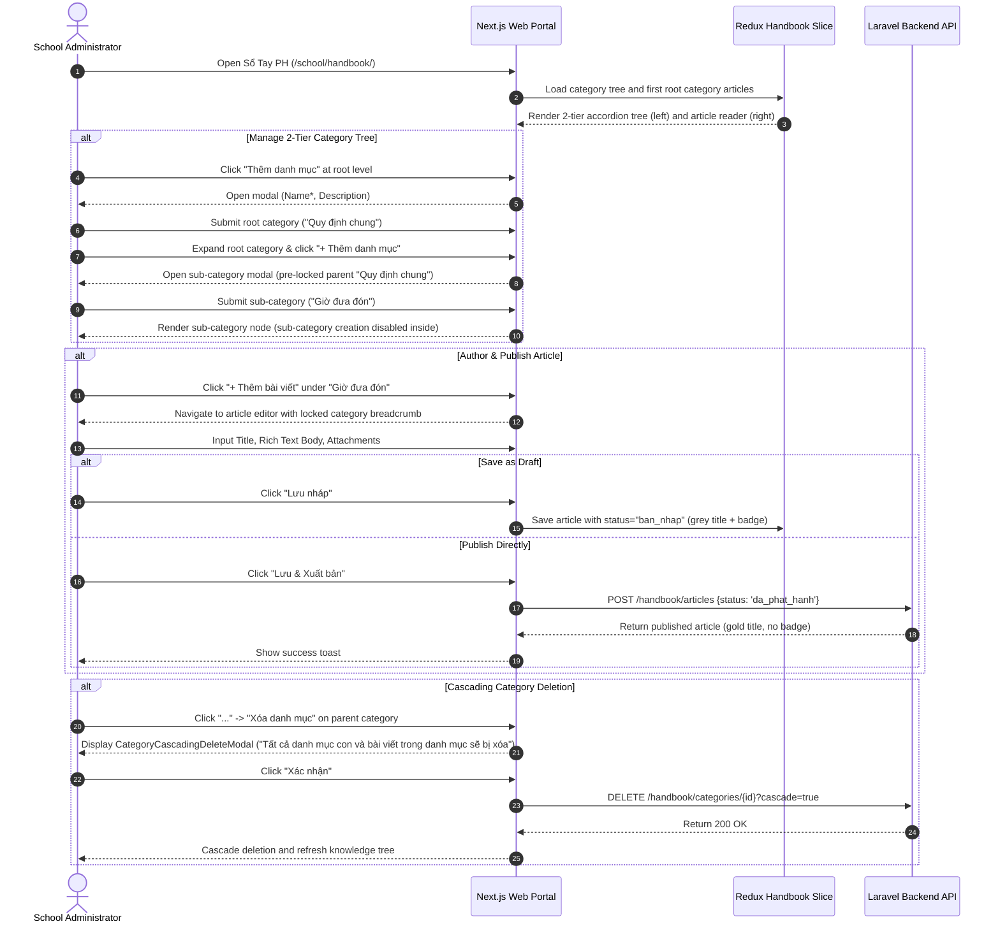

---

## 7. School Administration Phase 3 (Nhà Trường) Sequence Diagrams

### 7.1 Feedback Ticket Lifecycle & Two-Way Thread Flow (Góp Ý)

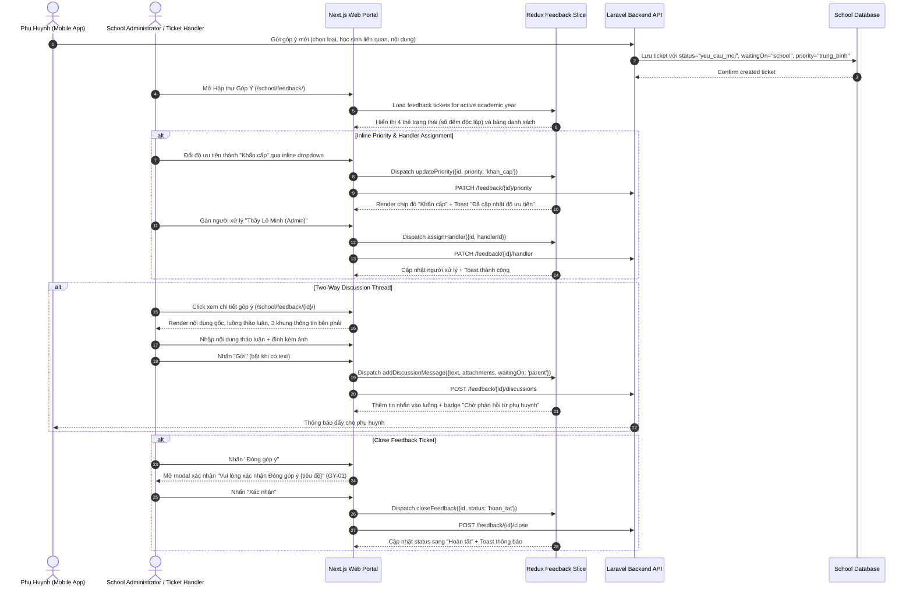

### 7.2 Event Calendar Multi-View Scheduling Flow (Lịch Sự Kiện)

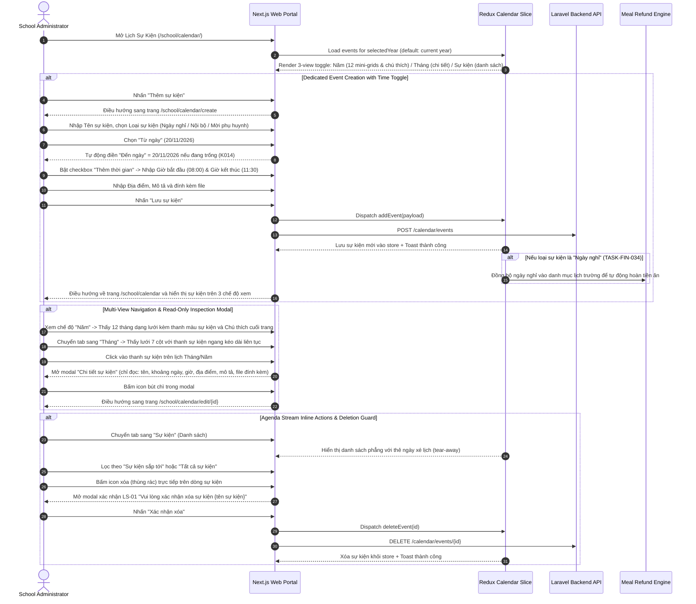

### 7.3 Academic Year & Semester Transition Flow (Năm Học)

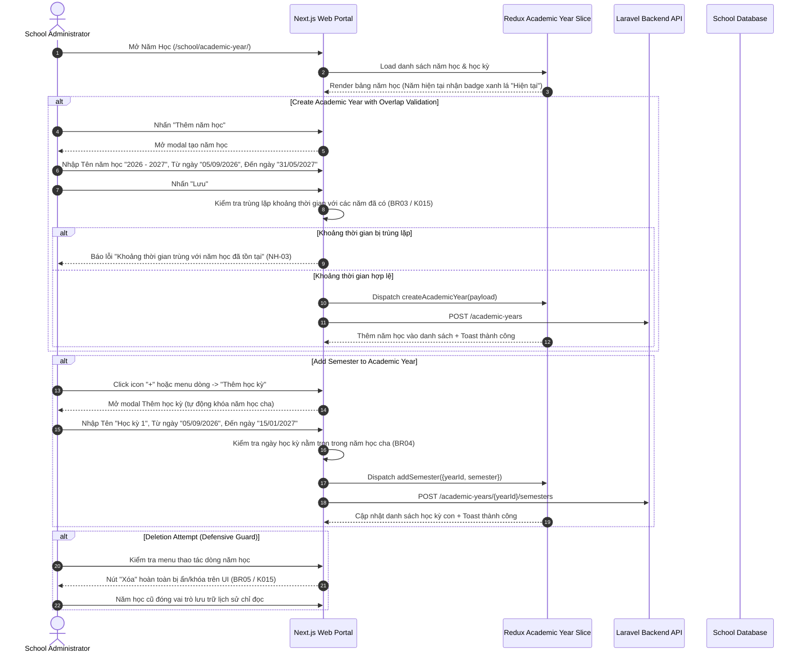

### 7.4 Student Archive, Restore & Permanent Purge Safeguard Flow (Lưu Trữ)

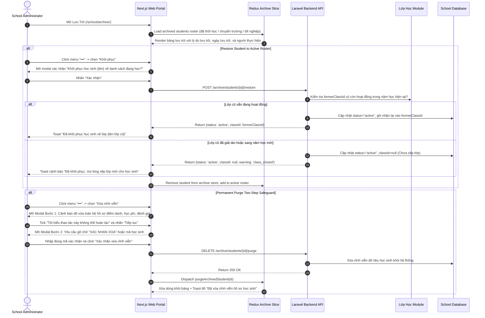

---

## 8. Finance Domain: Miễn Giảm (Tuition Exemption & Fee Discount Management)

### 8.1 Discount Policy Creation & Dual Scope Topology Flow

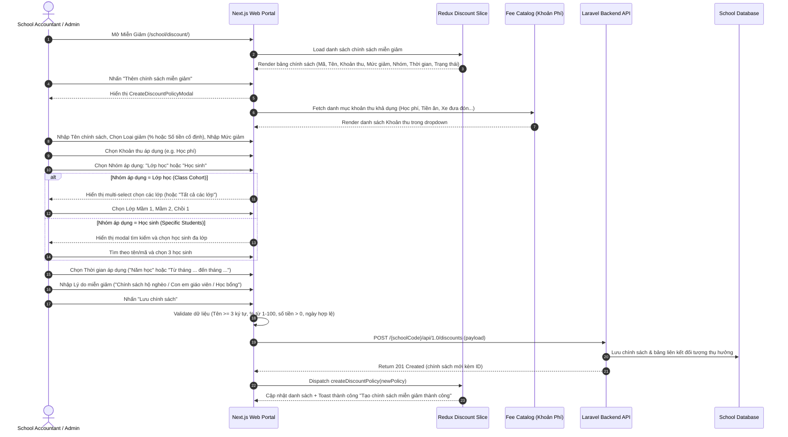

### 8.2 Tuition Invoice Creation Wizard with Discount Auto-Apply & Override Flow

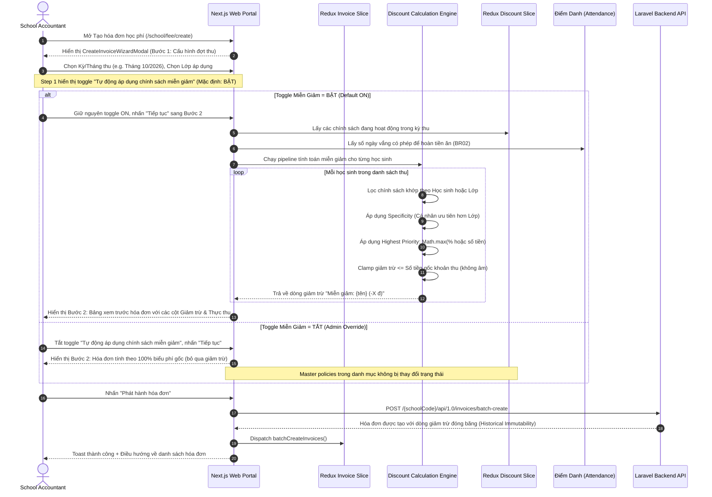

### 8.3 Discount Policy Lifecycle State Machine

```mermaid
stateDiagram-v2
    [*] --> HoatDong: Tạo mới chính sách (Trong thời hạn hợp lệ)
    [*] --> HetHan: Tạo mới với ngày kết thúc trong quá khứ

    state HoatDong {
        [*] --> InScope: Khớp đợt thu & đối tượng
        InScope --> Deducted: Áp dụng giảm trừ vào hóa đơn
    }

    HoatDong --> NgungApDung: Kế toán nhấn "Ngừng áp dụng" (Pause)
    NgungApDung --> HoatDong: Kế toán nhấn "Kích hoạt lại" (Resume trong hạn)

    HoatDong --> HetHan: Thời gian hệ thống vượt quá toMonth / Năm học
    NgungApDung --> HetHan: Thời gian hệ thống vượt quá toMonth / Năm học

    state HetHan {
        [*] --> ReadOnly: Chỉ đọc, loại trừ khỏi hóa đơn mới
    }

    HetHan --> HoatDong: Kế toán chỉnh sửa gia hạn thời gian áp dụng

    HoatDong --> DaXoa: Xác nhận xóa (Chưa áp dụng hóa đơn nào)
    NgungApDung --> DaXoa: Xác nhận xóa (Chưa áp dụng hóa đơn nào)
    HetHan --> DaXoa: Xác nhận xóa

    note right of HetHan
        Bảo toàn lịch sử: Hóa đơn đã tạo trong quá khứ
        giữ nguyên mức giảm trừ không bị ảnh hưởng.
    end note
```

---

## 9. Cấu Hình: Học Phí (Settings Fee Configuration Operational Flows)

### 9.1 Multi-Block Configuration & Independent Save Lifecycle Flow

The multi-block settings flow ensures each configuration domain operates independently without cross-block state contamination or unsaved data loss.

```mermaid
sequenceDiagram
    autonumber
    actor Admin as Admin trường / Kế toán
    participant Client as Web Portal (/setting/fee/)
    participant Redux as settingFeeSlice (Redux)
    participant Guard as UnsavedChangesModal
    participant API as Backend Server / Database

    Admin->>Client: Truy cập /demo/setting/fee/
    Client->>API: GET /{schoolCode}/api/1.0/settings/fee
    API-->>Client: Trả về 5 khối cấu hình (Ghi chú, Sepay, SInvoice, Trả trễ/Báo vắng, Email)
    Client->>Redux: Hydrate initial state (tất cả dirtyFlags = false)
    Client-->>Admin: Hiển thị 5 khối form với 4 nút "Lưu" độc lập (disabled)

    Admin->>Client: Chỉnh sửa "Ghi chú hóa đơn" (Khối 1)
    Client->>Redux: Dispatch updateInvoiceNoteDraft(text)
    Redux->>Redux: Set dirtyFlags.invoiceNote = true
    Client-->>Admin: Nút "Lưu" Khối 1 chuyển sang active (xanh); các nút Lưu khác giữ nguyên disabled

    alt Admin nhấn "Lưu" Khối 1
        Admin->>Client: Nhấn "Lưu" ở Khối 1
        Client->>API: PUT /{schoolCode}/api/1.0/settings/fee/invoice-note
        API-->>Client: 200 OK (Thành công)
        Client->>Redux: Dispatch saveInvoiceNoteSuccess()
        Redux->>Redux: Set dirtyFlags.invoiceNote = false
        Client-->>Admin: Hiện toast thành công + Nút "Lưu" trở về disabled
    else Admin cố tình chuyển trang khi chưa lưu
        Admin->>Client: Nhấn liên kết điều hướng sang trang khác
        Client->>Redux: Kiểm tra dirtyFlags (hasUnsavedChanges = true)
        Client->>Guard: Bật modal "Thay đổi của bạn chưa được lưu..."
        alt Admin chọn "Ở lại"
            Admin->>Guard: Nhấn "Ở lại"
            Guard-->>Client: Đóng modal, giữ nguyên màn hình và dữ liệu đang sửa
        else Admin xác nhận "Rời khỏi"
            Admin->>Guard: Nhấn "Rời khỏi"
            Guard-->>Client: Hủy bỏ thay đổi draft, tiếp tục điều hướng
        end
    end
```

### 9.2 Late Childcare Surcharge Mode Switching & Tier Table Row Flow

```mermaid
sequenceDiagram
    autonumber
    actor Admin as Admin trường
    participant Client as Web Portal
    participant Val as settingFeeValidation.ts
    participant Redux as settingFeeSlice

    Admin->>Client: Bật toggle "Về muộn"
    Client->>Redux: Set latePickup.isEnabled = true
    Client-->>Admin: Kích hoạt các điều khiển bên trong (không còn bị mờ/disabled)

    alt Chuyển sang "Theo khung giờ"
        Admin->>Client: Chọn radio "Theo khung giờ"
        Client-->>Admin: Hiển thị bảng Phí giữ học sinh muộn (Dòng 1: không có icon thùng rác)
        Admin->>Client: Nhấn "Thêm khung giờ"
        Client->>Redux: Thêm Dòng 2 (Giờ bắt đầu, Giờ kết thúc, Số tiền)
        Client-->>Admin: Hiển thị Dòng 1 và Dòng 2 (Cột Hành động hiện icon thùng rác cho cả 2 dòng)
        Admin->>Client: Nhấn icon thùng rác ở Dòng 2
        Client->>Redux: Xóa Dòng 2
        Client-->>Admin: Bảng còn lại 1 dòng; icon thùng rác tự động ẩn đi (BR13)
    else Cấu hình Báo vắng & Giờ hoạt động
        Admin->>Client: Bật toggle "Báo vắng", chọn 24 giờ
        Client-->>Admin: Hiển thị bảng Giờ hoạt động tham chiếu (Thứ 2 - Thứ 7) + Thông báo hoàn tiền có điều kiện
        Admin->>Client: Tắt toggle "Báo vắng"
        Client-->>Admin: Ẩn bảng Giờ hoạt động + Cập nhật thông báo: tự động hoàn toàn bộ ngày nghỉ (BR10)
    end
```

### 9.3 Reconciliation Email Distribution Roster Validation Flow

```mermaid
sequenceDiagram
    autonumber
    actor Accountant as Kế toán trường
    participant Client as ReconciliationEmailBlock
    participant Val as settingFeeValidation.ts
    participant Redux as settingFeeSlice

    Accountant->>Client: Nhập chuỗi email vào ô "Nhập email" và nhấn "Thêm"
    Client->>Val: validateEmailCandidate(email, existingEmails)
    
    alt Email sai định dạng (regex không khớp)
        Val-->>Client: Trả về lỗi ERR-HP-01 ("Email không hợp lệ")
        Client-->>Accountant: Hiển thị text đỏ "Email không hợp lệ", viền input chuyển đỏ
    else Email đã tồn tại trong danh sách
        Val-->>Client: Trả về lỗi ERR-HP-02 ("Email đã tồn tại trong danh sách")
        Client-->>Accountant: Hiển thị text đỏ báo trùng lặp
    else Hợp lệ và danh sách < 3
        Val-->>Client: Hợp lệ
        Client->>Redux: Dispatch addReconciliationEmail(email)
        Client-->>Accountant: Thêm email tag vào danh sách, xóa trắng input
        opt Đã đủ 3 email (Capacity Reached)
            Client-->>Accountant: Vô hiệu hóa (disabled) ô nhập email và nút "Thêm" (BR14)
        end
    end
```

---

## 10. Meal Refund Mechanism & Next-Month Invoicing Auto-Deduction Flow (Cơ Chế Hoàn Tiền Ăn & Khấu Trừ Hóa Đơn Kỳ Sau)

### 10.1 Dual-Category Meal Refund Configuration Flow

```mermaid
sequenceDiagram
    autonumber
    actor Admin as BGH / Kế toán trường
    participant Client as LatePickupAndRefundBlock
    participant Redux as settingFeeSlice
    participant Val as settingFeeValidation.ts

    Admin->>Client: Mở Cấu hình > Học phí (/setting/fee), cuộn đến Khối 4
    Client-->>Admin: Hiển thị Nhóm A (Lịch trường/Lễ: Badge cố định hoàn 100%) và Nhóm B (Tự nghỉ)

    Admin->>Client: Nhập tỷ lệ Nhóm B: Tiền ăn = 50%, Tiền ăn sáng = 70%
    Client->>Val: validateMealRefundRates(50, 70)
    Val-->>Client: Hợp lệ (0 <= rate <= 100)
    Client->>Redux: Dispatch updateDraftMealRefundRates({mainMealRatePercent: 50, breakfastRatePercent: 70})
    Redux->>Redux: Set dirtyFlags.latePickupAndRefund = true
    Client-->>Admin: Cập nhật widget tính toán minh họa (Tháng 9: Tự nghỉ 3 ngày + Lễ 1 ngày -> Hoàn 162.000đ)
    Client-->>Admin: Nút "Lưu thay đổi" chuyển sang active (xanh)

    Admin->>Client: Nhấn "Lưu thay đổi"
    Client->>Redux: Dispatch saveLatePickupAndRefund()
    Client-->>Admin: Hiển thị toast thành công + reset dirty flag
```

### 10.2 Next-Month Invoicing Auto-Deduction Flow ($M+1$)

```mermaid
sequenceDiagram
    autonumber
    actor Accountant as Kế toán trường
    participant Wizard as CreateInvoiceWizardModal (/school/fee/create)
    participant Billing as invoiceValidation.ts
    participant Attendance as attendanceSlice & calendarSlice
    participant Redux as invoiceSlice
    participant Parent as Phụ Huynh (App / VietQR)

    Accountant->>Wizard: Chọn kỳ hóa đơn "Tháng 10/2026", chọn đối tượng (Lớp 10A1 / Em Nguyễn Gia Huy)
    Wizard->>Attendance: Truy vấn ngày vắng và lịch nghỉ Tháng 9/2026
    Attendance-->>Wizard: Trả về D_self = 3 ngày (tự nghỉ), D_school = 1 ngày (lễ 02/09)
    Wizard->>Billing: calculateStudentMealRefund(studentId, "2026-10", settingFeeState)
    Billing-->>Wizard: Kết quả hoàn tiền Tháng 9: Tiền ăn = 100.000đ, Tiền ăn sáng = 62.000đ (Tổng: 162.000đ)

    Wizard-->>Accountant: Bước 3 (Chi tiết & Khấu trừ) hiển thị itemized deduction:
    Note over Wizard, Accountant: Khấu trừ hoàn tiền ăn T9: -100.000đ (3 ngày tự nghỉ [50%]: -60.000đ, 1 ngày nghỉ lễ [100%]: -40.000đ)<br/>Khấu trừ hoàn tiền ăn sáng T9: -62.000đ (3 ngày tự nghỉ [70%]: -42.000đ, 1 ngày nghỉ lễ [100%]: -20.000đ)

    Accountant->>Wizard: Xác nhận tạo hóa đơn
    Wizard->>Redux: Dispatch createBatchInvoices(payload)
    Redux->>Redux: Lưu hóa đơn với netAmount đã trừ 162.000đ và cập nhật VietQRData
    Wizard-->>Accountant: Toast thông báo tạo hóa đơn thành công
    Redux-->>Parent: Phát hóa đơn Tháng 10 hiển thị rõ chi tiết khấu trừ hoàn tiền ăn Tháng 9
```


---

## 11. School Class Management Flows (Quản Lý Lớp Học)

### 11.1 Dual-Taxonomy Directory Browsing & Filtering Flow

```mermaid
sequenceDiagram
    autonumber
    actor Admin as School Administrator
    participant UI as Class Directory (/school/classes)
    participant Redux as classSlice.ts
    participant Val as classValidation.ts

    Admin->>UI: Mở Danh sách lớp học (/school/classes)
    UI->>Redux: Lấy danh sách lớp học và KPI summary
    Redux-->>UI: Hiển thị 4 thẻ KPI và bảng "Lớp chính khóa" mặc định

    alt Chuyển sang Tab Lớp Ngoại Khóa
        Admin->>UI: Bấm tab "Lớp ngoại khóa"
        UI->>Redux: Dispatch setClassTab('ngoai_khoa')
        Redux-->>UI: Ẩn bộ lọc "Khối lớp", hiển thị danh sách CLB với giáo viên phụ trách và lịch sinh hoạt
    end

    alt Lọc theo Khối Lớp (Chính khóa)
        Admin->>UI: Bấm tab "Lớp chính khóa", chọn "Khối 1" trong dropdown
        UI->>Redux: Dispatch setGradeFilter('Khối 1')
        Redux->>Val: filterClasses(classes, {tab: 'chinh_khoa', gradeLevel: 'Khối 1'})
        Val-->>UI: Trả về kết quả lớp thuộc Khối 1 ngay lập tức
    end

    alt Mở Lọc Mở Rộng
        Admin->>UI: Nhấn "Lọc mở rộng"
        UI-->>Admin: Mở Drawer lọc với tiêu chí: Phân loại GV, Giáo viên cụ thể, CSDL Sở, Sĩ số
        Admin->>UI: Chọn "Đã liên kết CSDL Sở" và bấm "Áp dụng"
        UI->>Redux: Dispatch setAdvancedFilters(payload)
        Redux-->>UI: Lọc danh sách thỏa mãn tất cả tiêu chí
    end
```

### 11.2 Dynamic Schema Class Creation Flow

```mermaid
sequenceDiagram
    autonumber
    actor Admin as School Administrator
    participant Wizard as Create Class (/school/classes/create)
    participant Redux as classSlice.ts
    participant Val as classValidation.ts

    Admin->>Wizard: Nhấn "Thêm lớp học"
    Wizard-->>Admin: Hiển thị form tạo lớp chính khóa (mặc định)

    alt Tạo Lớp Ngoại Khóa (CLB)
        Admin->>Wizard: Bật toggle "Lớp ngoại khóa"
        Wizard->>Wizard: Hoán đổi schema: Ẩn Khối lớp & GVCN, hiển thị Lĩnh vực, GV phụ trách (multi-select), Lịch sinh hoạt
        Admin->>Wizard: Nhập Tên CLB "CLB Bóng Rổ U12", chọn lĩnh vực "Thể thao", chọn 2 HLV, nhập lịch học
        Admin->>Wizard: Nhấn "Lưu lớp học"
        Wizard->>Val: validateClassForm(formData)
        Val-->>Wizard: Hợp lệ
        Wizard->>Redux: Dispatch createClass(payload)
        Wizard-->>Admin: Toast thành công, điều hướng về tab "Lớp ngoại khóa"
    else Tạo Lớp Chính Khóa với Cảnh Báo Trùng GVCN
        Admin->>Wizard: Giữ toggle "Lớp ngoại khóa" = OFF
        Admin->>Wizard: Nhập Tên "Lớp 1A3", Khối "Khối 1", chọn GVCN "Cô Nguyễn Thu Mai"
        Wizard->>Val: checkHomeroomConflict("Cô Nguyễn Thu Mai", activeClasses)
        Val-->>Wizard: Cảnh báo: Giáo viên đang là GVCN lớp 1A1
        Wizard-->>Admin: Hiển thị banner cảnh báo màu vàng (không chặn lưu)
        Admin->>Wizard: Xác nhận và nhấn "Lưu lớp học"
        Wizard->>Redux: Dispatch createClass(payload)
        Wizard-->>Admin: Toast thành công, điều hướng về tab "Lớp chính khóa"
    end
```

### 11.3 Empty Class Deletion Guardrail Flow

```mermaid
sequenceDiagram
    autonumber
    actor Admin as School Administrator
    participant UI as Class Table
    participant Modal as DeleteClassModal
    participant Redux as classSlice.ts
    participant Val as classValidation.ts

    alt Lớp có học sinh (studentCount > 0)
        Admin->>UI: Di chuột vào nút "Xóa" của lớp 1A1 (sĩ số 32)
        UI-->>Admin: Nút xóa bị disabled (màu xám nhạt, cursor-not-allowed)
        UI-->>Admin: Tooltip "Không thể xóa lớp đang có 32 học sinh. Vui lòng chuyển học sinh sang lớp khác trước khi xóa."
    else Lớp rỗng (studentCount === 0)
        Admin->>UI: Bấm nút "Xóa" của lớp 12A3 (sĩ số 0)
        UI->>Modal: Mở MODAL-DELETE-CLASS "Xác nhận xóa lớp học {Tên lớp}?"
        Admin->>Modal: Bấm "Xác nhận xóa"
        Modal->>Val: canDeleteClass(targetClass)
        Val-->>Modal: Hợp lệ (studentCount === 0)
        Modal->>Redux: Dispatch deleteClass(classId)
        Redux->>Redux: Xóa lớp khỏi state
        Redux-->>UI: Hiển thị toast thông báo xóa thành công
    end
```

### 11.4 Centralized Class Detail Hub & Operational Navigation Flow

```mermaid
sequenceDiagram
    autonumber
    actor Admin as School Administrator
    participant Hub as Class Detail (/school/classes/[classId])
    participant Ops as Operational Sub-modules

    Admin->>Hub: Nhấp vào dòng lớp "Lớp 1A1"
    Hub-->>Admin: Render Header thông tin lớp: Tên lớp, Khối, Phòng học, Card GVCN, Tỷ lệ sĩ số (32/35)

    alt Xem danh sách học sinh
        Admin->>Hub: Chọn tab "Học sinh"
        Hub-->>Admin: Bảng danh sách 32 học sinh, trạng thái điểm danh hôm nay, liên kết sang /school/kid/detail/[id]
    end

    alt Xem biểu phí lớp
        Admin->>Hub: Chọn tab "Thông tin học phí"
        Hub-->>Admin: Bảng tổng hợp biểu phí lớp (Học phí, Tiền ăn, Bán trú...) và nút "Mở Quản lý học phí"
    end

    alt Điểm danh nhanh lớp học
        Admin->>Hub: Chọn tab "Lối tắt vận hành" -> Click "Điểm danh hôm nay"
        Hub->>Ops: Điều hướng tới /class/lop-1a1/attendance
    end
```

---

## 12. Nhà Trường: Môn Học (School Subject Management Sequence Diagrams)

### 12.1 Educational Stage Browsing & Accent-Insensitive Search Flow

```mermaid
sequenceDiagram
    autonumber
    actor Admin as School Administrator
    participant UI as Subject Directory (/school/subjects)
    participant Redux as subjectSlice.ts
    participant Val as subjectValidation.ts

    Admin->>UI: Truy cập danh mục Môn Học
    UI->>Redux: Lấy danh sách môn học theo năm học hiện tại
    Redux-->>UI: Hiển thị tab "Tiểu học (TH)" mặc định + 4 thẻ KPI tổng quan

    alt Chuyển cấp học
        Admin->>UI: Bấm chọn tab "THCS"
        UI->>Redux: Dispatch setActiveStage("THCS")
        Redux-->>UI: Cập nhật bảng môn học cấp THCS (Ngữ văn, Toán, KHTN...)
    end

    alt Tìm kiếm không dấu
        Admin->>UI: Nhập từ khóa "dia li" vào ô tìm kiếm
        UI->>Val: filterSubjects(subjects, "dia li")
        Val-->>UI: Trả về môn "Lịch sử và Địa lí" và "Địa lí"
        UI-->>Admin: Hiển thị kết quả lọc tức thì (< 30ms)
    end
```

### 12.2 Teacher Assignment Flow (Phân Công Giáo Viên)

```mermaid
sequenceDiagram
    autonumber
    actor Admin as School Administrator
    participant Table as Subject Table Row
    participant Modal as AssignTeacherModal
    participant Val as subjectValidation.ts
    participant Redux as subjectSlice.ts

    Admin->>Table: Nhấp nút "Phân công GV" tại môn "Toán học"
    Table->>Modal: Mở MODAL-ASSIGN-TEACHER cho môn Toán học
    Modal->>Val: getUnassignedTeachers(allTeachers, subject.assignedTeachers)
    Val-->>Modal: Danh sách giáo viên chưa được gán môn Toán
    Modal-->>Admin: Render dropdown chọn giáo viên (đã loại trừ GV đã phân công)
    Admin->>Modal: Chọn giáo viên "Trần Thị Mai" và lớp phụ trách (tùy chọn)
    Admin->>Modal: Bấm "Lưu phân công"
    Modal->>Redux: Dispatch assignTeacher({ subjectId, teacherId, classIds })
    Redux->>Redux: Thêm GV vào assignedTeachers của môn học
    Redux-->>Table: Cập nhật chip giáo viên mới trên dòng môn học
    Redux-->>Admin: Hiển thị toast "Phân công giáo viên thành công"
```

### 12.3 Teacher Unassignment Confirmation Guardrail Flow

```mermaid
sequenceDiagram
    autonumber
    actor Admin as School Administrator
    participant Drawer as SubjectDetailDrawer
    participant Modal as UnassignTeacherModal
    participant Redux as subjectSlice.ts

    Admin->>Drawer: Xem danh sách giáo viên phụ trách môn "Tiếng Anh"
    Admin->>Drawer: Bấm nút xóa (icon trash) cạnh GV "Lê Văn Hùng"
    Drawer->>Modal: Mở MODAL-UNASSIGN-TEACHER
    Modal-->>Admin: Hiển thị hộp thoại cảnh báo: "Bạn có chắc chắn muốn hủy phân công giáo viên Lê Văn Hùng khỏi môn Tiếng Anh? (Đang phụ trách 3 lớp)"
    
    alt Hủy bỏ
        Admin->>Modal: Bấm "Hủy bỏ"
        Modal-->>Drawer: Đóng modal, giữ nguyên phân công
    else Xác nhận hủy phân công
        Admin->>Modal: Bấm "Xác nhận hủy"
        Modal->>Redux: Dispatch unassignTeacher({ subjectId, teacherId })
        Redux->>Redux: Gỡ GV khỏi danh sách phụ trách môn học
        Redux-->>Drawer: Cập nhật danh sách giáo viên trong drawer
        Redux-->>Admin: Hiển thị toast "Đã hủy phân công giáo viên thành công"
    end
```

### 12.4 Subject Detail & Assessment Matrix Inspection Flow

```mermaid
sequenceDiagram
    autonumber
    actor Admin as School Administrator
    participant Table as Subject Table
    participant Drawer as SubjectDetailDrawer

    Admin->>Table: Nhấp vào dòng môn học "Mỹ thuật"
    Table->>Drawer: Mở DRAWER-SUB-DETAIL
    Drawer-->>Admin: Hiển thị thông tin tổng quan: Tên môn, Mã môn, Khối lớp áp dụng
    Drawer-->>Admin: Hiển thị badge "Không tính điểm trung bình tổng kết"
    Drawer-->>Admin: Render Bảng Phương Thức Đánh Giá 4 Kỳ:
    Note over Drawer: Giữa Kỳ 1: Nhận xét<br/>Cuối Kỳ 1: Nhận xét<br/>Giữa Kỳ 2: Nhận xét<br/>Cuối Kỳ 2: Nhận xét
    Drawer-->>Admin: Render danh sách giáo viên giảng dạy hiện tại và nút "Phân công thêm"
```

---

## 13. Module 5: Nhà Trường — Khối Lớp (School Grade Level Management Flows)

### 13.1 Grade Directory Navigation & Educational Stage Filtering Flow

```mermaid
sequenceDiagram
    autonumber
    actor Admin as School Administrator
    participant Portal as Web Portal (/[schoolCode]/school/grades)
    participant Redux as gradeSlice.ts / classSlice.ts
    participant Val as gradeValidation.ts

    Admin->>Portal: Truy cập menu Nhà Trường > Khối lớp
    Portal->>Redux: Lấy danh mục khối lớp & danh sách lớp học (niên khóa hiện tại)
    Redux->>Val: computeSchoolKPIs(grades, classes)
    Val-->>Portal: Trả về 4 chỉ số KPI: Tổng số khối, Tổng số lớp, Tổng học sinh, Sĩ số TB/lớp
    Portal-->>Admin: Render 4 thẻ KPI summary cards & 5 tab cấp học ("Tất cả", "Tiểu học", "THCS", "THPT", "GDTX")
    
    Admin->>Portal: Nhấp chọn tab "THCS"
    Portal->>Redux: dispatch(setSelectedStage("THCS"))
    Redux->>Val: filterGradesByStage(grades, "THCS")
    Val-->>Portal: Trả về danh sách Khối 6, 7, 8, 9
    Portal-->>Admin: Hiển thị bảng Khối lớp THCS kèm số lớp, số HS và tỷ lệ gán GVCN
```

### 13.2 Instant Client-Side Accent-Insensitive Search & Reset Flow

```mermaid
sequenceDiagram
    autonumber
    actor Admin as School Administrator
    participant Input as Ô Tìm Kiếm (GradeToolbar)
    participant Val as gradeValidation.ts (normalizeVietnameseText)
    participant Table as Bảng Danh Sách Khối (GradeTable)

    Admin->>Input: Nhập từ khóa không dấu "khoi 1"
    Input->>Val: searchGrades(grades, "khoi 1")
    Val->>Val: Chuẩn hóa không dấu: "khoi 1" vs "Khoi 1" (K01), "Khoi 10" (K10)
    Val-->>Table: Trả về 2 bản ghi: Khối 1 và Khối 10 (< 10ms)
    Table-->>Admin: Cập nhật danh sách hiển thị tức thì không tải lại trang

    Admin->>Input: Xóa từ khóa tìm kiếm (bấm nút 'X' hoặc xóa text)
    Input->>Val: searchGrades(grades, "")
    Val-->>Table: Trả về toàn bộ danh mục khối lớp thuộc tab cấp học hiện tại
    Table-->>Admin: Khôi phục danh sách đầy đủ ngay lập tức
```

### 13.3 Grade Detail Inspection & Class Roster Operational Shortcut Flow

```mermaid
sequenceDiagram
    autonumber
    actor Admin as School Administrator
    participant Table as Bảng Khối Lớp
    participant Detail as Màn Hình Chi Tiết (/[schoolCode]/school/grades/[gradeId])
    participant ClassRoster as Bảng Lớp Thuộc Khối (GradeClassTable)
    participant Router as Next.js Router

    Admin->>Table: Nhấp chọn dòng "Khối 10" (hoặc icon faEye)
    Table->>Router: Điều hướng tới /[schoolCode]/school/grades/k10
    Router->>Detail: Khởi tạo trang Chi tiết Khối 10
    Detail-->>Admin: Hiển thị Breadcrumb: Nhà trường > Khối lớp > Chi tiết Khối 10
    Detail-->>Admin: Render 4 thẻ KPI: Mã K10 & THPT, 3 lớp học, 105 học sinh, 12 giáo viên
    Detail->>ClassRoster: Lấy danh sách lớp thuộc Khối 10 (10A1, 10A2, 10A3)
    ClassRoster-->>Admin: Render bảng 8 cột: STT, Tên lớp, Phòng, GVCN, Sĩ số + Progress bar, Số GVBM, Trạng thái, Lối tắt

    alt Lối tắt Xem Chi Tiết Lớp
        Admin->>ClassRoster: Bấm nút "Xem lớp"
        ClassRoster->>Router: push(/[schoolCode]/school/classes/c10a1)
    else Lối tắt Điểm Danh Lớp
        Admin->>ClassRoster: Bấm nút "Điểm danh"
        ClassRoster->>Router: push(/[schoolCode]/class/c10a1/attendance)
    else Lối tắt Thời Khóa Biểu
        Admin->>ClassRoster: Bấm nút "TKB"
        ClassRoster->>Router: push(/[schoolCode]/school/schedule?classId=c10a1)
    end
```

### 13.4 Dynamic Reactive Rollup Aggregation Flow

```mermaid
sequenceDiagram
    autonumber
    actor Operator as School Admin / Registrar
    participant ClassMod as Quản Lý Lớp Học (/school/classes)
    participant Store as Redux Store (classSlice & gradeSlice)
    participant Selector as selectGradeWithRollups

    Operator->>ClassMod: Thêm mới lớp 10A4 (Sĩ số: 35, GVCN: Đã gán)
    ClassMod->>Store: dispatch(addClass({ id: 'c10a4', gradeLevelId: 'k10', studentCount: 35, ... }))
    Store->>Store: Cập nhật classSlice.classes
    
    Operator->>Store: Mở danh mục Khối lớp (/school/grades)
    Store->>Selector: selectGradeWithRollups(state, 'k10')
    Selector->>Selector: Lọc classes có gradeLevelId === 'k10' & academicYear === active
    Note over Selector: Tổng lớp: 3 -> 4<br/>Tổng học sinh: 105 -> 140<br/>Tỷ lệ gán GVCN: 100%
    Selector-->>Operator: Hiển thị số liệu thống kê mới nhất ngay lập tức, không sai lệch số liệu
```

---

## 14. School Announcement Board Flows (Bảng Thông Tin)

### 14.1 Announcement Directory Browsing, Filtering & Accent-Insensitive Search Flow

```mermaid
sequenceDiagram
    autonumber
    actor Admin as School Administrator
    participant UI as Bảng Thông Tin (/school/announcements)
    participant Redux as announcementSlice.ts
    participant Val as announcementValidation.ts

    Admin->>UI: Mở Bảng Thông Tin (/school/announcements)
    UI->>Redux: Lấy danh sách thông báo và KPI tổng quan
    Redux->>Val: computeAnnouncementKPIs(announcements)
    Val-->>UI: Hiển thị 4 thẻ KPI: Tổng thông báo, Đã gửi, Chưa gửi, Bản nháp
    Redux-->>UI: Hiển thị tab "Tất cả" mặc định và danh sách thông báo

    alt Lọc theo Trạng Thái (Status Tabs)
        Admin->>UI: Bấm tab "Bản nháp"
        UI->>Redux: dispatch(setStatusFilter('ban_nhap'))
        Redux-->>UI: Lọc danh sách bản nháp; các dòng hiện thêm icon "Chỉnh sửa" cạnh icon "Xoá"
    end

    alt Lọc theo Loại Thông Báo (Category Dropdown)
        Admin->>UI: Chọn loại "Thực đơn" từ dropdown
        UI->>Redux: dispatch(setCategoryFilter('thuc_don'))
        Redux-->>UI: Hiển thị các thông báo thực đơn tuần
    end

    alt Tìm Kiếm Không Dấu (Accent-Insensitive Search)
        Admin->>UI: Nhập từ khóa không dấu "thoi khoa bieu"
        UI->>Val: searchAnnouncements(announcements, "thoi khoa bieu")
        Val-->>UI: Khớp chính xác các thông báo có tiêu đề "Thời khóa biểu..." (< 10ms)
        Admin->>UI: Xoá ô tìm kiếm
        UI-->>Admin: Phục hồi toàn bộ danh sách tức thì
    end
```

### 14.2 Multi-Channel Announcement Composition & Dynamic Audience Scoping Flow

```mermaid
sequenceDiagram
    autonumber
    actor Admin as School Administrator
    participant Composer as Trình Soạn Thông Báo (/school/announcements/create)
    participant Redux as announcementSlice.ts
    participant Val as announcementValidation.ts
    participant Router as Next.js Router

    Admin->>Composer: Nhấp "Tạo thông báo"
    Composer-->>Admin: Render form: Kênh thông báo, Loại thông báo, Đối tượng gửi, Tiêu đề, Nội dung, File đính kèm

    Admin->>Composer: Chọn Kênh: "Email và ứng dụng" (`both`)
    Admin->>Composer: Chọn Loại: "Kế hoạch học tập" (`ke_hoach_hoc_tap`)

    alt Đối Tượng Là Lớp Học (Conditional Selectors)
        Admin->>Composer: Chọn "Tạo thông báo cho" -> "Lớp học"
        Composer-->>Admin: Hiển thị thêm 2 trường bắt buộc: "Người nhận" & "Chọn lớp học"
        Admin->>Composer: Chọn Người nhận: "Giáo viên và Phụ huynh" (`all`)
        Admin->>Composer: Chọn các lớp: [10A1, 10A2, 10A3] (Multi-class batch)
    end

    Admin->>Composer: Nhập Tiêu đề & Nội dung thông báo
    Admin->>Composer: Tùy chọn: Chọn Ngày gửi (trong tương lai)

    alt Lưu Bản Nháp
        Admin->>Composer: Bấm "Lưu bản nháp"
        Composer->>Val: validateDraftPayload(formData)
        Val-->>Composer: Hợp lệ
        Composer->>Redux: dispatch(createAnnouncement({ ...formData, status: 'ban_nhap' }))
        Composer->>Router: push(/[schoolCode]/school/announcements)
    else Gửi Ngay / Lên Lịch
        Admin->>Composer: Bấm "Gửi"
        Composer->>Val: validatePublishPayload(formData)
        alt Thiếu Lớp Học khi đối tượng là "Lớp học"
            Val-->>Composer: Báo lỗi "Vui lòng chọn ít nhất một lớp học"
            Composer-->>Admin: Hiển thị lỗi viền đỏ tại trường Chọn lớp học
        else Hợp lệ
            Composer->>Redux: dispatch(createAnnouncement({ ...formData, status: sendDate ? 'chua_gui' : 'da_gui' }))
            Composer->>Router: push(/[schoolCode]/school/announcements)
        end
    end
```

### 14.3 Interactive WYSIWYG Recipient Preview Flow

```mermaid
sequenceDiagram
    autonumber
    actor Admin as School Administrator
    participant Composer as Trình Soạn Thông Báo
    participant Modal as PreviewAnnouncementModal
    participant Val as announcementValidation.ts

    Admin->>Composer: Nhập Tiêu đề và Nội dung (chưa chọn lớp học)
    Admin->>Composer: Bấm "Xem trước"
    Composer->>Val: validatePreviewRequirements(formData)
    Val-->>Composer: Đủ Tiêu đề và Nội dung -> Cho phép xem trước (BR08)
    Composer->>Modal: Mở MODAL-PREVIEW-ANN
    Modal-->>Admin: Mô phỏng giao diện người nhận trên mobile/web:
    Note over Modal, Admin: Header: Logo trường + Tên người gửi + Badge thể loại<br/>Body: Nội dung rich text định dạng hoàn chỉnh<br/>Footer: Danh sách file đính kèm & kênh truyền tải
    Admin->>Modal: Bấm "Đóng"
    Modal-->>Composer: Trở lại màn hình soạn thảo để tiếp tục hoàn thiện
```

### 14.4 Draft-Only Editing vs Published Read-Only Inspection Flow

```mermaid
sequenceDiagram
    autonumber
    actor Admin as School Administrator
    participant Table as Bảng Thông Báo
    participant Detail as Chi Tiết Thông Báo (/[announcementId])
    participant Edit as Trang Sửa Thông Báo (/edit/[announcementId])
    participant Router as Next.js Router

    alt Thông Báo Ở Trạng Thái Bản Nháp (ban_nhap)
        Admin->>Table: Nhấp chọn thông báo nháp (hoặc icon bút chì)
        Table->>Detail: Mở trang chi tiết thông báo
        Detail-->>Admin: Hiển thị metadata + 3 nút hành động: "Xoá", "Chỉnh sửa", "Gửi"
        Admin->>Detail: Bấm "Chỉnh sửa"
        Detail->>Router: push(/[schoolCode]/school/announcements/edit/{id})
        Router->>Edit: Load form điền sẵn dữ liệu từ bản nháp
        Admin->>Edit: Cập nhật nội dung & bấm "Lưu bản nháp" hoặc "Gửi"
    else Thông Báo Đã Gửi (da_gui)
        Admin->>Table: Nhấp chọn thông báo đã gửi
        Table->>Detail: Mở trang chi tiết thông báo
        Detail-->>Admin: Hiển thị metadata, ngày giờ gửi thực tế, số lượt "Đã xem" (viewCount)
        Note over Detail, Admin: Nút "Chỉnh sửa" hoàn toàn bị ẩn (BR02 / K038).<br/>Chỉ hiển thị nút "Xoá".
    end
```

### 14.5 Single & Bulk Deletion with Irrevocable Email Delivery Warning Flow

```mermaid
sequenceDiagram
    autonumber
    actor Admin as School Administrator
    participant UI as Bảng Thông Tin
    participant Modal as DeleteAnnouncementModal
    participant Redux as announcementSlice.ts

    alt Xoá Đơn Lẻ Một Thông Báo
        Admin->>UI: Bấm icon thùng rác trên dòng thông báo
        UI->>Modal: Mở MODAL-DELETE-CONFIRM với tiêu đề thông báo mục tiêu
    else Xoá Hàng Loạt (Bulk Deletion)
        Admin->>UI: Tích chọn checkbox ở header (chọn tất cả dòng trang hiện tại)
        UI-->>Admin: Nút "Xóa thông báo (N)" xuất hiện cạnh nút "Tạo thông báo"
        Admin->>UI: Bấm "Xóa thông báo (N)"
        UI->>Modal: Mở MODAL-DELETE-CONFIRM cho N thông báo đã chọn
    end

    Modal-->>Admin: Hiển thị cảnh báo hệ quả bắt buộc (BR10 / BT-01):
    Note over Modal, Admin: "Lưu ý: Người dùng sẽ không thể xem các thông tin liên quan<br/>đến thông báo này trên cả Web và App, trừ những email đã được gửi ra"

    alt Admin Hủy Thao Tác
        Admin->>Modal: Bấm "Hủy bỏ"
        Modal-->>UI: Đóng modal, không có thay đổi dữ liệu
    else Admin Xác Nhận Xoá
        Admin->>Modal: Bấm "Xác nhận xóa"
        Modal->>Redux: dispatch(deleteAnnouncements(selectedIds))
        Redux->>Redux: Đánh dấu isDeleted=true trong store
        Redux-->>UI: Loại bỏ thông báo khỏi bảng hiển thị + Toast thông báo xóa thành công
    end
```

---

## 15. Module 25: Bình Chọn (School Polls, Voting & Surveys Interaction Flows)

### 15.1 Decoupled Poll Authoring Flow (Tạo Bình Chọn Chưa Gán Đối Tượng)

```mermaid
sequenceDiagram
    autonumber
    actor Admin as School Administrator
    participant UI as Trang Tạo Bình Chọn (/school/poll/create)
    participant Val as pollValidation.ts
    participant Redux as pollSlice.ts
    participant Router as Next.js Router

    Admin->>UI: Truy cập trang Tạo bình chọn
    UI-->>Admin: Hiển thị form gồm Chủ đề, Mô tả, Thời hạn, Hình ảnh, Các lựa chọn (mặc định 2 ô)
    Admin->>UI: Điền Chủ đề*, Thời hạn bình chọn* (bắt buộc tương lai)
    Admin->>UI: Bấm "+ Thêm" để bổ sung lựa chọn thứ 3, thứ 4
    Admin->>UI: Cấu hình: Bật "Chọn nhiều phương án" hoặc "PH được xem kết quả"
    Admin->>UI: Bấm nút "Tạo bình chọn"
    UI->>Val: validatePollPayload(payload)
    alt Dữ liệu không hợp lệ (thiếu tiêu đề, thời hạn quá khứ, < 2 lựa chọn)
        Val-->>UI: Trả về lỗi kiểm tra
        UI-->>Admin: Hiển thị thông báo lỗi tại từng trường tương ứng
    else Dữ liệu hợp lệ
        Val-->>UI: Payload hợp lệ
        UI->>Redux: dispatch(createPoll(payload))
        Redux->>Redux: Lưu bình chọn mới với status="da_tao" (chưa gán đối tượng nhận)
        Redux-->>UI: Hoàn tất lưu trữ
        UI->>Router: push(/[schoolCode]/school/poll)
        Router-->>Admin: Điều hướng về danh sách, hiển thị toast "Tạo bình chọn thành công"
    end
```

### 15.2 Decoupled Audience Dispatch Modal Flow (Gửi Bình Chọn Tới Toàn Trường hoặc Lớp Học)

```mermaid
sequenceDiagram
    autonumber
    actor Admin as School Administrator
    participant Table as Bảng Danh Sách Bình Chọn
    participant Modal as SendPollModal (MODAL-SEND-POLL)
    participant Redux as pollSlice.ts

    Admin->>Table: Nhấp icon máy bay giấy ("Gửi") trên dòng bình chọn "Đã tạo"
    Table->>Modal: Mở modal xác nhận gửi với tên bình chọn
    Modal-->>Admin: Hiển thị radio chọn "Gửi đến": "Toàn trường" (mặc định) hoặc "Lớp học"

    alt Chọn Toàn Trường
        Admin->>Modal: Giữ nguyên lựa chọn "Toàn trường"
        Admin->>Modal: Bấm "Xác nhận gửi"
        Modal->>Redux: dispatch(sendPoll({ pollId, audienceScope: 'toan_truong' }))
    else Chọn Lớp Học Cụ Thể
        Admin->>Modal: Chọn radio "Lớp học"
        Modal-->>Admin: Hiển thị dropdown multi-select "Chọn lớp học"
        Admin->>Modal: Tích chọn các lớp (ví dụ: INFANT, Lá)
        Admin->>Modal: Bấm "Xác nhận gửi"
        Modal->>Redux: dispatch(sendPoll({ pollId, audienceScope: 'lop_hoc', targetClassIds }))
    end

    Redux->>Redux: Cập nhật status="da_gui", gắn sentAt=now()
    Redux-->>Table: Cập nhật bảng, chuyển bình chọn sang tab "Đã gửi", ẩn 3 icon hành động
    Table-->>Admin: Đóng modal, hiển thị thông báo "Gửi bình chọn thành công"
```

### 15.3 Live Result Cockpit & Conditional Pie Chart Visualization Flow

```mermaid
sequenceDiagram
    autonumber
    actor Admin as School Administrator
    participant Table as Bảng Danh Sách
    participant Detail as PollDetailCockpit (/school/poll/[pollId])
    participant Engine as pollValidation.ts

    Admin->>Table: Nhấp vào tên bình chọn (link cam có gạch chân)
    Table->>Detail: Mở trang chi tiết kết quả bình chọn
    Detail->>Engine: calculateOptionPercentages(poll.options, poll.totalVotes)
    Engine-->>Detail: Trả về mảng options kèm voteCount và percentage

    alt Bình Chọn Chưa Có Phiếu (totalVotes == 0)
        Detail-->>Admin: Hiển thị thanh tiến trình 0% cho từng phương án
        Note over Detail, Admin: Biểu đồ tròn HOÀN TOÀN BỊ ẨN (BR06 / NFR01) để tránh giao diện rỗng.
    else Bình Chọn Đã Có Phiếu (totalVotes > 0)
        Detail-->>Admin: Hiển thị thanh tiến trình kèm số phiếu và %
        Detail-->>Admin: Render thêm biểu đồ tròn (Pie Chart) trực quan hóa tỷ lệ các phương án
    end
```

### 15.4 Voter Choice Revision & Chronological Audit Modal Flow

```mermaid
sequenceDiagram
    autonumber
    actor Admin as School Administrator / Giáo Viên
    participant Detail as Trang Chi Tiết Kết Quả
    participant Roster as PollVoterRoster ("Danh sách đã bình chọn")
    participant Modal as VoteHistoryModal
    participant Redux as pollSlice.ts

    Admin->>Detail: Cuộn xuống phần "Danh sách đã bình chọn"
    Detail->>Roster: Render danh sách học sinh thuộc lớp được gửi
    Admin->>Roster: Lọc theo lớp hoặc tìm kiếm tên học sinh
    Roster-->>Admin: Hiển thị học sinh: Đã chọn phương án nào, thời điểm bình chọn gần nhất
    Admin->>Roster: Bấm icon đồng hồ ("Lịch sử thay đổi") cạnh lượt bình chọn của học sinh
    Roster->>Modal: Mở modal VoteHistoryModal(studentId, pollId)
    Modal->>Redux: Lấy mảng voteHistory của học sinh đó
    Redux-->>Modal: Trả về danh sách các lần đổi lựa chọn theo thứ tự thời gian
    Modal-->>Admin: Hiển thị bảng: Lần 1 (thời gian, phương án đã chọn), Lần 2 (thời gian, phương án mới)
    Admin->>Modal: Bấm "Đóng"
    Modal-->>Roster: Đóng modal, quay lại danh sách
```

### 15.5 State-Driven Action Visibility & Draft Deletion Flow

```mermaid
sequenceDiagram
    autonumber
    actor Admin as School Administrator
    participant Table as Bảng Danh Sách Bình Chọn
    participant Modal as DeletePollModal
    participant Redux as pollSlice.ts

    alt Bình Chọn Đang Mở ("Đã gửi") Hoặc Hết Hạn ("Đã đóng")
        Table-->>Admin: 3 icon Hành động (Sửa, Gửi, Xoá) HOÀN TOÀN BỊ ẨN (BR02)
        Note over Table, Admin: Bình chọn đã gửi/đóng được bảo vệ chống xóa hoặc sửa đổi nội dung.
    else Bình Chọn Ở Trạng Thái "Đã tạo"
        Table-->>Admin: Hiển thị đầy đủ 3 icon: Bút chì (Sửa), Máy bay (Gửi), Thùng rác (Xoá)
        Admin->>Table: Bấm icon Thùng rác
        Table->>Modal: Mở DeletePollModal ("Vui lòng xác nhận xóa bình chọn {title}")
        alt Admin Bấm Hủy
            Admin->>Modal: Bấm "Hủy bỏ"
            Modal-->>Table: Đóng modal, giữ nguyên bản ghi
        else Admin Xác Nhận Xoá
            Admin->>Modal: Bấm "Xác nhận"
            Modal->>Redux: dispatch(deletePoll(pollId))
            Redux->>Redux: Xóa bình chọn khỏi danh sách
            Redux-->>Table: Cập nhật lại danh sách bình chọn
            Table-->>Admin: Đóng modal, hiển thị toast "Đã xóa bình chọn"
        end
    end
```


---

## 16. School Staff Attendance Flows (Điểm Danh NV — Module 26)

### 16.1 Daily Roll Call: 1-Click Check-In & Check-Out

```mermaid
sequenceDiagram
    autonumber
    actor Admin as School Administrator (Người chấm công)
    participant UI as StaffAttendanceTable.tsx
    participant Slice as staffAttendanceSlice.ts
    participant State as Redux Store

    Admin->>UI: Mở danh sách điểm danh hôm nay (hoặc ngày hợp lệ <= today)
    UI-->>Admin: Hiển thị các dòng nhân viên với nút "Check-In" và "Check-Out"
    
    alt Ghi nhận Check-in
        Admin->>UI: Bấm nút "Check-In" trên dòng nhân viên (1 cú click duy nhất)
        Note over UI, Slice: Không mở modal xác nhận (BR03, K048)
        UI->>Slice: dispatch(recordCheckIn({ staffId, date, time: "07:45" }))
        Slice->>State: Ghi nhận checkInTime = giờ hiện tại
        State-->>UI: Cập nhật state thành công
        UI-->>Admin: Nút chuyển thành Badge giờ xanh dương "07:45" có icon bút chì, tăng bộ đếm "Tham dự"
    else Ghi nhận Check-out
        Admin->>UI: Bấm nút "Check-Out" trên dòng nhân viên (1 cú click duy nhất)
        UI->>Slice: dispatch(recordCheckOut({ staffId, date, time: "17:15" }))
        Slice->>State: Ghi nhận checkOutTime = giờ hiện tại
        State-->>UI: Cập nhật state thành công
        UI-->>Admin: Nút chuyển thành Badge giờ vàng/cam "17:15" có icon bút chì
    end
```

### 16.2 Inline Time Badge Editing & Error Rollback Safeguard

```mermaid
sequenceDiagram
    autonumber
    actor Admin as School Administrator
    participant Badge as TimeBadge (StaffAttendanceTable.tsx)
    participant Val as staffAttendanceValidation.ts
    participant Toast as Toast Notification
    participant Slice as staffAttendanceSlice.ts

    Admin->>Badge: Click vào badge giờ đã ghi nhận (ví dụ: "07:45")
    Badge-->>Admin: Chuyển thành ô nhập text inline `HH:mm` (BR04)
    
    alt Nhập giờ hợp lệ (ví dụ: "08:00")
        Admin->>Badge: Nhập "08:00" rồi rời khỏi ô (blur)
        Badge->>Val: validateTimeFormat("08:00")
        Val-->>Badge: Hợp lệ (true)
        Badge->>Slice: dispatch(updateTimeBadge({ staffId, date, type: 'checkIn', time: "08:00" }))
        Slice-->>Badge: Cập nhật state thành công
        Badge-->>Admin: Hiển thị badge giờ mới "08:00"
    else Xóa trống hoặc nhập sai định dạng (ví dụ: "" hoặc "99:99")
        Admin->>Badge: Xóa trống ô nhập rồi rời khỏi ô (blur)
        Badge->>Val: validateTimeFormat("")
        Val-->>Badge: Không hợp lệ (false)
        Badge->>Toast: Hiển thị toast lỗi DD-01 ("Thời gian không đúng định dạng.")
        Badge->>Badge: Tự động khôi phục lại giá trị giờ cũ ("07:45") (BR04, K048)
        Badge-->>Admin: Badge trở lại giá trị "07:45", không làm mất dữ liệu
    end
```

### 16.3 Independent Absence Confirmation Modal & Row Action Disablement

```mermaid
sequenceDiagram
    autonumber
    actor Admin as School Administrator
    participant Table as StaffAttendanceTable.tsx
    participant Modal as StaffAbsenceModal.tsx
    participant Slice as staffAttendanceSlice.ts

    Admin->>Table: Bật toggle switch "Vắng" trên dòng nhân viên
    Table->>Table: Vô hiệu hóa nút Check-In/Check-Out của đúng dòng đó (BR06)
    Table->>Modal: Mở StaffAbsenceModal(staffId, date)
    
    alt Nhân viên đã có Check-In hoặc Check-Out trong ngày
        Modal-->>Admin: Hiển thị cảnh báo DD-03 ("Lưu ý: Nhân viên đã check-in/check-out lúc {giờ}")
    end
    
    Modal-->>Admin: Hiển thị tùy chọn "Có phép" (mặc định) / "Không phép" và ô nhập ghi chú
    
    alt Admin bấm "Hủy"
        Admin->>Modal: Bấm "Hủy"
        Modal-->>Table: Đóng modal, gạt toggle "Vắng" trở lại OFF, mở lại nút Check-In/Check-Out
    else Admin bấm "Lưu"
        Admin->>Modal: Chọn "Có phép", nhập lý do, bấm "Lưu"
        Modal->>Slice: dispatch(recordAbsence({ staffId, date, absenceType: 'co_phep', absenceNote: "Nghỉ ốm" }))
        Slice-->>Table: Cập nhật state vắng, tăng bộ đếm "Vắng có phép"
        Table-->>Admin: Đóng modal, toggle "Vắng" hiển thị ON, mở lại các nút
    end
```

### 16.4 Date Selection Navigation & 45-Day Retrospective Read-Only Lock

```mermaid
sequenceDiagram
    autonumber
    actor Admin as School Administrator
    participant Toolbar as StaffAttendanceToolbar.tsx
    participant Val as staffAttendanceValidation.ts
    participant Table as StaffAttendanceTable.tsx

    Admin->>Toolbar: Mở lịch chọn ngày điểm danh
    Toolbar-->>Admin: Các ngày tương lai bị disabled (màu xám, không bấm được) (BR01)
    
    alt Chọn ngày trong quá khứ <= 45 ngày
        Admin->>Toolbar: Chọn ngày cách đây 10 ngày
        Toolbar->>Val: isDateLockedForEdit(selectedDate) -> false
        Toolbar-->>Admin: Hiển thị banner tĩnh DD-02 ("*Chỉ được cập nhật thông tin điểm danh trong vòng 45 ngày kể từ hôm nay")
        Toolbar->>Table: Tải dữ liệu điểm danh của ngày đã chọn
        Table-->>Admin: Cho phép thao tác Check-In/Check-Out/Vắng/Ghi chú bình thường
    else Chọn ngày trong quá khứ > 45 ngày (K046)
        Admin->>Toolbar: Chọn ngày cách đây 50 ngày
        Toolbar->>Val: isDateLockedForEdit(selectedDate) -> true
        Toolbar-->>Admin: Hiển thị banner tĩnh DD-02
        Toolbar->>Table: Tải dữ liệu điểm danh ở chế độ CHỈ ĐỌC (Read-Only)
        Table-->>Admin: Vô hiệu hóa toàn bộ nút Check-In, Check-Out, toggle Vắng, và ô sửa ghi chú
        Note over Table, Admin: Dữ liệu quá 45 ngày bị khóa cứng để bảo vệ quyết toán lương và kiểm toán.
    end
```

### 16.5 Read-Only Staff Profile Inspection

```mermaid
sequenceDiagram
    autonumber
    actor Admin as School Administrator
    participant Table as StaffAttendanceTable.tsx
    participant Modal as StaffProfileModal.tsx

    Admin->>Table: Click vào tên hiển thị (nickname dạng link) của nhân viên
    Table->>Modal: Mở StaffProfileModal(staffId)
    
    alt Nhân viên có vai trò Admin
        Modal-->>Admin: Tiêu đề "Thông tin Quản Trị" với Email, SĐT, ngày sinh, địa chỉ (BR11)
    else Nhân viên có vai trò Quản Lý
        Modal-->>Admin: Tiêu đề "Thông tin người dùng" bổ sung trường "Quản lý lớp" (link sang trang lớp) và "Đã xác thực"
    else Nhân viên có vai trò Giáo Viên / Nhân Viên
        Modal-->>Admin: Tiêu đề "Thông tin người dùng" với thông tin liên hệ và trạng thái xác thực
    end
    
    Note over Modal, Admin: Các trường rỗng hiển thị nhất quán dạng "Chưa có {trường}"
    Admin->>Modal: Bấm icon "X" hoặc "Đóng"
    Modal-->>Table: Đóng modal, không làm thay đổi dữ liệu
```


---

## 17. Nhà Trường: Sổ Tay PH (Parent Handbook User Flows)

### 17.1 Navigation, Accordion Tree Browsing & Pruning Search

```mermaid
sequenceDiagram
    autonumber
    actor Admin as School Administrator
    participant Nav as PortalLayout.tsx
    participant Page as Handbook Page (index.tsx)
    participant Toolbar as HandbookToolbar.tsx
    participant Tree as HandbookAccordionTree.tsx
    participant Detail as HandbookDetailPanel.tsx
    participant Val as parentHandbookValidation.ts

    Admin->>Nav: Click "Sổ tay PH" (sau Điểm danh NV, trước Lịch sự kiện)
    Nav->>Page: Điều hướng /[schoolCode]/school/handbook
    Page->>Tree: Khởi tạo cây danh mục (danh mục gốc đầu tiên mở sẵn)
    
    alt Click danh mục gốc khác
        Admin->>Tree: Click mở Danh mục gốc B
        Tree->>Val: toggleAccordionState(activeRootId, targetRootId)
        Val-->>Tree: Đóng Danh mục gốc A, mở Danh mục gốc B (Accordion Single-Active)
    end
    
    alt Click vào bài viết trong cây
        Admin->>Tree: Click chọn bài viết "Quy định đưa đón học sinh"
        Tree->>Detail: Kích hoạt hiển thị chi tiết bài viết
        Detail-->>Admin: Hiển thị breadcrumbs đầy đủ, rich text HTML, và file đính kèm
    end
    
    alt Tìm kiếm bài viết theo từ khóa
        Admin->>Toolbar: Nhập từ khóa "học phí" vào ô tìm kiếm
        Toolbar->>Val: filterTreeByArticleCriteria(tree, { searchQuery: "học phí" })
        Val-->>Tree: Thu gọn cây về đúng các nhánh chứa bài viết khớp, tự động mở rộng nhánh
        Note over Tree, Admin: Danh mục không chứa bài viết khớp bị ẩn hoàn toàn (BR10).
    end
    
    alt Tìm kiếm không có kết quả
        Admin->>Toolbar: Nhập từ khóa không tồn tại
        Toolbar->>Val: filterTreeByArticleCriteria(...) -> empty
        Val-->>Tree: Hiển thị thông báo rỗng ST-03 ("Hiện chưa có danh mục hoặc bài viết nào...")
    end
```

### 17.2 2-Tier Category Creation & Edit with Context-Aware Modal

```mermaid
sequenceDiagram
    autonumber
    actor Admin as School Administrator
    participant Tree as HandbookAccordionTree.tsx
    participant Modal as CategoryModal.tsx
    participant Store as Redux parentHandbookSlice

    alt Thêm danh mục gốc
        Admin->>Tree: Nhấn "+ Thêm danh mục" ở thanh công cụ
        Tree->>Modal: Mở CategoryModal(parentCategoryId: null)
        Modal-->>Admin: Form hiển thị "Tên danh mục"* và "Ghi chú" (không có trường "Danh mục chính")
        Admin->>Modal: Nhập tên danh mục, ghi chú -> Bấm "Thêm"
        Modal->>Store: dispatch(createCategory({ name, note, parentCategoryId: null }))
        Store-->>Tree: Cập nhật danh mục gốc mới vào cây
    end

    alt Thêm danh mục con (Cấp 2)
        Admin->>Tree: Trong danh mục gốc đang mở, nhấn "+ Thêm danh mục con"
        Tree->>Modal: Mở CategoryModal(parentCategoryId: rootId)
        Modal-->>Admin: Form hiển thị "Danh mục chính" (chỉ đọc) cùng "Tên danh mục"* và "Ghi chú" (BR11)
        Admin->>Modal: Nhập tên danh mục con -> Bấm "Thêm"
        Modal->>Store: dispatch(createCategory({ name, note, parentCategoryId: rootId }))
        Store-->>Tree: Cập nhật danh mục con mới vào danh mục cha
        Note over Tree: Ở cấp danh mục con, chỉ còn "+ Thêm bài viết", không còn "+ Thêm danh mục" (BR01).
    end
```

### 17.3 Article Authoring with Locked Breadcrumbs & Dual Save Actions

```mermaid
sequenceDiagram
    autonumber
    actor Admin as School Administrator
    participant Tree as HandbookAccordionTree.tsx
    participant Composer as create.tsx / edit/[articleId].tsx
    participant Store as Redux parentHandbookSlice

    Admin->>Tree: Nhấn "+ Thêm bài viết" trong một danh mục (gốc hoặc con)
    Tree->>Composer: Điều hướng /school/handbook/create?category={categoryId}
    Composer-->>Admin: Hiển thị breadcrumbs chỉ đọc cố định danh mục đích (BR07)
    Admin->>Composer: Điền Tiêu đề*, soạn nội dung Rich Text*, tải file đính kèm
    
    alt Lưu nháp
        Admin->>Composer: Bấm "Lưu nháp"
        Composer->>Store: dispatch(createArticle({ ...payload, status: 'draft' }))
        Store-->>Admin: Lưu thành công, bài viết có badge xám "Bản nháp", chữ xám (BR05)
    else Lưu & Xuất bản
        Admin->>Composer: Bấm "Lưu & Xuất bản"
        Composer->>Store: dispatch(createArticle({ ...payload, status: 'published' }))
        Store-->>Admin: Lưu và xuất bản tức thì, tiêu đề màu cam, không có badge (BR05, BR08)
    end
```

### 17.4 1-Click Status Toggling: Xuất Bản & Ẩn Bài Viết

```mermaid
sequenceDiagram
    autonumber
    actor Admin as School Administrator
    participant Tree as HandbookAccordionTree.tsx
    participant Store as Redux parentHandbookSlice
    participant Toast as Toast Notification

    alt Bài viết đang ở trạng thái Bản nháp
        Admin->>Tree: Mở menu "..." của bài Bản nháp
        Tree-->>Admin: Menu hiển thị: Chỉnh sửa / Xuất bản bài viết / Xóa bài viết
        Admin->>Tree: Bấm "Xuất bản bài viết"
        Tree->>Store: dispatch(toggleArticleStatus({ id, status: 'published' }))
        Store-->>Toast: Hiển thị "Đã xuất bản bài viết thành công"
        Store-->>Tree: Chuyển màu tiêu đề sang màu cam, bỏ badge Bản nháp, menu đổi thành "Ẩn bài viết" (BR05, BR12)
    else Bài viết đang ở trạng thái Đã phát hành
        Admin->>Tree: Mở menu "..." của bài Đã phát hành
        Tree-->>Admin: Menu hiển thị: Chỉnh sửa / Ẩn bài viết / Xóa bài viết
        Admin->>Tree: Bấm "Ẩn bài viết"
        Tree->>Store: dispatch(toggleArticleStatus({ id, status: 'draft' }))
        Store-->>Toast: Hiển thị "Đã ẩn bài viết thành công"
        Store-->>Tree: Chuyển màu tiêu đề sang xám, hiện badge Bản nháp, menu đổi thành "Xuất bản bài viết"
    end
```

### 17.5 Cascading Category Deletion vs Leaf Article Deletion

```mermaid
sequenceDiagram
    autonumber
    actor Admin as School Administrator
    participant Tree as HandbookAccordionTree.tsx
    participant Modal as HandbookDeleteModal.tsx
    participant Store as Redux parentHandbookSlice

    alt Xóa danh mục (Cảnh báo lan truyền ST-01)
        Admin->>Tree: Mở menu "..." của danh mục -> Bấm "Xóa danh mục"
        Tree->>Modal: Mở HandbookDeleteModal(type: 'category', target: category)
        Modal-->>Admin: Hiển thị cảnh báo nghiêm trọng ST-01 ("Vui lòng xác nhận xóa danh mục {tên}. Lưu ý: Tất cả danh mục con và bài viết trong danh mục sẽ bị xóa")
        Admin->>Modal: Bấm "Xác nhận xóa"
        Modal->>Store: dispatch(deleteCategoryCascade({ categoryId }))
        Store-->>Tree: Xóa đệ quy danh mục và toàn bộ danh mục con/bài viết bên trong (BR09)
    end

    alt Xóa bài viết (Xác nhận đơn giản ST-02)
        Admin->>Tree: Mở menu "..." của bài viết -> Bấm "Xóa bài viết"
        Tree->>Modal: Mở HandbookDeleteModal(type: 'article', target: article)
        Modal-->>Admin: Hiển thị xác nhận đơn giản ST-02 ("Vui lòng xác nhận xóa bài viết {tiêu đề}")
        Admin->>Modal: Bấm "Xác nhận xóa"
        Modal->>Store: dispatch(deleteArticle({ articleId }))
        Store-->>Tree: Xóa riêng lẻ bài viết lá, giữ nguyên danh mục cha
    end
```


## 18. School Parent Feedback (Góp Ý) Interaction Flows

### 18.1 Feedback Dashboard Mount, KPI Summary Cards & Filter Reset Flow

```mermaid
sequenceDiagram
    autonumber
    actor Admin as School Administrator
    participant Nav as PortalLayout Sidebar
    participant Page as FeedbackPage (/[schoolCode]/school/feedback)
    participant Cards as FeedbackKPICards.tsx
    participant Roster as FeedbackRoster.tsx
    participant Store as Redux feedbackSlice

    Admin->>Nav: Bấm vào mục "Góp ý" (icon faCommentDots)
    Nav->>Page: Điều hướng đến /[schoolCode]/school/feedback
    Page->>Store: Mount component & load initial feedback state
    Store-->>Cards: Render 4 thẻ KPI (Yêu cầu mới, Đang xử lý, Hoàn tất, Mở lại) với số tổng theo năm học
    Store-->>Roster: Render danh sách góp ý đầy đủ

    alt Bấm lọc theo thẻ trạng thái
        Admin->>Cards: Bấm vào thẻ "Đang xử lý"
        Cards->>Store: dispatch(setStatusFilter('processing'))
        Store-->>Cards: Đánh dấu viền active trên thẻ "Đang xử lý" & hiện nút "Xóa bộ lọc"
        Store-->>Roster: Lọc bảng chỉ hiện các góp ý có status === 'processing' (Các thẻ KPI vẫn giữ nguyên số tổng năm học)
    end

    alt Xóa bộ lọc
        Admin->>Cards: Bấm "Xóa bộ lọc" (hoặc bấm lại vào thẻ "Đang xử lý")
        Cards->>Store: dispatch(setStatusFilter('all'))
        Store-->>Cards: Bỏ viền active & ẩn nút "Xóa bộ lọc"
        Store-->>Roster: Hiển thị lại toàn bộ danh sách góp ý
    end
```

### 18.2 Inline Priority Triage & Assignee Mutation Flow

```mermaid
sequenceDiagram
    autonumber
    actor Admin as School Administrator
    participant Row as FeedbackRow.tsx
    participant Store as Redux feedbackSlice
    participant Toast as Toast Notification System

    alt Cập nhật độ ưu tiên trực tiếp (Không qua modal)
        Admin->>Row: Chọn dropdown "Độ ưu tiên" (chuyển từ "Trung bình" sang "Khẩn cấp")
        Row->>Store: dispatch(updateFeedbackPriority({ feedbackId, priority: 'urgent' }))
        Store-->>Row: Cập nhật badge đỏ ngay tức thì không cần reload hay xác nhận (BR04, K056)
        Store-->>Toast: Hiển thị thông báo "Đã cập nhật độ ưu tiên thành công"
    end

    alt Phân công người xử lý trực tiếp
        Admin->>Row: Chọn dropdown "Người xử lý" (chọn "Thầy Nguyễn Văn A")
        Row->>Store: dispatch(updateFeedbackAssignee({ feedbackId, assigneeId: 'T001' }))
        Store-->>Row: Cập nhật tên và avatar người phụ trách ngay lập tức
        Store-->>Toast: Hiển thị thông báo "Đã phân công người xử lý"
    end
```

### 18.3 Two-Way Discussion Stream & Reactive Turn-Taking Flow

```mermaid
sequenceDiagram
    autonumber
    actor Admin as School Administrator
    actor Parent as Parent Mobile App
    participant Detail as FeedbackDetailPane.tsx
    participant Composer as DiscussionComposer.tsx
    participant Store as Redux feedbackSlice

    Admin->>Detail: Mở chi tiết góp ý (/[schoolCode]/school/feedback/[id])
    Detail-->>Admin: Hiển thị luồng trao đổi lịch sử & trạng thái "Chờ phản hồi từ nhà trường"

    alt Gửi phản hồi từ nhà trường
        Admin->>Composer: Nhập nội dung phản hồi & đính kèm ảnh (nếu có)
        Note over Composer: Nút "Gửi" bị vô hiệu hóa nếu nội dung rỗng (BR06)
        Admin->>Composer: Bấm nút "Gửi"
        Composer->>Store: dispatch(sendAdminComment({ feedbackId, content, attachments }))
        Store-->>Detail: Thêm tin nhắn mới vào timeline
        Store-->>Detail: Tự động đổi waitingFor = 'parent' ("Chờ phản hồi từ phụ huynh") (BR05, K057)
    end

    alt Phụ huynh phản hồi từ Mobile App
        Parent->>Store: Parent sends comment via API
        Store-->>Detail: Thêm tin nhắn phụ huynh vào timeline
        Store-->>Detail: Tự động đổi waitingFor = 'school' ("Chờ phản hồi từ nhà trường") (BR05)
        opt Nếu góp ý trước đó đã "Hoàn tất"
            Store-->>Detail: Tự động đổi status = 'reopened' ("Mở lại") (K057)
        end
    end
```

### 18.4 Terminal Ticket Closure Guarded by Confirmation Modal GY-01 & Read-Only Profiles Flow

```mermaid
sequenceDiagram
    autonumber
    actor Admin as School Administrator
    participant Detail as FeedbackDetailPane.tsx
    participant Modal as ClosureModal.tsx
    participant ProfileModal as ProfileQuickViewModal.tsx
    participant Store as Redux feedbackSlice

    alt Đóng góp ý (Bảo vệ bởi modal xác nhận GY-01)
        Admin->>Detail: Bấm nút "Đóng góp ý"
        Detail->>Modal: Mở ClosureModal(feedbackId, feedbackTitle)
        Modal-->>Admin: Hiển thị cảnh báo GY-01 ("Vui lòng xác nhận Đóng góp ý {tên góp ý}")
        Admin->>Modal: Bấm "Xác nhận đóng"
        Modal->>Store: dispatch(closeFeedback({ feedbackId }))
        Store-->>Detail: Cập nhật status = 'completed' ("Hoàn tất") & khóa luồng trao đổi (BR07)
    end

    alt Xem nhanh thông tin học sinh hoặc phụ huynh
        Admin->>Detail: Bấm vào tên học sinh hoặc tên phụ huynh
        Detail->>ProfileModal: Mở ProfileQuickViewModal(target: 'student' | 'parent', entityId)
        ProfileModal-->>Admin: Hiển thị modal thông tin dạng chỉ đọc (Read-only)
        Note over ProfileModal: Các trường chưa có dữ liệu hiển thị "Chưa có {trường}" (BR08)
    end
```

## Section 19: School Academic Year (Năm Học — Module 29) Flows

### 19.1 Academic Year Directory Viewing, Dynamic Scoping, and Real-Time Search Flow

```mermaid
sequenceDiagram
    autonumber
    actor Admin as School Administrator
    participant Page as AcademicYearPage (/[schoolCode]/school/academic-year)
    participant Toolbar as AcademicYearToolbar.tsx
    participant Table as AcademicYearTable.tsx
    participant Engine as academicYearValidation.ts
    participant Store as Redux academicYearSlice

    Admin->>Page: Truy cập trang Danh mục Năm học
    Page->>Store: Khởi tạo danh sách năm học & đọc ngày hệ thống
    Table->>Engine: isCurrentAcademicYear(year, today)
    Engine-->>Table: Trả về true/false dựa trên [startDate, endDate] (BR01, K059)
    Table-->>Admin: Hiển thị bảng năm học: Năm hiện tại in đậm màu xanh (#0070CE) & chip "Hiện tại"
    Table-->>Admin: Hiển thị footer "Tổng: N"

    Admin->>Toolbar: Nhập từ khóa tìm kiếm vào ô "Tìm kiếm năm học"
    Toolbar->>Store: dispatch(setSearchQuery(query))
    Store->>Engine: filterAcademicYears(years, query)
    Engine-->>Table: Danh sách năm học lọc theo tên không phân biệt hoa/thường/dấu
    Table-->>Admin: Bảng cập nhật tức thì (<10ms) & footer cập nhật "Tổng: M" (BR05)
```

### 19.2 Academic Year Creation Flow with Minimalist 3-Field Modal and Submit Gating

```mermaid
sequenceDiagram
    autonumber
    actor Admin as School Administrator
    participant Toolbar as AcademicYearToolbar.tsx
    participant Modal as AcademicYearModal.tsx
    participant Engine as academicYearValidation.ts
    participant Store as Redux academicYearSlice
    participant Table as AcademicYearTable.tsx

    Admin->>Toolbar: Bấm nút "+ Tạo năm học"
    Toolbar->>Store: dispatch(openCreateModal())
    Store-->>Modal: Mở AcademicYearModal ở chế độ Create (modalMode = 'create')
    Note over Modal: Form có đúng 3 trường: Tên, Ngày bắt đầu, Ngày kết thúc (BR04, K062)<br/>Không có checkbox "Hiện tại"
    Note over Modal: Nút "Thêm" bị vô hiệu hóa (disabled) ban đầu (NH-01)

    Admin->>Modal: Nhập Tên năm học, chọn Ngày bắt đầu và Ngày kết thúc
    Modal->>Engine: validateAcademicYearForm({ name, startDate, endDate })
    alt Ngày kết thúc < Ngày bắt đầu
        Engine-->>Modal: Lỗi: "Ngày kết thúc phải sau hoặc bằng ngày bắt đầu" (VR-AY-02)
        Modal-->>Admin: Hiển thị lỗi màu đỏ, nút "Thêm" tiếp tục bị vô hiệu hóa
    else Dữ liệu hợp lệ
        Engine-->>Modal: Form valid: isValid = true
        Modal-->>Admin: Kích hoạt nút "Thêm"
        Admin->>Modal: Bấm nút "Thêm"
        Modal->>Store: dispatch(addAcademicYear({ name, startDate, endDate }))
        Store-->>Table: Thêm bản ghi mới, tự động đánh giá "Hiện tại" nếu chứa ngày hôm nay
        Modal-->>Admin: Đóng modal & hiển thị toast thông báo thành công
    end
```

### 19.3 Academic Year In-Place Edit Flow & Referential Integrity Protection (Zero Delete)

```mermaid
sequenceDiagram
    autonumber
    actor Admin as School Administrator
    participant Table as AcademicYearTable.tsx
    participant Modal as AcademicYearModal.tsx
    participant Engine as academicYearValidation.ts
    participant Store as Redux academicYearSlice

    Note over Table: Cột "Hành động" chỉ có duy nhất nút "Sửa" (faEdit).<br/>Nút Xóa bị loại bỏ vĩnh viễn trên toàn hệ thống (BR03, K060).

    Admin->>Table: Bấm icon "Sửa" trên hàng năm học
    Table->>Store: dispatch(openEditModal(year))
    Store-->>Modal: Mở AcademicYearModal ở chế độ Edit (modalMode = 'edit', data pre-filled)
    Admin->>Modal: Chỉnh sửa tên hoặc khoảng thời gian bắt đầu/kết thúc
    Modal->>Engine: validateAcademicYearForm(formData)
    alt Dữ liệu hợp lệ
        Modal-->>Admin: Kích hoạt nút "Cập nhật"
        Admin->>Modal: Bấm "Cập nhật"
        Modal->>Store: dispatch(updateAcademicYear({ id, name, startDate, endDate }))
        Store-->>Table: Cập nhật bản ghi tại chỗ (giữ nguyên ID tham chiếu)
        Store->>Engine: Đánh giá lại cờ "Hiện tại" cho toàn bộ bảng
        Table-->>Admin: Cập nhật giao diện tức thì & đóng modal
    end
```

---

## 20. School Archive (Lưu Trữ) User & Operational Flows

### 20.1 Archived Student Directory Browsing, Search, Month Filter & Sorting Flow

```mermaid
sequenceDiagram
    autonumber
    actor Admin as School Administrator
    participant Nav as PortalLayout.tsx (Menu NHÀ TRƯỜNG)
    participant Page as school/archive/index.tsx
    participant Toolbar as ArchiveToolbar.tsx
    participant Table as ArchiveTable.tsx
    participant Engine as archiveValidation.ts
    participant Store as Redux archiveSlice

    Admin->>Nav: Click "Lưu trữ" (icon faArchive, vị trí thứ 14 sau "Năm học")
    Nav->>Page: Navigate to /[schoolCode]/school/archive
    Page->>Store: Initialize state with archived student list from mock fixtures
    Store-->>Table: Render roster table (STT, Mã HS, Họ và tên, Lớp cũ, Ngày sinh, Giới tính, Lý do, Ngày, Lưu trữ bởi, Hành động)
    Note over Table: Missing context fields in legacy records render as clean empty cells (BR02, K067)
    
    alt Real-Time Search
        Admin->>Toolbar: Nhập từ khóa tìm kiếm (tên, nickname, mã HS)
        Toolbar->>Store: dispatch(setSearchQuery(query))
        Store->>Engine: filterArchivedStudents(students, { searchQuery })
        Engine-->>Table: Cập nhật bảng tức thời (< 10ms) & cập nhật "Tổng: N"
    else Filter by Archive Month
        Admin->>Toolbar: Chọn tháng/năm lưu trữ (e.g. "09/2026")
        Toolbar->>Store: dispatch(setArchivePeriodMonth("2026-09"))
        Store->>Engine: filterArchivedStudents(students, { archivePeriodMonth })
        Engine-->>Table: Lọc các học sinh có archiveDate trong tháng được chọn
    else Sort Alphabetically
        Admin->>Table: Bấm icon mũi tên cạnh cột "Học sinh"
        Table->>Store: dispatch(toggleSortDirection())
        Store->>Engine: sortArchivedStudents(students, sortDirection)
        Engine-->>Table: Đảo chiều sắp xếp danh sách A→Z hoặc Z→A (BR08)
    end
```

### 20.2 Archived Student Profile & Staff Operator Inspection Flow

```mermaid
sequenceDiagram
    autonumber
    actor Admin as School Administrator
    participant Table as ArchiveTable.tsx
    participant StudentModal as ArchivedStudentDetailModal.tsx
    participant StaffModal as ArchiveStaffModal.tsx
    participant Store as Redux archiveSlice

    alt View Archived Student Detail
        Admin->>Table: Click vào tên học sinh
        Table->>Store: dispatch(openStudentDetailModal(student))
        Store-->>StudentModal: Mở modal thông tin học sinh
        Note over StudentModal: Hiển thị banner cảnh báo màu vàng "🔒 Học sinh đã được lưu trữ" (BR03)<br/>Hiển thị thông tin hồ sơ chỉ đọc (read-only)<br/>Hiển thị 3 trường cuối: Lý do lưu trữ, Ngày lưu trữ, Ghi chú lưu trữ
        Admin->>StudentModal: Đóng modal
    else View Archiving Staff Profile
        Admin->>Table: Click vào tên người ở cột "Lưu trữ bởi"
        Table->>Store: dispatch(openStaffModal(staff))
        Store-->>StaffModal: Mở modal thông tin quản trị/nhân sự
        Note over StaffModal: Hiển thị avatar, họ tên, vai trò, email, số điện thoại người thực hiện lưu trữ (BR02)
        Admin->>StaffModal: Đóng modal
    end
```

### 20.3 Student Restoration & Class Continuity Guard Flow (LT-01, K013, K066)

```mermaid
sequenceDiagram
    autonumber
    actor Admin as School Administrator
    participant Table as ArchiveTable.tsx
    participant RestoreModal as RestoreConfirmModal.tsx
    participant Engine as archiveValidation.ts
    participant Store as Redux archiveSlice
    participant Toast as Toast Notification System

    Admin->>Table: Click icon Phục hồi (faBoxOpen) trên dòng học sinh
    Table->>Store: dispatch(openRestoreModal(student))
    Store-->>RestoreModal: Mở modal xác nhận LT-01 với minh họa 2 trẻ em
    Note over RestoreModal: "Vui lòng xác nhận phục hồi học sinh {tên học sinh}!"
    
    alt Hủy bỏ
        Admin->>RestoreModal: Bấm "Hủy bỏ"
        RestoreModal-->>Admin: Đóng modal, không thay đổi dữ liệu
    else Xác nhận phục hồi
        Admin->>RestoreModal: Bấm "Xác nhận"
        RestoreModal->>Engine: evaluateRestorationClass(student, activeClasses)
        alt Lớp cũ còn hoạt động trong năm học hiện tại
            Engine-->>Store: restoreStudent({ studentId, targetClassId: formerClassId })
            Store-->>Table: Xóa khỏi danh sách lưu trữ, chuyển về danh sách hoạt động
            Store->>Toast: showToast({ type: 'success', message: 'Đã phục hồi học sinh về lớp {lớp cũ}' })
        else Lớp cũ đã giải tán hoặc sang năm học mới
            Engine-->>Store: restoreStudent({ studentId, targetClassId: null })
            Store-->>Table: Xóa khỏi danh sách lưu trữ, đặt classId = null
            Store->>Toast: showToast({ type: 'warning', message: 'Đã phục hồi. Lớp cũ không hoạt động, vui lòng xếp lớp mới!' })
        end
        RestoreModal-->>Admin: Đóng modal & cập nhật danh sách
    end
```

### 20.4 Guarded Permanent Purge Flow with Red Hazard Confirmation (LT-02, BR06, K065)

```mermaid
sequenceDiagram
    autonumber
    actor Admin as School Administrator
    participant Table as ArchiveTable.tsx
    participant PurgeModal as PermanentDeleteModal.tsx
    participant Store as Redux archiveSlice
    participant Toast as Toast Notification System

    Admin->>Table: Click icon Xóa (faTrash) trên dòng học sinh
    Table->>Store: dispatch(openPurgeModal(student))
    Store-->>PurgeModal: Mở modal xác nhận LT-02 với minh họa đỏ có dấu X
    Note over PurgeModal: "Vui lòng xác nhận xoá học sinh {tên học sinh}!"<br/>Cảnh báo: Hành động này sẽ xoá vĩnh viễn toàn bộ dữ liệu điểm danh, học phí, đánh giá (BR06)
    
    alt Hủy bỏ
        Admin->>PurgeModal: Bấm "Hủy bỏ"
        PurgeModal-->>Admin: Đóng modal, dữ liệu giữ nguyên
    else Xác nhận xóa vĩnh viễn
        Admin->>PurgeModal: Bấm "Xác nhận xoá vĩnh viễn"
        PurgeModal->>Store: dispatch(purgeStudent(studentId))
        Store-->>Table: Xóa vĩnh viễn bản ghi khỏi Redux store và cơ sở dữ liệu
        Store->>Toast: showToast({ type: 'error', message: 'Đã xoá vĩnh viễn học sinh {tên học sinh} khỏi hệ thống!' })
        PurgeModal-->>Admin: Đóng modal, cập nhật tổng số bản ghi
    end
```

---

## 21. Cấu Hình: Trường (School Profile & Operational Baseline Configuration Flows)

### 21.1 Overview to Two-Tab Edit Transition Flow (`FR-SCH-INFO-001`, `FR-SCH-INFO-003`, `K069`, `K070`)

```mermaid
sequenceDiagram
    autonumber
    actor Admin as School Administrator
    participant Overview as SchoolOverviewPage.tsx
    participant Router as Next.js Router
    participant EditPage as SchoolEditPage.tsx
    participant Store as Redux schoolProfileSlice

    Admin->>Overview: Truy cập /[schoolCode]/setting/school
    Overview->>Store: selectSchoolProfile
    Store-->>Overview: Trả về dữ liệu profile, giờ hoạt động, quy định điểm danh
    Overview-->>Admin: Render màn hình tổng quan Read-Only (thông tin, giờ học, điểm danh)
    
    Admin->>Overview: Click icon Sửa (icon_edit_square) ở góc trên bên phải
    Overview->>Router: router.push('/[schoolCode]/setting/school/edit?tab=info')
    Router-->>EditPage: Tải trang chỉnh sửa với Tab "Thông tin trường" được kích hoạt
    EditPage->>Store: Khởi tạo local draft state từ master profile
    EditPage-->>Admin: Render form chỉnh sửa thông tin trường với đầy đủ input
```

### 21.2 Inline Field Validation on Blur Flow (`FR-SCH-INFO-004`, `TR-01`, `BR02`)

```mermaid
sequenceDiagram
    autonumber
    actor Admin as School Administrator
    participant Form as SchoolInfoForm.tsx
    participant Validator as schoolValidation.ts
    participant State as Form Local State

    Admin->>Form: Xóa trắng ô "Tên trường *" và rời con trỏ chuột (blur)
    Form->>Validator: validateSchoolInfoField('name', '')
    Validator-->>Form: Trả về lỗi: "Vui lòng nhập tên trường" (TR-01)
    Form->>State: setErrors(prev => ({ ...prev, name: 'Vui lòng nhập tên trường' }))
    State-->>Form: Cập nhật visual state (viền đỏ border-red-500, dòng text đỏ dưới input)
    Form-->>Admin: Hiển thị cảnh báo lỗi tức thì (< 5ms) mà không cần bấm Lưu
```

### 21.3 Independent Operating Hours Sub-Form Submission (`FR-SCH-INFO-005`, `BR07`, `BR08`, `K071`, `K072`, `K073`)

```mermaid
sequenceDiagram
    autonumber
    actor Admin as School Administrator
    participant WeekdaysTab as OperatingHoursForm.tsx
    participant Validator as schoolValidation.ts
    participant Store as Redux schoolProfileSlice
    participant Toast as Toast Notification System

    Admin->>WeekdaysTab: Chọn tab "Giờ hoạt động" (?tab=weekdays)
    Admin->>WeekdaysTab: Điều chỉnh giờ mở/đóng cửa Thứ 2 (VD: 06:45 - 17:30, bước nhảy 5 phút)
    Note over WeekdaysTab: Chủ nhật hiển thị nhãn xám "Không hoạt động" (K073)
    Admin->>WeekdaysTab: Click nút "Cập nhật" của sub-form Giờ hoạt động
    WeekdaysTab->>Validator: validateOperatingHours(schedule)
    Validator-->>WeekdaysTab: Hợp lệ (openTime < closeTime cho tất cả các ngày hoạt động)
    WeekdaysTab->>Store: dispatch(updateOperatingHours(schedule))
    Store-->>WeekdaysTab: Cập nhật state thành công, reset dirtyOperatingHours = false
    Store->>Toast: showToast({ type: 'success', message: 'Cập nhật giờ hoạt động trường thành công!' })
    WeekdaysTab-->>Admin: Hiển thị toast thành công; form Quy định điểm danh hoàn toàn không bị ảnh hưởng (K071)
```

### 21.4 Attendance Rules Submission with Fee Settings Linkage (`FR-SCH-INFO-006`, `FR-SCH-INFO-007`, `BR10`, `BR11`, `K074`)

```mermaid
sequenceDiagram
    autonumber
    actor Admin as School Administrator
    participant RulesForm as AttendanceRulesForm.tsx
    participant Router as Next.js Router
    participant Store as Redux schoolProfileSlice
    participant Toast as Toast Notification System

    Admin->>RulesForm: Bật switch "Đến muộn" -> Dropdown phút kích hoạt (5 - 60 phút)
    Admin->>RulesForm: Chọn mốc đến muộn "15 phút"
    Admin->>RulesForm: Bật switch "Về muộn" -> Hiển thị text hướng dẫn và link "tại đây"
    
    alt Admin click link "tại đây" để cấu hình mức phí
        Admin->>RulesForm: Click liên kết "Cài đặt phí trông học sinh về muộn tại đây"
        RulesForm->>Router: router.push('/[schoolCode]/setting/fee')
        Router-->>Admin: Điều hướng sang trang Cấu hình học phí (K074)
    else Admin lưu quy định điểm danh
        Admin->>RulesForm: Click nút "Cập nhật" của sub-form Quy định điểm danh
        RulesForm->>Store: dispatch(updateAttendanceRules({ lateArrivalEnabled: true, lateArrivalMinutes: 15, lateDepartureEnabled: true }))
        Store-->>RulesForm: Cập nhật state thành công, reset dirtyAttendanceRules = false
        Store->>Toast: showToast({ type: 'success', message: 'Cập nhật quy định điểm danh thành công!' })
        RulesForm-->>Admin: Hiển thị toast thành công; sub-form Giờ hoạt động hoàn toàn không bị ảnh hưởng (K071)
    end
```

### 21.5 Dirty Form Unsaved Changes Navigation Guard (`FR-SCH-INFO-008`, `TR-02`, `BR12`)

```mermaid
sequenceDiagram
    autonumber
    actor Admin as School Administrator
    participant Form as SchoolEditPage.tsx
    participant Modal as UnsavedChangesModal.tsx
    participant Router as Next.js Router

    Admin->>Form: Nhập thay đổi thông tin nhưng chưa bấm "Cập nhật" (isDirty = true)
    Admin->>Form: Click chuyển tab khác hoặc click menu sidebar / nút Back
    Form->>Form: Intercept navigation (beforePopState / Link click event)
    Form-->>Modal: Mở modal cảnh báo TR-02
    Note over Modal: "Thay đổi của bạn chưa được lưu. Vui lòng xác nhận rời khỏi khi chưa lưu!" (TR-02)

    alt Admin chọn Hủy bỏ
        Admin->>Modal: Click "Hủy bỏ"
        Modal-->>Form: Đóng modal, giữ nguyên trạng thái form và vị trí hiện tại
    else Admin xác nhận rời khỏi
        Admin->>Modal: Click "Xác nhận rời khỏi"
        Modal->>Form: Discard draft state
        Modal->>Router: router.push(targetDestination)
        Router-->>Admin: Điều hướng đến đích mà không lưu thay đổi
    end
```

---

## 22. Module 6: Cấu Hình — Tài Khoản (User & Student Account Management and Access Control Flows)

### 22.1 Two-Tab Routed Navigation & Multi-Role Roster Flow (`FR-ACC-001`, `FR-ACC-002`, `K076`)

```mermaid
sequenceDiagram
    autonumber
    actor Admin as School Administrator
    participant Nav as PortalLayout.tsx
    participant Page as AccountTabsShell.tsx
    participant UserTab as UserAccountsTable.tsx
    participant StudentTab as StudentAccountsTable.tsx
    participant Router as Next.js Router

    Admin->>Nav: Click "Tài khoản" (dưới CẤU HÌNH, sau Học phí, trước Thông báo)
    Nav->>Router: router.push('/[schoolCode]/setting/users')
    Router->>Page: Khởi tạo trang Tài khoản
    Page-->>Admin: Hiển thị 2 Tab: "Người Dùng" (active) và "Học Sinh"
    Page->>UserTab: Tải danh sách Người Dùng (mặc định status='active')
    UserTab-->>Admin: Hiển thị bảng người dùng kèm pill vai trò (Admin, Quản lý, GV, NV, PH)
    
    alt Chuyển sang Tab Học Sinh
        Admin->>Page: Click tab "Học Sinh"
        Page->>Router: router.push('/[schoolCode]/setting/users?tab=students')
        Page->>StudentTab: Mount tab Học Sinh
        StudentTab-->>Admin: Hiển thị bảng tài khoản học sinh kèm bộ lọc lớp học
    end
```

### 22.2 Super-Admin Creation Lock & Action Icon Suppression (`FR-ACC-003`, `BR03`, `BR04`, `K077`)

```mermaid
sequenceDiagram
    autonumber
    actor Admin as School Administrator
    participant Table as UserAccountsTable.tsx
    participant Modal as UserAccountForm.tsx

    alt Xem tài khoản có vai trò Admin trên Roster
        Table->>Table: Kiểm tra vai trò của tài khoản
        Note over Table: Tài khoản có role 'admin'
        Table-->>Admin: Chỉ hiển thị icon Xem (con mắt); hoàn toàn ẩn icon Sửa (bút chì) và Xóa (thùng rác) (K077)
    else Mở form tạo tài khoản mới
        Admin->>Table: Bấm "Thêm người dùng"
        Table->>Modal: Mở form tạo người dùng mới
        Modal->>Modal: Render danh sách vai trò
        Note over Modal: Checkbox "Admin" bị vô hiệu hóa vĩnh viễn (disabled=true) (BR04)
        Modal-->>Admin: Checkbox "Admin" mờ đi, không thể tích chọn
    end
```

### 22.3 CSDL Sở Sync Safeguard & Status Toggle Rejection (`FR-ACC-004`, `TK-03`, `BR05`, `BR06`, `K078`)

```mermaid
sequenceDiagram
    autonumber
    actor Admin as School Administrator
    participant Table as UserAccountsTable.tsx
    participant Form as UserAccountForm.tsx
    participant Banner as ErrorBanner (TK-03)

    alt Gạt công tắc Trạng thái trên dòng tài khoản CSDL Sở
        Admin->>Table: Click toggle switch Trạng thái của tài khoản có badge "CSDL Sở"
        Table->>Table: Kiểm tra cờ isSyncedFromCsld === true
        Table-->>Admin: Ngăn chặn thay đổi trạng thái, giữ nguyên giá trị cũ (BR06)
        Table->>Banner: Hiển thị thông báo lỗi màu đỏ TK-03
        Note over Banner: "Không thể cập nhật với đối tượng được đồng bộ từ CSDL ngành" (TK-03, K078)
    else Mở form chỉnh sửa tài khoản CSDL Sở
        Admin->>Table: Bấm icon Sửa (bút chì)
        Table->>Form: Mở form chỉnh sửa
        Form-->>Admin: Hiển thị banner vàng thông báo tài khoản đồng bộ từ CSDL Sở (BR05)
        Form-->>Admin: Ô nhập "Họ và tên" bị khóa mờ (disabled=true, cursor-not-allowed)
    end
```

### 22.4 Asymmetric Status Confirmation Mechanics (`FR-ACC-005`, `TK-05`, `TK-06`, `BR06`, `BR07`, `K079`)

```mermaid
sequenceDiagram
    autonumber
    actor Admin as School Administrator
    participant Table as UserAccountsTable.tsx
    participant Form as UserAccountForm.tsx
    participant Modal as AccountActionConfirmModal.tsx (TK-05)
    participant Toast as Toast Notification (TK-06)
    participant Store as Redux accountSlice

    alt Gạt trạng thái trực tiếp trên bảng (Row-level toggle)
        Admin->>Table: Gạt switch Trạng thái trên dòng người dùng thường (isSyncedFromCsld=false)
        Table->>Store: dispatch(toggleUserStatus({ userId }))
        Store-->>Table: Cập nhật active = !active ngay lập tức không qua modal (BR06)
        Table->>Toast: Hiển thị toast tự tắt TK-06: "Cập nhật trạng thái thành công"
        Table-->>Admin: Trạng thái đổi tức thì, trải nghiệm nhanh gọn
    else Lưu thay đổi trong Form chi tiết (Form-level submit)
        Admin->>Form: Chỉnh sửa thông tin và bấm nút "Cập nhật"
        Form->>Modal: Mở modal xác nhận TK-05 (BR07, K079)
        Note over Modal: "Vui lòng xác nhận cập nhật tài khoản này!" (TK-05)
        alt Admin bấm Hủy bỏ
            Admin->>Modal: Click "Hủy bỏ"
            Modal-->>Form: Đóng modal, giữ nguyên form chờ sửa tiếp
        else Admin xác nhận
            Admin->>Modal: Click "Xác nhận"
            Modal->>Store: dispatch(updateUserAccount(formData))
            Store-->>Form: Lưu dữ liệu thành công, đóng form
            Form->>Toast: Hiển thị thông báo cập nhật thành công
        end
    end
```

### 22.5 Decoupled Email Modal & Password Security Sub-Page Flow (`FR-ACC-006`, `BR08`, `BR09`, `K080`)

```mermaid
sequenceDiagram
    autonumber
    actor Admin as School Administrator
    participant Form as UserAccountForm.tsx
    participant EmailModal as ChangeEmailModal.tsx
    participant Router as Next.js Router
    participant PwdPage as ChangePasswordSubPage.tsx (/[id]/password)
    participant Store as Redux accountSlice

    alt Đổi Email Tài Khoản
        Admin->>Form: Xem trường Email (dạng read-only text)
        Admin->>Form: Click nút "Thay đổi" bên cạnh email
        Form->>EmailModal: Mở modal "Thay đổi email" (BR08)
        Admin->>EmailModal: Nhập email mới và bấm "Xác nhận"
        EmailModal->>EmailModal: Kiểm tra định dạng RFC 5322 regex
        EmailModal->>Store: dispatch(changeUserEmail({ userId, newEmail }))
        EmailModal-->>Form: Cập nhật email hiển thị mới, đóng modal
    else Đổi Mật Khẩu Tài Khoản
        Admin->>Form: Cuộn xuống mục BẢO MẬT
        Admin->>Form: Click link "Đổi mật khẩu"
        Form->>Router: router.push('/[schoolCode]/setting/users/[id]/password')
        Router->>PwdPage: Render trang đổi mật khẩu chuyên dụng (BR09, K080)
        PwdPage-->>Admin: Hiển thị cảnh báo hủy bỏ phiên đăng nhập cũ (NĐ 13/2023/NĐ-CP)
        Admin->>PwdPage: Nhập Mật khẩu mới & Xác nhận mật khẩu mới (kèm icon ẩn/hiện)
        Admin->>PwdPage: Bấm "Lưu mật khẩu"
        PwdPage->>Store: dispatch(resetUserPassword({ userId, newPassword }))
        PwdPage->>Router: router.push('/[schoolCode]/setting/users')
    end
```

### 22.6 Dynamic Role Disclosure & Staff Function Validation TK-02 (`FR-ACC-007`, `BR10`, `BR12`, `BR13`, `K081`)

```mermaid
sequenceDiagram
    autonumber
    actor Admin as School Administrator
    participant Form as UserAccountForm.tsx
    participant Val as accountValidation.ts

    Admin->>Form: Mở form tạo/sửa người dùng
    Admin->>Form: Tích chọn vai trò "Nhân viên"
    Form->>Form: Render động khu vực "Chức năng nhân viên" (4 checkbox: Điểm danh, Kế toán, Thông báo, Chăm sóc) và "Mã NV" (BR10)
    
    alt Bỏ chọn toàn bộ chức năng nhân viên
        Admin->>Form: Bỏ tích tất cả 4 checkbox chức năng
        Form->>Val: validateUserForm(formData)
        Val-->>Form: Lỗi TK-02
        Form-->>Admin: Hiển thị cảnh báo lỗi viền đỏ TK-02: "Vui lòng chọn chức năng" (K081)
    end

    alt Tích chọn vai trò "Quản lý"
        Admin->>Form: Tích chọn vai trò "Quản lý"
        Form->>Form: Render động trường chọn "Lớp phụ trách" (BR12)
    end

    alt Tích chọn "Nhân viên" hoặc "Giáo viên"
        Form->>Form: Render động accordion "Thông tin bổ sung" (CCCD, Chức vụ, Ngày vào làm, Bằng cấp, Kỹ năng, Bộ phận) (BR13)
    end
```

### 22.7 Student Account Management & Regex Validation Flow (`FR-ACC-009`, `BR19`, `BR20`, `BR21`, `K082`)

```mermaid
sequenceDiagram
    autonumber
    actor Admin as School Administrator
    participant Table as StudentAccountsTable.tsx
    participant Modal as StudentAccountModal.tsx
    participant Val as accountValidation.ts
    participant Store as Redux accountSlice

    Admin->>Table: Mở tab "Học Sinh", chọn lọc lớp "Lớp 1A1"
    Table-->>Admin: Hiển thị danh sách học sinh: STT, Mã HS, Họ và tên, Lớp, Tên tài khoản, Trạng thái, Hành động
    
    alt Học sinh chưa có tài khoản
        Table-->>Admin: Dòng học sinh hiển thị icon "+" (Tạo tài khoản)
        Admin->>Table: Click icon "+"
        Table->>Modal: Mở modal tạo tài khoản học sinh
        Admin->>Modal: Nhập tên đăng nhập chứa ký tự lạ (VD: "an@#$")
        Modal->>Val: validateStudentUsername("an@#$")
        Val-->>Modal: Không hợp lệ (chỉ cho phép a-z, 0-9, dấu gạch dưới, gạch ngang, chấm)
        Modal-->>Admin: Báo lỗi định dạng tên đăng nhập
        Admin->>Modal: Sửa thành "an.nguyen2018", nhập mật khẩu
        Modal-->>Admin: Hiển thị gợi ý màu xanh lá hợp lệ
        Admin->>Modal: Bấm "Tạo tài khoản"
        Modal->>Store: dispatch(createStudentAccount(payload))
        Modal-->>Table: Đóng modal, cập nhật tài khoản và đổi icon thành cây bút chì (BR19)
    else Học sinh đã có tài khoản
        Table-->>Admin: Dòng học sinh hiển thị username đã cấp và icon cây bút chì (Sửa)
        Admin->>Table: Click icon cây bút chì
        Table->>Modal: Mở modal cập nhật thông tin đăng nhập học sinh (BR20)
    end
```


### 23. Settings Face Recognition Flows (Cấu Hình — Nhận Diện)

#### 23.1 Biometric Roster Navigation & Conjunction Search/Filtering Flow (`FR-REC-002`, `FR-REC-003`, `BR07`, `BR08`, `BR09`)

```mermaid
sequenceDiagram
    autonumber
    actor Admin as School Administrator
    participant Shell as FaceRecognitionShell.tsx
    participant Toolbar as FaceRecognitionToolbar.tsx
    participant Table as FaceRecognitionTable.tsx
    participant Val as faceRecognitionValidation.ts
    participant Store as Redux faceRecognitionSlice

    Admin->>Shell: Mở /setting/face-recognition
    Shell->>Toolbar: Render search, class selector, status selector
    Shell->>Table: Render student biometric roster
    Admin->>Toolbar: Nhập từ khóa tìm kiếm "Minh" (accent-insensitive)
    Toolbar->>Store: dispatch(setSearchQuery("Minh"))
    Admin->>Toolbar: Chọn lớp "Lớp 1A1"
    Toolbar->>Store: dispatch(setClassFilter("class-1a1"))
    Admin->>Toolbar: Chọn trạng thái "Chưa đăng ký nhận diện"
    Toolbar->>Store: dispatch(setStatusFilter("unregistered"))
    Store->>Val: filterStudentFaceRecords(records, filters)
    Val-->>Store: Trả về danh sách thỏa mãn đồng thời cả 3 điều kiện (AND)
    Store-->>Table: Render danh sách học sinh chưa đăng ký của Lớp 1A1 có tên "Minh"
    Store-->>Shell: Cập nhật chỉ số "Tổng: N" phản ánh đúng kết quả lọc
```

#### 23.2 Biometric Photo Registration Workflow (`FR-REC-005`, `BR02`, `BR03`, `BR04`, `K085`, `K086`)

```mermaid
sequenceDiagram
    autonumber
    actor Admin as School Administrator
    participant Table as FaceRecognitionTable.tsx
    participant Modal as RegisterFaceModal.tsx
    participant Val as faceRecognitionValidation.ts
    participant Store as Redux faceRecognitionSlice

    Table-->>Admin: Dòng học sinh chưa đăng ký hiển thị "-" và icon "+"
    Admin->>Table: Click icon "+" (tooltip: "Đăng ký ảnh nhận diện")
    Table->>Store: dispatch(openRegisterModal(student))
    Store-->>Modal: Mở modal "Đăng ký ảnh nhận diện"
    Modal-->>Admin: Hiển thị 4 trường thông tin read-only: Biệt danh, Giới tính, Ngày sinh, Lớp học link
    Modal-->>Admin: Nút "Đăng ký" hiển thị trạng thái disabled (chưa chọn ảnh)
    Admin->>Modal: Bấm "UPLOAD FILE", chọn ảnh chân dung hợp lệ
    Modal->>Val: canSubmitRegistration(selectedFile)
    Val-->>Modal: Hợp lệ (file exists)
    Modal-->>Admin: Hiển thị ảnh preview và bật nút "Đăng ký" (enabled)
    Admin->>Modal: Bấm "Đăng ký"
    Modal->>Store: dispatch(registerFacePhoto({ studentId, facePhotoUrl }))
    Store-->>Store: Lưu ảnh, gán ngày ghi nhận DD/MM/YYYY, isRegistered = true
    Store-->>Modal: Đóng modal
    Store-->>Table: Cập nhật dòng: hiện ảnh thumbnail, ngày ghi nhận, và đổi hành động sang 2 icon: bút chì + X
```

#### 23.3 Biometric Photo Modification Workflow & Replacement Requirement (`FR-REC-006`, `BR04`, `BR05`, `K086`)

```mermaid
sequenceDiagram
    autonumber
    actor Admin as School Administrator
    participant Table as FaceRecognitionTable.tsx
    participant Modal as EditFaceModal.tsx
    participant Val as faceRecognitionValidation.ts
    participant Store as Redux faceRecognitionSlice

    Table-->>Admin: Dòng học sinh đã đăng ký hiển thị ảnh thumbnail, ngày, và icon bút chì
    Admin->>Table: Click icon cây bút chì (tooltip: "Chỉnh sửa ảnh nhận diện")
    Table->>Store: dispatch(openEditModal(student))
    Store-->>Modal: Mở modal "Chỉnh sửa ảnh nhận diện"
    Modal-->>Admin: Hiển thị ảnh hiện tại trong khung preview và 4 trường read-only
    Modal-->>Admin: Nút "Đăng ký" disabled (chỉ xem ảnh cũ chưa đủ điều kiện lưu)
    Admin->>Modal: Bấm "UPLOAD FILE", chọn ảnh mới
    Modal->>Val: canSubmitEdit(hasNewFile)
    Val-->>Modal: Hợp lệ (ảnh mới được chọn)
    Modal-->>Admin: Cập nhật khung preview bằng ảnh mới, bật nút "Đăng ký" (enabled)
    Admin->>Modal: Bấm "Đăng ký"
    Modal->>Store: dispatch(updateFacePhoto({ studentId, facePhotoUrl }))
    Store-->>Store: Cập nhật ảnh mới và cập nhật ngày ghi nhận mới
    Store-->>Modal: Đóng modal
    Store-->>Table: Cập nhật ảnh thumbnail và ngày ghi nhận mới trên dòng
```

#### 23.4 Guarded Biometric Deletion Workflow with Explicit Name Confirmation (`FR-REC-007`, `BR06`, `K088`, `NFR01`)

```mermaid
sequenceDiagram
    autonumber
    actor Admin as School Administrator
    participant Table as FaceRecognitionTable.tsx
    participant Modal as DeleteFaceConfirmModal.tsx
    participant Store as Redux faceRecognitionSlice

    Table-->>Admin: Dòng học sinh đã đăng ký hiển thị icon X (tooltip: "Xóa ảnh nhận diện")
    Admin->>Table: Click icon X
    Table->>Store: dispatch(openDeleteModal(student))
    Store-->>Modal: Mở hộp thoại xác nhận xóa thông tin nhận diện
    Modal-->>Admin: Hiển thị thông báo nêu rõ họ tên: "Vui lòng xác nhận xóa thông tin nhận diện của học sinh {Họ tên}"
    
    alt Hủy bỏ thao tác
        Admin->>Modal: Bấm "Hủy bỏ"
        Modal->>Store: dispatch(closeModal())
        Modal-->>Admin: Đóng hộp thoại, giữ nguyên toàn bộ dữ liệu nhận diện
    else Xác nhận xóa
        Admin->>Modal: Bấm "Xác nhận"
        Modal->>Store: dispatch(deleteFacePhoto({ studentId }))
        Store-->>Store: Xóa facePhotoUrl, xóa registeredDate, gán isRegistered = false
        Store-->>Modal: Đóng hộp thoại
        Store-->>Table: Dòng học sinh trở lại trạng thái chưa đăng ký: ảnh và ngày là "-", hành động chỉ có icon "+"
    end
```

---

## Section 24: Cấu Hình — Tính Năng (Feature Flags & Academic Term Configuration)

### Sequence Flow 1: Cấu hình tính năng bình luận và kiểm duyệt hoạt động lớp (Tab Hoạt Động)

```mermaid
sequenceDiagram
    autonumber
    actor Admin as School Administrator
    participant Nav as PortalLayout.tsx
    participant Tab as ActivitySettingsTab.tsx
    participant Store as Redux featureFlagsSlice
    participant Toast as ToastNotification

    Admin->>Nav: Click "Cấu hình" -> "Tính năng"
    Nav->>Tab: Điều hướng sang canonical route /[schoolCode]/setting/activity/
    Tab->>Store: Lấy cấu hình tính năng hiện tại
    Store-->>Tab: { allowComments: true, requireCommentModeration: true }
    Tab-->>Admin: Hiển thị 2 toggle độc lập; nút "Cập nhật" ở trạng thái disabled
    
    alt Bật/tắt toggle Bình luận
        Admin->>Tab: Tắt toggle "Bình luận" (allowComments = false)
        Tab-->>Admin: Toggle "Duyệt bình luận" vẫn BẬT và tương tác bình thường (K090)
        Tab->>Store: dispatch(setActivityToggle({ key: 'allowComments', value: false }))
        Store-->>Tab: isDirty = true
        Tab-->>Admin: Nút "Cập nhật" chuyển sang trạng thái enabled (màu xanh thương hiệu)
    end

    alt Lưu cấu hình
        Admin->>Tab: Click "Cập nhật"
        Tab->>Store: dispatch(saveActivitySettings())
        Store-->>Store: Cập nhật savedActivitySettings = activeActivitySettings
        Store-->>Toast: dispatch(addToast({ message: "Cập nhật cấu hình thành công", type: "success" }))
        Toast-->>Admin: Hiển thị thông báo thành công
        Tab-->>Admin: Nút "Cập nhật" trở về trạng thái disabled (isDirty = false)
    end
```

### Sequence Flow 2: Khai báo và chỉnh sửa mốc học kỳ inline (Tab Học Kỳ)

```mermaid
sequenceDiagram
    autonumber
    actor Admin as School Administrator
    participant Nav as FeatureFlagsTabs.tsx
    participant Tab as PeriodSettingsTab.tsx
    participant Row as InlineTermRow.tsx
    participant Store as Redux featureFlagsSlice

    Admin->>Nav: Click tab "Học Kỳ"
    Nav->>Tab: Điều hướng sang canonical route /[schoolCode]/setting/period/
    Tab->>Store: Lấy danh sách năm học và học kỳ của năm hiện tại
    Store-->>Tab: Dropdown mặc định chọn năm có nhãn "(Hiện tại)", bảng hiển thị danh sách học kỳ
    
    alt Năm học đã có 2 học kỳ
        Tab-->>Admin: Nút "+ Thêm học kỳ" ở trạng thái disabled (K092: tối đa 2 học kỳ/năm)
    else Năm học có dưới 2 học kỳ
        Tab-->>Admin: Nút "+ Thêm học kỳ" ở trạng thái enabled
        Admin->>Tab: Click "+ Thêm học kỳ"
        Tab->>Store: dispatch(startAddTerm())
        Store-->>Tab: Thêm dòng nhập liệu inline trống ở cuối bảng; khóa nút "+ Thêm học kỳ"
        Tab-->>Admin: Dòng chuyển thành các ô nhập liệu: Học kỳ, Từ ngày, Đến ngày, Ghi chú, icon Tick (Lưu), icon X (Hủy)
    end

    alt Chỉnh sửa học kỳ có sẵn
        Admin->>Row: Click icon Sửa (bút chì) trên dòng Học kì 1
        Row->>Store: dispatch(startEditTerm("term-1"))
        Store-->>Tab: Khóa icon Sửa của các dòng khác và nút "+ Thêm học kỳ" (K093: Mutual exclusion)
        Row-->>Admin: Dòng chuyển thành các ô input; hiển thị cặp icon Tick và X
        
        alt Hủy chỉnh sửa
            Admin->>Row: Click icon X (Hủy)
            Row->>Store: dispatch(cancelEditTerm())
            Store-->>Tab: Khôi phục dữ liệu ban đầu, mở khóa các nút thao tác khác
        else Lưu chỉnh sửa
            Admin->>Row: Nhập ngày mới và click icon Tick (Lưu)
            Row->>Store: dispatch(saveTerm(payload))
            Store-->>Store: Kiểm tra ngày bắt đầu < ngày kết thúc, cập nhật bản ghi học kỳ
            Store-->>Tab: Dòng trở lại chế độ hiển thị thông thường với dữ liệu mới
        end
    end
```

---

## Section 25: Cấu Hình — Thông Báo (Notification Configuration)

### Sequence Flow 1: Kiểm tra cấu hình, chỉnh sửa và xác nhận lưu qua modal (Monolithic Form & Guarded Modal)

```mermaid
sequenceDiagram
    autonumber
    actor Admin as School Administrator
    participant Nav as PortalLayout.tsx
    participant Page as NotificationPage.tsx
    participant Banner as NotificationPolicyBanner.tsx
    participant Cards as SectionCards (1-5)
    participant Bar as NotificationActionBar.tsx
    participant Modal as NotificationConfirmModal.tsx
    participant Store as Redux notificationSettingsSlice
    participant Toast as ToastNotification

    Admin->>Nav: Click "Cấu hình" -> "Thông báo"
    Nav->>Page: Điều hướng sang canonical route /[schoolCode]/setting/notification/
    Page->>Store: Lấy cấu hình thông báo hiện tại của trường
    Store-->>Page: { attendance, birthday, tuition, other, parent }
    Page-->>Banner: Render banner 3 nguyên tắc: Toàn trường, Đa nền tảng, Fallback ngày 31
    Page-->>Cards: Render 5 thẻ cấu hình với toggle, time inputs và scope selectors
    Page-->>Bar: Nút "Cập nhật" ở trạng thái disabled (isDirty = false)

    alt Chỉnh sửa cấu hình form
        Admin->>Cards: Bật nhắc học phí "Sau hạn đóng học phí 5 ngày" (Section 3)
        Cards->>Store: dispatch(updateTuitionSettings({ timing: 'after', days: 5 }))
        Store-->>Store: Tính toán isDirty = true (so sánh với savedSettings)
        Store-->>Bar: Nút "Cập nhật" chuyển sang enabled (xanh thương hiệu #0070CE)
    end

    alt Xác nhận thay đổi qua Modal
        Admin->>Bar: Click "Cập nhật"
        Bar->>Store: dispatch(openConfirmModal())
        Store-->>Modal: Mở modal "Vui lòng xác nhận thay đổi cấu hình thông báo của trường!"
        
        alt Hủy bỏ trong Modal
            Admin->>Modal: Click "Hủy bỏ"
            Modal->>Store: dispatch(closeConfirmModal())
            Store-->>Modal: Đóng modal; giữ nguyên các giá trị đang sửa trên form (K096)
            Bar-->>Admin: Nút "Cập nhật" vẫn enabled để tiếp tục tinh chỉnh
        else Đồng ý lưu trong Modal
            Admin->>Modal: Click "Xác nhận"
            Modal->>Store: dispatch(saveNotificationSettings())
            Store-->>Store: Ghi đè savedSettings = activeSettings, isDirty = false
            Store-->>Modal: Đóng modal
            Store-->>Toast: dispatch(addToast({ message: "Cập nhật cấu hình thông báo thành công", type: "success" }))
            Toast-->>Admin: Hiển thị toast thành công
            Bar-->>Admin: Nút "Cập nhật" trở về trạng thái disabled
        end
    end
```

### Sequence Flow 2: Định tuyến kênh thông báo bất đối xứng và Fallback tràn ngày cuối tháng

```mermaid
sequenceDiagram
    autonumber
    actor Daemon as Notification Dispatch Cron Worker
    participant Store as School Notification Settings
    participant Fallback as Calendar Overflow Engine
    participant PushRouter as Multi-Platform Router
    actor Parent as Phụ Huynh (Web & App)
    actor Staff as Giáo Viên & Quản Trị Viên (Web, App & Email)

    Daemon->>Store: Truy vấn cấu hình định kỳ hàng ngày
    Store-->>Daemon: Cấu hình ngày nhắc (VD: Ngày 31)

    alt Xử lý tràn ngày cuối tháng (Tháng 2 có 28/29 ngày, tháng 4/6/9/11 có 30 ngày)
        Daemon->>Fallback: Kiểm tra số ngày trong tháng hiện tại (daysInMonth)
        Fallback-->>Daemon: Target reminder day = min(scheduledDay, daysInMonth)
        Note over Daemon,Fallback: Nhắc ngày 31 tự động kích hoạt vào ngày 28/29 tháng 2 hoặc 30 tháng 4 (K097)
    end

    alt Phân loại kênh gửi (Multi-Channel Asymmetry)
        alt Sự kiện Vận hành thông thường (Điểm danh, Sinh nhật, Học phí, Phụ huynh)
            Daemon->>PushRouter: Gửi thông báo sự kiện
            PushRouter-->>Parent: Web portal header alert + Mobile push notification (K099)
        else Sự kiện Hàng đợi duyệt hành chính (Hoạt động chờ duyệt, Nhật ký hàng ngày)
            Daemon->>PushRouter: Kiểm tra dual switches (Web/App vs Email)
            PushRouter-->>Staff: Web/App push notification (nếu webApp = true)
            PushRouter-->>Staff: Gửi Email cảnh báo tới hòm thư nhân sự (nếu email = true) (K099)
        end
    end
```
