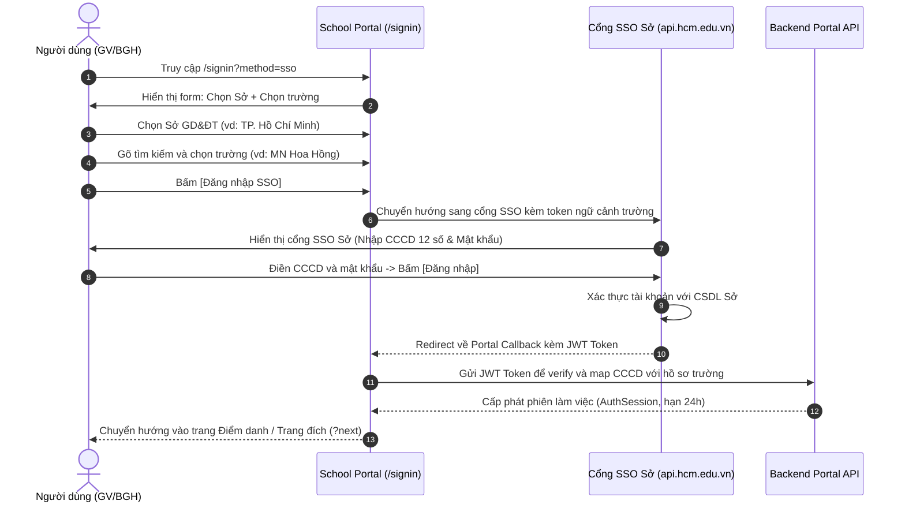

# Tài Liệu Yêu Cầu Sản Phẩm (PRD) — Đăng Nhập

> **Dự án:** Cổng Vận Hành Trường Học (School Operating Portal — Finviet / SOHA)  
> **Không gian Confluence:** Space `EDUS` (`https://kb.finviet.com.vn/x/m6ptBg`)  
> **Vị trí tài liệu:** M7: Khác → SM2: Đăng nhập (Page ID: `107850404`, Parent ID: `107850395`)  
> **Route triển khai:** `/signin` (màn hình chọn phương thức), `/sso/login` (cổng SSO của Sở GD&ĐT — prototype mock)  
> **Phiên bản:** 1.1 (Đã chốt các quyết định kiến trúc & nghiệp vụ)  
> **Chủ quản tài liệu:** Finviet Product & Engineering Team  
> **Trạng thái:** Đã hoàn thành Prototype, Đã kiểm thử 100%, Sẵn sàng tích hợp API Backend  

---

## 1. Thông tin tổng quan

### 1.1 Bối cảnh
School Operating Portal là hệ thống quản trị vận hành trường học đa người thuê (Multi-tenant SaaS), định danh từng trường thông qua tiền tố đường dẫn `/{schoolCode}` hoặc mã trường. Cổng xác thực đăng nhập (`/signin`) là cửa ngõ truy cập duy nhất vào hệ thống cho mọi đối tượng nhân sự trường học.

Để phục vụ hai nhóm đối tượng trường học đặc thù tại Việt Nam, hệ thống cung cấp 2 phương thức đăng nhập độc lập trên cùng một giao diện:
1. **Đăng nhập SSO bằng dữ liệu Sở GD&ĐT:** Dành cho các trường công lập, trường liên cấp thuộc các Sở GD&ĐT đã triển khai hệ thống xác thực tập trung ngành giáo dục (ví dụ: Sở GD&ĐT TP. Hồ Chí Minh với cổng HCMEDU SSO).
2. **Đăng nhập bằng tài khoản Finviet:** Dành cho các cơ sở giáo dục, trường ngoài công lập hoặc các đơn vị sử dụng tài khoản quản trị do Finviet cấp trực tiếp (gồm Mã trường, Email và Mật khẩu).

### 1.2 Mục tiêu sản phẩm
- Cung cấp trải nghiệm đăng nhập mượt mà, phân định rõ ràng giữa luồng SSO của Sở và luồng tài khoản Finviet.
- Đảm bảo tính bảo mật đa người thuê (Multi-tenant isolation): tài khoản trường nào chỉ được truy cập vào dữ liệu của trường đó.
- Không để lộ thông tin nhạy cảm về sự tồn tại của tài khoản trong hệ thống thông qua các thông báo lỗi chung (chống rà quét tài khoản / Account Enumeration Attack).
- Đưa người dùng về đúng phân hệ làm việc hoặc trang đích mong muốn (`?next=`) ngay sau khi xác thực thành công.

### 1.3 Đối tượng người dùng
- **Ban Giám Hiệu / Quản trị viên trường học:** Đăng nhập để điều hành, duyệt thu/chi, phân quyền và cấu hình năm học.
- **Giáo viên chủ nhiệm / Giáo viên bộ môn:** Đăng nhập để điểm danh, ghi nhận hoạt động, tải ảnh album, chấm điểm và trao đổi với phụ huynh.
- **Kế toán trường học:** Đăng nhập để quản lý danh mục thu, phát hành hóa đơn học phí và đối soát thanh toán.

### 1.4 Phạm vi tính năng
- **Trong phạm vi:**
  - Tab 1: Đăng nhập SSO (chọn Sở GD&ĐT, chọn trường qua bộ lọc tìm kiếm tiếng Việt không dấu, chuyển hướng sang cổng SSO của Sở, xử lý callback).
  - Tab 2: Đăng nhập bằng tài khoản (nhập mã trường, email/tài khoản, mật khẩu, ẩn/hiện mật khẩu, hộp chọn "Nhớ mật khẩu").
  - Quản lý phiên làm việc tập trung (24 giờ), tự động điều hướng người dùng đã có phiên, đăng xuất an toàn xóa sạch phiên.
  - Xử lý tham số URL `?method=sso|account` và tham số điều hướng an toàn `?next=`.
- **Ngoài phạm vi (phiên bản 1.0):**
  - Quên/đặt lại mật khẩu tự phục vụ qua SMS OTP.
  - Đăng nhập bằng mã QR hoặc nhận diện khuôn mặt sinh trắc học.
  - Chuyển đổi đa ngôn ngữ (English / Tiếng Việt).
  - Phân quyền chi tiết sau đăng nhập (sẽ do hệ thống RBAC của Portal xử lý sau khi nạp session).

---

## 2. Thiết kế giao diện & Luồng trải nghiệm người dùng

Màn hình `/signin` được thiết kế theo tỷ lệ chuẩn của hệ thống:
- **Cột trái (Promo Banner):** Banner hình ảnh nhận diện thương hiệu Finviet *"Giải pháp Chuyển đổi số Giáo dục"*, hotline hỗ trợ 1900 9005 và địa chỉ công ty. (Tự động ẩn trên màn hình có chiều rộng < 900px để tối ưu hiển thị di động).
- **Cột phải (Auth Box):** Khung xác thực trung tâm chứa logo Finviet, tiêu đề *"Đăng nhập vào trường"*, thanh chuyển tab `SegmentedControl` (`Đăng nhập SSO` | `Đăng nhập bằng tài khoản`), form nhập liệu và chân trang thông tin ngôn ngữ.

### 2.1 Luồng 1: Đăng nhập SSO (Dữ liệu Sở GD&ĐT)

| Bước | Thành phần giao diện | Hành vi & Tương tác |
|---|---|---|
| 1 | Ô chọn Sở GD&ĐT | Dropdown đơn chọn Sở Giáo dục & Đào tạo. Mặc định chọn Sở đầu tiên trong danh mục (ví dụ: *Sở GD&ĐT TP. Hồ Chí Minh*). |
| 2 | Ô chọn Trường học (`ComboboxField`) | Ô chọn tích hợp bộ gõ tìm kiếm thông minh. Danh sách trường tự động lọc chỉ hiển thị các trường **trực thuộc Sở đã chọn**. Hiển thị theo cú pháp `Tên trường (Mã trường)`. Hỗ trợ gõ tên hoặc mã trường không phân biệt hoa thường và không dấu (ví dụ: gõ `hoa hong` tìm ra `Trường MN Hoa Hồng (74718333)`). Khi người dùng đổi Sở, trường đã chọn tự động xóa trống để tránh sai lệch dữ liệu. |
| 3 | Nút `Đăng nhập SSO` | Nút chính (Primary Button). Bắt buộc người dùng đã chọn đầy đủ Sở và Trường. Nếu bấm khi chưa chọn trường, hiển thị thông báo lỗi màu đỏ ngay dưới ô nhập và không cho phép chuyển trang. |
| 4 | Cổng SSO của Sở GD&ĐT | Chuyển hướng người dùng sang cổng SSO của Sở. Giao diện cổng SSO hiển thị biểu trưng Sở, tên trường học đã chọn, ô nhập **Tên tài khoản (Số CCCD - 12 chữ số)** và ô **Mật khẩu**. |
| 5 | Hoàn tất đăng nhập | Xác thực thành công tại cổng SSO Sở sẽ chuyển hướng người dùng trở lại Portal kèm token xác thực. Portal khởi tạo phiên làm việc có thời hạn 24 giờ và điều hướng vào trang nghiệp vụ của trường. |

### 2.2 Luồng 2: Đăng nhập bằng tài khoản (Finviet cấp)

| Thành phần | Loại component | Đặc tả chi tiết |
|---|---|---|
| **Mã trường** | `TextField` (icon `school`) | Nhập mã định danh tenant của trường (ví dụ: `demo`, `vinschool`). Không phân biệt hoa/thường, tự động loại bỏ khoảng trắng thừa đầu/cuối chuỗi. |
| **Email** | `TextField` (icon `user`) | Nhập địa chỉ email quản trị hoặc giảng dạy. Kiểm tra định dạng email chuẩn `user@domain.ext`. |
| **Mật khẩu** | `TextField` (icon `lock`) | Nhập mật khẩu tài khoản. Tích hợp nút icon mắt (`eye` / `eye-slash`) bên phải để người dùng chủ động ẩn hoặc hiện mật khẩu khi cần kiểm tra. |
| **Nhớ mật khẩu** | `Checkbox` | Tùy chọn lưu phiên làm việc lâu dài (24 giờ). |
| **Nút Đăng nhập** | `Button` (Primary, full-width) | Kích hoạt gửi yêu cầu xác thực. Khi đang trong trạng thái gửi yêu cầu (Loading), nút tự động chuyển sang nhãn `Đang đăng nhập...` và khóa toàn bộ form để ngăn chặn bấm gửi trùng lặp. |

---

## 3. Quy tắc nghiệp vụ & Bảo mật (Business Rules)

| Mã quy tắc | Tên quy tắc | Nội dung quy tắc chi tiết |
|---|---|---|
| **DN-01** | Chuẩn hóa Mã trường | Mã trường không phân biệt chữ hoa, chữ thường (`case-insensitive`) và tự động được cắt bỏ khoảng trắng ở hai đầu (`trim`). Ví dụ: ` DEMO ` được hiểu là `demo`. |
| **DN-02** | Chuẩn hóa Email & Mật khẩu | Địa chỉ email tự động chuyển thành chữ thường (`lowercase`). Mật khẩu **bắt buộc phân biệt chữ hoa và chữ thường** (`case-sensitive`) để đảm bảo tính an toàn mật mã học. |
| **DN-03** | Xác thực tính đầy đủ cục bộ (Form Validation) | Nếu người dùng để trống bất kỳ trường thông tin bắt buộc nào (Mã trường, Email hoặc Mật khẩu), hệ thống hiển thị thông báo lỗi cục bộ dưới từng ô tương ứng và chưa gửi yêu cầu lên máy chủ xác thực. |
| **DN-04** | Thông báo lỗi an ninh bảo mật chung (Security Generic Error) | Khi thông tin đăng nhập không hợp lệ (sai mã trường, sai email, hoặc sai mật khẩu), hệ thống **bắt buộc hiển thị cùng một thông báo lỗi duy nhất**: *"Mã trường, email hoặc mật khẩu không chính xác."*. Tuyệt đối không thông báo riêng lẻ *"Email không tồn tại"* hay *"Mật khẩu không đúng"* nhằm triệt tiêu nguy cơ rà quét tài khoản (User Enumeration). |
| **DN-05** | Thông báo lỗi cổng SSO Sở | Tại cổng SSO của Sở, khi người dùng nhập sai thông tin, hiển thị thông báo chung: *"Tên tài khoản hoặc mật khẩu không chính xác."*. Tài khoản SSO của trường A tuyệt đối không được phép đăng nhập vào trường B. |
| **DN-06** | Xóa trắng mật khẩu khi thất bại | Sau mỗi lượt đăng nhập không thành công, ô nhập mật khẩu tự động được làm trống (`empty/clear`) và con trỏ tập trung (focus) trở lại ô mật khẩu để người dùng nhập lại an toàn. |
| **DN-07** | Chống gửi trùng lặp (Anti Double-Submission) | Trong quá trình hệ thống đang xử lý xác thực (in-flight request), toàn bộ các ô nhập dữ liệu và nút bấm đều ở trạng thái `disabled`, nhãn nút hiển thị `Đang đăng nhập...`. |
| **DN-08** | Định dạng số định danh cá nhân CCCD | Tên tài khoản tại cổng SSO Sở bắt buộc phải là số Căn cước công dân (CCCD) gồm đúng **12 chữ số** (Regex: `^\d{12}$`). Các trường hợp nhập thiếu số, thừa số hoặc chứa chữ cái sẽ bị chặn ngay tại client. |
| **DN-09** | Thời hạn hiệu lực của phiên làm việc (Session Duration) | Phiên làm việc sau khi xác thực thành công (cả phiên thông thường và phiên có tích chọn "Nhớ mật khẩu") có thời hạn hiệu lực chính xác là **24 giờ (24 hours)**. Sau 24 giờ, phiên tự động hết hiệu lực và điều hướng về trang đăng nhập. |
| **DN-10** | Giới hạn số lần thử (Retry Limit) | **Không giới hạn (No limit)** số lần thử đăng nhập của người dùng ở phiên bản hiện tại, nhằm hỗ trợ giáo viên và cán bộ nhà trường thuận tiện thao tác trong giờ giảng dạy mà không bị khóa tài khoản đột ngột. |
| **DN-11** | Ánh xạ tài khoản SSO với dữ liệu trường (Account Provisioning) | Toàn bộ các cơ sở trường học được Sở GD&ĐT cấp quyền sử dụng SSO đều đã có sẵn danh mục hồ sơ giáo viên/nhân sự đồng bộ từ CSDL Sở. Cổng Portal tự động khớp số CCCD từ token SSO với hồ sơ nhân sự của trường để cấp quyền tương ứng. |
| **DN-12** | Kiến trúc SSO linh hoạt đa Sở (Adaptive SSO Protocol) | Ở giai đoạn hiện tại, hệ thống sử dụng giao thức **JWT (JSON Web Token)** đồng nhất với định dạng SSO của Sở GD&ĐT TP.HCM (`api.hcm.edu.vn`). Tầng xử lý backend áp dụng Adapter Pattern để sẵn sàng cấu hình thêm các giao thức khác (OAuth2/OIDC, SAML) khi tích hợp với các Sở GD&ĐT tỉnh/thành khác trong tương lai. |
| **DN-13** | Điều hướng trang sau đăng nhập (Post-Login Redirection) | Đăng nhập thành công sẽ đưa người dùng vào trang mặc định: `/{schoolCode}/class/lop-1a1/attendance` (Điểm danh lớp 1A1). Nếu trên URL có tham số `?next=`, hệ thống sẽ điều hướng người dùng đến trang đích đó. |
| **DN-14** | Chống tấn công chuyển hướng ngoài (Open-Redirect Protection) | Tham số `?next=` chỉ được chấp nhận nếu là đường dẫn nội bộ hợp lệ bắt đầu bằng `/`. Hệ thống tự động từ chối và loại bỏ các URL có dạng `//domain.com`, `http://...`, `https://...`, chứa ký tự `\`, hoặc trỏ ngược về `/signin`, `/sso/...`. |
| **DN-15** | Tự động chuyển hướng khi đã có phiên (Active Session Bypass) | Khi người dùng đã có phiên hợp lệ truy cập vào `/signin`, hệ thống tự động kiểm tra và chuyển hướng ngay vào cổng vận hành của trường mà không yêu cầu đăng nhập lại. |
| **DN-16** | Đăng xuất an toàn (Safe Logout) | Nút Đăng xuất (`Đăng xuất`) trên thanh điều hướng đầu trang (`AppHeader`) sẽ lập tức xóa sạch token phiên làm việc trên trình duyệt và chuyển hướng người dùng về trang `/signin`. |

---

## 4. Các trạng thái giao diện (UI State Matrix)

| Màn hình / Component | Trạng thái hiển thị | Mô tả hành vi & Phản hồi trực quan |
|---|---|---|
| `/signin` — Tab SSO | **Mặc định (Initial)** | Hiển thị dropdown Sở GD&ĐT và ô chọn trường trống với gợi ý *"Chọn trường / Nhập mã trường"*. Nút `Đăng nhập SSO` sẵn sàng. |
| `/signin` — Tab SSO | **Lỗi chưa chọn trường** | Ô chọn trường viền đỏ (`border-danger`), hiển thị dòng cảnh báo chữ đỏ *"Vui lòng chọn trường học"* ngay dưới ô nhập. |
| `/signin` — Tab SSO | **Dropdown danh sách mở** | Danh sách trường hiển thị nổi (popover listbox) với thanh cuộn mượt. Gõ từ khóa sẽ lọc động danh sách theo thời gian thực (hỗ trợ tiếng Việt không dấu). |
| `/signin` — Tab SSO | **Không tìm thấy kết quả** | Hiển thị dòng trạng thái *"Không tìm thấy trường nào phù hợp"* trong khung danh sách mở. |
| `/signin` — Tab Tài khoản | **Mặc định (Initial)** | Ba ô nhập `Mã trường`, `Email`, `Mật khẩu` ở trạng thái bình thường. Hộp chọn `Nhớ mật khẩu` bỏ trống. Nút `Đăng nhập` màu xanh chuẩn DS. |
| `/signin` — Tab Tài khoản | **Lỗi dữ liệu từng ô** | Ô nhập tương ứng viền đỏ, hiển thị câu thông báo lỗi chi tiết bên dưới (ví dụ: *"Vui lòng nhập email hợp lệ"*). |
| `/signin` — Tab Tài khoản | **Lỗi an ninh chung** | Xuất hiện hộp thông báo cảnh báo đỏ (`Alert banner`) phía trên các ô nhập với nội dung: *"Mã trường, email hoặc mật khẩu không chính xác."*. |
| `/signin` — Tab Tài khoản | **Đang gửi yêu cầu (Loading)** | Con trỏ chuột chuyển sang dạng chờ, nút Đăng nhập hiển thị `Đang đăng nhập...` kèm icon xoay (spinner). |
| `/signin` — Tab Tài khoản | **Hiện mật khẩu (Revealed)** | Bấm icon mắt đổi icon sang `eye-slash`, kiểu input chuyển từ `password` sang `text`. |
| `/sso/login` (Cổng Sở) | **Mặc định** | Khung đăng nhập căn giữa trang nền xám, hiển thị logo Sở GD&ĐT, tên trường học đã chọn và 2 ô nhập CCCD và Mật khẩu. |
| `/sso/login` (Cổng Sở) | **Lỗi CCCD / Mật khẩu** | Hiển thị dòng cảnh báo đỏ: *"Số CCCD phải gồm đúng 12 chữ số"* hoặc *"Tên tài khoản hoặc mật khẩu không chính xác."*. |
| `/sso/login` (Cổng Sở) | **Tham số không hợp lệ** | Nếu người dùng truy cập trực tiếp `/sso/login` mà thiếu thông tin Sở hoặc Trường, hiển thị thông báo lỗi và nút quay lại trang `/signin`. |

---

## 5. Yêu cầu phi chức năng & Bảo mật dữ liệu (NFR)

1. **Tuân thủ Design System `[DS] ECO ME DASHBOARD v1.2.0`:**
   - Sử dụng màu chủ đạo vàng `#FEC020` cho banner và xanh nhận diện `#0066CC` cho nút đăng nhập.
   - 100% các ô nhập liệu sử dụng các thành phần chuẩn: `TextField`, `ComboboxField`, `SegmentedControl`, `Checkbox`, `Button`. Tuyệt đối không dùng thẻ HTML `<input>` thô.
2. **Bảo mật lưu trữ thông tin xác thực:**
   - Phía máy khách (Client Browser) tuyệt đối không lưu trữ mật khẩu dưới bất kỳ hình thức nào (`localStorage`, `sessionStorage`, `cookies`).
   - Phiên làm việc lưu trữ tối giản gồm: `schoolCode`, `schoolName`, `email`, `fullName`, `role`, `loginMethod`, `tokenExpiry`.
   - Trong môi trường sản phẩm thực tế (Production), phiên đăng nhập được duy trì thông qua Cookie `HttpOnly; Secure; SameSite=Strict` được mã hóa bởi Laravel Sanctum / NextAuth JWE.
3. **Hiệu năng & Khả năng phản hồi:**
   - Thời gian tải trang `/signin` lần đầu đạt dưới **1.0 giây** trên mạng 4G tiêu chuẩn.
   - Thao tác lọc tìm kiếm trường học trong `ComboboxField` phản hồi tức thì với độ trễ dưới **50ms**.
   - Thời gian xử lý xác thực API backend phản hồi dưới **300ms**.
4. **Khả năng tiếp cận (Accessibility - WCAG 2.1 AA):**
   - Hỗ trợ điều hướng hoàn toàn bằng bàn phím (`Tab`, `Shift+Tab`, `Enter`, `Escape`, `ArrowUp`, `ArrowDown`).
   - Các thông báo lỗi form có thuộc tính `role="alert"` để phần mềm đọc màn hình cho người khiếm thị nhận diện ngay lập tức.
   - Tỷ lệ tương phản màu chữ đạt chuẩn tối thiểu 4.5:1.

---

## 6. Kế hoạch tích hợp API Backend (Production Hand-off)

| Luồng nghiệp vụ | Endpoint API dự kiến | Phương thức | Dữ liệu truyền lên | Dữ liệu trả về mong đợi |
|---|---|---|---|---|
| **Lấy danh mục Sở GD&ĐT** | `/api/1.0/sso/departments` | `GET` | Không | `[{ id, name, portalName, operator, ssoEndpoint }]` |
| **Lấy danh sách trường theo Sở** | `/api/1.0/sso/schools?departmentId={id}` | `GET` | `departmentId` | `[{ id, schoolCode, schoolName, csdlCode }]` |
| **Xác thực tài khoản Finviet** | `/{schoolCode}/api/1.0/auth/login` | `POST` | `{ email, password, remember }` | `{ token, user: { id, fullName, role, email }, school: { code, name } }` |
| **Xác thực Callback SSO** | `/api/1.0/sso/callback` | `POST` | `{ departmentId, schoolCode, ssoToken }` | `{ token, user: { id, fullName, role, cccd }, school: { code, name } }` |
| **Đăng xuất an toàn** | `/{schoolCode}/api/1.0/auth/logout` | `POST` | Bearer Token | `{ success: true, message: "Logged out" }` |

---

## 7. Tiêu chí nghiệm thu sản phẩm (Acceptance Criteria)

- [x] **AC-01:** Chọn Sở GD&ĐT sẽ tự động tải đúng danh sách trường của Sở đó. Thay đổi Sở sẽ tự động xóa trường đã chọn trước đó.
- [x] **AC-02:** Nhập từ khóa tiếng Việt không dấu trong ô tìm kiếm trường (ví dụ: `hoa hong`) tìm kiếm chính xác các trường có tên tương ứng.
- [x] **AC-03:** Bấm "Đăng nhập SSO" khi chưa chọn trường học hiển thị cảnh báo đỏ và chặn chuyển trang.
- [x] **AC-04:** Chuyển sang cổng SSO Sở với đầy đủ tham số định danh trường. Cổng SSO yêu cầu đúng 12 chữ số CCCD.
- [x] **AC-05:** Đăng nhập tài khoản với mã trường viết hoa, viết thường hoặc có khoảng trắng thừa (` DEMO `) đều được chuẩn hóa và xác thực thành công.
- [x] **AC-06:** Khi nhập sai mã trường, email hoặc mật khẩu, hệ thống hiển thị cùng một thông báo lỗi an ninh bảo mật chung và tự động xóa ô mật khẩu.
- [x] **AC-07:** Các URL chuyển hướng độc hại (`?next=//evil.com`, `?next=https://...`) bị vô hiệu hóa an toàn, đưa người dùng về trang mặc định của hệ thống.
- [x] **AC-08:** Phiên làm việc được duy trì liên tục trong **24 giờ**. Người dùng đã đăng nhập khi truy cập `/signin` tự động vào thẳng hệ thống.
- [x] **AC-09:** Nút Đăng xuất tại thanh điều hướng xóa sạch phiên và đưa người dùng về màn hình đăng nhập.
- [x] **AC-10:** Hệ thống vượt qua 100% các bài kiểm thử tự động (Unit Test & E2E Browser Test).

---

## 8. Dữ liệu thử nghiệm (Demo Environment Credentials)

| Phương thức | Thông tin truy cập thử nghiệm | Vai trò người dùng | Phân hệ điều hướng |
|---|---|---|---|
| **Tài khoản Finviet** | Mã trường: `demo` Email: `admin@demo.edu.vn` Mật khẩu: `Demo@2026` | Quản trị viên trường học | `/demo/class/lop-1a1/attendance` |
| **Đăng nhập SSO Sở** | Sở GD&ĐT: *Sở GD&ĐT TP. Hồ Chí Minh* Trường: *Liên cấp PT Sao Mai (74719001)* Số CCCD: `079201001234` Mật khẩu: `Sso@2026` | Giáo viên chủ nhiệm | `/demo/class/lop-1a1/attendance` |
