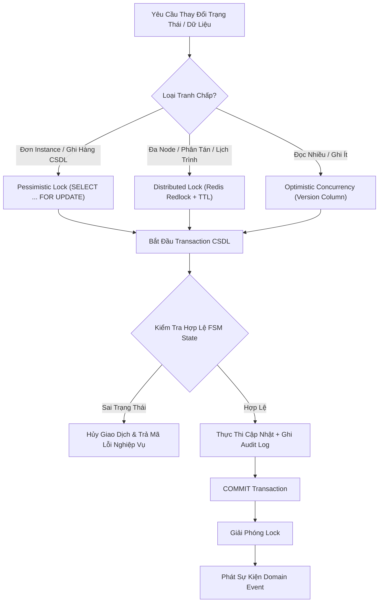
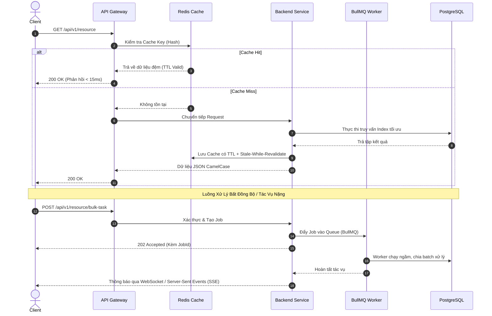

# 🏛️ KIẾN TRÚC KỸ THUẬT TỔNG THỂ (SYSTEM ARCHITECTURE)
## Khung Kiến Trúc Kỹ Thuật Nền Tảng Cho Sản Phẩm Mới (Technical Architecture Blueprint)

> **Mã định danh kiến trúc**: `ARCH-ENTERPRISE-MODULAR-BLUEPRINT-V1`  
> **Phiên bản**: 1.0.0 (Greenfield Technical Standard)  
> **Tính chất tài liệu**: **Đặc tả thuần kỹ thuật (Pure Technical Specs)** — không phụ thuộc nghiệp vụ cụ thể.  
> **Phong cách kiến trúc**: **Enterprise Modular Monolith (Clean / Hexagonal Architecture)**, sẵn sàng phân rã Microservices khi quy mô yêu cầu.  
> **Nguyên tắc cốt lõi**: Type-Safe 100% · Zero-Mock Persistence · Stateless Compute · Framework-Native Simplicity.

---

## 🧭 1. TỔNG QUAN TÔ-PÔ HỆ THỐNG (SYSTEM TOPOLOGY)

Hệ thống được thiết kế theo mô hình **Đa tầng độc lập (Decoupled Multi-Tier)**, phân tách hoàn toàn giữa Lớp Trình diễn (Client), Cổng Điều phối (Gateway), Lõi Xử lý Ứng dụng (Core Application) và Lớp Lưu trữ Dữ liệu (Data Tier):

```text
┌───────────────────────────────────────────────────────────────────────────────────────────────────┐
│                                      1. CLIENT TIER (EDGE & BROWSER)                              │
│                                                                                                   │
│  [ Web Desktop SPA ]                 [ Mobile Web / PWA ]                 [ Backoffice Portal ]   │
│  React 19 / Vite / Next.js           Responsive Touch / Offline           Admin Console           │
│  State: TanStack Query + Zustand     Storage: IndexedDB / CacheStorage    Design System Tokens    │
└─────────────────────────────────────────────────┬─────────────────────────────────────────────────┘
                                                  │ HTTPS (TLS 1.3) / WebSocket / WSS
                                                  ▼
┌───────────────────────────────────────────────────────────────────────────────────────────────────┐
│                                  2. REVERSE PROXY & EDGE GATEWAY                                  │
│                                                                                                   │
│  ├── Nginx / Envoy Proxy: SSL Termination, Static Asset Caching, Gzip/Brotli Compression          │
│  ├── Security Boundary: Rate Limiting, DDoS Shield, CORS Validation, Security Headers (CSP, HSTS)  │
│  └── Traffic Routing: / -> Static SPAs (0 MB Node RAM) | /api/v1/* -> Core App (Port 4000)        │
└─────────────────────────────────────────────────┬─────────────────────────────────────────────────┘
                                                  │ Localhost Loopback / VPC Private Network
                                                  ▼
┌───────────────────────────────────────────────────────────────────────────────────────────────────┐
│                           3. BACKEND CORE TIER (MODULAR MONOLITH APPLICATION)                     │
│                                                                                                   │
│  [ HTTP / WS Engine ] ── [ Request ID / Pino Logger ] ── [ Auth Guard ] ── [ Tenant Context RLS ] │
│                                                 │                                                 │
│  ┌──────────────────────────────────────────────┴──────────────────────────────────────────────┐  │
│  │ BOUNDED DOMAIN CONTEXTS (Hexagonal / Clean Architecture):                                   │  │
│  │ ├── Domain Context A          ├── Domain Context B          ├── Domain Context C            │  │
│  │ └── Shared Kernel (Events, Base Entities, Custom Value Objects, Formula Engines)            │  │
│  └──────────────────────────────────────────────┬──────────────────────────────────────────────┘  │
│                                                 │                                                 │
│  [ Infrastructure Adapters ]                    │                                                 │
│  ├── Database Adapter: Drizzle ORM / Connection Pool (Max Connections, Idle Timeout)             │
│  ├── Distributed Cache & Lock: Redis 7 (Atomic Lua Scripts, Redlock Manager)                      │
│  └── Async Job Engine: BullMQ / Event Queue (Dead Letter Queue, Exponential Backoff)             │
└───────────────────────────────────────┬───────────────────────────────┬───────────────────────────┘
                                        │                               │
                                        ▼                               ▼
                 ┌───────────────────────────────┐   ┌─────────────────────────────────────┐
                 │     4. PRIMARY DATABASE       │   │    5. DISTRIBUTED CACHE & QUEUE     │
                 │ PostgreSQL 16 Enterprise      │   │ Redis 7 Native Cluster              │
                 │ Row Level Security (RLS)      │   │ Redlock Concurrency Guard           │
                 │ Connection Pooler (PgBouncer) │   │ In-Memory TTL Cache                 │
                 │ B-Tree, GIN, BRIN Indexes     │   │ BullMQ Job Queue & Event Streams    │
                 └───────────────────────────────┘   └─────────────────────────────────────┘
```

---

## 🏛️ 2. PHÂN TẦNG KIẾN TRÚC MÃ NGUỒN (HEXAGONAL ARCHITECTURE)

Mỗi phân hệ (Domain Module) tuân thủ nghiêm ngặt nguyên lý **Ports & Adapters**, bảo đảm Domain Logic không bị phụ thuộc vào Framework hoặc CSDL:

```text
               ┌────────────────────────────────────────────────────────┐
               │              LAYER 1: ADAPTER IN (PORTS)               │
               │  Controllers · WebSocket Gateways · Event Subscribers  │
               └───────────────────────────┬────────────────────────────┘
                                           │ Calls
                                           ▼
               ┌────────────────────────────────────────────────────────┐
               │              LAYER 2: APPLICATION SERVICES             │
               │  Use Cases · Orchestrators · Transaction Boundaries    │
               └───────────────────────────┬────────────────────────────┘
                                           │ Implements / Uses
                                           ▼
               ┌────────────────────────────────────────────────────────┐
               │                 LAYER 3: DOMAIN CORE                   │
               │  Entities · Value Objects · Finite State Machines (FSM)│
               │  Domain Events · Business Invariants (Zero-Framework)  │
               └───────────────────────────┬────────────────────────────┘
                                           │ Inverted Dependency (SPI)
                                           ▼
               ┌────────────────────────────────────────────────────────┐
               │              LAYER 4: ADAPTER OUT (INFRA)              │
               │  Postgres Repositories · Redis Cache · Storage Gateway │
               └────────────────────────────────────────────────────────┘
```

### Quy tắc bất biến giữa các tầng:
1. **Quy tắc phụ thuộc một chiều (Dependency Inversion)**: Tầng ngoài được phép phụ thuộc vào tầng trong; tầng Domain Core tuyệt đối không import thư viện bên ngoài (NestJS, ORM, Express).
2. **DTO & Serialization**: Dữ liệu gửi đến và trả về từ API bắt buộc được validate qua Validation Pipe (Zod / Class-Validator) và chuẩn hóa **100% camelCase duy nhất**.
3. **Kỷ luật độ dài file**: Mọi file mã nguồn (`.ts`, `.tsx`, `.sql`) bắt buộc $\le 250$ dòng. Khi vượt ngưỡng, phân rã ngay thành các helpers, strategies hoặc hooks đơn trách nhiệm.

---

## 🔒 3. KIẾN TRÚC DỮ LIỆU & KIỂM SOÁT ĐỒNG THỜI (DATA & CONCURRENCY)



### Các nguyên tắc quản trị dữ liệu:
* **Zero-Mock & Real Persistence**: Không sử dụng mock data, memory collections trong môi trường runtime. Mọi trạng thái bắt buộc được lưu vết bền vững vào PostgreSQL.
* **Kiểm soát đồng thời 3 cấp (Concurrency Control)**:
  1. *Optimistic Lock*: Sử dụng cột `version INT DEFAULT 1` cho các thực thể có tần suất tranh chấp thấp.
  2. *Pessimistic Row Lock*: Sử dụng `.for('update')` trong Transaction đối với các thao tác tài chính, kho hàng, số dư và hạn mức.
  3. *Distributed Lock*: Sử dụng Redis Redlock (với khóa tự giải phóng TTL) cho các tác vụ định kỳ (Cron Jobs), Worker bất đồng bộ hoặc giao dịch liên server.
* **Bộ máy trạng thái hữu hạn (FSM - Finite State Machine)**: Mọi vòng đời thực thể cốt lõi phải được định nghĩa ma trận chuyển trạng thái tường minh. Nghiêm cấm cập nhật trạng thái tự do không qua transition guard.

---

## 🛡️ 4. BẢO MẬT, ĐA NGƯỜI THUÊ & PHÂN QUYỀN (SECURITY & MULTI-TENANCY)

### 4.1. Cơ Chế Cách Ly Đa Người Thuê (Multi-Tenant Isolation)
Hệ thống sử dụng mô hình **Shared Database, Isolated Rows**:
* Mọi bảng dữ liệu người thuê bắt buộc có cột `tenant_id` (hoặc `organization_id`) dạng UUIDv4 có đánh chỉ mục Index.
* Tích hợp **PostgreSQL Row-Level Security (RLS)**: Ép buộc phiên kết nối CSDL phải thiết lập biến session `app.current_tenant_id` trước khi thực thi truy vấn, ngăn chặn rò rỉ dữ liệu chéo giữa các tổ chức ở tầng CSDL.

### 4.2. Xác Thực & Phân Quyền (AuthN & AuthZ)
* **Xác thực (Authentication)**:
  * Cơ chế Stateless JWT kép: `Access Token` (thời hạn ngắn, lưu HttpOnly Cookie / Header) + `Refresh Token` (lưu CSDL có cơ chế thu hồi tức thì Revocation List).
  * Mã hóa mật khẩu: Sử dụng thuật toán `Argon2id` hoặc `Bcrypt` với Salt Rounds $\ge 10$.
* **Phân quyền (Authorization)**:
  * Mô hình **RBAC nâng cao (Role-Based Access Control) kết hợp ABAC (Attribute-Based Scope)**.
  * Phân quyền theo 3 cấp độ: `Module` $\rightarrow$ `Resource:Action` (ví dụ: `orders:create`, `finance:approve`) $\rightarrow$ `Data Scope` (Toàn công ty / Chi nhánh / Cá nhân).

---

## ⚡ 5. HIỆU NĂNG, BỘ NHỚ ĐỆM & BẤT ĐỒNG BỘ (PERFORMANCE & ASYNC)



1. **Chiến lược Bộ nhớ đệm (Caching Strategy)**:
   * Áp dụng mẫu *Cache-Aside* kết hợp cơ chế *Event-Driven Cache Invalidation*.
   * Dữ liệu danh mục/cấu hình dùng chung được gắn TTL và tự động bị hủy (`DEL`) ngay khi có sự kiện thay đổi dữ liệu phát sinh.
2. **Hàng đợi & Tác vụ chạy ngầm (Queue & Workers)**:
   * Phân tách 100% các tác vụ nặng (xuất nhập file dung lượng lớn, gửi email/thông báo, đồng bộ bên thứ 3) ra khỏi luồng xử lý HTTP chính thông qua Worker Queue.
   * Cấu hình bắt buộc: Thử lại tự động với số mũ (Exponential Backoff), Dead Letter Queue (DLQ) để lưu vết job lỗi, và Timeout guard ngăn worker bị treo.

---

## 📊 6. QUAN SÁT HỆ THỐNG & ĐỘ BỀN VẬN HÀNH (OBSERVABILITY & RELIABILITY)

1. **Ghi nhật ký có cấu trúc (Structured Logging)**:
   * Toàn bộ log xuất ra định dạng JSON phẳng chuẩn hóa (`level`, `time`, `traceId`, `tenantId`, `userId`, `context`, `message`, `durationMs`).
   * Sử dụng Middleware gán `traceId` (UUIDv4) xuyên suốt từ Gateway $\rightarrow$ Service $\rightarrow$ Query CSDL để truy vết lỗi End-to-End.
2. **Cổng kiểm tra sức khỏe (Health Check Gates)**:
   * `/health/liveness`: Xác nhận tiến trình Node.js đang hoạt động.
   * `/health/readiness`: Kiểm tra kết nối thật tới PostgreSQL và Redis trước khi Nginx định tuyến traffic vào instance.
3. **Chiến lược kiểm thử tự động (Quality Gates)**:
   * **Unit Tests**: Kiểm thử logic thuần của Domain Entities, FSM và Service Helpers.
   * **Integration Tests**: Kiểm thử tương tác Repository với CSDL thật (dùng Docker Testcontainers hoặc CSDL kiểm thử cô lập).
   * **E2E Smoke Tests**: Kiểm thử luồng giao diện trọng yếu bằng Playwright với tiêu chí nhị phân PASS / FAIL trước khi phát hành.
