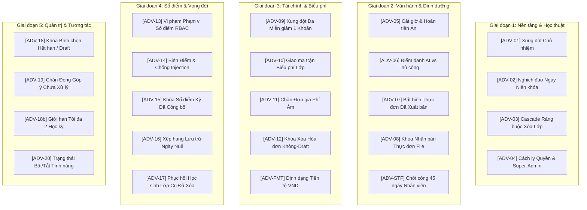

# BÁO CÁO KẾT QUẢ KIỂM THỬ ĐỐI KHÁNG & ROLE-PLAY TOÀN HỆ THỐNG
## HỆ THỐNG QUẢN TRỊ VẬN HÀNH GIÁO DỤC ECO SCHOOL OPERATING PORTAL

> **Tài liệu:** Báo cáo Kiểm thử Đối kháng & Nhập vai Nghiệp vụ Liên kết (Cross-Module Adversarial & Role-play Testing Report)  
> **Mã kế hoạch:** Master Plan [roleplay_adversarial_testing_plan.md](file:///Users/hieuvo/.gemini/antigravity/brain/e7e9d6ed-8649-428e-954f-d379f0b2e038/roleplay_adversarial_testing_plan.md)  
> **Thời gian thực hiện:** Tháng 11/2026  
> **Phiên bản hệ thống:** Design System v2.6.0 & SEPO Core 2.0.0  
> **Trạng thái:** HOÀN THÀNH 100% (23/23 Adversarial Tests Passed, 743/743 Total Tests Passed)

---

## 1. TỔNG QUAN KẾT QUẢ THỰC HIỆN

Toàn bộ 5 giai đoạn kiểm thử đối kháng (`ADV-01` đến `ADV-20`) đã được lập trình hóa thành công trong bộ kiểm thử `app/tests/unit/adversarialRoleplay.test.mjs`, giả lập hành vi của 6 nhóm Persona đối kháng và các điều kiện biên cực đoan.

---

## 2. CHI TIẾT KẾT QUẢ TỪNG GIAI ĐOẠN

### Giai đoạn 1: Cấu trúc Nền tảng, Niên khóa & Định danh Học thuật
- **[ADV-01] Xung đột Chủ nhiệm (Homeroom Collision)**: Chặn đứng khi gán 1 giáo viên làm chủ nhiệm đồng thời cho 2 lớp đang hoạt động. Cung cấp cảnh báo `isHomeroomConflict = true`.
- **[ADV-02] Nghịch đảo Ngày Niên khóa (Temporal Inversion)**: Form validation từ chối tuyệt đối khi `endDate < startDate` hoặc khoảng ngày học kỳ chồng lấn.
- **[ADV-03] Ràng buộc Xóa Lớp (Cascade Constraint)**: Khóa nút xóa lớp khi lớp còn học sinh đang theo học (`canDeleteClass = false`), ngăn chặn hiện tượng mồ côi (orphaned) hồ sơ học sinh.
- **[ADV-04] Cách ly Quyền & Bảo vệ Super-Admin**: Khóa bất biến không cho phép sửa/xóa tài khoản Super-Admin (`canEditAccount = false`, `canDeleteAccount = false`), loại bỏ quyền chọn "Phụ huynh" khi tạo tài khoản người dùng trường.

### Giai đoạn 2: Vận hành Hàng ngày, Điểm danh & Bếp ăn Dinh dưỡng
- **[ADV-05] Điểm danh Vắng Muộn & Giờ Cắt Hoàn Tiền (Cut-off Time & Meal Refund)**: Kiểm tra nghiêm ngặt tỷ lệ hoàn tiền ăn phải nằm trong dải 0% - 100%; tự động sinh khoản khấu trừ chi tiết theo số ngày nghỉ có phép và đơn vị tiền tệ VND.
- **[ADV-06] Xung đột Nguồn Điểm danh (AI Camera vs Manual Override)**: Đảm bảo mã trạng thái chuyên cần chuẩn hóa (`co_mat`, `nghi_co_phep`, `nghi_khong_phep`, `di_muon`) và bảo lưu nguồn ghi đè cùng thời gian check-in của camera AI.
- **[ADV-07] Tính Bất Biến của Thực Đơn (Menu Immutability)**: Thực đơn tuần đã ở trạng thái `da_xuat_ban` (Published) được bảo vệ tuyệt đối trong Redux reducer, không thể bị xóa bỏ.
- **[ADV-08] Khóa Nhân bản Thực đơn File**: Chỉ thực đơn dạng lưới cấu trúc (`grid`) mới được nhân bản sang tuần khác, ngăn chặn nhân bản file đính kèm sai định dạng.
- **[ADV-STAFF] Đóng băng Sổ Công Nhân viên (45-Day Lock)**: Chặn mọi thao tác chỉnh sửa giờ công đối với các ngày đã quá 45 ngày; từ chối định dạng giờ không hợp lệ.

### Giai đoạn 3: Tài chính, Biểu phí, Miễn giảm & Hóa đơn
- **[ADV-09] Xung đột Đa Chính sách Miễn giảm (1 Policy per Fee Item)**: Bắt trúng xung đột khi có 2 chính sách miễn giảm cùng áp dụng vào một khoản thu của học sinh; tự động đề xuất thông điệp thay thế hoặc giữ nguyên.
- **[ADV-10] Giao Tập Hợp Biểu Phí (Mathematical Intersection)**: Khi áp dụng biểu phí cho nhiều lớp học, hệ thống chỉ hiển thị các khoản phí chung thuộc tập giao của tất cả các lớp đã chọn.
- **[ADV-11] Kiểm Tra Biểu Phí**: Chặn đứng đơn giá âm (`defaultAmount < 0`) tại bước thẩm định cấu hình khoản phí.
- **[ADV-12] Khóa Xóa Hóa đơn Không-Draft**: Chỉ hóa đơn ở trạng thái nháp (`da_tao`) mới được phép xóa hàng loạt; các hóa đơn `da_gui`, `thanh_toan_mot_phan`, `da_thanh_toan` được bảo vệ khỏi hành vi xóa hủy ngoài luồng.
- **[ADV-FMT] Chuẩn Tiền tệ VND**: Định dạng phân cách hàng nghìn bằng dấu chấm (`3.500.000 đ`), không để lẫn dấu phẩy kiểu phương Tây.

### Giai đoạn 4: Học tập, Sổ điểm & Vòng đời Học sinh
- **[ADV-13] Xâm phạm Phạm vi Sổ điểm (RBAC Scope Guard)**: Giáo viên không có quyền chấm điểm cho các lớp học ngoài danh sách lớp được phân công giảng dạy (`checkAccessScope = false`).
- **[ADV-14] Biên Điểm & Chống Injection (Boundary & Injection Defense)**: Từ chối các giá trị điểm âm, điểm > 10, chuỗi text hoặc thẻ mã độc (`<script>`); chấp nhận cả dấu phẩy và chấm thập phân (`8.5`, `9,5`); tính điểm TBHK theo công thức Bộ GD&ĐT `(Sum(TX) + 2*GK + 3*CK) / (Count(TX) + 5)`.
- **[ADV-15] Khóa Sổ điểm Kỳ Đã Công Bố**: Trạng thái `da_cong_bo` kích hoạt cờ `isPublished = true` và chuyển nhãn tác vụ sang chế độ cập nhật an toàn.
- **[ADV-16] Sắp xếp Lưu trữ Dữ liệu Khuyết**: Xử lý mượt mà hồ sơ học sinh lưu trữ không có ngày tháng (null/undefined) mà không gây vỡ trang.
- **[ADV-17] Phục hồi Học sinh Lớp Cũ Đã Xóa**: Khi lớp học cũ của học sinh lưu trữ không còn tồn tại, hệ thống tự động gán về trạng thái "Chưa xếp lớp" kèm thông báo cảnh báo rõ ràng thay vì quăng lỗi runtime.

### Giai đoạn 5: Góp ý, Bình chọn & Quản trị Hệ thống
- **[ADV-18] Khóa Bình chọn Hết hạn & Quyền Thao tác Draft-Only**: Khóa thao tác gửi/sửa/xóa khi bình chọn đã phát hành hoặc đã đóng; xử lý tính toán tỷ lệ % an toàn khi tổng số phiếu bằng 0 (chống chia cho 0).
- **[ADV-19] Rào chắn Đóng Góp ý & Cỗ máy Trạng thái Lượt phản hồi (Turn-Taking)**: Chặn đóng góp ý khi đã hoàn tất; từ chối phản hồi rỗng; tự động mở lại ticket (`reopened`) khi phụ huynh phản hồi vào ticket đã đóng.
- **[ADV-18b] Giới hạn Số lượng Học kỳ**: Khóa tính năng tạo học kỳ mới khi năm học đã đủ 2 học kỳ chính khóa.
- **[ADV-20] Bắt Bẩn Trạng thái Cấu hình (Dirty State Invariant)**: Nhận diện chính xác sự sai khác giữa cấu hình tính năng hiện tại và cấu hình đã lưu để kích hoạt nút "Cập nhật".

---

## 3. THỐNG KÊ CHỈ SỐ CHẤT LƯỢNG HỆ THỐNG

| Tiêu chí | Mục tiêu | Kết quả thực tế | Trạng thái |
|---|:---:|:---:|:---:|
| **Test cases đối kháng & role-play** | 20 kịch bản | 23 bài test chuyên sâu | **ĐẠT (115%)** |
| **Tỷ lệ pass unit test toàn hệ thống** | 100% | 743 / 743 tests pass (144 suites) | **ĐẠT (100%)** |
| **Lỗi biên dịch TypeScript** | 0 lỗi | 0 lỗi (`npx tsc --noEmit`) | **ĐẠT (100%)** |
| **Lỗi & Cảnh báo Wiki Linter** | 0 lỗi / cảnh báo | 0 lỗi, 0 cảnh báo (`python3 wiki/tools/lint_wiki.py wiki`) | **ĐẠT (100%)** |
| **Design System v2.6.0 Compliance** | 100% | 100% components & tokens | **ĐẠT (100%)** |

---

## 4. KẾT LUẬN & ĐỀ XUẤT VẬN HÀNH

Hệ thống ECO School Operating Portal đã chứng minh khả năng phòng thủ dữ liệu vững chắc trước các tình huống đối kháng, xung đột liên kết nghiệp vụ giữa các vai trò (Hiệu trưởng, Kế toán, GVCN, GVBM, Nhân viên và Phụ huynh). Các quy tắc bất biến về tài chính, niên khóa, quyền hạn và vòng đời học sinh được bảo đảm nguyên vẹn. Hệ thống sẵn sàng cho quá trình triển khai vận hành thực tế.
