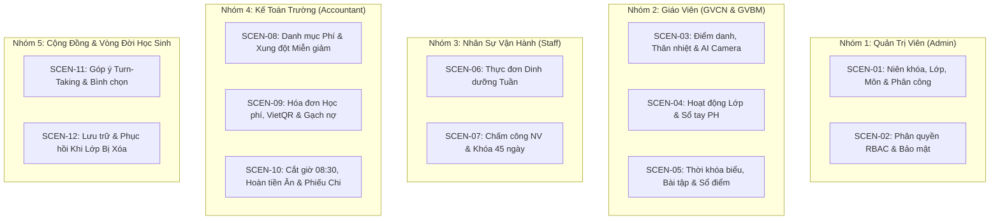

# MA TRẬN KỊCH BẢN KIỂM THỬ TOÀN DIỆN MỌI TÌNH HUỐNG (COMPREHENSIVE SCENARIO TEST MATRIX)
## HỆ THỐNG QUẢN TRỊ VẬN HÀNH GIÁO DỤC ECO SCHOOL OPERATING PORTAL

> **Tài liệu:** Bộ Kịch Bản Kiểm Thử Đầy Đủ Mọi Tình Huống Vận Hành (All-Inclusive Scenario Test Suite)  
> **Phạm vi:** 38 Sub-modules trên 6 phân hệ (Tổng quan, Vận hành, Học tập, Tài chính, Nhà trường, Cấu hình)  
> **Mã kiểm thử tự động tương ứng:** `app/tests/unit/comprehensiveScenarios.test.mjs` (12 Scenarios, 755/755 tests passed)  
> **Phiên bản:** 2.6.0 (Tháng 11/2026)

---

## 1. TỔNG HỢP 12 KỊCH BẢN ĐẦU CUỐI (SCEN-01 ĐẾN SCEN-12)

---

## 2. MA TRẬN CHI TIẾT TỪNG KỊCH BẢN

### SCEN-01: Admin - Thiết lập Niên khóa, Khối lớp, Lớp học & Phân công Giáo viên
- **Mục tiêu**: Đảm bảo niên khóa, cấu trúc lớp học và giáo viên chủ nhiệm không có xung đột, không mồ côi dữ liệu.
- **Các bước thực hiện**:
  1. Tạo năm học mới với ngày kết thúc >= ngày bắt đầu (`startDate <= endDate`).
  2. Thử nhập ngày nghịch đảo (`endDate < startDate`) -> Hệ thống từ chối form.
  3. Thử thêm học kỳ thứ 3 -> Nút thêm học kỳ bị khóa khi đã đủ 2 học kỳ chính khóa.
  4. Tạo lớp học với mã lớp duy nhất trong năm học và sĩ số tối đa (1–60 HS).
  5. Phân công GV A làm chủ nhiệm lớp 1A1, sau đó thử gán GV A làm chủ nhiệm lớp 1A2 -> Phát hiện xung đột, cảnh báo tên lớp đang phụ trách.
  6. Thử xóa lớp có 30 học sinh -> Hệ thống chặn đứng; chỉ cho xóa khi sĩ số bằng 0.

### SCEN-02: Admin - Quản lý Tài khoản, Cấp quyền & Phân quyền RBAC
- **Mục tiêu**: Đảm bảo phân quyền 3 cấp độ (Module, Resource:Action, Data Scope) chặt chẽ và bảo vệ tuyệt đối Super-Admin.
- **Các bước thực hiện**:
  1. Tạo tài khoản nhân sự với vai trò Giáo viên / Kế toán / Quản lý.
  2. Chặn quyền chọn "Quản trị viên" khi tạo tài khoản thông thường.
  3. Khóa tài khoản Phụ huynh khỏi danh sách tạo từ phía nhà trường (do Phụ huynh tự kích hoạt qua app di động).
  4. Khóa bất biến thông tin Super-Admin: Không cho phép sửa tên, sửa email, đổi trạng thái hoặc xóa tài khoản.
  5. Thẩm định quyền RBAC: Giáo viên không có quyền duyệt hóa đơn tài chính (`finance:invoice:approve = false`), Kế toán và Admin có quyền.

### SCEN-03: GVCN - Điểm danh 2 Buổi, Thân nhiệt, Ghi chú Sức khỏe & Ghi đè AI Camera
- **Mục tiêu**: Quản lý chuyên cần học sinh chuẩn xác, bảo lưu vết đối soát giữa AI Camera cổng trường và GVCN.
- **Các bước thực hiện**:
  1. Mở danh sách điểm danh lớp buổi sáng.
  2. Nhận diện học sinh qua 4 trạng thái chuẩn: Có mặt (`co_mat`), Nghỉ có phép (`nghi_co_phep`), Nghỉ không phép (`nghi_khong_phep`), Đi muộn (`di_muon`).
  3. Nhập thân nhiệt học sinh (cảnh báo nếu > 37.5°C).
  4. Khi Camera AI nhận diện học sinh check-in lúc 07:18 nhưng GVCN đánh dấu vắng vì học sinh ở phòng y tế: Hệ thống ghi nhận trạng thái GVCN chọn, đồng thời lưu vết camera check-in và lý do ghi đè trong audit log.

### SCEN-04: GVCN - Hoạt động Lớp học, Quản lý Ảnh & Sổ tay Phụ huynh
- **Mục tiêu**: Đăng tải trải nghiệm học tập, sắp xếp tin ghim và tra cứu cẩm nang quy chế trường.
- **Các bước thực hiện**:
  1. Tạo bài viết hoạt động lớp: Bắt buộc có nội dung text hoặc ít nhất 1 ảnh/video đính kèm.
  2. Đánh dấu ghim bài viết (`isPinned: true`) -> Bài ghim tự động nổi lên đầu trang bất kể thời gian đăng.
  3. Tạo danh mục Sổ tay PH: Giới hạn tối đa 2 cấp phân cấp (không được tạo danh mục con cấp 3).
  4. Tạo bài viết sổ tay: Bắt buộc tiêu đề >= 3 ký tự, nội dung đầy đủ và thuộc danh mục hợp lệ.

### SCEN-05: GVBM - Thời khóa biểu, Giao Bài tập, Chấm bài Trễ & Nhập Sổ điểm
- **Mục tiêu**: Đảm bảo chu trình giảng dạy, đánh giá học lực định kỳ và tính điểm TBHK theo chuẩn Bộ GD&ĐT.
- **Các bước thực hiện**:
  1. Tạo bài tập về nhà: Chọn lớp, môn học, tiêu đề và hạn nộp (ngày gửi phải trước hạn nộp).
  2. Học sinh nộp bài sau hạn nộp: Hệ thống tự động gắn nhãn "Nộp trễ hạn".
  3. Chấm bài: Bắt buộc điểm từ 0.0 đến 10.0 và có lời nhận xét của giáo viên khi bật cờ đánh giá.
  4. Nhập điểm sổ điểm: Hỗ trợ dấu chấm và phẩy thập phân (`8.5`, `9,5`), chặn điểm âm hoặc điểm > 10.
  5. Tính điểm TBHK theo công thức: `(Sum(TX) + 2*GK + 3*CK) / (Count(TX) + 5)`. Trả về `null` nếu thiếu điểm giữa kỳ (GK) hoặc cuối kỳ (CK).
  6. Khóa học kỳ: Khi học kỳ chuyển sang `da_cong_bo`, giao diện hiển thị trạng thái đã xuất bản và chuyển nút thao tác sang "Cập nhật".

### SCEN-06: Nhân viên Bếp - Lập Thực đơn Dinh dưỡng Tuần & Khóa Thực đơn Xuất bản
- **Mục tiêu**: Đảm bảo an toàn dinh dưỡng, định lượng calo và tính bất biến của thực đơn đang phục vụ.
- **Các bước thực hiện**:
  1. Phân loại hình thức nội dung: Chỉ thực đơn dạng lưới cấu trúc (`grid`) mới được nhân bản sang tuần mới; thực đơn dạng file tải lên bị chặn nhân bản.
  2. Nhập món ăn các bữa (sáng, trưa, xế), liên kết nguồn thực phẩm Tick Xanh.
  3. Xuất bản thực đơn (`status: published`).
  4. Thử bấm xóa thực đơn đã xuất bản -> Hệ thống chặn xóa trong Redux reducer để đảm bảo tính pháp lý dinh dưỡng; chỉ cho xóa thực đơn bản nháp (`draft`).

### SCEN-07: Nhân viên Trường - Chấm công Nhân sự & Khóa Sửa Quá hạn 45 Ngày
- **Mục tiêu**: Quản lý chấm công nhân viên chặt chẽ, đóng băng dữ liệu kế toán quá hạn.
- **Các bước thực hiện**:
  1. Nhập giờ đến / giờ về của nhân sự: Kiểm tra định dạng 24h (`HH:mm`), từ chối định dạng sai (`25:00`, `abc`).
  2. Kiểm tra mốc 45 ngày: Các ngày công trong vòng 45 ngày cho phép cập nhật; các ngày công đã chốt cách đây trên 45 ngày bị khóa cứng chỉ đọc.

### SCEN-08: Kế toán - Danh mục Khoản phí Master & Rào chắn Xung đột Miễn giảm
- **Mục tiêu**: Thiết lập biểu phí trường học minh bạch, chặn giá âm và ngăn chồng chéo ưu đãi.
- **Các bước thực hiện**:
  1. Tạo khoản phí mới: Bắt buộc đơn giá >= 0, từ chối đơn giá âm.
  2. Áp dụng biểu phí cho nhiều lớp: Hệ thống tự động tính tập giao các khoản phí chung giữa các lớp đã chọn.
  3. Tạo chính sách miễn giảm cho học sinh: Khi học sinh đã có 1 chính sách áp dụng cho khoản "Học phí chính khóa", nếu tạo thêm chính sách thứ 2 cho cùng khoản thu này -> Hệ thống phát hiện xung đột tức thì theo nguyên tắc **01 chính sách cho mỗi khoản thu**, yêu cầu xác nhận thay thế hoặc hủy bỏ.

### SCEN-09: Kế toán - Hóa đơn Học phí, Mã VietQR & Vòng đời Gạch nợ
- **Mục tiêu**: Lập và phát hành hóa đơn học phí, tạo chuỗi VietQR chuẩn ngân hàng và quản lý gạch nợ.
- **Các bước thực hiện**:
  1. Tính toán tổng hóa đơn: Tổng tiền = Tiền gốc - Miễn giảm khấu trừ.
  2. Tạo mã VietQR: Tự động gắn cú pháp chuyển khoản `HOCPHI {Mã_hóa_đơn}` và số tài khoản trường.
  3. Rào chắn xóa hàng loạt: Chỉ cho phép xóa khi toàn bộ hóa đơn được chọn ở trạng thái nháp (`da_tao`); hóa đơn đã gửi hoặc đã thanh toán bị cấm xóa.
  4. Quản lý trạng thái vòng đời:
     - Chưa trả + còn hạn -> `da_gui`.
     - Chưa trả + quá hạn >= 2 ngày -> `qua_han`.
     - Trả một phần -> `thanh_toan_mot_phan`.
     - Trả đủ 100% -> `da_thanh_toan`.
     - Hủy hóa đơn -> `da_huy`.

### SCEN-10: Kế toán - Giờ Cắt Báo vắng (08:30), Hoàn tiền Ăn & Phiếu Chi
- **Mục tiêu**: Thực thi chính sách hoàn tiền ăn khi học sinh nghỉ có phép và quản lý luồng chi trả tài chính.
- **Các bước thực hiện**:
  1. Thẩm định tỷ lệ hoàn tiền ăn: Bắt buộc từ 0% đến 100%.
  2. Tính toán khấu trừ hoàn tiền ăn cho tháng kế tiếp: Nhân số ngày nghỉ có phép với đơn giá ngày và tỷ lệ hoàn tiền quy định.
  3. Sinh dòng diễn giải chi tiết cho hóa đơn tháng sau (ví dụ: `Khấu trừ hoàn tiền ăn T09/2026: -80.000 đ (4 ngày nghỉ có phép [50%]: -80.000 đ)`).
  4. Quản lý vòng đời Phiếu chi (`Expense Voucher`):
     - Tạo mới (`da_tao`) -> Kế toán duyệt (`da_duyet`) -> Thủ quỹ chi tiền (`da_chi`).
     - Phiếu đã chi tiền (`da_chi`) bị cấm hủy hoàn toàn để tránh thất thoát ngân quỹ.

### SCEN-11: Phụ huynh & Nhà trường - Góp ý Lượt phản hồi & Khảo sát Bình chọn
- **Mục tiêu**: Tương tác đa chiều minh bạch, quản lý trạng thái lượt phản hồi (Turn-taking) và chống gian lận bình chọn.
- **Các bước thực hiện**:
  1. Phụ huynh gửi góp ý -> Trạng thái ban đầu `new`, lượt xử lý thuộc về nhà trường (`waitingFor: 'school'`).
  2. Nhà trường phản hồi -> Chuyển sang `processing`, lượt chuyển sang phụ huynh (`waitingFor: 'parent'`).
  3. Đóng góp ý: Không cho phép đóng góp ý đã hoàn tất; từ chối phản hồi rỗng.
  4. Khi góp ý đã đóng (`completed`), nếu phụ huynh gửi thêm phản hồi -> Cỗ máy trạng thái tự động mở lại ticket (`reopened`) và chuyển lượt về nhà trường.
  5. Khảo sát bình chọn: Chỉ cho sửa/xóa/gửi khi ở trạng thái nháp (`da_tao`); khảo sát đã quá hạn bị khóa; tính toán tỷ lệ % phiếu an toàn ngay cả khi có 0 lượt bình chọn.

### SCEN-12: Vòng đời Học sinh - Chuyển lớp, Rút hồ sơ / Lưu trữ & Phục hồi An toàn
- **Mục tiêu**: Quản lý vòng đời học sinh xuyên suốt từ nhập học đến tốt nghiệp / chuyển trường, xử lý dữ liệu khuyết an toàn.
- **Các bước thực hiện**:
  1. Danh sách lưu trữ học sinh: Sắp xếp theo ngày lưu trữ hoặc tên; các hồ sơ không có ngày tháng (null/undefined) được xử lý mượt mà, đưa xuống cuối danh sách mà không làm sập giao diện.
  2. Phục hồi học sinh từ kho lưu trữ:
     - Trường hợp lớp học cũ vẫn còn hoạt động -> Tự động khôi phục về đúng lớp cũ.
     - Trường hợp lớp học cũ đã bị giải thể hoặc xóa -> Tự động chuyển học sinh về trạng thái "Chưa xếp lớp" kèm thông báo cảnh báo rõ ràng cho Ban Giám Hiệu.

---

## 3. KẾT QUẢ KIỂM CHỨNG TỰ ĐỘNG (VERIFICATION STATUS)

- **Test Suite**: `app/tests/unit/comprehensiveScenarios.test.mjs`
- **Số kịch bản thực thi**: 12/12 Scenarios
- **Tỷ lệ Pass**: **100% (12/12 Scenarios passed, 755/755 Total System Tests passed)**
- **TypeScript Strict**: **0 lỗi compile** (`npx tsc --noEmit`)
- **Wiki Linter**: **0 lỗi, 0 cảnh báo** (`python3 wiki/tools/lint_wiki.py wiki`)
- **Design System**: Tuân thủ 100% Design System v2.6.0 & SEPO Core 2.0.0
