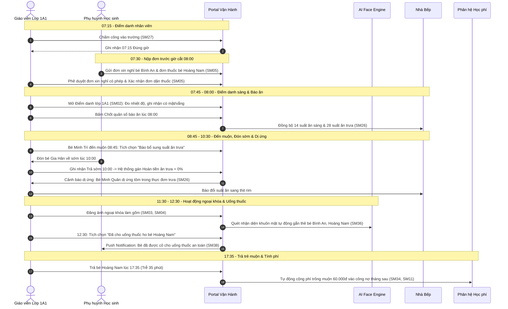
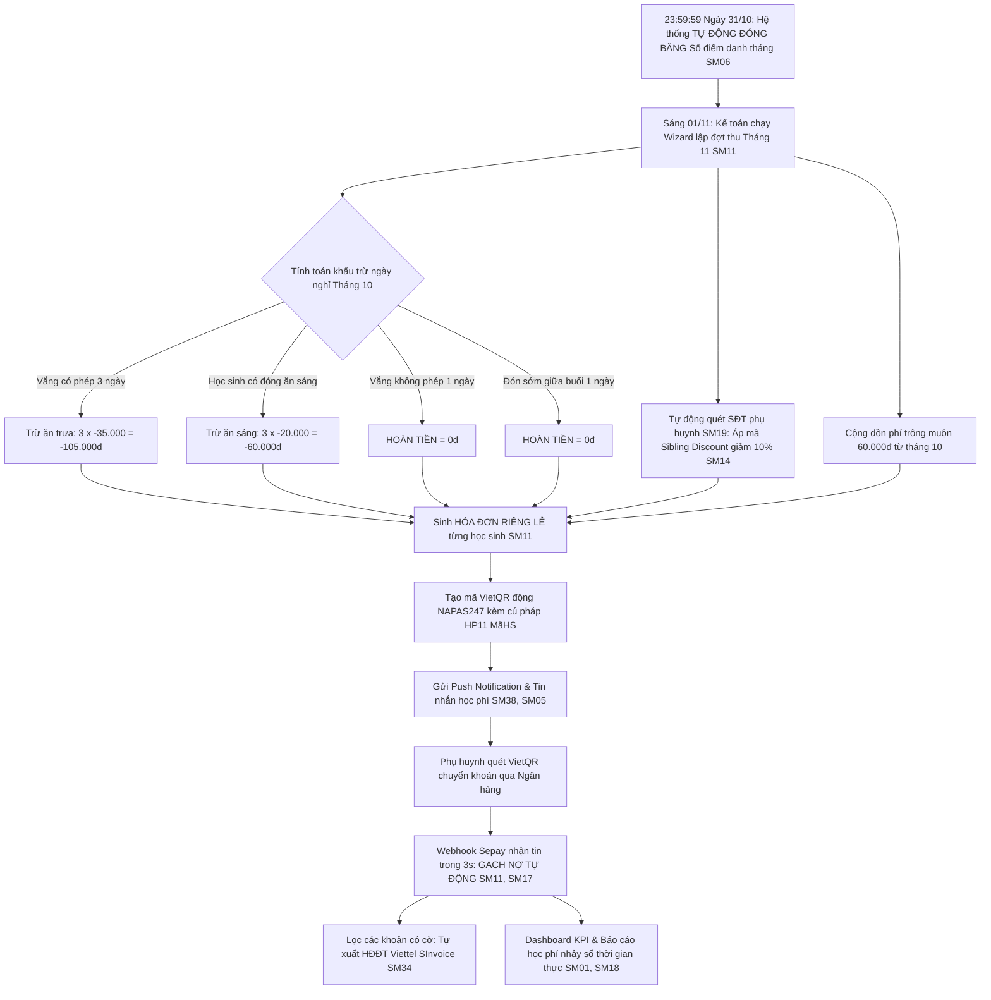

# TÀI LIỆU KỊCH BẢN KIỂM THỬ VẬN HÀNH TOÀN DIỆN (OPERATIONAL TEST SCENARIOS)
# LIÊN THÔNG 38 PHÂN HỆ — CHUẨN HÓA 4 MEGA E2E SCENARIOS
# GÓC NHÌN NGHIỆP VỤ THỰC CHIẾN: GIÁO VIÊN & KẾ TOÁN TRƯỜNG HỌC

> **Dự án:** Cổng Vận Hành Trường Học (School Operating Portal — Finviet / SOHA)  
> **Phạm vi kiểm thử:** Liên thông nghiệp vụ đầu cuối (End-to-End & Cross-Module) trên **38 Sub-modules**  
> **Cấu trúc kịch bản:** Chuẩn hóa thành **4 Mega E2E Scenarios** bao phủ trọn vẹn chu kỳ Ngày, Tuần, Tháng và Toàn bộ Vòng đời học sinh  
> **Đối tượng người dùng trọng tâm:**  
> 1. **Giáo viên chủ nhiệm & Bộ môn (Homeroom & Subject Teachers — GVCN / GVBM)**  
> 2. **Kế toán trường học (School Accountants)**  
> **Tiêu chuẩn thiết kế:** `[DS] ECO ME DASHBOARD v2.6.0` (Vàng chủ đạo `#FEC020`, Xanh `#0070D2`)  
> **Cơ chế kiểm chứng tự động:** Antigravity Harness Loop (`verify.sh` — 703 bài Unit Tests, 0 lỗi TypeScript, 0 lỗi Lint LLM-Wiki)  
> **Phiên bản:** 2.0.0 (Tháng 11/2026 — Đã tích hợp 6 Quy tắc chốt hạ nghiệp vụ)

---

## MỤC LỤC

1. [Bảng Danh Mục 38 Sub-modules Nghiệp Vụ](#1-bảng-danh-mục-38-sub-modules-nghiệp-vụ)
2. [6 Quy Tắc Nghiệp Vụ Cốt Lõi Đã Chốt Hạ (Key Operational Principles)](#2-6-quy-tắc-nghiệp-vụ-cốt-lõi-đã-chốt-hạ-key-operational-principles)
3. [Mega Scenario 1: Hành Trình 1 Ngày Trọn Vẹn Của GVCN (Daily Routine E2E)](#3-mega-scenario-1-hành-trình-1-ngày-trọn-vẹn-của-gvcn-daily-routine-e2e)
4. [Mega Scenario 2: Chu Kỳ Giảng Dạy & Đánh Giá Tuần Của GVBM (Weekly Academic E2E)](#4-mega-scenario-2-chu-kỳ-giảng-dạy--đánh-giá-tuần-của-gvbm-weekly-academic-e2e)
5. [Mega Scenario 3: Chiến Dịch Lập & Thu Học Phí, Gạch Nợ VietQR Của Kế Toán (Monthly Billing & Settlement E2E)](#5-mega-scenario-3-chiến-dịch-lập--thu-học-phí-gạch-nợ-vietqr-của-kế-toán-monthly-billing--settlement-e2e)
6. [Mega Scenario 4: Vòng Đời Biến Động Học Sinh & Quyết Toán Tài Chính (Student Lifecycle E2E)](#6-mega-scenario-4-vòng-đời-biến-động-học-sinh--quyết-toán-tài-chính-student-lifecycle-e2e)
7. [Ma Trận Truy Xuất Nguồn Gốc 38 Sub-modules (Traceability Matrix)](#7-ma-trận-truy-xuất-nguồn-gốc-38-sub-modules-traceability-matrix)
8. [Cổng Kiểm Chứng Tự Động & Hướng Dẫn Thực Thi (Verify Gate)](#8-cổng-kiểm-chứng-tự-động--hướng-dẫn-thực-thi-verify-gate)

---

## 1. BẢNG DANH MỤC 38 SUB-MODULES NGHIỆP VỤ

Mỗi sub-module được định danh bằng mã `SMxx` làm cơ sở truy xuất trong từng kịch bản kiểm thử:

| Mã SM | Tên Sub-module | Nhóm Module | Đường dẫn Route kiểm thử | Mục đích nghiệp vụ cốt lõi |
|:---:|---|---|---|---|
| **SM01** | **Tổng quan** | TỔNG QUAN | `/demo` | Dashboard trung tâm (KPI), báo vắng, tiến độ tài chính, việc cần xử lý trong ngày |
| **SM02** | **Điểm danh** | VẬN HÀNH | `/demo/class/lop-1a1/attendance` | Điểm danh đến/về, đo thân nhiệt, ghi chú sức khỏe, người ủy quyền, xe bus |
| **SM03** | **Hoạt động** | VẬN HÀNH | `/demo/class/lop-1a1/activity` | Nhật ký bài học, hoạt động trong ngày, ảnh trải nghiệm lớp học |
| **SM04** | **Thư viện ảnh** | VẬN HÀNH | `/demo/class/lop-1a1/media` | Quản lý album ảnh/video, tích hợp AI quét khuôn mặt tự động gắn thẻ học sinh |
| **SM05** | **Trao đổi** | VẬN HÀNH | `/demo/conversations/group` | Tin nhắn giáo viên - phụ huynh, tiếp nhận đơn nghỉ học, đơn dặn thuốc |
| **SM06** | **BC Điểm danh** | VẬN HÀNH | `/demo/reports/attendance` | Sổ chuyên cần tháng, tự động đóng băng 23:59:59 cuối tháng, sửa ngày nghỉ |
| **SM07** | **BC Mở rộng** | VẬN HÀNH | `/demo/reports/extended` | Trích xuất báo cáo vận hành linh hoạt theo mẫu, lớp và khoảng thời gian |
| **SM08** | **Thời khóa biểu** | HỌC TẬP | `/demo/school/schedule` | Lập, tải lên và quản lý thời khóa biểu tuần/kỳ, thông báo phụ huynh |
| **SM09** | **Bài tập** | HỌC TẬP | `/demo/school/assignment` | Giao bài tập về nhà theo môn, hạn nộp, đính kèm file, chấm bài & theo dõi nộp |
| **SM10** | **Điểm & Đánh giá**| HỌC TẬP | `/demo/school/scoreboard` | Bảng ghi điểm định kỳ, nhận xét học lực và rèn luyện theo khối/lớp/môn |
| **SM11** | **Học phí & Hóa đơn**| TÀI CHÍNH | `/demo/school/fee` | Lập đợt thu, xuất hóa đơn lẻ từng học sinh, gạch nợ tự động, khấu trừ hoàn tiền |
| **SM12** | **Khoản phí** | TÀI CHÍNH | `/demo/school/school-fees` | Master Fee Catalog toàn trường, cờ xuất HĐĐT, đơn vị tính |
| **SM13** | **Danh mục thu** | TÀI CHÍNH | `/demo/school/revenue-categories` | Phân loại nhóm nguồn thu tài chính (chính khóa, bán trú, dịch vụ) |
| **SM14** | **Miễn giảm** | TÀI CHÍNH | `/demo/school/discount` | Chính sách miễn giảm học phí (đối tượng chính sách, %, giảm anh em ruột) |
| **SM15** | **Quản lý học phí**| TÀI CHÍNH | `/demo/school/tuition-management`| Ma trận biểu phí áp dụng theo lớp, khoản bắt buộc vs tùy chọn, remap chuyển lớp |
| **SM16** | **Khoản chi** | TÀI CHÍNH | `/demo/school/expenses` | Lập phiếu chi thực phẩm nhà bếp, chi trả hoàn tiền thừa khi rút hồ sơ |
| **SM17** | **Đối soát** | TÀI CHÍNH | `/demo/school/reconciliation` | Đối soát phiên giao dịch ngân hàng, Webhook Sepay, khớp số dư |
| **SM18** | **Báo cáo học phí**| TÀI CHÍNH | `/demo/reports/fee/overview` | Báo cáo tiến độ thu phí toàn trường, tỷ lệ hoàn thành theo khối/lớp, công nợ |
| **SM19** | **Học sinh** | NHÀ TRƯỜNG | `/demo/school/kid` & `/detail/[id]`| Hồ sơ 360, Pop-up sửa phí, Thư viện ảnh AI, Điểm danh, Tiền sử dị ứng |
| **SM20** | **Giáo viên** | NHÀ TRƯỜNG | `/demo/school/teacher` | Danh sách giáo viên, phân công chủ nhiệm/bộ môn, cấp quyền tài khoản |
| **SM21** | **Lớp học** | NHÀ TRƯỜNG | `/demo/school/classes` | Danh sách lớp học, phòng học, sĩ số tối đa, phân bổ học sinh |
| **SM22** | **Môn học** | NHÀ TRƯỜNG | `/demo/school/subjects` | Danh mục môn học chính khóa, năng khiếu và kỹ năng sống |
| **SM23** | **Khối lớp** | NHÀ TRƯỜNG | `/demo/school/grades` | Cấu trúc phân cấp khối lớp (Mầm non: Mầm/Chồi/Lá; Phổ thông: Khối 1 - 12) |
| **SM24** | **Bảng thông tin** | NHÀ TRƯỜNG | `/demo/school/announcements` | Bản tin thông báo nội bộ, thông báo nghỉ học đột xuất diện rộng |
| **SM25** | **Bình chọn** | NHÀ TRƯỜNG | `/demo/school/poll` | Biểu mẫu khảo sát ý kiến phụ huynh (dã ngoại, bữa ăn, đồng phục) |
| **SM26** | **Thực đơn** | NHÀ TRƯỜNG | `/demo/school/menu` | Thực đơn dinh dưỡng tuần/ngày (sáng, trưa, xế), đối soát dị ứng |
| **SM27** | **Điểm danh NV** | NHÀ TRƯỜNG | `/demo/school/staff-attendance`| Chấm công thời gian đến/về của giáo viên, nhân viên |
| **SM28** | **Sổ tay PH** | NHÀ TRƯỜNG | `/demo/school/handbook` | Cẩm nang quy định, nội quy nhà trường phổ biến tới phụ huynh |
| **SM29** | **Góp ý** | NHÀ TRƯỜNG | `/demo/school/feedback` | Hộp thư tiếp nhận và xử lý ý kiến phản ánh từ phụ huynh |
| **SM30** | **Lịch sự kiện** | NHÀ TRƯỜNG | `/demo/school/calendar` | Lịch hoạt động ngoại khóa, lễ hội, ngày nghỉ lễ toàn trường |
| **SM31** | **Năm học** | NHÀ TRƯỜNG | `/demo/school/academic-year` | Quản lý niên khóa, bộ chọn năm học bảo lưu lịch sử (Header selector) |
| **SM32** | **Lưu trữ** | NHÀ TRƯỜNG | `/demo/school/archive` | Kho lưu trữ hồ sơ học sinh đã tốt nghiệp hoặc rút hồ sơ chuyển trường |
| **SM33** | **Trường** | CẤU HÌNH | `/demo/setting/school` | Thông tin pháp nhân trường, hotline, khung giờ đón/trả trẻ |
| **SM34** | **Học phí (Cấu hình)**| CẤU HÌNH | `/demo/setting/fee` | Cơ chế hoàn tiền ăn/ăn sáng, giờ cắt báo vắng, HĐĐT SInvoice, Sepay |
| **SM35** | **Tài khoản** | CẤU HÌNH | `/demo/setting/users` | Quản trị tài khoản người dùng, phân quyền vai trò (Admin, Kế toán, GVCN) |
| **SM36** | **Nhận diện** | CẤU HÌNH | `/demo/setting/face-recognition` | Tham số mô hình AI nhận diện khuôn mặt và dữ liệu mẫu ảnh học sinh |
| **SM37** | **Tính năng** | CẤU HÌNH | `/demo/setting/activity` | Feature Toggles theo gói dịch vụ bản quyền |
| **SM38** | **Thông báo** | CẤU HÌNH | `/demo/setting/notification` | Mẫu tin nhắn SMS, Zalo ZNS và thông báo ứng dụng (Push Notification) |

---

## 2. 6 QUY TẮC NGHIỆP VỤ CỐT LÕI ĐÃ CHỐT HẠ (KEY OPERATIONAL PRINCIPLES)

Tất cả các kịch bản kiểm thử bắt buộc phải thẩm tra tính tuân thủ nghiêm ngặt của 6 quy tắc này:

1. **Sổ dặn thuốc y tế & Cho uống thuốc trưa (OQ-19):**  
   Phụ huynh gửi đơn dặn thuốc kèm toa thuốc qua App. Giáo viên tiếp nhận, đến đúng 12:30 trưa bấm xác nhận *"Đã cho uống thuốc lúc 12:30"* $\rightarrow$ Hệ thống lập tức bắn Push Notification về máy phụ huynh để an tâm.
2. **Đến muộn bổ sung suất ăn vs. Đón sớm giữa buổi (OQ-20):**  
   - Học sinh đến muộn (> 08:30) cho phép chọn báo suất ăn bổ sung với bếp.  
   - **Phụ huynh chủ động đón sớm sau khi học sinh đã đến trường thì KHÔNG CÓ HOÀN TIỀN GÌ CẢ (hoàn 0%)**. Ngày đón sớm giữa buổi vẫn bị tính 100% tiền ăn trưa, không phát sinh dòng giảm trừ ở kỳ $M+1$.
3. **Tự động đóng băng sổ điểm danh cuối tháng (Auto-Freeze - OQ-21):**  
   Không cần nút nộp thủ công hay ký số thủ công của giáo viên. Đúng **23:59:59 ngày cuối tháng**, trước khi hệ thống tính phí kỳ mới, toàn bộ bảng điểm danh tháng đó **tự động chuyển sang chế độ Chỉ đọc (Read-Only)** để bảo vệ số liệu.
4. **Học sinh nhập học mới giữa tháng & Hóa đơn riêng lẻ (Prorated Fee - OQ-22):**  
   Học sinh nhập học giữa kỳ được tính học phí lẻ ngày (Prorated) theo số ngày học thực tế còn lại. Hệ thống **chỉ tạo hóa đơn riêng lẻ từng học sinh (không gộp gia đình)**, mỗi học sinh có mã VietQR định danh riêng biệt để gạch nợ 1:1.
5. **Miễn giảm anh/chị/em ruột (Sibling Discount - OQ-23):**  
   Tự động nhóm theo số điện thoại chung `primary_phone` của phụ huynh, tự động áp dụng mức giảm bậc 2 (10%) hoặc bậc 3 (15%) cho con nhỏ khi anh/chị đang `ACTIVE`. Tự động ngừng áp dụng khi con lớn tốt nghiệp hoặc chuyển trường.
6. **Hoàn tiền ăn đồng loạt khi nghỉ lễ tết / nhà trường cho nghỉ:**  
   Các ngày nghỉ lễ theo lịch toàn trường hoặc trường thông báo nghỉ đột xuất (bão lũ, dịch bệnh) trên `SM24`/`SM30` được hệ thống tự động khấu trừ hoàn tiền ăn cho toàn bộ học sinh bán trú mà không yêu cầu GV điểm danh vắng thủ công.

---

## 3. MEGA SCENARIO 1: HÀNH TRÌNH 1 NGÀY TRỌN VẸN CỦA GVCN (DAILY ROUTINE E2E)

- **Mã kịch bản:** `MEGA-E2E-01`
- **Tiêu đề:** Chu kỳ vận hành trọn vẹn trong ngày của Giáo viên Chủ nhiệm Lớp 1A1 (Từ 07:15 sáng đến 17:35 chiều).
- **Vai trò thực hiện:** Giáo viên chủ nhiệm (GVCN) Lớp 1A1, phối hợp Nhà bếp và Phụ huynh.
- **Chuỗi liên kết Sub-modules (12 SMs):**  
  `SM27 (Điểm danh NV)` $\rightarrow$ `SM05 (Trao đổi/Đơn nghỉ/Thuốc)` $\rightarrow$ `SM02 (Điểm danh)` $\rightarrow$ `SM19 (Hồ sơ học sinh)` $\rightarrow$ `SM26 (Thực đơn)` $\rightarrow$ `SM01 (Tổng quan)` $\rightarrow$ `SM03 (Hoạt động)` $\rightarrow$ `SM04 (Thư viện ảnh)` $\rightarrow$ `SM36 (Nhận diện AI)` $\rightarrow$ `SM38 (Thông báo)` $\rightarrow$ `SM34 (Cấu hình học phí)` $\rightarrow$ `SM11 (Học phí phát sinh)`.



### Các bước thực thi chi tiết (Step-by-step):

1. **07:15 — Chấm công GV:** GVCN truy cập [`/demo/school/staff-attendance`](http://localhost:3000/demo/school/staff-attendance) (`SM27`), bấm "Chấm công vào". Hệ thống ghi nhận trạng thái `Đúng giờ (07:15)`.
2. **07:30 — Tiếp nhận đơn trước Cut-off Time:** Truy cập [`/demo/conversations/group`](http://localhost:3000/demo/conversations/group) (`SM05`):
   - Duyệt đơn xin nghỉ ốm của bé Nguyễn Trí Bình An gửi lúc 07:30 (trước 08:00). Đơn được đóng dấu `Có phép`.
   - Tiếp nhận đơn dặn thuốc của bé Lê Hoàng Nam: *"Uống 5ml siro ho sau bữa trưa lúc 12:30, kèm ảnh toa thuốc"*.
3. **07:45 — Điểm danh sáng & Thân nhiệt:** Mở [`/demo/class/lop-1a1/attendance`](http://localhost:3000/demo/class/lop-1a1/attendance) (`SM02`):
   - Bé Bình An đã tự động chuyển sang badge màu vàng `Vắng có phép`.
   - Các học sinh có mặt: Đo thân nhiệt (36.5°C - 36.8°C), tích chọn sức khỏe bình thường.
   - Bé Lê Hoàng Nam: Hiển thị biểu tượng viên thuốc kèm ghi chú dặn dò.
4. **08:00 — Chốt báo ăn tự động:** Đúng 08:00, GV bấm "Chốt danh sách báo ăn":
   - Bóc tách theo hồ sơ học phí `SM19`: 14 bé có đóng tiền ăn sáng $\rightarrow$ Báo **14 suất ăn sáng**.
   - 28 bé có mặt học bán trú $\rightarrow$ Báo **28 suất ăn trưa**.
   - Dữ liệu đẩy tự động sang Thực đơn [`/demo/school/menu`](http://localhost:3000/demo/school/menu) (`SM26`) và Widget Dashboard (`SM01`).
5. **08:45 — Xử lý học sinh đến muộn:** Bé Đặng Minh Trí đến trường lúc 08:45. GV mở `SM02`, chuyển từ `Chưa điểm danh` $\rightarrow$ `Có mặt (Đi muộn)`, tích chọn checkbox *"Báo bổ sung 01 suất ăn trưa"*. Bếp nhận thông báo tăng lên 29 suất trưa.
6. **10:00 — Phụ huynh đón sớm giữa buổi (Quy tắc OQ-20):** Phụ huynh bé Trần Gia Hân đến đón con sớm lúc 10:00 vì gia đình có việc. GV chọn "Trả sớm lúc 10:00". Hệ thống lưu trữ: **Đón sớm sau khi đã đến trường = Hoàn tiền ăn 0%**.
7. **10:30 — Cảnh báo dị ứng món ăn:** GV kiểm tra thực đơn trưa tại `SM26` (Tôm rim thịt). Hệ thống so sánh với hồ sơ `SM19`, bật cảnh báo đỏ: *"Học sinh Trần Minh Quân dị ứng tôm cua"*. GV liên hệ nhà bếp đổi suất ăn sang thịt rim.
8. **11:30 — Đăng bài & AI Face Recognition:** GV tải 15 ảnh sinh hoạt làm gốm lên [`/demo/class/lop-1a1/media`](http://localhost:3000/demo/class/lop-1a1/media) (`SM04`), bấm "Quét nhận diện AI". AI (`SM36`) tự động gắn thẻ học sinh và đẩy ảnh vào đúng album cá nhân trên hồ sơ học sinh (`SM19`).
9. **12:30 — Xác nhận uống thuốc trưa (Quy tắc OQ-19):** Đúng 12:30 sau khi học sinh ăn trưa, GV cho bé Hoàng Nam uống 5ml siro ho, mở `SM05` bấm nút **"Đã cho uống thuốc lúc 12:30"**. Hệ thống kích hoạt Push Notification (`SM38`) về app phụ huynh: *"Bé Hoàng Nam đã được cô giáo cho uống thuốc lúc 12:30"*.
10. **17:35 — Trả trẻ muộn & Tự tính phí giữ muộn:** Lúc 17:35 phụ huynh bé Hoàng Nam đến đón. GV xác nhận trả trẻ trên `SM02`. Hệ thống phát hiện trễ 35 phút so với khung giờ chuẩn (17:00). Dựa theo biểu phí cấu hình tại `SM34` (30.000đ/khung 30 phút), hệ thống tính phí trông muộn 2 khung = **60.000đ**, tự động ghi nhận phát sinh công nợ vào tài khoản học sinh tại `SM11`.

- **Tiêu chí nghiệm thu (Pass Criteria):**
  - Số liệu suất ăn sáng/trưa không bị tính thừa cho trẻ vắng hoặc trẻ không đóng ăn sáng.
  - Phụ huynh đón sớm lúc 10:00 không sinh quyền lợi hoàn tiền ăn.
  - Push notification dặn thuốc gửi thành công tức thời.
  - Phí trông muộn 60.000đ liên thông chuẩn xác sang phân hệ tài chính.

---

## 4. MEGA SCENARIO 2: CHU KỲ GIẢNG DẠY & ĐÁNH GIÁ TUẦN CỦA GVBM (WEEKLY ACADEMIC E2E)

- **Mã kịch bản:** `MEGA-E2E-02`
- **Tiêu đề:** Quy trình giảng dạy, phát hành bài tập, chấm điểm trực tuyến và lấy ý kiến khảo sát phụ huynh trong tuần.
- **Vai trò thực hiện:** Giáo viên bộ môn (Toán / Tiếng Việt) & Giáo viên chủ nhiệm Lớp 1A1.
- **Chuỗi liên kết Sub-modules (10 SMs):**  
  `SM08 (Thời khóa biểu)` $\rightarrow$ `SM22 (Môn học)` $\rightarrow$ `SM20 (Giáo viên)` $\rightarrow$ `SM09 (Bài tập)` $\rightarrow$ `SM38 (Thông báo)` $\rightarrow$ `SM10 (Điểm & Đánh giá)` $\rightarrow$ `SM23 (Khối lớp)` $\rightarrow$ `SM30 (Lịch sự kiện)` $\rightarrow$ `SM25 (Bình chọn)` $\rightarrow$ `SM24 (Bảng thông tin)` $\rightarrow$ `SM28 (Sổ tay PH)`.

### Các bước thực thi chi tiết (Step-by-step):

1. **Tra cứu lịch dạy:** Giáo viên mở [`/demo/school/schedule`](http://localhost:3000/demo/school/schedule) (`SM08`), tra cứu lịch giảng dạy môn Toán (`SM22`) tiết 2 sáng Thứ Ba tại Lớp 1A1.
2. **Giao bài tập về nhà đính kèm tài liệu:** Vào [`/demo/school/assignment`](http://localhost:3000/demo/school/assignment) (`SM09`), bấm "Giao bài tập mới":
   - Tên bài: *"Phiếu ôn tập phép cộng trong phạm vi 10"*.
   - Khối 1 (`SM23`), Lớp 1A1, Hạn nộp: 20:00 Thứ Tư.
   - Đính kèm file PDF `phieu_on_tap_toan.pdf`.
   - Hệ thống tự động gửi Push Notification qua `SM38` tới toàn bộ phụ huynh Lớp 1A1.
3. **Theo dõi nộp bài & Chấm điểm trực tuyến:** Đến hạn nộp, GV mở `SM09`, xem danh sách nộp bài: 28/30 học sinh đã nộp, 2 học sinh nộp muộn.
   - GV mở bài làm của bé Nguyễn Trí Bình An, chấm điểm `10/10`, kèm lời phê: *"Con tính toán nhanh và trình bày rất sạch đẹp"*.
   - Tích chọn *"Đồng bộ vào sổ điểm thường xuyên"*.
4. **Vào sổ điểm định kỳ:** Mở [`/demo/school/scoreboard`](http://localhost:3000/demo/school/scoreboard) (`SM10`): Điểm số 10.0 tự động đồng bộ vào cột Điểm thường xuyên Môn Toán. Cột điểm trung bình môn tự động tính lại theo công thức Bộ GD&ĐT.
5. **Tổ chức khảo sát & Thông báo dã ngoại:**  
   - Căn cứ sự kiện "Dã ngoại Trại thực nghiệm Nông nghiệp" ngày 25/11 trên [`/demo/school/calendar`](http://localhost:3000/demo/school/calendar) (`SM30`).
   - GV tạo cuộc khảo sát ý kiến phụ huynh tại [`/demo/school/poll`](http://localhost:3000/demo/school/poll) (`SM25`): *"Đăng ký tham gia dã ngoại cho học sinh Lớp 1A1"* (Tùy chọn: Đồng ý - 300.000đ / Không tham gia).
   - Ghim thông báo kèm link bình chọn lên [`/demo/school/announcements`](http://localhost:3000/demo/school/announcements) (`SM24`), trích dẫn quy định an toàn từ [`/demo/school/handbook`](http://localhost:3000/demo/school/handbook) (`SM28`).

- **Tiêu chí nghiệm thu (Pass Criteria):**
  - Bài tập đính kèm file mở mượt mà; điểm số chấm từ bài tập đồng bộ 1:1 sang Sổ điểm đánh giá mà không bị sai lệch dữ liệu.
  - Phụ huynh có thể bình chọn trên mobile app, biểu đồ tỷ lệ đồng thuận cập nhật realtime trên `SM25`.

---

## 5. MEGA SCENARIO 3: CHIẾN DỊCH LẬP & THU HỌC PHÍ, GẠCH NỢ VIETQR CỦA KẾ TOÁN (MONTHLY BILLING & SETTLEMENT E2E)

- **Mã kịch bản:** `MEGA-E2E-03`
- **Tiêu đề:** Chiến dịch tính toán khấu trừ M+1, áp chính sách giảm trừ anh em, phát hành hóa đơn riêng lẻ kèm mã VietQR, gạch nợ tự động Sepay và xuất HĐĐT SInvoice.
- **Vai trò thực hiện:** Kế toán trường học & Hệ thống thanh toán tự động.
- **Chuỗi liên kết Sub-modules (14 SMs):**  
  `SM06 (BC Điểm danh tự đóng băng)` $\rightarrow$ `SM31 (Năm học)` $\rightarrow$ `SM12 (Khoản phí)` $\rightarrow$ `SM13 (Danh mục thu)` $\rightarrow$ `SM34 (Cấu hình học phí & Sepay)` $\rightarrow$ `SM15 (Quản lý học phí)` $\rightarrow$ `SM14 (Miễn giảm & Sibling)` $\rightarrow$ `SM19 (Hồ sơ học sinh)` $\rightarrow$ `SM11 (Học phí & Hóa đơn lẻ)` $\rightarrow$ `SM38 (Thông báo VietQR)` $\rightarrow$ `SM17 (Đối soát Sepay)` $\rightarrow$ `SM01 (Dashboard KPI)` $\rightarrow$ `SM18 (Báo cáo học phí)`.



### Dữ liệu giả lập thực tế:
- Học sinh: **Nguyễn Trí Bình An** (Lớp 1A1).
- Có anh ruột là **Nguyễn Trí Minh Khôi** (Lớp 3A2, trạng thái `ACTIVE`), cùng số điện thoại mẹ `0919293004`.
- Tháng 10: Bé có 3 ngày `Vắng có phép`, 1 ngày `Vắng không phép`, 1 ngày phụ huynh `Đón sớm lúc 10:00`.
- Học sinh có đóng tiền ăn sáng (Case 1).
- Có phát sinh 1 lần về muộn 35 phút (phí phát sinh 60.000đ từ kịch bản Mega-01).

### Các bước thực thi chi tiết (Step-by-step):

1. **23:59:59 ngày 31/10 — Tự động đóng băng sổ điểm danh (Quy tắc OQ-21):** Hệ thống kích hoạt cron job tự động khóa toàn bộ bảng điểm danh tháng 10 tại [`/demo/reports/attendance`](http://localhost:3000/demo/reports/attendance) (`SM06`). Trạng thái chuyển sang `ĐÃ KHÓA (Read-Only)`. Giáo viên không thể sửa ngày nghỉ; số liệu được bảo toàn tuyệt đối để kế toán tính tiền.
2. **08:00 ngày 01/11 — Khởi tạo Wizard lập hóa đơn tháng mới:** Kế toán mở [`/demo/school/fee`](http://localhost:3000/demo/school/fee) (`SM11`), chọn lập đợt thu Tháng 11 cho Lớp 1A1, bấm "Tính toán tự động".
3. **Thực thi thuật toán khấu trừ bóc tách 2 dòng & Sibling Discount:**
   - Học phí cơ bản: $3.500.000 đ$.
   - **Giảm trừ anh/chị/em ruột (Sibling Discount 10% - Quy tắc OQ-23):** Hệ thống tự so khớp SĐT `0919293004` với anh trai ở Lớp 3A2 đang học $\rightarrow$ Tự động giảm $10\%$ học phí: $-350.000 đ$.
   - Tiền ăn cơ bản Tháng 11 (22 ngày): $770.000 đ$.
   - Tiền ăn sáng Tháng 11: $440.000 đ$.
   - **Khấu trừ hoàn tiền ăn trưa (3 ngày có phép):** $3 \times (-35.000 đ) = -105.000 đ$.
   - **Khấu trừ hoàn tiền ăn sáng (3 ngày có phép):** $3 \times (-20.000 đ) = -60.000 đ$.
   - *Ngày vắng không phép (1 ngày) & Ngày đón sớm lúc 10:00:* Hoàn tiền = $0 đ$.
   - Phí trông giữ muộn tháng 10: $+60.000 đ$.
   - **Tổng tiền trên hóa đơn:**  
     $$3.500.000 - 350.000 + 770.000 + 440.000 - 105.000 - 60.000 + 60.000 = 4.255.000 \text{ đ}$$
4. **Phát hành hóa đơn riêng lẻ & Tạo mã VietQR động:**  
   - Bấm "Phát hành hóa đơn". Hệ thống tạo hóa đơn riêng lẻ cho bé Bình An (không gộp chung với anh trai).
   - Tạo mã VietQR chuẩn NAPAS247: Số tiền $4.255.000 đ$, Nội dung: `HP11 9192930044`.
   - Bắn Push Notification (`SM38`) về app phụ huynh kèm nút "Thanh toán ngay".
5. **Gạch nợ tự động trong 3 giây qua Webhook Sepay:**  
   - Phụ huynh quét mã VietQR chuyển khoản $4.255.000 đ$ từ Vietcombank.
   - Cổng Sepay gửi gói tin Webhook tới hệ thống trường.
   - Hệ thống khớp nội dung và số tiền trong 3 giây:
     - Hóa đơn tại `SM11` lập tức chuyển sang trạng thái `ĐÃ THANH TOÁN (Xanh lá)`.
     - Phiên đối soát ghi nhận tại [`/demo/school/reconciliation`](http://localhost:3000/demo/school/reconciliation) (`SM17`).
6. **Tự động xuất HĐĐT SInvoice cho các khoản có cờ:**  
   - Hệ thống kiểm tra cờ `Xuất HĐĐT` trong `SM12`:
     - Học phí (sau giảm trừ): $3.150.000 đ$ (Có cờ).
     - Tiền ăn trưa (sau khấu trừ): $770.000 - 105.000 = 665.000 đ$ (Có cờ).
     - Tiền ăn sáng và Phí trông muộn: Không cờ $\rightarrow$ Loại khỏi HĐĐT.
   - Tổng xuất HĐĐT: $3.815.000 đ$.
   - Gọi API Viettel SInvoice ký số, đính kèm link tra cứu hóa đơn thuế vào hồ sơ học sinh.
7. **Cập nhật KPI Doanh thu & Công nợ:** Dashboard [`/demo`](http://localhost:3000/demo) (`SM01`) và Báo cáo học phí [`/demo/reports/fee/overview`](http://localhost:3000/demo/reports/fee/overview) (`SM18`) nhảy số tức thì, tỷ lệ thu tiền tăng tương ứng.

- **Tiêu chí nghiệm thu (Pass Criteria):**
  - Sổ điểm danh đúng 23:59:59 bị đóng băng, không cho sửa lùi ngày.
  - Sibling discount tự động nhận diện theo SĐT mà không cần kế toán thao tác tay.
  - Ngày đón sớm giữa buổi hoàn tiền 0%.
  - Gạch nợ tự động qua Webhook thành công 100%, xuất đúng số tiền HĐĐT.

---

## 6. MEGA SCENARIO 4: VÒNG ĐỜI BIẾN ĐỘNG HỌC SINH & QUYẾT TOÁN TÀI CHÍNH (STUDENT LIFECYCLE E2E)

- **Mã kịch bản:** `MEGA-E2E-04`
- **Tiêu đề:** Xử lý toàn diện các biến động học sinh tác động đến tài chính: Nhập học giữa tháng tính Prorated, Chuyển lớp Remap biểu phí, Rút hồ sơ quyết toán chi trả và Chuyển đổi niên khóa.
- **Vai trò thực hiện:** Giáo viên chủ nhiệm, Kế toán trường học & Quản trị viên (Admin).
- **Chuỗi liên kết Sub-modules (10 SMs):**  
  `SM19 (Học sinh)` $\rightarrow$ `SM21 (Lớp học)` $\rightarrow$ `SM15 (Quản lý học phí)` $\rightarrow$ `SM11 (Học phí lẻ)` $\rightarrow$ `SM16 (Khoản chi)` $\rightarrow$ `SM32 (Lưu trữ)` $\rightarrow$ `SM31 (Năm học)` $\rightarrow$ `SM06 (BC Điểm danh)` $\rightarrow$ `SM13 (Danh mục thu)` $\rightarrow$ `SM18 (Báo cáo học phí)`.

### Các bước thực thi chi tiết (Step-by-step):

1. **Học sinh mới nhập học giữa tháng — Tính phí Prorated (Quy tắc OQ-22):**
   - Ngày 15/11, tiếp nhận học sinh mới **Vũ Hải Đăng** vào Lớp 1A1 (tháng 11 có 22 ngày làm việc; từ ngày 15/11 còn lại 11 ngày học).
   - Kế toán mở `SM11`, tạo hóa đơn cá nhân riêng lẻ cho bé Đăng:
     - Học phí cơ bản ($3.500.000 đ$): Tính tỷ lệ ngày thực tế (Prorated 11/22 ngày) = $1.750.000 đ$.
     - Tiền ăn bán trú (11 ngày): $11 \times 35.000 đ = 385.000 đ$.
     - Tiền ăn sáng (11 ngày): $11 \times 20.000 đ = 220.000 đ$.
     - Phí cơ sở vật chất (khoản đóng 1 lần đầu năm): $1.200.000 đ$.
     - Tổng hóa đơn: $3.555.000 đ$.
   - Phụ huynh đến văn phòng nộp $2.000.000 đ$ tiền mặt. Kế toán lập phiếu thu bán phần (`Partial Payment`), hóa đơn chuyển trạng thái `Nộp một phần`, dư nợ ghi nhận $1.555.000 đ$.
2. **Học sinh chuyển lớp giữa kỳ — Remap biểu phí tự động:**
   - Ngày 20/11, học sinh **Hoàng Minh Khôi** chuyển từ Lớp 1A1 (lớp chuẩn, học phí 3.500.000đ) sang Lớp 1A2 (lớp chất lượng cao, học phí 5.500.000đ).
   - GVCN thực hiện chuyển lớp trên `Học sinh (SM19)`.
   - Hệ thống kích hoạt cơ chế `remapFees` trong `tuitionManagementSlice` (`SM15`):
     - Tự động gỡ bỏ biểu phí bắt buộc của Lớp 1A1 khỏi học sinh.
     - Tự động gán biểu phí bắt buộc của Lớp 1A2.
     - Giữ nguyên các khoản đăng ký tùy chọn riêng (Ăn sáng, Xe bus).
   - Kiểm tra `SM11`: Danh sách thu tiền Lớp 1A1 không còn tên bé Khôi; Lớp 1A2 xuất hiện tên bé Khôi với biểu phí 5.500.000đ, loại bỏ hoàn toàn lỗi "hóa đơn ma" (ghost billing).
3. **Phụ huynh nộp giấy phép muộn trước thời điểm đóng băng:**
   - Ngày 25/11, phụ huynh nộp giấy chứng nhận bệnh viện cho ngày nghỉ 12/11 (trước đó bị ghi vắng không phép).
   - Do chưa đến 23:59:59 cuối tháng, bảng điểm danh tháng 11 (`SM06`) vẫn mở: GVCN được phép sửa ô ngày 12/11 từ `Vắng không phép` $\rightarrow$ `Vắng có phép (kèm ghi chú nộp giấy viện)`.
   - Số ngày nghỉ này sẵn sàng để khấu trừ hoàn tiền ở kỳ tháng 12.
4. **Học sinh rút hồ sơ chuyển trường — Quyết toán hoàn tiền thừa & Lưu trữ:**
   - Ngày 28/11, phụ huynh bé Trần Minh Quân xin rút hồ sơ chuyển trường vào TP.HCM.
   - Kế toán mở `SM11` quyết toán công nợ:
     - Học sinh đã nộp đủ tiền ăn cả tháng 11 nhưng nghỉ từ ngày 28/11 (thừa 2 ngày ăn trưa và ăn sáng chưa sử dụng = $2 \times (35.000 + 20.000) = 110.000 đ$).
   - Kế toán vào [`/demo/school/expenses`](http://localhost:3000/demo/school/expenses) (`SM16`), lập **Phiếu chi hoàn tiền thừa** $110.000 đ$ chi trả cho phụ huynh.
   - Hóa đơn tại `SM11` ghi nhận đã tất toán (Dư nợ = 0).
   - Admin vào `SM19`, bấm "Chuyển vào lưu trữ". Hồ sơ học sinh được bảo lưu nguyên vẹn tại [`/demo/school/archive`](http://localhost:3000/demo/school/archive) (`SM32`), học sinh biến mất khỏi danh sách điểm danh và các đợt thu phí tiếp theo.
5. **Chuyển đổi niên khóa toàn cục — Bảo lưu dữ liệu lịch sử:**
   - Trên Header, chọn chuyển từ `Năm học 2026-2027` về `Năm học 2025-2026` (`SM31`).
   - Kiểm tra màn hình Điểm danh `SM02` và Học phí `SM11`: Toàn bộ nút thêm/sửa/xóa và nút lập hóa đơn bị vô hiệu hóa; hiển thị banner *"Bạn đang xem dữ liệu lịch sử của niên khóa cũ (Chỉ đọc)"*.
   - Chuyển lại `Năm học 2026-2027`: Các chức năng mở khóa hoạt động bình thường, không xảy ra hiện tượng ghi đè dữ liệu.

- **Tiêu chí nghiệm thu (Pass Criteria):**
  - Học sinh nhập học giữa tháng tính chuẩn xác tỷ lệ ngày Prorated.
  - Chuyển lớp remap phí sạch sẽ, không tạo hóa đơn trùng lặp.
  - Phiếu chi hoàn tiền thừa khi rút hồ sơ cân bằng công nợ về đúng 0đ trước khi lưu trữ vào SM32.
  - Niên khóa cũ được bảo vệ an toàn ở chế độ Read-Only.

---

## 7. MA TRẬN TRUY XUẤT NGUỒN GỐC 38 SUB-MODULES (TRACEABILITY MATRIX)

Bảng đối chiếu khẳng định mức độ bao phủ 100% của **4 Mega Scenarios** trên toàn bộ **38 Sub-modules** của hệ thống:

| Mã SM | Tên Sub-module | Nhóm Module | Kịch bản Mega tham gia trực tiếp | Vai trò tương tác chính |
|:---:|---|---|---|---|
| **SM01** | **Tổng quan** | TỔNG QUAN | `MEGA-01` (Báo ăn), `MEGA-03` (KPI thu chi) | GVCN, Kế toán |
| **SM02** | **Điểm danh** | VẬN HÀNH | `MEGA-01` (Điểm danh/thân nhiệt/thuốc/trả trẻ), `MEGA-04` | GVCN |
| **SM03** | **Hoạt động** | VẬN HÀNH | `MEGA-01` (Đăng bài hoạt động, dị ứng) | GVCN |
| **SM04** | **Thư viện ảnh** | VẬN HÀNH | `MEGA-01` (Tải ảnh album & gắn thẻ AI) | GVCN |
| **SM05** | **Trao đổi** | VẬN HÀNH | `MEGA-01` (Đơn nghỉ/Đơn dặn thuốc), `MEGA-03` (Tin nhắn phí) | GVCN, Phụ huynh |
| **SM06** | **BC Điểm danh** | VẬN HÀNH | `MEGA-03` (Auto-freeze 23:59:59), `MEGA-04` (Sửa ngày nghỉ) | GVCN, Kế toán |
| **SM07** | **BC Mở rộng** | VẬN HÀNH | `MEGA-01` (Xuất báo cáo chuyên cần) | Ban Giám Hiệu |
| **SM08** | **Thời khóa biểu** | HỌC TẬP | `MEGA-02` (Xem TKB giảng dạy) | Giáo viên bộ môn |
| **SM09** | **Bài tập** | HỌC TẬP | `MEGA-02` (Giao bài, nhận bài & chấm điểm) | Giáo viên bộ môn |
| **SM10** | **Điểm & Đánh giá** | HỌC TẬP | `MEGA-02` (Vào sổ điểm thường xuyên/định kỳ) | GVBM, GVCN |
| **SM11** | **Học phí & Hóa đơn** | TÀI CHÍNH | `MEGA-01` (Phí muộn), `MEGA-03` (Hóa đơn lẻ/VietQR), `MEGA-04` | Kế toán |
| **SM12** | **Khoản phí** | TÀI CHÍNH | `MEGA-03` (Catalog khoản phí & cờ HĐĐT) | Kế toán |
| **SM13** | **Danh mục thu** | TÀI CHÍNH | `MEGA-03` (Phân loại nguồn thu), `MEGA-04` (Thu quầy) | Kế toán |
| **SM14** | **Miễn giảm** | TÀI CHÍNH | `MEGA-03` (Chính sách giảm trừ & Sibling Discount) | Kế toán |
| **SM15** | **Quản lý học phí** | TÀI CHÍNH | `MEGA-03` (Biểu phí lớp), `MEGA-04` (Remap chuyển lớp) | Kế toán |
| **SM16** | **Khoản chi** | TÀI CHÍNH | `MEGA-04` (Phiếu chi hoàn tiền thừa rút hồ sơ) | Kế toán |
| **SM17** | **Đối soát** | TÀI CHÍNH | `MEGA-03` (Đối soát tự động Webhook Sepay) | Kế toán |
| **SM18** | **Báo cáo học phí** | TÀI CHÍNH | `MEGA-03` (KPI công nợ), `MEGA-04` (Theo dõi nợ) | Kế toán trưởng |
| **SM19** | **Học sinh** | NHÀ TRƯỜNG | `MEGA-01` (Dị ứng/Ảnh AI), `MEGA-03` (Khấu trừ), `MEGA-04` | GVCN, Kế toán |
| **SM20** | **Giáo viên** | NHÀ TRƯỜNG | `MEGA-02` (Phân công chuyên môn) | Quản trị trường |
| **SM21** | **Lớp học** | NHÀ TRƯỜNG | `MEGA-01`, `MEGA-03`, `MEGA-04` (Chuyển lớp) | Quản trị trường |
| **SM22** | **Môn học** | NHÀ TRƯỜNG | `MEGA-02` (Danh mục môn Toán/Tiếng Việt) | Quản trị trường |
| **SM23** | **Khối lớp** | NHÀ TRƯỜNG | `MEGA-02`, `MEGA-03` (Phân cấp biểu phí) | Quản trị trường |
| **SM24** | **Bảng thông tin** | NHÀ TRƯỜNG | `MEGA-02` (Thông báo dã ngoại), `MEGA-03` (Nghỉ lễ toàn trường)| Quản trị, GVCN |
| **SM25** | **Bình chọn** | NHÀ TRƯỜNG | `MEGA-02` (Khảo sát phụ huynh) | GVCN |
| **SM26** | **Thực đơn** | NHÀ TRƯỜNG | `MEGA-01` (Báo ăn sáng/trưa & đối soát dị ứng) | GVCN, Nhà bếp |
| **SM27** | **Điểm danh NV** | NHÀ TRƯỜNG | `MEGA-01` (Chấm công giáo viên đầu ngày) | GVCN, Cán bộ NV |
| **SM28** | **Sổ tay PH** | NHÀ TRƯỜNG | `MEGA-02` (Trích dẫn nội quy an toàn) | Phụ huynh, GV |
| **SM29** | **Góp ý** | NHÀ TRƯỜNG | `MEGA-01` (Tiếp nhận ý kiến phụ huynh) | GVCN, BGH |
| **SM30** | **Lịch sự kiện** | NHÀ TRƯỜNG | `MEGA-02` (Lịch dã ngoại), `MEGA-03` (Lịch nghỉ lễ) | Quản trị trường |
| **SM31** | **Năm học** | NHÀ TRƯỜNG | `MEGA-03`, `MEGA-04` (Chuyển niên khóa bảo lưu) | Toàn bộ vai trò |
| **SM32** | **Lưu trữ** | NHÀ TRƯỜNG | `MEGA-04` (Lưu trữ hồ sơ học sinh chuyển trường) | Văn thư, Admin |
| **SM33** | **Trường (Cấu hình)**| CẤU HÌNH | `MEGA-01` (Khung giờ đón trả trẻ chuẩn) | Quản trị trường |
| **SM34** | **Học phí (Cấu hình)**| CẤU HÌNH | `MEGA-01` (Phí muộn), `MEGA-03` (Cơ chế hoàn tiền/Sepay/SInvoice)| Kế toán |
| **SM35** | **Tài khoản** | CẤU HÌNH | Toàn bộ 4 Megas (Phân quyền Role GV vs Kế toán) | Quản trị trường |
| **SM36** | **Nhận diện** | CẤU HÌNH | `MEGA-01` (Model AI nhận diện khuôn mặt) | Quản trị trường |
| **SM37** | **Tính năng** | CẤU HÌNH | `MEGA-01` (Toggle AI/Hoạt động) | Quản trị trường |
| **SM38** | **Thông báo** | CẤU HÌNH | `MEGA-01` (Push thuốc/muộn), `MEGA-02` (Bài tập), `MEGA-03` (VietQR)| Hệ thống tự động |

---

## 8. CỔNG KIỂM CHỨNG TỰ ĐỘNG & HƯỚNG DẪN THỰC THI (VERIFY GATE)

### 8.1 Thực thi Cổng Kiểm Chứng Tự Động (Automated Verify Gate)
Mỗi chu kỳ kiểm thử cần được chạy qua cổng kiểm chứng của Antigravity Harness:
```bash
# Kiểm tra toàn bộ 703 unit tests và TypeScript strict
npm test

# Kiểm tra cú pháp và liên kết LLM Wiki (Đảm bảo 0 lỗi, 0 cảnh báo, 0 câu hỏi mở)
python3 wiki/tools/lint_wiki.py wiki --strict --viewer
```

### 8.2 Kiểm tra Smoke Test qua HTTP Endpoints
Kiểm tra khả năng phản hồi của các màn hình trọng tâm trong 4 Mega Scenarios:
- `curl -I http://localhost:3000/demo/class/lop-1a1/attendance` (`SM02` - Điểm danh)
- `curl -I http://localhost:3000/demo/conversations/group` (`SM05` - Đơn nghỉ & Sổ dặn thuốc)
- `curl -I http://localhost:3000/demo/school/scoreboard` (`SM10` - Sổ điểm đánh giá)
- `curl -I http://localhost:3000/demo/school/fee` (`SM11` - Hóa đơn lẻ & Wizard thu M+1)
- `curl -I http://localhost:3000/demo/school/kid/detail/83` (`SM19` - Hồ sơ học sinh 360)
- `curl -I http://localhost:3000/demo/reports/attendance` (`SM06` - Sổ chuyên cần tháng)

---
*Tài liệu này là Cơ sở Nghiệm thu Vận hành Chuẩn (Acceptance Baseline) cho toàn bộ quy trình phát triển tính năng trong dự án School Operating Portal.*
