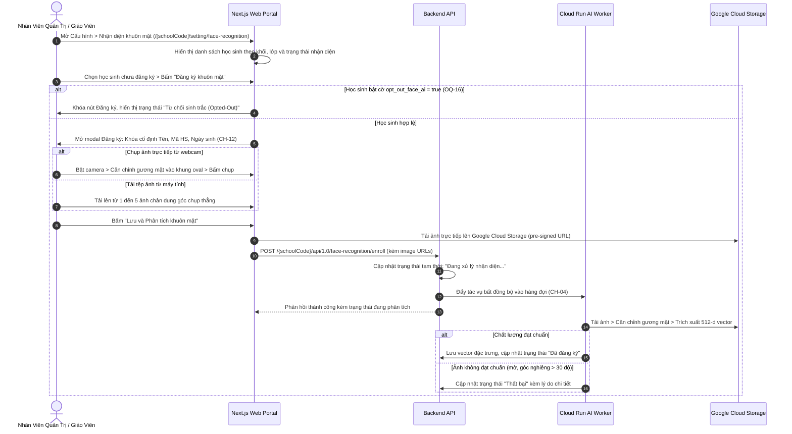

# Luồng Đăng Ký Sinh Trắc Học Khuôn Mặt Học Sinh (Face Biometric Enrollment Flow)

## Mục tiêu
Đặc tả luồng chụp ảnh trực tiếp qua webcam hoặc tải tệp ảnh chân dung lên hệ thống để đăng ký nhận diện khuôn mặt sinh trắc học cho học sinh, cơ chế bất biến thông tin nhân khẩu học (`CH-12`) và pipeline trích xuất vector đặc trưng bất đồng bộ (`CH-04`), đồng thời tôn trọng quyền từ chối sinh trắc học `opt_out_face_ai` theo Nghị định 13/2023/NĐ-CP (OQ-16).

## Các bước

1. **Chọn học sinh đăng ký:**
   - Nhân viên truy cập phân hệ Cấu hình > Nhận diện khuôn mặt (`/setting/face-recognition`).
   - Lọc danh sách học sinh theo trạng thái: "Chưa đăng ký", "Đã đăng ký", "Thất bại", "Từ chối sinh trắc (Opted-Out)".
   - Nếu học sinh có cờ `opt_out_face_ai = true`: nút đăng ký bị khóa, hiển thị biểu tượng bảo vệ quyền riêng tư (OQ-16).
   - Với học sinh bình thường, chọn học sinh và bấm "Đăng ký".
2. **Khóa thông tin nhân khẩu học (CH-12):**
   - Modal hiển thị đầy đủ Họ tên, Mã học sinh, Lớp học và Ngày sinh của học sinh ở chế độ chỉ đọc (Read-only / Disabled).
   - Tuyệt đối không cho phép chỉnh sửa các trường này tại màn hình quét ảnh để tránh làm sai lệch hồ sơ pháp lý.
3. **Thu thập ảnh chân dung:**
   - Hỗ trợ 2 phương thức: Mở luồng camera trực tiếp với khung oval định vị khuôn mặt, hoặc chọn tệp ảnh JPEG/PNG có sẵn.
   - Kiểm tra sơ bộ phía client: ảnh phải có dung lượng từ 50KB đến 5MB, độ phân giải tối thiểu 300x300 pixel.
4. **Tải lên & Xử lý bất đồng bộ (CH-04):**
   - Ảnh được tải lên Google Cloud Storage.
   - Hệ thống tạo tác vụ nền Cloud Run worker để trích xuất vector đặc trưng. Giao diện hiển thị badge màu vàng "Đang xử lý nhận diện...".
   - Khi hoàn tất, trạng thái chuyển sang màu xanh "Đã đăng ký" kèm ngày giờ đăng ký.

## Quy tắc chặn / validation
- **Quy tắc bảo vệ nhân khẩu học (CH-12):** Tuyệt đối cấm sửa đổi họ tên hoặc mã học sinh trong form đăng ký nhận diện ảnh.
- **Quy tắc quyền riêng tư sinh trắc học (OQ-16):** Học sinh có cờ `opt_out_face_ai = true` tuyệt đối không được thu thập hoặc trích xuất vector khuôn mặt. Mọi vector đã lưu trước đó phải bị xóa hoàn toàn khỏi cơ sở dữ liệu.
- **Quy tắc chất lượng ảnh:** Hệ thống tự động từ chối ảnh chụp quá tối, ảnh chụp nghiêng quá 30 độ hoặc ảnh có nhiều hơn 1 khuôn mặt trong cùng một khung hình.

## Khác biệt spec ↔ code
| Mã spec | Spec yêu cầu | Code hiện tại | Mức | Bằng chứng |
|---|---|---|---|---|
| CH-12 | Khóa thông tin nhân khẩu học trong modal đăng ký ảnh | Modal component đã có form read-only cho info học sinh | MISSING | — |
| CH-04 | Đăng ký khuôn mặt AI và pipeline trích xuất vector bất đồng bộ | Giao diện đã có modal webcam và upload ảnh | MISSING | — |

## Liên quan
- [Phân hệ Cấu hình](../overview/module-settings.md)
- [Thực thể hồ sơ nhận diện khuôn mặt](../entities/face-biometric-registration.md)
- [Khái niệm nhận diện khuôn mặt AI](../concepts/ai-face-recognition.md)
- [Màn hình cấu hình nhận diện](../screens/m6-sm4-nhan-dien.md)
