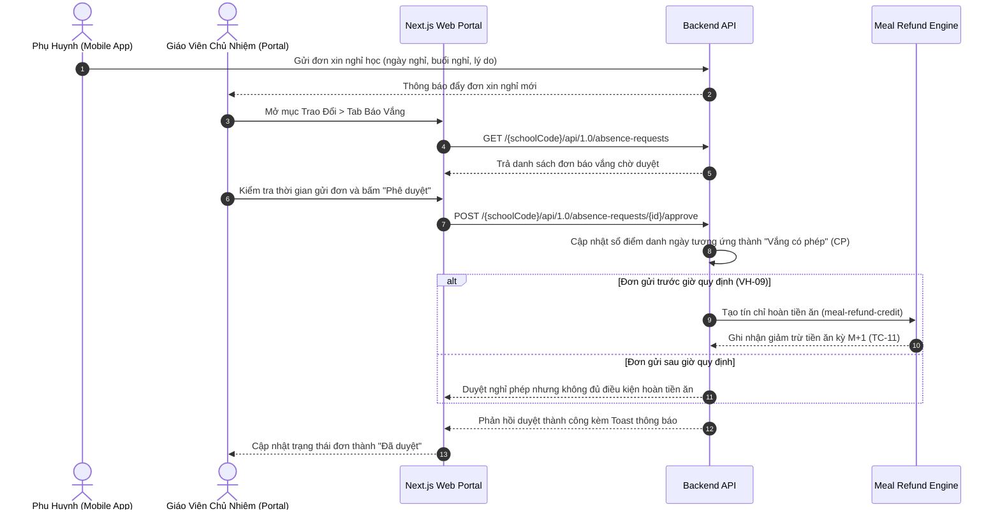

# Luồng Tiếp Nhận & Phê Duyệt Đơn Xin Nghỉ Học (Student Leave Request Flow)

## Mục tiêu
Đặc tả luồng tương tác khép kín từ khi phụ huynh gửi đơn xin nghỉ học trên ứng dụng di động đến khi giáo viên chủ nhiệm tiếp nhận, xét duyệt trên giao diện School Operating Portal, tự động đánh dấu trạng thái "Vắng có phép" trong sổ điểm danh và kích hoạt tính toán hoàn trừ tiền ăn cho kỳ hóa đơn tháng kế tiếp ($M+1$).

## Các bước

1. **Khởi tạo đơn (Phụ huynh):** Phụ huynh chọn học sinh, khoảng thời gian nghỉ, buổi nghỉ (Cả ngày, Sáng, Chiều), lý do và đính kèm đơn thuốc/giấy phép nếu có.
2. **Tiếp nhận đơn (Giáo viên):** Giáo viên chủ nhiệm truy cập phân hệ Trao Đổi (`/conversations`) hoặc Điểm Danh (`/class/[classId]/attendance`), mở danh sách đơn báo vắng chờ duyệt.
3. **Phê duyệt đơn:**
   - Giáo viên nhấn nút "Duyệt" trên hàng đơn. Hệ thống mở modal xác nhận thông tin học sinh và ngày nghỉ.
   - Khi xác nhận duyệt, hệ thống gọi API cập nhật trạng thái đơn thành `approved`.
4. **Đồng bộ sổ điểm danh & Hoàn tiền ăn:**
   - Ngày nghỉ trong đơn tự động chuyển thành trạng thái "Vắng có phép" (CP) trên bảng điểm danh của lớp.
   - Nếu đơn được gửi trước giờ chốt suất ăn (cấu hình tại Cấu hình học phí), hệ thống tự động sinh bản ghi tín chỉ hoàn tiền ăn (`meal-refund-credit`), sẵn sàng khấu trừ vào hóa đơn tháng tiếp theo.

## Quy tắc chặn / validation
- **Quy tắc thời gian (VH-09, TC-08):** Đơn báo vắng chỉ được kích hoạt chế độ hoàn tiền ăn khi được gửi trước giờ quy định của nhà trường (cấu hình tại Cấu hình học phí, mặc định 08:30 sáng). Đơn nộp muộn sau 08:30 sáng vẫn được tính là nghỉ phép nhưng không được xét hoàn tiền suất ăn bán trú ngày hôm đó.
- **Đón về sớm khẩn cấp do y tế (OQ-10):** Nếu học sinh đã đến lớp nhưng sốt cao $\ge 38.5^\circ\text{C}$ hoặc có sự cố y tế đột xuất và được phụ huynh đón về trước 10:30 sáng, giáo viên hoặc nhân viên y tế kích hoạt đơn đón về sớm y tế (`emergency_medical_half_day`), hệ thống ghi nhận trạng thái `half_day_leave` và hoàn trả 50% tiền ăn ngày đó.
- **Quy tắc ngày quá khứ:** Phụ huynh không được nộp đơn báo vắng cho các ngày đã qua trong quá khứ; các trường hợp đột xuất phải liên hệ trực tiếp giáo viên chủ nhiệm xử lý thủ công.
- **Bảo toàn thặng dư (OQ-09):** Nếu tổng tiền hoàn ăn lớn hơn học phí tháng M+1, phần tiền thừa tự động kết chuyển thành số dư tín dụng `credit_balance` lưu vào hồ sơ học sinh.

## Khác biệt spec ↔ code
| Mã spec | Spec yêu cầu | Code hiện tại | Mức | Bằng chứng |
|---|---|---|---|---|
| VH-09 | Tự động đồng bộ đơn báo vắng sang điểm danh và hoàn tiền ăn | Prototype đã có tab Trao đổi và điểm danh | MISSING | — |
| TC-11 | Tính toán hoàn tiền ăn chu kỳ M+1 từ đơn báo vắng | Đã có mock model meal-refund-credit | MISSING | — |

## Liên quan
- [Phân hệ Vận hành](../overview/module-operations.md)
- [Phân hệ Tài chính](../overview/module-finance.md)
- [Cơ chế hoàn tiền ăn tự động](../concepts/meal-refund-engine.md)
- [Thực thể đơn xin nghỉ học](../entities/student-absence-request.md)
- [Thực thể tín chỉ hoàn tiền ăn](../entities/meal-refund-credit.md)
- [Luồng điểm danh đón trả](fl-diem-danh-don-tra.md)
- [Màn hình trao đổi](../screens/m2-sm4-trao-doi.md)
- [Màn hình điểm danh](../screens/m2-sm1-diem-danh.md)
