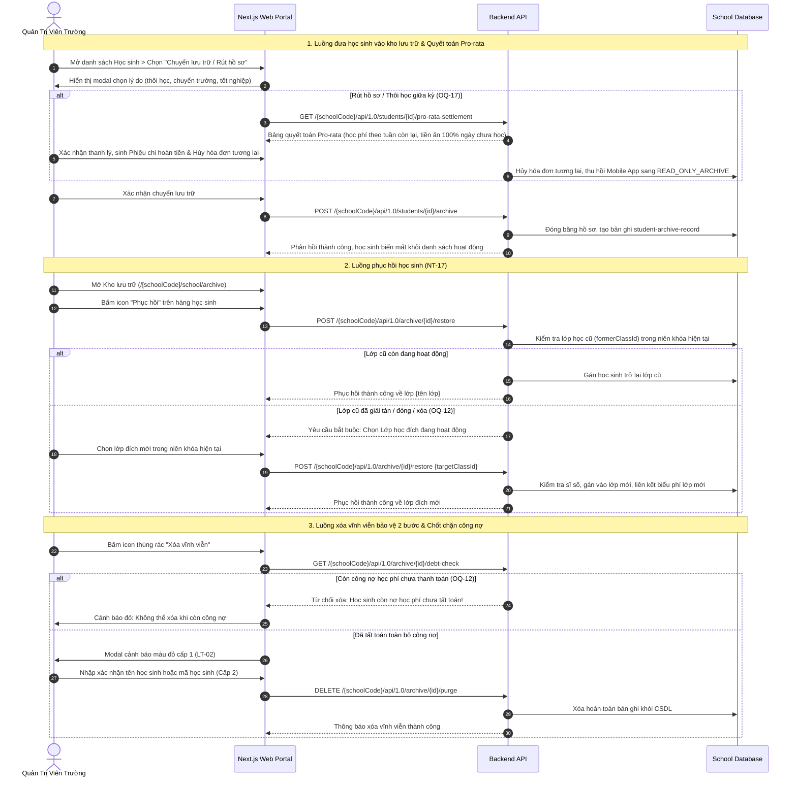

# Luồng Lưu Trữ & Phục Hồi Học Sinh Kho Lạnh (Student Archive & Restoration Flow)

## Mục tiêu
Đặc tả quy trình chuyển hồ sơ học sinh vào kho lưu trữ lạnh khi thôi học, chuyển trường hoặc tốt nghiệp; cơ chế quyết toán học phí Pro-rata và hạ cấp tài khoản Mobile App khi rút hồ sơ giữa kỳ; cơ chế kiểm tra tính sẵn sàng của lớp học cũ khi phục hồi học sinh (`LT-01`); và quy trình xóa vĩnh viễn bảo vệ 2 bước với cảnh báo nguy hiểm màu đỏ (`LT-02`).

## Các bước

1. **Đưa học sinh vào kho lưu trữ & Thanh lý học phí rút hồ sơ (OQ-17):**
   - Admin truy cập danh sách Học sinh (`/school/kid`), bấm menu `•••` chọn "Lưu trữ / Rút hồ sơ".
   - Nếu là Thôi học / Rút hồ sơ giữa kỳ (`withdrawn`), hệ thống tự động lập Bảng quyết toán Pro-rata: Phân chia khoản không hoàn (phí CSVC, nhập học) và khoản hoàn lại (học phí theo tuần còn lại, tiền ăn 100% ngày chưa học).
   - Tự động sinh Phiếu chi hoàn tiền (`TuitionRefundVoucher`) loại `STUDENT_WITHDRAWAL_REFUND` (duyệt chi 2 cấp), quét và Hủy vĩnh viễn tất cả hóa đơn dự kiến chưa phát hành trong tương lai.
   - Thu hồi tức thời quyền tương tác trên Mobile App (chat, điểm danh), chuyển tài khoản phụ huynh sang chế độ `READ_ONLY_ARCHIVE` chỉ đọc lịch sử.
2. **Tra cứu trong kho lưu trữ:**
   - Admin truy cập Kho lưu trữ (`/school/archive`), sử dụng thanh công cụ lọc theo tháng lưu trữ, tìm kiếm tên, mã học sinh hoặc lớp học cũ.
3. **Phục hồi học sinh (LT-01, NT-17, OQ-12):**
   - Admin bấm nút "Phục hồi" trên dòng học sinh.
   - Hệ thống kiểm tra: Nếu lớp cũ còn hoạt động, cho phép phục hồi về lớp cũ (kiểm tra sĩ số). Nếu lớp cũ đã đóng/xóa: BẮT BUỘC Admin phải chọn một **Lớp học đích đang hoạt động** trong niên khóa hiện hành.
4. **Xóa vĩnh viễn bảo vệ 2 bước & Chốt chặn công nợ (LT-02, OQ-12):**
   - Hệ thống kiểm tra công nợ học phí: Tuyệt đối cấm xóa nếu còn nợ chưa thanh toán (`balance_due > 0`).

## Quy tắc chặn / validation
- **Quy tắc cách ly tuyệt đối (NT-17):** Học sinh trong kho lưu trữ không bao giờ xuất hiện trong bảng tính học phí, danh sách điểm danh hay danh sách phân chia suất ăn.
- **Quyết toán Pro-rata khi rút hồ sơ (OQ-17):** Phân chia rõ ràng khoản không hoàn lại và khoản hoàn theo tuần/ngày; bắt buộc lập phiếu chi và hủy toàn bộ hóa đơn tương lai.
- **Bắt buộc chọn lớp đích khi phục hồi (OQ-12):** Cấm phục hồi học sinh về trạng thái mồ côi "Chưa xếp lớp" nếu lớp cũ đã giải tán; bắt buộc phải gán vào một lớp đích đang hoạt động.
- **Chốt chặn bảo toàn công nợ (OQ-12):** Tuyệt đối cấm xóa vĩnh viễn hồ sơ học sinh khi còn dư nợ học phí (`balance_due > 0`).

## Khác biệt spec ↔ code
| Mã spec | Spec yêu cầu | Code hiện tại | Mức | Bằng chứng |
|---|---|---|---|---|
| NT-17 | Cách ly kho lạnh, kiểm tra lớp khi phục hồi và bảo vệ xóa 2 bước | Đã có route `app/src/pages/[schoolCode]/school/archive/index.tsx` | MISSING | — |
| NT-10 | Quản lý kho lưu trữ học sinh thôi học, chuyển trường | Giao diện kho lưu trữ đã hoàn thiện đầy đủ component | MISSING | — |

## Liên quan
- [Phân hệ Nhà trường](../overview/module-school-admin.md)
- [Khái niệm vòng đời học sinh](../concepts/student-lifecycle-transitions.md)
- [Thực thể hồ sơ lưu trữ học sinh](../entities/student-archive-record.md)
- [Thực thể hồ sơ học sinh](../entities/student-profile.md)
- [Thực thể Phiếu chi nội bộ](../entities/expense-voucher.md)
- [Màn hình kho lưu trữ](../screens/m5-sm14-luu-tru.md)
