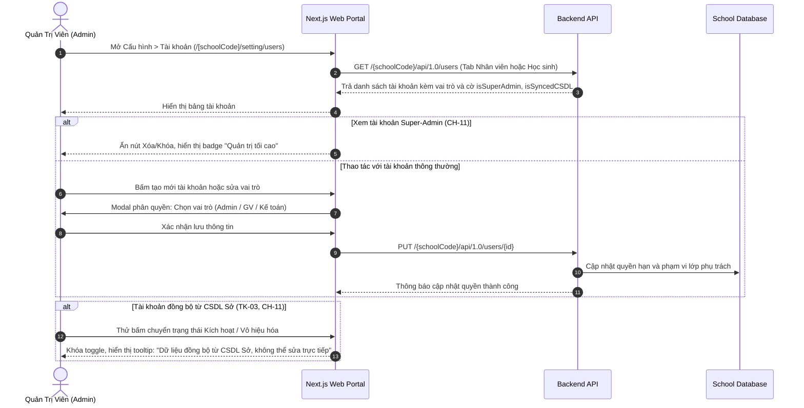

# Luồng Quản Trị Tài Khoản & Phân Quyền Đa Vai Trò (Account Governance & RBAC Flow)

## Mục tiêu
Đặc tả luồng quản trị tài khoản người dùng, khởi tạo nhân sự, phân bổ vai trò (Quản trị viên, Giáo viên, Kế toán), cơ chế khóa bảo vệ tài khoản Super-Admin (`CH-11`), chốt chặn an toàn khi đồng bộ CSDL Sở và đổi mật khẩu phân quyền.

## Các bước

1. **Điều hướng danh sách tài khoản:**
   - Quản trị viên truy cập `/setting/users`, hệ thống cung cấp 2 tab rõ ràng: "Tài khoản nhân viên" và "Tài khoản học sinh/phụ huynh".
   - Bộ lọc hỗ trợ lọc theo Vai trò (Quản trị viên, Giáo viên chính, Giáo viên hỗ trợ, Kế toán), Trạng thái (Hoạt động, Đã khóa), và Nguồn dữ liệu (Nội bộ, CSDL Sở).
2. **Khóa bảo vệ Super-Admin (CH-11):**
   - Đối với tài khoản có cờ `isSuperAdmin: true`, toàn bộ các hành động xóa tài khoản, hạ quyền hoặc vô hiệu hóa trạng thái bị ẩn hoặc vô hiệu hóa hoàn toàn trên giao diện và backend, ngăn chặn việc vô tình tự khóa quyền truy cập hệ thống.
3. **Bảo vệ tài khoản đồng bộ CSDL Sở:**
   - Tài khoản được đánh dấu `isSyncedCSDL: true` có các trường thông tin pháp lý (Họ tên, CCCD, Email, Mã định danh ngành) ở chế độ chỉ đọc.
   - Nút gạt trạng thái kích hoạt bị vô hiệu hóa để bảo đảm tính nhất quán với dữ liệu của Sở GD&ĐT.
4. **Phân quyền chức năng & Lớp phụ trách:**
   - Khi chỉnh sửa tài khoản giáo viên, Admin chọn phân công các lớp phụ trách và chỉ định quyền hạn: "Giáo viên chính" (được đăng tin trực tiếp) hoặc "Giáo viên hỗ trợ" (bài đăng chuyển vào hàng đợi kiểm duyệt).

## Quy tắc chặn / validation
- **Quy tắc bảo vệ Super-Admin (CH-11):** Hệ thống luôn bảo đảm có ít nhất một tài khoản Super-Admin hoạt động. Cấm mọi thao tác xóa tài khoản Super-Admin từ giao diện quản trị web.
- **Quy tắc mật khẩu:** Mật khẩu cấp mới hoặc đặt lại phải có độ dài tối thiểu 8 ký tự, bao gồm chữ hoa, chữ thường và chữ số.

## Khác biệt spec ↔ code
| Mã spec | Spec yêu cầu | Code hiện tại | Mức | Bằng chứng |
|---|---|---|---|---|
| CH-11 | Khóa bảo vệ Super-Admin và chốt chặn an toàn CSDL Sở | Đã có màn hình `/setting/users` với logic khóa admin | MISSING | — |
| CH-02 | Quản lý tài khoản người dùng, phân quyền RBAC đa cấp | Đã có danh sách tài khoản và modal phân quyền | MISSING | — |

## Liên quan
- [Phân hệ Cấu hình](../overview/module-settings.md)
- [Khái niệm kiểm duyệt 2 cấp](../concepts/rbac-two-tier-moderation.md)
- [Màn hình quản trị tài khoản](../screens/m6-sm2-tai-khoan.md)
